# Agent测试与评估


## 为什么 Agent 需要测试与评估？

假设你开发了一个 AI Agent，它可以：

1. 接收用户问题。
2. 判断是否需要调用工具。
3. 调用天气查询工具。
4. 根据工具结果生成回答。
5. 如果工具调用失败，自动重试。
6. 最后将结果返回给用户。

看起来功能已经完整了。

但你怎么确定它真的可靠？

### 普通 Python 程序为什么需要测试？

```python
def add(a: int, b: int) -> int:
    return a + b
  
add(1, 2) == 3
add(10, 20) == 30
add(-1, 1) == 0

def test_add():
    assert add(1, 2) == 3
```

如果结果不符合预期，测试就会失败。

### 为什么 Agent 的测试更加复杂？

例如：

> 用户：帮我查询北京今天的天气

Agent 可能会：

- 正确调用天气工具。
- 错误地选择搜索工具。
- 不调用工具，直接编造天气。
- 调用天气工具，但参数错误。
- 工具调用成功，却错误理解返回结果。
- 工具调用失败，没有正确重试。
- 最终回答没有引用工具返回的数据。

所以只测试 Agent 有没有返回值肯定是不够的。

```python
assert agent.invoke(...) is not None
```

所以需要多个维度去验证 Agent。

### Agent 测试的六个维度

| 测试维度     | 核心问题                 | 示例                       |
| ------------ | ------------------------ | -------------------------- |
| 功能测试     | Agent 能否完成任务？     | 是否成功查询天气           |
| 工具测试     | Tool 是否正常工作？      | 参数是否正确、异常是否处理 |
| 工具选择测试 | Agent 是否选对工具？     | 天气问题是否调用天气工具   |
| 执行轨迹测试 | Agent 是否按照预期执行？ | 是否先查询再总结           |
| 回答质量测试 | 最终答案是否正确？       | 是否准确描述天气           |
| 可靠性测试   | 异常情况下是否正常处理？ | 超时、重试、工具失败       |

### 测试与评估有什么区别？

| 对比     | Testing（测试）      | Evaluation（评估）    |
| -------- | -------------------- | --------------------- |
| 主要目的 | 验证功能是否符合预期 | 衡量 Agent 的整体质量 |
| 判断方式 | 通常有明确的预期结果 | 通常使用评分或指标    |
| 结果     | 通过 / 失败          | 分数、等级、指标      |
| 典型工具 | pytest               | LangSmith Evaluation  |
| 示例     | 是否调用了天气工具   | 工具选择是否合理      |

#### 测试：

```python
assert result["city"] == "北京"
assert result["temperature"] == 25
```

#### 评估:

```shell
回答准确性：0.95
工具选择准确率：0.98
执行轨迹合理性：0.90
```

实际项目中，两者需要结合使用。

#### Agent 测试体系整体架构

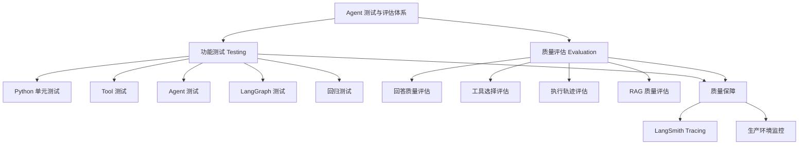

## Python 测试基础

```python
# calculator.py

def add(a: int, b: int) -> int:
    return a + b
```

```python
# test_calculator.py

from calculator import add


def test_add():
    result = add(1, 2)

    assert result == 3
```

测试文件通常以 `test_` 开头。

测试函数通常以 `test_` 开头。

执行：

```shell
pytest
```

得到结果

```shell
============================= test session starts =============================
collected 1 item

test_calculator.py .                                                     [100%]

============================== 1 passed ======================================
```

`collected 1 item`：发现了一个测试。

`.`：测试通过。

`1 passed`：一个测试通过

### assert：断言

测试失败报错：

```shell
AssertionError: assert 3 == 4
```

常见断言

```python
def test_basic():
    # 判断相等
    assert 10 == 10

    # 判断不相等
    assert 10 != 20

    # 判断布尔值
    assert True

    # 判断包含
    assert "天气" in "查询天气"

    # 判断列表长度
    assert len([1, 2, 3]) == 3

    # 判断是否为 None
    result = None
    assert result is None
```

agent中使用：

```python
from weather import get_weather


def test_get_weather():
    result = get_weather("北京")

    assert result["city"] == "北京"
    assert result["temperature"] == 25
    assert result["weather"] == "晴天"
```

### Fixture：测试夹具

假设：

```python
def test_user_name():
    user = {"name": "Tom", "age": 20}
    assert user["name"] == "Tom"


def test_user_age():
    user = {"name": "Tom", "age": 20}
    assert user["age"] == 20


def test_user_exists():
    user = {"name": "Tom", "age": 20}
    assert user is not None
```

每个测试都重复创建了相同的用户数据。

Fixture 就是为了解决这类问题。

```python
import pytest


@pytest.fixture
def user():
    return {
        "name": "Tom",
        "age": 20
    }
  
def test_user_name(user):
    assert user["name"] == "Tom"


def test_user_age(user):
    assert user["age"] == 20


def test_user_exists(user):
    assert user is not None
```

pytest 会自动执行 `user()` Fixture，并把返回值传给测试函数。

这里不需要自己调用 `user()`。

#### Fixture 的 scope

Fixture 可以控制生命周期。

常见的有：

| scope    | 生命周期             | 使用场景         |
| -------- | -------------------- | ---------------- |
| function | 每个测试函数执行一次 | 普通测试数据     |
| class    | 每个测试类执行一次   | 类级别共享资源   |
| module   | 每个测试文件执行一次 | 文件级别共享资源 |
| session  | 整个测试会话执行一次 | 共享测试环境     |

```python
@pytest.fixture(scope="session")
def app_config():
    print("初始化测试配置")

    return {
        "model": "test-model"
    }
```

同一次 pytest 测试会话中，这个 Fixture 通常只初始化一次。

### Mock 模拟对象

**Mock 可以用一个模拟对象替代真实数据，让我们控制它的返回结果和行为。**

```python
# weather.py
def get_weather(city: str, weather_api):
    return weather_api(city)

# test_weather.py
from unittest.mock import Mock
from weather import get_weather


def test_get_weather():
    mock_api = Mock()

    mock_api.return_value = {
        "city": "北京",
        "temperature": 25
    }

    result = get_weather("北京", mock_api)

    assert result["city"] == "北京"
    assert result["temperature"] == 25

    # 验证 API 是否被正确调用
    mock_api.assert_called_once_with("北京")
```

`return_value`：控制模拟对象的返回值。

`assert_called_once_with()`：验证模拟对象是否被正确调用一次，并且参数是否正确。

#### Mock 异常

```python
from unittest.mock import Mock


def test_weather_api_error():
    mock_api = Mock()

    mock_api.side_effect = TimeoutError("API 请求超时")

    try:
        mock_api("北京")
    except TimeoutError as e:
        assert str(e) == "API 请求超时"
```

`side_effect` 可以用来模拟：

- API 超时。
- 网络异常。
- 数据库连接失败。
- 工具调用失败。
- 连续调用时返回不同结果。

## Tool Testing 工具测试

Tool 能正常运行，不代表它已经具备生产环境所需要的可靠性。

**我们需要验证它的参数、返回值、异常处理和边界条件。**

### Tool Testing 到底测试什么

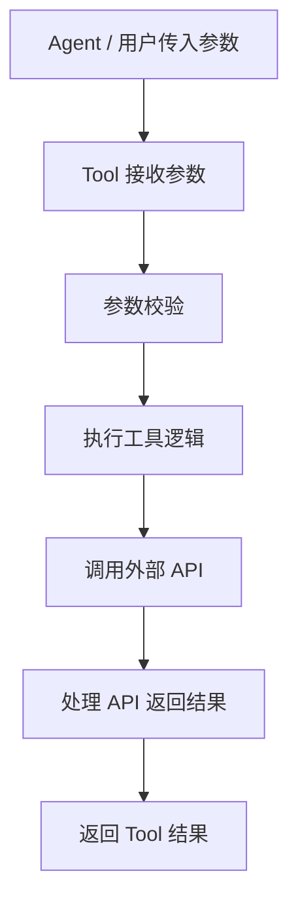

测试也应该覆盖这些环节：

| 测试对象 | 测试问题                 |
| -------- | ------------------------ |
| 输入参数 | 城市名称是否正确？       |
| 参数校验 | 空城市名称是否应该拒绝？ |
| 工具逻辑 | 是否正确调用天气 API？   |
| API 调用 | 参数是否正确传给 API？   |
| 返回结果 | 是否返回预期的数据结构？ |
| 异常处理 | API 超时是否被正确处理？ |

```python
from langchain.tools import tool


def fetch_weather(city: str) -> dict:
    """
    模拟外部天气 API。
    实际项目中这里可以调用天气服务。
    """
    return {
        "city": city,
        "temperature": 25,
        "weather": "晴天"
    }


@tool
def get_weather(city: str) -> str:
    """查询指定城市的天气。"""
    
    # 校验空参数
    if not city or not city.strip():
        raise ValueError("城市名称不能为空")

    data = fetch_weather(city)

    return (
        f"{data['city']}天气：{data['weather']}，"
        f"气温：{data['temperature']}℃"
    )


result = get_weather.invoke({
    "city": "北京"
})

print(result) # 北京天气：晴天，气温：25℃


from app.tools import get_weather

# 测试正常参数
def test_get_weather_with_valid_city():
    result = get_weather.invoke({
        "city": "北京"
    })

    assert "北京" in result
    assert "晴天" in result
    assert "25℃" in result

# 测试空参数
def test_get_weather_with_empty_city():
    with pytest.raises(ValueError, match="城市名称不能为空"):
        get_weather.invoke({
            "city": ""
        })
        
# 测试不填写参数
def test_get_weather_without_city():
    with pytest.raises(Exception):
        get_weather.invoke({})
        
# 测试返回值和数据结构
def test_get_weather_return_value():
    result = get_weather.invoke({
        "city": "上海"
    })

    assert isinstance(result, str)
    assert result.startswith("上海天气：")
    assert "气温：25℃" in result
```

`pytest.raises(ValueError)`：预期这段代码会抛出 ValueError，如果没有抛出异常，测试就失败。

### 使用 Mock 模拟天气 API

```python
# tests/test_get_weather_with_mock.py
from unittest.mock import Mock
from app import tools # tools 就是上面的文件假装放在 app 目录下


def test_get_weather_with_mock(monkeypatch):
    # monkeypatch 是 pytest 注入的 fixture，测试结束自动还原，
    # 所以这里替换的 fetch_weather 不会污染其他用例。
    mock_api = Mock(
        return_value={
            "city": "北京",
            "temperature": 30,
            "weather": "多云",
        }
    )
    # 用可控数据替换外部 API：测试只验证 get_weather 的格式化逻辑，
    # 不再依赖 fetch_weather 里硬编码的 25℃/晴天。
    monkeypatch.setattr(tools, "fetch_weather", mock_api)

    # @tool 包装后是 BaseTool，必须用 .invoke({"city": ...})。
    # 底层 _run 函数仍定义在 app.tools 中，按模块全局名查 fetch_weather → patch 生效。
    # 前提：内部没有写成 from .api import fetch_weather 这类本地绑定。
    result = tools.get_weather.invoke({"city": "北京"})

    assert "北京" in result
    assert "多云" in result
    assert "30℃" in result

    # 补上了上一版纯桩测试缺的一环：确实调用了外部 API，且参数传对了。
    # 隐含前提：get_weather 内部是 fetch_weather(city) 位置传参；
    # 若改成 fetch_weather(city=city)，这里要写 assert_called_once_with(city="北京")。
    mock_api.assert_called_once_with("北京")

```

这里的 `monkeypatch` 是 pytest 提供的 Fixture。测试结束后，它会自动恢复被替换的对象，避免影响其他测试。

### 异常测试

超时：

```python
from langchain.tools import tool


def fetch_weather(city: str) -> dict:
    return {
        "city": city,
        "temperature": 25,
        "weather": "晴天"
    }


@tool
def get_weather(city: str) -> str:
    """查询指定城市的天气。"""

    if not city or not city.strip():
        raise ValueError("城市名称不能为空")

    try:
        data = fetch_weather(city)

    except TimeoutError:
        return "天气服务暂时超时，请稍后重试"

    return (
        f"{data['city']}天气：{data['weather']}，"
        f"气温：{data['temperature']}℃"
    )
```

```python
from unittest.mock import Mock

from app import tools


def test_get_weather_timeout(monkeypatch):
    mock_api = Mock(
      	# 表示调用 Mock 时，不返回正常数据，而是抛出异常。
        side_effect=TimeoutError("API 请求超时")
    )

    monkeypatch.setattr(
        tools,
        "fetch_weather",
        mock_api
    )

    result = tools.get_weather.invoke({
        "city": "北京"
    })

    assert result == "天气服务暂时超时，请稍后重试"
```

### 边界测试

例如天气工具：

| 输入           | 预期行为                     |
| -------------- | ---------------------------- |
| `"北京"`       | 正常查询                     |
| `""`           | 拒绝空字符串                 |
| `"   "`        | 拒绝纯空格                   |
| `"台北"`       | 正常查询                     |
| `"New York"`   | 正常查询                     |
| 很长的城市名称 | 按业务规则拒绝或处理         |
| `None`         | 按参数 Schema 或业务校验拒绝 |

#### pytest 参数化测试

有多个输入，不需要重复编写测试函数。可以使用：

```python
@pytest.mark.parametrize
```

```python
import pytest

from app.tools import get_weather


@pytest.mark.parametrize(
    "city",
    [
        "",
        "   ",
    ]
)
def test_get_weather_invalid_city(city):
    with pytest.raises(ValueError):
        get_weather.invoke({
            "city": city
        })
```

这样一个测试函数就能测试多组数据。

### 完整 Tool 测试清单

| 测试类型     | 测试内容             | 重要程度   |
| ------------ | -------------------- | ---------- |
| 正常参数测试 | 输入合法参数         | 必须       |
| 缺失参数测试 | 必填参数缺失         | 必须       |
| 非法参数测试 | 空值、错误类型       | 必须       |
| 返回值测试   | 返回内容正确         | 必须       |
| 返回结构测试 | 数据结构符合约定     | 必须       |
| Mock 测试    | 外部依赖模拟         | 必须       |
| 调用验证     | 调用次数和参数       | 必须       |
| 异常测试     | 超时、网络异常       | 必须       |
| 边界测试     | 极端输入和特殊字符   | 必须       |
| 重试测试     | 失败后是否按策略重试 | 视工具需求 |

## Agent Testing Agent 测试

### Agent Testing 的核心思想

Agent 测试需要验证的，不只是结果，还包括中间的执行步骤。

```shell
用户：北京今天的天气怎么样？

预期执行过程：

1. Agent 理解用户的问题。
2. Agent 选择 get_weather 工具。
3. Agent 传入 city="北京"。
4. 工具返回天气数据。
5. Agent 根据天气数据生成回答。
```

### Agent Testing 的核心目标

| 测试内容     | 测试目标               | 示例                   |
| ------------ | ---------------------- | ---------------------- |
| 功能测试     | Agent 能否正常执行     | 输入问题后是否返回结果 |
| 工具选择测试 | 是否选择正确工具       | 是否调用 `get_weather` |
| 参数测试     | 工具参数是否正确       | `city` 是否为 Tokyo    |
| 执行轨迹测试 | 工具调用流程是否正确   | 是否产生 ToolMessage   |
| 最终回答测试 | 是否正确使用工具结果   | 是否包含东京天气信息   |
| 异常测试     | 异常情况下能否正确处理 | 工具超时后是否符合预期 |

### 使用 Fake Model 测试 Agent

如果每次测试都调用真实大模型，会出现几个问题：

- 需要 API Key。
- 每次调用可能产生费用。
- 模型输出存在随机性。
- 不同时间可能选择不同工具。
- 测试速度较慢。

```shell
用户：北京今天的天气怎么样？
```

如果使用真实 LLM，它有时可能选择正确 Tool，有时可能出现其他行为。

这样测试结果就不够稳定。因此，单元测试中，我们可以直接控制模型输出。

#### 使用 GenericFakeChatMod

它可以通过一个 Iterator，按照顺序返回预先准备好的模型响应。

```python
from langchain_core.language_models.fake_chat_models import (
    GenericFakeChatModel
)

from langchain.messages import AIMessage

model = GenericFakeChatModel(
    messages=iter([
        AIMessage(content="这是第一次响应"),
        AIMessage(content="这是第二次响应")
    ])
)

response1 = model.invoke("你好")

print(response1.content) # 这是第一次响应

response2 = model.invoke("再问一个问题")

print(response2.content) # 这是第二次响应
```

这里有一个需要注意的地方：

`GenericFakeChatModel` 不会自动理解用户的问题，也不会真正判断应该调用哪个工具。

它只是按照我们预先设定的顺序返回响应。

因此，可以利用它模拟各种 Agent 执行场景。

#### 为什么需要重写 bind_tools

在 LangChain 中，通常使用：

```python
agent = create_agent(
    model=model,
    tools=[get_weather]
)
```

创建 Agent。

`create_agent()` 会把工具绑定到模型上，调用模型的：

```python
bind_tools()
```

但是 `GenericFakeChatModel` 本身没有实现这个方法。

因此，我们需要继承它，并补充一个 `bind_tools()`方法：

```python
class FakeToolCallingModel(GenericFakeChatModel):

    def bind_tools(self, tools, **kwargs):
        return self
```

这里返回 `self` 的意思是：

不需要真正把工具绑定到模型，只需要让 Agent 能够正常创建。

因为我们已经在 Fake Model 中提前准备好了工具调用响应。

#### 创建一个可以测试的 Agent

```python
from langchain.agents import create_agent
from langchain.messages import AIMessage, HumanMessage, ToolCall, ToolMessage
from langchain_core.language_models.fake_chat_models import GenericFakeChatModel
from app import tools  # 导入模块对象本身，monkeypatch 才能替换它的属性


class FakeToolCallingModel(GenericFakeChatModel):
    # GenericFakeChatModel 不实现 bind_tools，而 create_agent 构造时必调 → 必须覆写。
    # 工具响应已由 messages 迭代器脚本化，不需要真的绑定工具。
    # 参数名保持 tools：框架可能按关键字 tools= 调用，改名会 TypeError。
    def bind_tools(self, tools, **kwargs) -> "FakeToolCallingModel":
        return self


def test_agent_calls_weather_tool(monkeypatch):
    # 1. Mock 外部天气 API
    def mock_fetch_weather(city: str) -> dict:
        return {
            "city": city,
            "weather": "晴天",
            "temperature": 25,
        }

    monkeypatch.setattr(tools, "fetch_weather", mock_fetch_weather)

    # 2. 创建 Fake Model：每次 _generate 从迭代器取下一个响应，不读历史消息
    model = FakeToolCallingModel(
        messages=iter([
            # 第一次响应：调用天气工具
            AIMessage(
                content="",
                tool_calls=[
                    ToolCall(
                        name="get_weather",
                        args={"city": "东京"},
                        id="call_1",  # ToolNode 生成的 ToolMessage 会沿用这个 tool_call_id
                    )
                ],
            ),
            # 第二次响应：写死的最终回答，不依赖工具实际返回
            AIMessage(content="东京天气晴朗，气温25℃。"),
        ])
    )

    # 3. 创建 Agent
    agent = create_agent(model=model, tools=[tools.get_weather])

    # 4. 执行 Agent
    result = agent.invoke({
        "messages": [HumanMessage(content="东京天气怎么样？")]
    })

    # 5. 获取执行过程中的消息
    messages = result["messages"]

    # 6. 测试工具是否被调用
    tool_call_messages = [
        message for message in messages
        if isinstance(message, AIMessage) and message.tool_calls
    ]
    assert len(tool_call_messages) == 1

    # 7. 测试工具选择是否正确
    tool_call = tool_call_messages[0].tool_calls[0]
    assert tool_call["name"] == "get_weather"

    # 8. 测试工具参数是否正确
    assert tool_call["args"]["city"] == "东京"

    # 9. 测试工具是否返回结果（修复 mock 后内容为：东京天气：晴天，气温：25℃）
    tool_messages = [
        message for message in messages
        if isinstance(message, ToolMessage)
    ]
    assert len(tool_messages) == 1
    assert "东京" in tool_messages[0].content
    assert "晴天" in tool_messages[0].content

    # 10. 测试最终回答
    final_message = messages[-1]
    assert isinstance(final_message, AIMessage)
    assert "东京" in final_message.text
    assert "25℃" in final_message.text

```

### Agent Testing 与 Tool Testing 的区别

假设天气工具存在问题：

- Tool Testing 关注：工具接收到正确参数后，能否正确执行？
- Agent Testing 关注：Agent 能否正确选择这个工具，并且正确使用它？

对比：

| 对比维度         | Tool Testing     | Agent Testing           |
| ---------------- | ---------------- | ----------------------- |
| 测试对象         | 单个工具         | 整个 Agent              |
| 是否需要 LLM     | 不需要           | 单元测试使用 Fake Model |
| 是否测试工具选择 | 不测试           | 测试                    |
| 是否测试工具参数 | 测试工具输入校验 | 测试 Agent 生成的参数   |
| 是否测试工具执行 | 测试             | 测试执行流程            |
| 是否测试最终回答 | 不需要           | 需要                    |
| 主要目标         | 工具正确性       | Agent 执行逻辑正确性    |

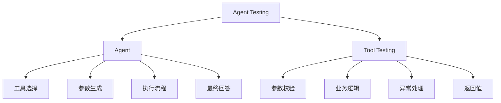

### 单元测试和集成测试

#### Unit Testing：单元测试

单元测试主要使用 Fake Model。

特点：

- 不需要真实模型 API。
- 不产生模型调用费用。
- 可以控制模型的响应。
- 测试结果稳定。
- 适合 CI 自动化测试。

```python
model = FakeToolCallingModel(
    messages=iter([
        AIMessage(
            content="",
            tool_calls=[
                ToolCall(
                    name="get_weather",
                    args={"city": "东京"},
                    id="call_1"
                )
            ]
        ),
        AIMessage(content="东京天气晴朗，气温25℃。")
    ])
)
```

Agent 是否能够正确处理预设的模型响应和执行流程。

#### Integration Testing：集成测试

集成测试则使用真实模型。

```python
from langchain.agents import create_agent
from langchain_openai import ChatOpenAI

from app.tools import get_weather


model = ChatOpenAI(
    model="你的模型名称",
    temperature=0
)

agent = create_agent(
    model=model,
    tools=[get_weather]
)

result = agent.invoke({
    "messages": [
        {
            "role": "user",
            "content": "东京天气怎么样？"
        }
    ]
})

print(result["messages"][-1].text)
```

这里会真正调用模型 API。

它可以测试：

- 模型是否能够理解用户意图。
- 模型是否能够选择正确工具。
- 模型是否能够生成合理参数。
- 模型是否能够根据工具结果生成回答。

### 两种测试的对比

| 对比维度   | Unit Testing   | Integration Testing |
| ---------- | -------------- | ------------------- |
| 模型       | Fake Model     | 真实模型            |
| API Key    | 不需要         | 需要                |
| API 费用   | 通常没有       | 通常有              |
| 执行速度   | 快             | 相对较慢            |
| 输出稳定性 | 高             | 可能存在波动        |
| 测试重点   | Agent 执行逻辑 | 真实模型与工具协作  |
| 适用场景   | 日常开发、CI   | 发布前验证          |

## LangGraph Testing LangGraph 测试

LangGraph Testing 需要重点验证：

1. Node 是否正确执行。
2. State 是否正确读取和更新。
3. Edge 是否按照预期连接。
4. Conditional Edge 是否正确选择分支。
5. Graph 是否按照预期执行循环。
6. Checkpointer 是否正确保存和恢复状态。
7. Interrupt 是否能够暂停和恢复执行。

我们需要分别测试：

| 测试对象         | 测试目标                   |
| ---------------- | -------------------------- |
| Node             | 节点逻辑是否正确           |
| State            | 状态是否正确更新           |
| Edge             | 节点之间的执行顺序是否正确 |
| Conditional Edge | 条件判断是否正确           |
| Cycle            | 循环是否按预期结束         |
| Checkpointer     | 状态是否正确持久化         |
| Interrupt        | 是否正确暂停和恢复         |
| 完整 Graph       | 整个工作流是否符合预期     |

**核心原则：先测试单个组件，再测试完整 Graph。**

### 测试 Node

一个 Node 通常接收当前 State，执行逻辑，然后返回需要更新的 State。

```python
# tests/test_graph.py

def add_number(state):
    return {
        "number": state["number"] + 1
    }


def test_add_number_node():
    state = {
        "number": 10
    }

    result = add_number(state)

    assert result == {
        "number": 11
    }
```

### 测试 State

```python
from typing_extensions import TypedDict

from langgraph.graph import StateGraph, START, END


class GraphState(TypedDict):
    number: int
    result: int


def calculate_node(state: GraphState):
    return {
        "result": state["number"] * 2
    }


builder = StateGraph(GraphState)

builder.add_node("calculate", calculate_node)

builder.add_edge(START, "calculate")
builder.add_edge("calculate", END)

graph = builder.compile()

def test_graph_state_update():

    result = graph.invoke({
        "number": 10
    })

    assert result["number"] == 10
    assert result["result"] == 20
```

### 测试 Edge

```python
from typing_extensions import TypedDict

from langgraph.graph import StateGraph, START, END


class State(TypedDict):
    steps: list[str]


def node_a(state):
    return {
        "steps": state["steps"] + ["A"]
    }


def node_b(state):
    return {
        "steps": state["steps"] + ["B"]
    }


builder = StateGraph(State)

builder.add_node("node_a", node_a)
builder.add_node("node_b", node_b)

builder.add_edge(START, "node_a")
builder.add_edge("node_a", "node_b")
builder.add_edge("node_b", END)

graph = builder.compile()

def test_edge_execution_order():

    result = graph.invoke({
        "steps": []
    })

    assert result["steps"] == ["A", "B"]
```

如果两个节点执行顺序不符合预期，测试就会失败。

### 测试 Conditional Edge

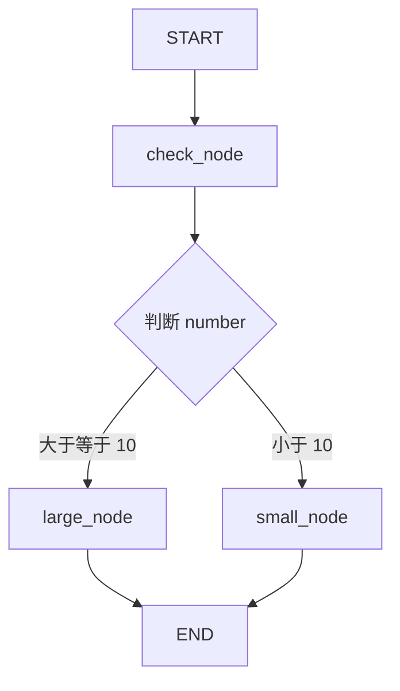

需要测试两种情况：

- `number >= 10`：进入 `large_node`。
- `number < 10`：进入 `small_node`。

```python
from typing_extensions import TypedDict

from langgraph.graph import StateGraph, START, END


class State(TypedDict):
    number: int
    result: str


def check_node(state):
    return {}


def large_node(state):
    return {
        "result": "large"
    }


def small_node(state):
    return {
        "result": "small"
    }


def route_by_number(state):

    if state["number"] >= 10:
        return "large"

    return "small"


builder = StateGraph(State)

builder.add_node("check", check_node)
builder.add_node("large", large_node)
builder.add_node("small", small_node)

builder.add_edge(START, "check")

builder.add_conditional_edges(
    "check",
    route_by_number,
    {
        "large": "large",
        "small": "small"
    }
)

builder.add_edge("large", END)
builder.add_edge("small", END)

graph = builder.compile()

# 测试路由函数
def test_route_by_number():

    assert route_by_number({
        "number": 10
    }) == "large"

    assert route_by_number({
        "number": 5
    }) == "small"

# 测试 large 是否正常
def test_conditional_edge_large():

    result = graph.invoke({
        "number": 15
    })

    assert result["result"] == "large"

# 测试 small 是否正常
def test_conditional_edge_small():

    result = graph.invoke({
        "number": 5
    })

    assert result["result"] == "small"
```

路由函数单独测试，Graph 分支也单独测试。

### 测试 Cycles

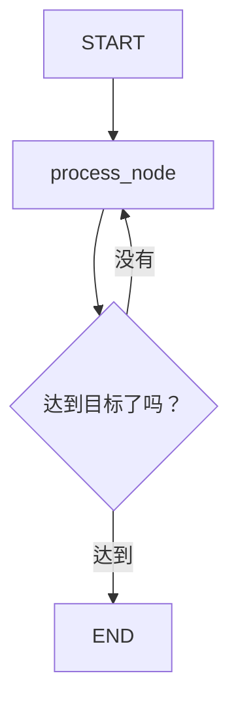

需要验证：

1. 循环是否能够正常执行。
2. 循环次数是否符合预期。
3. 达到结束条件后是否退出。
4. 不满足结束条件时是否可能无限循环。

```python
from typing_extensions import TypedDict

from langgraph.graph import StateGraph, START, END


class State(TypedDict):
    count: int


def process_node(state):

    return {
        "count": state["count"] + 1
    }


def should_continue(state):

    if state["count"] < 3:
        return "continue"

    return "end"


builder = StateGraph(State)

builder.add_node("process", process_node)

builder.add_edge(START, "process")

builder.add_conditional_edges(
    "process",
    should_continue,
    {
        "continue": "process",
        "end": END
    }
)

graph = builder.compile()

# 测试循环次数 证明循环能够按照预期退出
def test_graph_cycle():

    result = graph.invoke({
        "count": 0
    })

    assert result["count"] == 3
```

测试防止死循环：

```python
import pytest

from langgraph.errors import GraphRecursionError


def test_graph_recursion_limit():

    with pytest.raises(GraphRecursionError):

        graph.invoke(
            {"count": 0},
            config={
                "recursion_limit": 2
            }
        )
```

`recursion_limit` 限制的是 Graph 的执行步数，不是 Python 函数自身的递归深度。

### 测试 Checkpointer

```python
from typing_extensions import TypedDict

from langgraph.graph import StateGraph, START, END
from langgraph.checkpoint.memory import InMemorySaver


class State(TypedDict):
    count: int


def increment_node(state):

    return {
        "count": state["count"] + 1
    }


builder = StateGraph(State)

builder.add_node("increment", increment_node)

builder.add_edge(START, "increment")
builder.add_edge("increment", END)

checkpointer = InMemorySaver()

graph = builder.compile(
    checkpointer=checkpointer
)

# 测试状态是否被保存
def test_checkpointer_saves_state():

    config = {
        "configurable": {
            "thread_id": "test-thread-001"
        }
    }

    graph.invoke(
        {"count": 10},
        config=config
    )

    snapshot = graph.get_state(config)

    assert snapshot.values["count"] == 11
    
# 测试不同 thread_id 是否隔离
def test_checkpointer_thread_isolation():

    config_a = {
        "configurable": {
            "thread_id": "user-a"
        }
    }

    config_b = {
        "configurable": {
            "thread_id": "user-b"
        }
    }

    graph.invoke(
        {"count": 10},
        config=config_a
    )

    graph.invoke(
        {"count": 100},
        config=config_b
    )

    state_a = graph.get_state(config_a)
    state_b = graph.get_state(config_b)

    assert state_a.values["count"] == 11
    assert state_b.values["count"] == 101
```

### 测试 Interrupt

需要测试：

1. Graph 是否真的暂停。
2. 是否返回了正确的中断信息。
3. 是否能够通过 `Command(resume=...)` 恢复。
4. 恢复后是否产生正确的状态。

```python
from typing_extensions import TypedDict

from langgraph.graph import StateGraph, START, END
from langgraph.checkpoint.memory import InMemorySaver
from langgraph.types import interrupt, Command


class State(TypedDict):
    approved: bool


def approval_node(state):

    approved = interrupt(
        "是否批准执行？"
    )

    return {
        "approved": approved
    }


builder = StateGraph(State)

builder.add_node("approval", approval_node)

builder.add_edge(START, "approval")
builder.add_edge("approval", END)

checkpointer = InMemorySaver()

graph = builder.compile(
    checkpointer=checkpointer
)


# 测试是否暂停
def test_graph_interrupt():

    config = {
        "configurable": {
            "thread_id": "approval-test-001"
        }
    }

    result = graph.invoke(
        {"approved": False},
        config=config
    )

    assert "__interrupt__" in result

    interrupt_info = result["__interrupt__"][0]

    assert interrupt_info.value == "是否批准执行？"
    
# 测试人工审批后恢复
def test_graph_resume_after_approval():

    config = {
        "configurable": {
            "thread_id": "approval-test-002"
        }
    }

    # 第一次执行：暂停
    graph.invoke(
        {"approved": False},
        config=config
    )

    # 第二次执行：人工批准并恢复
    result = graph.invoke(
        Command(resume=True),
        config=config
    )

    assert result["approved"] is True
```

### 测试完整 Graph

一个简单的订单审批工作流：

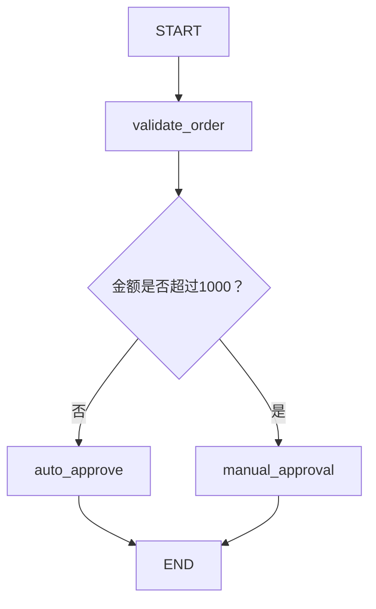

```python
from typing_extensions import TypedDict

from langgraph.graph import StateGraph, START, END


class OrderState(TypedDict):
    amount: int
    status: str


def validate_order(state):
    return {}


def route_order(state):

    if state["amount"] > 1000:
        return "manual"

    return "auto"


def auto_approve(state):

    return {
        "status": "approved"
    }


def manual_approval(state):

    return {
        "status": "pending"
    }


builder = StateGraph(OrderState)

builder.add_node("validate", validate_order)
builder.add_node("auto_approve", auto_approve)
builder.add_node("manual_approval", manual_approval)

builder.add_edge(START, "validate")

builder.add_conditional_edges(
    "validate",
    route_order,
    {
        "auto": "auto_approve",
        "manual": "manual_approval"
    }
)

builder.add_edge("auto_approve", END)
builder.add_edge("manual_approval", END)

graph = builder.compile()

# 测试自动审批
def test_order_auto_approve():

    result = graph.invoke({
        "amount": 500,
        "status": "pending"
    })

    assert result["status"] == "approved"

# 测试人工审批
def test_order_manual_approval():

    result = graph.invoke({
        "amount": 2000,
        "status": "pending"
    })

    assert result["status"] == "pending"
```

### 使用 pytest Fixture 管理 Graph

实际项目中，Graph 数量增加后，不建议所有测试共用一个全局 Graph 变量。

```python
# app/graph.py
def build_graph():

    builder = StateGraph(State)

    builder.add_node("calculate", calculate_node)

    builder.add_edge(START, "calculate")
    builder.add_edge("calculate", END)

    return builder.compile()
```


```python
# tests/conftest.py

import pytest

from app.graph import build_graph


@pytest.fixture
def test_graph():
    return build_graph()
```


```python
def test_graph_state_update(test_graph):

    result = test_graph.invoke({
        "number": 10
    })

    assert result["result"] == 20
```

## Agent Evaluation Agent 质量评估

```
问：帮我查询东京天气，并告诉我今天适不适合户外跑步。
```

工具返回

```
东京天气：晴天，气温25℃。
```

Agent 最后回答：

```
东京今天晴天，气温25℃。
```

从程序执行角度看，一切正常。

但是用户还问了「适不适合户外跑步」，Agent 并没有回答这个问题。

这说明：

- Tool Testing 通过。
- Agent Testing 可能通过。
- LangGraph Testing 也可能通过。
- 但 Agent 的回答质量并不合格。

因此，我们需要引入 Agent Evaluation（Agent 质量评估）。

### Testing 与 Evaluation 有什么区别？

| 对比维度 | Testing（测试）        | Evaluation（评估）            |
| -------- | ---------------------- | ----------------------------- |
| 核心问题 | 程序是否按预期执行？   | Agent 的表现是否足够好？      |
| 关注重点 | 功能、逻辑、异常       | 正确性、相关性、完整性、质量  |
| 常见方式 | pytest、assert、Mock   | 规则评分、LLM Judge、人工评分 |
| 结果     | 通过或失败             | 分数、等级、评估意见          |
| 示例     | 是否调用 `get_weather` | 是否真正回答了用户的问题      |

> Testing 主要验证程序行为；Evaluation 主要衡量系统表现。两者互相补充。

### Agent Evaluation 的整体架构

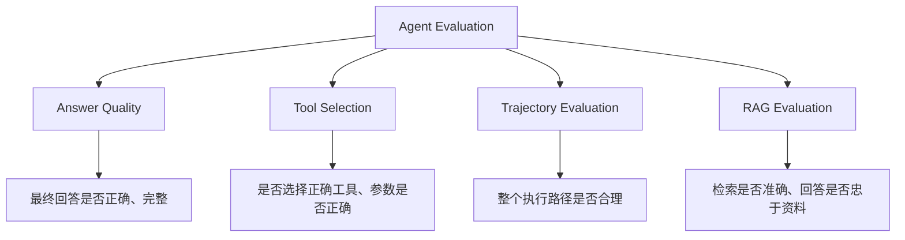

### Answer Quality 回答质量评估

**Agent 最终给用户的回答是否满足要求？**

| 评估维度     | 含义   | 示例                     |
| ------------ | ------ | ------------------------ |
| Correctness  | 正确性 | 天气和温度是否正确       |
| Relevance    | 相关性 | 是否回答了用户的问题     |
| Completeness | 完整性 | 是否遗漏重要问题         |
| Faithfulness | 忠实性 | 是否有依据、是否编造     |
| Clarity      | 清晰度 | 是否容易理解             |
| Helpfulness  | 有用性 | 是否真正帮助用户完成任务 |

这些指标不一定每个项目都需要全部使用，应当根据 Agent 的业务目标选择。

例如：

- 天气 Agent：重点关注正确性、完整性。
- 客服 Agent：重点关注相关性、正确性、帮助程度。
- 企业知识库 Agent：重点关注忠实性、正确性、引用依据。

#### 准备评估数据

先准备几条测试数据：

```python
evaluation_dataset = [
    {
        "input": "东京天气怎么样？",
        "reference": "东京天气晴朗，气温25℃。"
    },
    {
        "input": "北京天气怎么样？",
        "reference": "北京天气多云，气温18℃。"
    },
    {
        "input": "上海天气怎么样？",
        "reference": "上海天气下雨，气温20℃。"
    }
]
```

这里有两个重要概念：

- `input`：用户输入。
- `reference`：参考答案，也叫 Ground Truth。

Ground Truth 是我们认为正确、可以作为评估依据的答案。

```
参考答案：
东京天气晴朗，气温25℃。
```

```
东京目前是晴天，温度约25摄氏度。
```

虽然文字不同，但语义相同，应该视为正确。

#### 使用规则进行简单评估

对于一些可以明确判断的内容，我们可以先使用 Python 规则评估。

```python
def evaluate_answer(prediction, reference):

    required_keywords = [
        "东京",
        "晴朗",
        "25"
    ]

    passed = all(
        keyword in prediction
        for keyword in required_keywords
    )

    return {
        "score": 1 if passed else 0,
        "passed": passed
    }
  
prediction = "东京天气晴朗，气温25℃。"

result = evaluate_answer(
    prediction,
    "东京天气晴朗，气温25℃。"
)

print(result)

# {
#     "score": 1,
#     "passed": True
# }
```

它有一个明显的问题：

它只能判断预先定义的规则，不能真正理解语义。

因此，规则评估适合：

- 必须包含某些字段。
- JSON 格式是否正确。
- 是否出现禁止内容。
- 是否满足明确的业务条件。

对于语义和主观质量，需要更灵活的评估方式。

#### 使用 LLM-as-a-Judge

使用另一个 LLM 作为评审模型，对 Agent 的输出进行评分。

设计一个评分标准：

```shell
你是一个 AI Agent 质量评估专家。

请根据用户问题、参考答案和 Agent 回答进行评估。

评估维度：

1. Correctness：事实是否正确。
2. Relevance：是否回答用户问题。
3. Completeness：是否遗漏重要信息。

评分标准：

0：完全错误或没有回答。
1：部分正确，但存在明显遗漏。
2：基本正确，只有轻微遗漏。
3：完全正确且回答完整。

请返回：
- score：0 到 3 的整数
- reason：评分理由
```

```shell
用户问题：
东京天气怎么样？

参考答案：
东京天气晴朗，气温25℃。

Agent 回答：
东京今天晴天，温度25摄氏度。

评分：
3

理由：
回答准确，包含天气状况和温度。
```

LLM Judge 适合评估：

- 语义正确性。
- 回答完整性。
- 是否答非所问。
- 语气和表达质量。
- 回答是否符合业务要求。

评审模型本身也可能判断错误，因此重要业务应结合规则评估、人工抽查和真实数据进行校准。

### Tool Selection 工具选择评估

当我们有大量测试样本时，就需要统计 Agent 的工具选择表现。

例如：

| 用户问题            | 预期工具    | Agent 实际选择 | 是否正确 |
| ------------------- | ----------- | -------------- | -------- |
| 东京天气怎么样？    | get_weather | get_weather    | 是       |
| 搜索 LangGraph 文档 | search_docs | search_docs    | 是       |
| 查询订单状态        | get_order   | get_weather    | 否       |
| 北京天气怎么样？    | get_weather | get_weather    | 是       |

这里可以计算工具选择准确率。

例如：

- 总测试次数：100 次。
- 正确选择工具：92 次。

```python
def evaluate_tool_selection(
    expected_tool,
    actual_tool
):
    return {
        "score": 1 if expected_tool == actual_tool else 0,
        "passed": expected_tool == actual_tool
    }
  
result = evaluate_tool_selection(
    expected_tool="get_weather",
    actual_tool="get_weather"
)

assert result["passed"] is True
```

#### Tool Arguments Accuracy 工具参数准确率

工具选择正确，不代表参数也正确。

```python
def evaluate_tool_arguments(
    expected_args,
    actual_args
):
    return {
        "score": 1 if expected_args == actual_args else 0,
        "passed": expected_args == actual_args
    }
  
result = evaluate_tool_arguments(
    expected_args={
        "city": "东京"
    },
    actual_args={
        "city": "东京"
    }
)

assert result["passed"] is True
```

#### 不应该只使用精确匹配

有些工具参数存在合理差异。

```python
预期：

{"city": "台北"}

实际：

{"city": "台北市"}
```

实际评估时可以根据业务定义参数规范化函数：

```python
def normalize_city(city):

    aliases = {
        "台北市": "台北",
        "北京市": "北京",
        "东京市": "东京"
    }

    return aliases.get(city, city)
  
  
assert (
    normalize_city("台北市")
    == normalize_city("台北")
)
```

### Trajectory Evaluation 执行轨迹评估

**Agent 为了完成任务，整个执行过程是否合理？**

例如，用户提出：

```
查询东京天气，并告诉我是否适合户外跑步。
```

预期执行路径：

```
1. 调用 get_weather("东京")
2. 获取天气结果
3. 根据天气结果生成跑步建议
4. 返回最终回答
```

但是 Agent 实际可能执行：

```
1. 调用 search_web("东京天气")
2. 调用 get_weather("大阪")
3. 返回东京天气建议
```

最终回答即使看起来正确，执行轨迹也存在问题。

#### 什么是 Trajectory？

Trajectory 可以理解为 Agent 完成任务时经历的执行步骤。

例如：

```python
trajectory = [
    {
        "tool": "get_weather",
        "args": {
            "city": "东京"
        }
    },
    {
        "tool": "calculate_running_suitability",
        "args": {
            "temperature": 25,
            "weather": "晴天"
        }
    }
]
```


它记录了：

- 调用了哪些工具。
- 工具调用的顺序。
- 每次调用的参数。
- 每一步的执行结果。

#### Exact Match 完全匹配

```python
expected_trajectory = [
    "get_weather",
    "calculate_running_suitability"
]

actual_trajectory = [
    "get_weather",
    "calculate_running_suitability"
]

score = (
    1 if expected_trajectory == actual_trajectory else 0
)

assert score == 1
```

这种方式要求工具名称和执行顺序完全一致。

优点：

- 简单。
- 容易实现。
- 结果稳定。

缺点：

- 有些任务可能存在多条正确路径。
- 某些步骤可以调整顺序。
- 多执行一个无关步骤就可能导致完全不匹配。

#### Required Tools 必需工具检查

有时我们不要求执行顺序完全一致，只要求必要工具都被调用。

```python
expected_tools = {
    "get_weather",
    "calculate_running_suitability"
}

actual_tools = {
    "get_weather",
    "calculate_running_suitability",
    "search_web"
}

# 检查必需工具是否全部出现
def evaluate_required_tools(
    expected_tools,
    actual_tools
):
    missing_tools = expected_tools - actual_tools

    return {
        "score": (
            len(expected_tools - missing_tools)
            / len(expected_tools)
            if expected_tools else 1.0
        ),
        "missing_tools": list(missing_tools)
    }
```

这个指标可以衡量 Agent 是否完成了必要步骤。

#### Trajectory LLM Judge

对于复杂 Agent，执行路径可能并不固定。

例如，一个研究 Agent 可能：

```
路径 A：

search_web
→ read_page
→ summarize
```

也可能：

```
路径 B：

search_web
→ search_web
→ read_page
→ summarize
```

只要最终获取了足够信息，并且没有违反业务要求，两种路径都可能合理。

这时可以把完整执行轨迹交给 LLM Judge，让它根据任务目标判断执行过程是否合理。

### RAG Evaluation 检索增强生成评估

如果 Agent 使用了 RAG，那么还需要专门评估检索和生成质量。

因为 RAG 的回答依赖外部知识库。

一个 RAG Agent 即使生成能力很强，如果检索到的文档不正确，最终答案也可能出错。

RAG Evaluation 可以分成两个阶段：

1. Retrieval Evaluation：检索质量评估。
2. Generation Evaluation：生成质量评估。

#### Context Precision 上下文精确率

它主要评估：

**检索出来的文档中，有多少是相关的？**

例如，用户问：

```
LangGraph 的 Checkpointer 有什么作用？
```

Retriever 返回了 5 个文档：

| 文档  | 内容                    | 是否相关 |
| ----- | ----------------------- | -------- |
| Doc 1 | Checkpointer 的基本介绍 | 是       |
| Doc 2 | thread_id 的作用        | 是       |
| Doc 3 | Python 基础语法         | 否       |
| Doc 4 | 状态持久化机制          | 是       |
| Doc 5 | CSS 样式教程            | 否       |

其中：

- 相关文档：3 个。
- 检索文档：5 个。

简单计算：
$$
Precision = \frac{3}{5}=60\%
$$


这个例子使用的是简化计算方式。

#### Context Recall 上下文召回率

它主要评估：

**所有应该检索到的重要信息，有多少被成功检索出来？**

例如：

用户问题需要以下三个知识点：

```
1. Checkpointer 的作用
2. thread_id 的作用
3. 如何恢复执行
```

Retriever 实际只找到了：

```
1. Checkpointer 的作用
2. thread_id 的作用
```

那么：
$$
Recall = \frac{2}{3}\approx66.7\%
$$
说明检索结果遗漏了「如何恢复执行」这个重要知识点。

#### Faithfulness 忠实度

它主要评估：

**Agent 的回答是否用检索到的文档作为依据？**

假设检索文档内容：

```
InMemorySaver 是 LangGraph 提供的内存 Checkpointer，
适合本地开发和测试。
```

Agent 回答：

```
InMemorySaver 适合本地开发和测试。
```

这与检索内容一致。

但如果 Agent 回答：

```
InMemorySaver 是生产环境推荐使用的分布式数据库。
```

这就没有依据，属于不忠实于检索上下文的回答。

#### Answer Correctness 答案正确性

它主要评估：

**Agent 的最终答案是否符合参考答案？**

例如：

```
用户问题：

LangGraph 的 Checkpointer 有什么作用？

参考答案：

保存 Graph 执行过程中的状态，
支持后续恢复执行。
```

Agent 回答：

```
Checkpointer 用于保存 Graph 状态，
使工作流能够在后续调用中恢复。
```

#### RAG 评估指标总结

| 指标               | 评估对象 | 核心问题               |
| ------------------ | -------- | ---------------------- |
| Context Precision  | 检索结果 | 找到的文档有多少相关？ |
| Context Recall     | 检索结果 | 重要文档有没有遗漏？   |
| Faithfulness       | 最终回答 | 回答是否有上下文依据？ |
| Answer Correctness | 最终回答 | 答案是否符合参考答案？ |
| Answer Relevance   | 最终回答 | 是否回答了用户的问题？ |

LangSmith 的 RAG 评估也将检索质量和生成质量分开衡量，这样可以区分问题究竟出在 Retriever 还是 LLM

### 三种常见 Evaluator（评估器）

在 Agent Evaluation 中，常见的评估方式有三种。

#### Code Evaluator（代码评估器）

通过 Python 代码或规则计算分数。

```python
def tool_name_evaluator(
    expected_tool,
    actual_tool
):
    passed = expected_tool == actual_tool

    return {
        "key": "tool_selection",
        "score": 1 if passed else 0,
        "comment": (
            "工具选择正确"
            if passed
            else "工具选择错误"
        )
    }
```

适用场景：

- 工具名称是否正确。
- 参数是否符合 Schema。
- JSON 是否合法。
- 是否包含必需字段。
- 是否超过执行步数。

#### LLM-as-a-Judge（模型评估器）

使用另一个 LLM 评估 Agent 的输出。

```
Agent 回答：

LangGraph 使用 Checkpointer 保存状态。

评审模型：

请判断这个回答是否准确、完整。
```

适用场景：

- 回答正确性。
- 回答完整性。
- 语义相关性。
- 执行轨迹是否合理。
- 是否满足用户意图。

#### Human Evaluation（人工评估）

由人工对 Agent 的结果进行检查和评分。

例如：

| 用户问题                | Agent 回答       | 人工评分 |
| ----------------------- | ---------------- | -------- |
| 如何使用 Checkpointer？ | 回答准确、完整   | 5        |
| 如何使用 Checkpointer？ | 只介绍了部分功能 | 3        |
| 如何使用 Checkpointer？ | 回答完全错误     | 1        |

人工评估通常适合：

- 高风险业务。
- 复杂专业问题。
- 评审标准难以完全自动化的场景。
- 校准 LLM Judge 的评分质量。

#### 三种方式如何选择？

| 评估方式         | 速度     | 成本 | 稳定性         | 适合场景       |
| ---------------- | -------- | ---- | -------------- | -------------- |
| Code Evaluator   | 快       | 低   | 高             | 明确规则       |
| LLM Judge        | 相对较慢 | 较高 | 有波动         | 语义质量       |
| Human Evaluation | 慢       | 高   | 取决于评审标准 | 高质量人工审核 |

例如：

- 工具选择使用 Code Evaluator。
- 最终回答使用 LLM Judge。
- 高风险回答使用人工审核。

### 建立自己的 Agent Evaluation Dataset

果想持续评估 Agent，就不能每次临时手动写一个问题。

我们需要建立一个专门的 Evaluation Dataset（评估数据集）。

#### Dataset 的基本结构

一个评估数据集通常包含：

| 字段                | 含义                     |
| ------------------- | ------------------------ |
| input               | 用户输入                 |
| reference_output    | 参考答案                 |
| expected_tools      | 预期调用的工具           |
| expected_args       | 预期工具参数             |
| expected_trajectory | 预期执行路径             |
| context             | RAG 检索上下文（如果有） |

例如：

```python
evaluation_dataset = [
    {
        "input": "东京天气怎么样？",

        "reference_output": "东京天气晴朗，气温25℃。",

        "expected_tools": [
            "get_weather"
        ],

        "expected_args": {
            "city": "东京"
        },

        "expected_trajectory": [
            "get_weather"
        ]
    },

    {
        "input": "北京天气怎么样？",

        "reference_output": "北京天气多云，气温18℃。",

        "expected_tools": [
            "get_weather"
        ],

        "expected_args": {
            "city": "北京"
        },

        "expected_trajectory": [
            "get_weather"
        ]
    }
]
```

这就相当于我们为 Agent 准备了一套评估标准。

#### 为什么需要 Dataset？

假设今天修改了 Agent 的 System Prompt。

修改前：

```
Agent v1
```

修改后：

```
Agent v2
```

我们想知道：

```
Agent v2 是否比 Agent v1 更好？
```

这时可以让两个版本运行相同的 Evaluation Dataset，然后比较评估结果。

例如：

| 评估指标                | Agent v1 | Agent v2 |
| ----------------------- | -------- | -------- |
| Answer Correctness      | 85%      | 92%      |
| Tool Selection Accuracy | 90%      | 95%      |
| Trajectory Success      | 80%      | 88%      |
| 平均执行时间            | 4.2 秒   | 3.8 秒   |

这样就能判断修改是否真的带来了提升。

### 构建一个简单的 Agent Evaluation 流程

先用 Python 实现一个简化版评估流程。

这样可以先理解 Evaluation 的工作原理。

#### 准备评估数据

```python
evaluation_dataset = [
    {
        "input": "东京天气怎么样？",

        "reference_output": "东京天气晴朗，气温25℃。",

        "expected_tool": "get_weather",

        "expected_city": "东京"
    },
    {
        "input": "北京天气怎么样？",

        "reference_output": "北京天气多云，气温18℃。",

        "expected_tool": "get_weather",

        "expected_city": "北京"
    }
]
```

#### 定义评估函数

```python
# 评估工具是否选择正确。
def evaluate_tool_selection(expected, actual):

    return int(expected == actual)

# 评估工具参数是否正确。
def evaluate_tool_argument(expected, actual):

    return int(expected == actual)

# 使用简单关键词规则评估回答。
def evaluate_answer(prediction, reference):

    required_keywords = reference.split("，")

    return int(
        all(
            keyword in prediction
            for keyword in required_keywords
        )
    )
```

#### 执行评估

假如得到结果如下：

```python
agent_results = [
    {
        "prediction": "东京天气晴朗，气温25℃。",
        "actual_tool": "get_weather",
        "actual_city": "东京"
    },
    {
        "prediction": "北京天气多云，气温18℃。",
        "actual_tool": "get_weather",
        "actual_city": "北京"
    }
]
```

开始评估：

```python
scores = []

for sample, result in zip(
    evaluation_dataset,
    agent_results
):

    tool_score = evaluate_tool_selection(
        sample["expected_tool"],
        result["actual_tool"]
    )

    argument_score = evaluate_tool_argument(
        sample["expected_city"],
        result["actual_city"]
    )

    answer_score = evaluate_answer(
        result["prediction"],
        sample["reference_output"]
    )

    scores.append({
        "tool_selection": tool_score,
        "tool_argument": argument_score,
        "answer_quality": answer_score
    })

print(scores)
```

结果：

```python
[
    {
        "tool_selection": 1,
        "tool_argument": 1,
        "answer_quality": 1
    },
    {
        "tool_selection": 1,
        "tool_argument": 1,
        "answer_quality": 1
    }
]
```

#### 计算整体指标

```python
def calculate_average(scores, key):

    return sum(
        item[key]
        for item in scores
    ) / len(scores)


print(
    "工具选择准确率：",
    calculate_average(scores, "tool_selection")
)

print(
    "参数准确率：",
    calculate_average(scores, "tool_argument")
)

print(
    "回答质量得分：",
    calculate_average(scores, "answer_quality")
)

# 工具选择准确率：1.0
# 参数准确率：1.0
# 回答质量得分：1.0
```

## LangSmith

Agent 执行后，如何知道它做了什么？

Agent 为什么调用了错误的工具？

如何保存一批测试数据，反复测试 Agent？

如何判断新版本比旧版本更好？

Agent 上线后，如何持续监控真实用户的请求？

### 什么是 LangSmith？

LangSmith 是 LangChain 生态中的可观测性和评估平台。

它主要解决两个问题：

1. Observability（可观测性）：观察 Agent 的执行过程，定位问题。
2. Evaluation（评估）：通过数据集和评估器，衡量 Agent 的质量。

#### LangSmith 的核心功能

| 功能              | 主要作用                        |
| ----------------- | ------------------------------- |
| Tracing           | 记录 Agent 的执行过程           |
| Projects          | 按项目组织 Trace                |
| Datasets          | 保存评估数据                    |
| Evaluators        | 对 Agent 输出进行评分           |
| Experiments       | 在 Dataset 上运行评估并保存结果 |
| Online Evaluation | 对生产环境的 Trace 进行自动评估 |
| Feedback          | 收集人工或程序化反馈            |

#### 整体工作流程

开发阶段

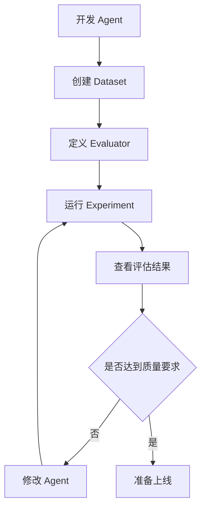

生产阶段

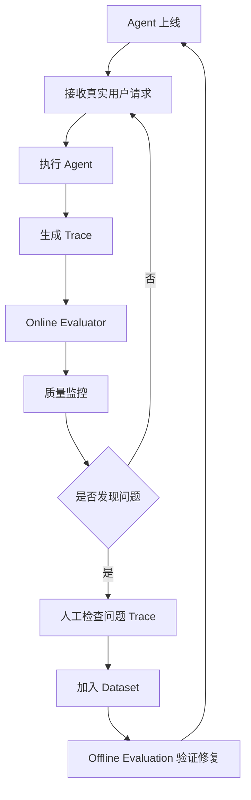


### Tracing: 执行追踪

Tracing 可以理解为：**记录一次 Agent 执行过程中的所有重要步骤。**

有了 Tracing，我们可以看到：

- Agent 收到了什么输入。
- LLM 使用了什么 Prompt。
- LLM 返回了什么内容。
- 调用了哪个工具。
- 工具接收了什么参数。
- 工具返回了什么结果。
- 每一步执行耗时多久。
- 是否发生异常。
- 最终输出是什么。

这就是 Tracing 的价值。

#### Trace 和 Run 有什么区别？

| 概念  | 含义                   | 示例                           |
| ----- | ---------------------- | ------------------------------ |
| Trace | 一次完整的执行追踪     | 用户发起一次天气查询           |
| Run   | Trace 中的一个执行步骤 | LLM 调用、工具执行、Agent 节点 |

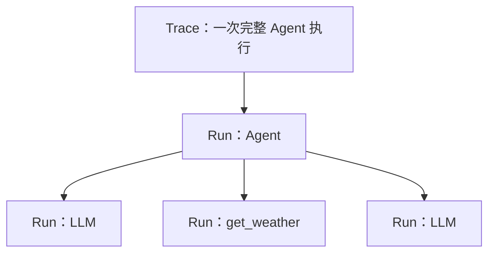

**理解重点：Trace 是一次执行的整体记录，Run 是其中的具体执行单元。**

#### 安装 LangSmith

```bash
uv add langsmith
```

#### 配置环境变量

首先注册 LangSmith 账号：https://smith.langchain.com/

创建 API Key：

1. 登录 LangSmith。
2. 打开 Settings。
3. 找到 API Keys。
4. 创建 API Key。
5. 保存密钥。

然后配置环境变量。（也可以写在 .env 环境变量文件里面）

```bash
export LANGSMITH_TRACING=true
export LANGSMITH_API_KEY="申请的 api-key"
export LANGSMITH_PROJECT="agent-testing"
```

| 环境变量            | 作用               |
| ------------------- | ------------------ |
| `LANGSMITH_TRACING` | 是否开启追踪       |
| `LANGSMITH_API_KEY` | LangSmith 身份认证 |
| `LANGSMITH_PROJECT` | 指定追踪项目       |

#### 开启 Tracing 后需要修改 Agent 代码吗？

对于正常使用 LangChain 构建的 Agent，配置好环境变量后，通常不需要修改 Agent 的执行代码。

只要 Tracing 配置正确，LangChain 就会自动把相关执行信息发送到 LangSmith。

官方文档明确说明：开启追踪后，正常执行 LangChain 对象即可记录 Trace，不需要额外添加追踪代码。

#### 查看 Trace 和 Run

进入 LangSmith 的 Tracing 页面，选择对应 Project，就可以查看该项目中的执行记录。

重点理解以下信息：

| 信息       | 作用             |
| ---------- | ---------------- |
| Name       | 执行记录名称     |
| Status     | 执行成功还是失败 |
| Start Time | 开始时间         |
| Latency    | 执行耗时         |
| Inputs     | 输入内容         |
| Outputs    | 输出内容         |
| Error      | 错误信息         |
| Metadata   | 附加元数据       |
| Tags       | 标签             |
| Tokens     | Token 使用情况   |

点击某一条 Trace，可以进一步检查其内部 Run。

**Tracing 的价值不只是记录错误，而是帮助我们定位错误发生在哪一步。**

#### 自定义 Tracing：@traceable

LangChain 的模型、工具和 Agent 通常能够自动追踪。但业务函数、自研检索、外部 SDK 调用、非 LangChain 的模型调用在 trace 里是黑盒。

你可能也希望在 LangSmith 中看到它的执行记录。这时可以使用：

```python
@traceable
```

```python
from langsmith import traceable


@traceable
def calculate_score(data):

    return sum(data) / len(data)


result = calculate_score([80, 90, 100])

print(result)
```

执行后，这个函数也会成为 Trace 中的一个 Run。

##### 自定义名称、Tags 和 Metadata

```python
from langsmith import traceable


@traceable(
    name="calculate_score",
    tags=["evaluation", "business"],
    metadata={
        "version": "v1",
        "module": "score"
    }
)
def calculate_score(data):

    return sum(data) / len(data)
```

### Dataset：评估数据集

Tracing 解决的是：

Agent 执行时发生了什么？

接下来要解决：

如何使用一批固定的问题，反复评估 Agent？

这就需要 Dataset。

Dataset 是一组用于测试和评估 Agent 的数据。

**我们提前准备好一批问题和参考答案，然后让 Agent 逐个回答，再判断 Agent 的表现。**

例如，天气 Agent：

| 输入问题             | 参考答案          |
| -------------------- | ----------------- |
| 北京今天天气怎么样？ | 北京今天晴天，25℃ |
| 上海今天天气怎么样？ | 上海今天多云，22℃ |
| 深圳今天天气怎么样？ | 深圳今天小雨，28℃ |

这里每一行都是一个 Example。

一个 Dataset 由多个 Example 组成。

#### 为什么需要 Dataset？

假设你修改了 Agent 的 System Prompt。

修改前：

```
Agent v1
```

修改后：

```
Agent v2
```

如果没有固定的测试数据，你很难判断 v2 是否真的比 v1 更好。

有了 Dataset，就可以让两个版本执行完全相同的测试样本，然后比较结果。

因此，Dataset 的核心价值是：

- 固定评估输入。
- 保存参考答案。
- 复用历史测试案例。
- 比较不同版本。
- 发现新版本引入的回归问题。

#### Dataset 的核心结构

每个 Example 主要包含：

| 字段     | 含义           |
| -------- | -------------- |
| inputs   | 测试输入       |
| outputs  | 参考输出       |
| metadata | 可选的附加信息 |

#### 创建 Dataset

```python
from langsmith import Client


client = Client()


# 创建 Dataset
dataset = client.create_dataset(
    dataset_name="weather-agent-dataset",
    description="天气 Agent 测试数据集"
)


# 准备测试样本
examples = [
    {
        "inputs": {
            "question": "北京今天天气怎么样？"
        },
        "outputs": {
            "answer": "北京今天晴天，25℃"
        }
    },
    {
        "inputs": {
            "question": "上海今天天气怎么样？"
        },
        "outputs": {
            "answer": "上海今天多云，22℃"
        }
    },
    {
        "inputs": {
            "question": "深圳今天天气怎么样？"
        },
        "outputs": {
            "answer": "深圳今天小雨，28℃"
        }
    }
]


# 添加 Example
client.create_examples(
    dataset_id=dataset.id,
    examples=examples
)


print("Dataset 创建成功：", dataset.name)
```

创建成功后，就可以在 LangSmith 的 Datasets & Experiments 页面中看到刚才创建的数据集。

注意：创建脚本不要反复执行。

因为每次执行 `create_dataset()` 都可能创建一个新的 Dataset。实际项目中应先查询是否已经存在，或者将数据集初始化脚本与日常评估脚本分开。

#### Dataset 的 UI 操作

也可以直接在 LangSmith UI 中创建 Dataset。找到 Datasets & Experiments：

点击`+ Dataset` 之后上传 .cvs 或者 jsonl 文件。

创建完成后，可以在 UI 中查看：

- Dataset 名称
- Example 数量
- Inputs
- Reference Outputs
- Metadata

#### Dataset 从哪里来？

企业项目中的 Dataset 不一定全部手工编写。

常见来源有：

| 来源         | 说明                      |
| ------------ | ------------------------- |
| 人工构造     | 开发人员准备典型问题      |
| 真实用户请求 | 从生产环境收集请求        |
| 历史失败案例 | 把曾经失败的请求保存下来  |
| 合成数据     | 使用 LLM 辅助生成测试数据 |
| 业务专家标注 | 由业务人员提供标准答案    |

特别值得注意的是：

生产环境中出现的问题，应该逐步转化为 Dataset 中的测试样本。

这样可以防止修复一个问题之后，未来版本又出现同样的问题。

### Target Function: 被评估对象

Target Function 就是我们想要评估的程序。

它可以是：

- 一个普通 Python 函数。
- 一个 LangChain Chain。
- 一个 LangChain Agent。
- 一个 LangGraph Graph。
- 一个完整的 AI 应用。

```python
def target(inputs):
    question = inputs["question"]

    result = agent.invoke({
        "messages": [
            {
                "role": "user",
                "content": question
            }
        ]
    })

    return {
        "answer": result["messages"][-1].text
    }
```

这里的 `target` 就是被评估的对象。

例如 Dataset 中有一条数据：

```python
{
    "inputs": {
        "question": "东京天气怎么样？"
    },
    "outputs": {
        "answer": "东京天气晴朗，气温25℃。"
    }
}
```

LangSmith 会将：

```python
{
    "question": "东京天气怎么样？"
}
```

传递给 Target Function。

Target Function 执行 Agent 后，返回：

```python
{
    "answer": "东京今天晴天，气温25℃。"
}
```

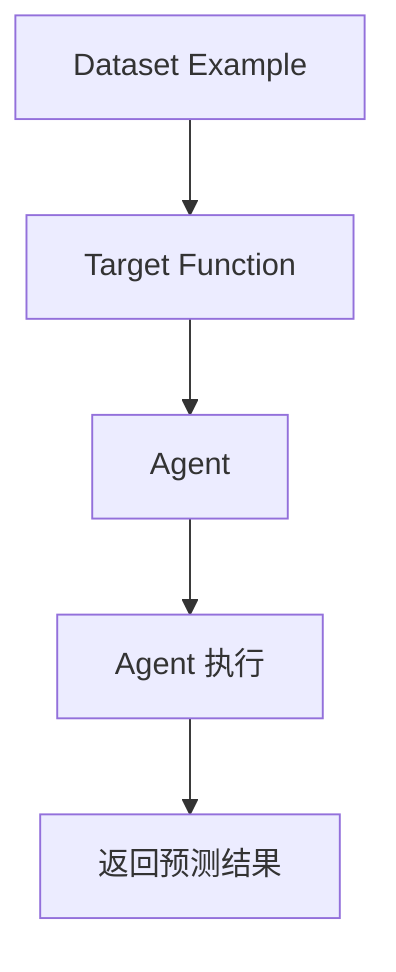


### Evaluator：评估器

Evaluator 就是用来评价 Agent 执行结果的组件。

```
用户问题：
    北京今天天气怎么样？

参考答案：
    北京今天晴天，25℃

Agent 实际回答：
    北京今天晴天，25℃

Evaluator：
    判断回答是否正确

结果：
    True
```

Evaluator 的工作就是判断 Agent 的输出是否符合预期。

#### Evaluator 的主要类型

LangSmith 支持多种评估方式：

| 类型                | 说明                   | 适合场景                 |
| ------------------- | ---------------------- | ------------------------ |
| Code Evaluator      | 使用 Python 规则判断   | 格式、字段、工具选择     |
| LLM-as-a-Judge      | 使用 LLM 判断质量      | 正确性、相关性、表达质量 |
| Human Evaluation    | 人工评价               | 专业领域、复杂业务       |
| Pairwise Evaluator  | 比较两个版本的结果     | 版本优劣比较             |
| Composite Evaluator | 组合多个评分           | 综合质量评价             |
| Summary Evaluator   | 对整个实验进行汇总分析 | 数据集整体指标           |

这些类型并不是完全互斥的。比如一次 Experiment 可以同时使用代码评估器和 LLM 评估器

#### Code Evaluator

Code Evaluator 就是通过 Python 代码判断结果。

例如，我们希望天气 Agent 必须调用 `get_weather` 工具。

```python
def tool_selection_evaluator(
    inputs: dict,
    outputs: dict,
    reference_outputs: dict
):
    expected_tool = reference_outputs["tool"]

    actual_tools = outputs.get("tools", [])

    return {
        "key": "tool_selection",
        "score": expected_tool in actual_tools
    }
  
  
inputs = {
    "question": "北京今天天气怎么样？"
}

outputs = {
    "tools": ["get_weather"]
}

reference_outputs = {
    "tool": "get_weather"
}

# 结果
{
    "key": "tool_selection",
    "score": True
}
```

- `key`：评估指标名称。
- `score`：评估结果。

#### LLM-as-a-Judge

两段文字并不完全相同，但语义基本一致。

如果只使用字符串比较，就可能误判。

这时可以使用 LLM-as-a-Judge。使用另一个模型去评估输出的结果。

```python
from openevals.llm import create_llm_as_judge
from openevals.prompts import CORRECTNESS_PROMPT


correctness_evaluator = create_llm_as_judge(
    prompt=CORRECTNESS_PROMPT,
    model="openai:替换为当前支持的评估模型",
    feedback_key="correctness",
)


result = correctness_evaluator(
    inputs={
        "question": "北京今天天气怎么样？"
    },
    outputs={
        "answer": "北京今天阳光充足，气温大约 25 度。"
    },
    reference_outputs={
        "answer": "北京今天晴天，25℃"
    }
)

print(result)
```

重点理解：

- `inputs`：原始测试问题。
- `outputs`：Agent 实际回答。
- `reference_outputs`：参考答案。
- `feedback_key`：评分结果对应的指标名称。

#### Human Evaluation

人工评估就是让人来判断 Agent 的结果。

```
Agent 回答：
    北京今天晴天，气温 25℃。

人工评价：
    是否正确？是
    是否完整？是
    是否符合业务要求？是
```

#### Pairwise Evaluation

Pairwise Evaluation 是比较两个 Agent 版本的输出。

```
问题：
    北京今天天气怎么样？

Agent V1：
    北京今天晴天，25℃。

Agent V2：
    北京今天晴天，气温 25℃，适合外出。
```

评估器比较两个回答：

- 哪个回答更准确？
- 哪个回答更完整？
- 哪个回答更符合用户需求？

它适合模型升级、Prompt 优化和 Agent 架构调整之后的版本比较。

#### Evaluator 应该如何选择？

| 评估目标             | 推荐方式             |
| -------------------- | -------------------- |
| 是否调用正确工具     | Code Evaluator       |
| 工具参数是否正确     | Code Evaluator       |
| JSON 格式是否正确    | Code Evaluator       |
| 回答是否正确         | LLM Judge + 参考答案 |
| 回答是否有帮助       | LLM Judge            |
| 两个版本哪个更好     | Pairwise             |
| 是否符合专业业务要求 | Human Evaluation     |
| 多个指标综合评分     | Composite Evaluator  |

**核心原则：能用确定性规则判断的，就优先使用 Code Evaluator；需要语义判断的，再使用 LLM Judge。**

### Experiment：评估实验

**Experiment 就是让 Agent 在 Dataset 上执行测试，并使用 Evaluator 对结果进行评分的一次完整评估运行。**

```
Dataset:
    weather-agent-dataset

    1. 北京天气怎么样？
    2. 上海天气怎么样？
    3. 深圳天气怎么样？

Target:
    Weather Agent

Evaluators:
    1. Tool Selection
    2. Answer Correctness

Experiment:
    Weather Agent V1 Evaluation
```

执行后，我们就可以看到 Agent 在这批测试数据上的表现。

#### 运行 Experiment

现在把 Dataset、Target 和 Evaluator 组合起来。

```python
from langsmith import Client


client = Client()


experiment_results = client.evaluate(
    target,
    data="weather-agent-dataset",
    evaluators=[
        tool_selection_evaluator,
        correctness_evaluator,
    ],
    experiment_prefix="weather-agent-v1",
    max_concurrency=2,
)


print(experiment_results)
```

这里重点理解几个参数：

| 参数              | 作用                   |
| ----------------- | ---------------------- |
| target            | 被评估的程序           |
| data              | Dataset 名称或对应数据 |
| evaluators        | 评估器列表             |
| experiment_prefix | Experiment 名称前缀    |
| max_concurrency   | 最大并发执行数         |

调用 `client.evaluate()` 后，LangSmith 会：

1. 从 Dataset 获取 Example。
2. 将每个 Example 的 Inputs 传给 Target。
3. 执行 Agent。
4. 获取 Agent 的 Outputs。
5. 调用 Evaluators。
6. 保存评估结果。
7. 创建 Experiment。

这就是完整的 Offline Evaluation 流程

#### 在 UI 中查看 Experiment

运行完成后，进入：

```
Datasets & Experiments
        ↓
选择 Dataset
        ↓
找到对应 Experiment
        ↓
查看评估结果
```

要关注：

| 内容              | 作用             |
| ----------------- | ---------------- |
| Inputs            | 测试问题         |
| Reference Outputs | 参考答案         |
| Outputs           | Agent 实际输出   |
| Feedback          | Evaluator 的评分 |
| Experiment        | 本次评估运行     |

例如：

| 问题             | Agent 输出    | 正确性评分 |
| ---------------- | ------------- | ---------- |
| 北京天气怎么样？ | 北京晴天，25℃ | 1          |
| 上海天气怎么样？ | 上海多云，22℃ | 1          |
| 深圳天气怎么样？ | 深圳晴天，28℃ | 0          |

这时我们就可以找到第三条失败的 Example，进一步检查它的 Trace。

#### 对比不同 Agent 版本

假设我们有两个版本：

```
Weather Agent V1
Weather Agent V2
```

V1 使用旧 Prompt，V2 优化了 Prompt。

我们分别运行：

```
Experiment V1
Experiment V2
```

然后比较：

| 评估指标           | V1     | V2     |
| ------------------ | ------ | ------ |
| Answer Correctness | 80%    | 93%    |
| Tool Selection     | 90%    | 96%    |
| 平均耗时           | 2.1 秒 | 1.8 秒 |
| 平均 Token         | 800    | 650    |

这就可以帮助我们判断新版本是否真的有提升。

**Experiment 的真正价值，是让 Agent 的优化从主观感觉变成有数据支撑的版本比较。**

### Online Evaluation：生产环境评估

前面学的都是开发阶段。也叫离线评估，Online Evaluation（在线评估）。

但是 Agent 上线后，会遇到大量真实用户请求。

这些请求不可能全部提前写进 Dataset。

所以我们还需要 Online Evaluation。

#### Online Evaluation 是什么？

Online Evaluation 是针对生产环境中的真实执行记录进行自动评估。

```
用户 A：
    北京今天天气怎么样？

Agent：
    北京今天晴天，25℃。

LangSmith：
    自动记录 Trace
    自动运行 Evaluator
    生成评估结果
```

它可以帮助我们持续观察 Agent 的真实表现。

与离线评估的区别：

| 对比项   | Offline Evaluation（离线评估） | Online Evaluation（在线评估） |
| -------- | ------------------------------ | ----------------------------- |
| 运行阶段 | 开发、发布前                   | 生产环境                      |
| 数据来源 | Dataset                        | 真实 Trace                    |
| 输入     | 固定测试数据                   | 实际用户请求                  |
| 参考答案 | 通常可以有                     | 通常没有                      |
| 主要目标 | 测试、比较、回归               | 监控、发现问题                |
| 运行方式 | 主动触发实验                   | 按规则自动运行                |

#### 创建 Online Evaluator

在 LangSmith 中，Online Evaluator 可以配置为自动评估某个 Tracing Project 中符合条件的 Run。

```
Tracing
    ↓
选择对应的 Tracing Project
    ↓
找到 Evaluators 相关入口
    ↓
添加 Evaluator
    ↓
配置评估规则
    ↓
启用
```

#### Online Evaluator 的过滤条件

生产环境可能产生大量 Trace。

如果每条 Trace 都执行 LLM Judge，会产生额外的模型调用成本。

所以 Online Evaluator 可以配置过滤条件。

```
只评估满足以下条件的 Run：

1. 执行状态异常
2. 调用了 get_weather 工具
3. Metadata 中 environment = production
4. 用户反馈不满意
```

也可以设置 Sampling Rate（抽样评估）。

```
Sampling Rate = 0.1
```

表示对符合过滤条件的 Run，抽样评估 10%。

这可以降低评估成本。

#### Online Evaluation 的应用场景

| 场景         | 评估内容               |
| ------------ | ---------------------- |
| 回答质量监控 | 回答是否准确、是否相关 |
| 安全监控     | 是否出现不安全内容     |
| 工具调用监控 | 是否调用了不允许的工具 |
| 格式监控     | 是否违反结构化输出要求 |
| 异常监控     | 是否出现异常输出       |
| 用户体验监控 | 回答是否有帮助         |

#### Online Evaluation 的结果如何处理？

```
用户问题：
    北京天气怎么样？

Agent 回答：
    上海今天晴天，25℃。
```

可以形成这样的处理流程：

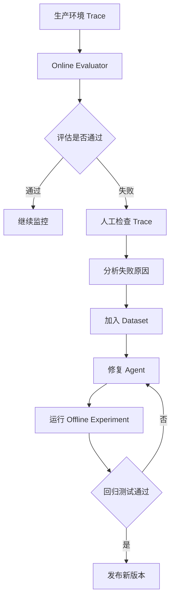

### Offline Evaluation 与 Online Evaluation

#### 两者的核心区别

**发布前测试**

使用固定 Dataset，检查 Agent 是否满足预期，比较版本，发现回归问题。

Dataset → Target → Evaluator → Experiment

**上线后监控**

使用真实生产 Trace，持续评估 Agent 的表现，发现线上问题。

Production Trace → Online Evaluator → Monitoring

#### 企业级 Agent 应该如何使用？

我建议按照下面的方式组织：

| 阶段     | 使用功能             | 目的                     |
| -------- | -------------------- | ------------------------ |
| 开发     | Tracing              | 查看 Agent 执行过程      |
| 调试     | Tracing              | 定位错误                 |
| 测试     | Dataset              | 保存测试数据             |
| 评估     | Evaluator            | 判断质量                 |
| 发布前   | Experiment           | 比较版本、回归测试       |
| 上线后   | Online Evaluation    | 监控真实请求             |
| 持续改进 | Dataset + Experiment | 将线上问题转化为测试用例 |

#### 完整的企业级质量闭环

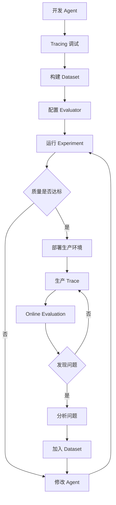

这套流程可以让 Agent 的开发和质量管理形成一个持续循环。

### 构建一个完整的天气 Agent 评估流程

前面学习的是各个概念，现在把它们串起来。

我们的目标是：

使用 LangSmith 对天气 Agent 进行测试和评估。

#### 项目结构

```
agent-testing/
│
├── app/
│   ├── __init__.py
│   └── weather_agent.py
│
├── evaluation/
│   ├── __init__.py
│   ├── create_dataset.py
│   ├── evaluators.py
│   └── run_experiment.py
│
├── tests/
│   └── test_weather_agent.py
│
├── .env
└── requirements.txt
```

各文件的职责：

| 文件                  | 作用                 |
| --------------------- | -------------------- |
| weather_agent.py      | 天气 Agent 实现      |
| create_dataset.py     | 创建评估数据集       |
| evaluators.py         | 定义评估器           |
| run_experiment.py     | 运行评估实验         |
| test_weather_agent.py | 编写 Python 单元测试 |

#### 创建天气 Agent

```python
# app/weather_agent.py

from langchain.agents import create_agent
from langchain.tools import tool
from langchain_openai import ChatOpenAI


@tool
def get_weather(city: str) -> str:
    """查询指定城市的天气。"""

    weather_data = {
        "北京": "晴天，25℃",
        "上海": "多云，22℃",
        "深圳": "小雨，28℃",
    }

    return weather_data.get(city, "暂无天气数据")


model = ChatOpenAI(
    model="替换为你当前可用的模型名称"
)


agent = create_agent(
    model=model,
    tools=[get_weather],
)


def run_agent(question: str) -> dict:

    result = agent.invoke({
        "messages": [
            {
                "role": "user",
                "content": question
            }
        ]
    })

    final_message = result["messages"][-1]

    return {
        "answer": final_message.text,
        "messages": result["messages"]
    }
```

#### 创建 Dataset

```python
# evaluation/create_dataset.py

from langsmith import Client


client = Client()


dataset_name = "weather-agent-dataset"


# 先检查 Dataset 是否已经存在
datasets = list(
    client.list_datasets(
        dataset_name=dataset_name
    )
)


if datasets:
    dataset = datasets[0]
else:
    dataset = client.create_dataset(
        dataset_name=dataset_name,
        description="天气 Agent 评估数据集"
    )


examples = [
    {
        "inputs": {
            "question": "北京今天天气怎么样？"
        },
        "outputs": {
            "answer": "北京今天晴天，25℃"
        }
    },
    {
        "inputs": {
            "question": "上海今天天气怎么样？"
        },
        "outputs": {
            "answer": "上海今天多云，22℃"
        }
    },
    {
        "inputs": {
            "question": "深圳今天天气怎么样？"
        },
        "outputs": {
            "answer": "深圳今天小雨，28℃"
        }
    }
]


client.create_examples(
    dataset_id=dataset.id,
    examples=examples
)


print("Dataset 准备完成：", dataset.name)
```

```bash
python -m evaluation.create_dataset
```


#### 定义 Code Evaluator

```python
# evaluation/evaluators.py

def answer_contains_city(
    inputs: dict,
    outputs: dict,
    reference_outputs: dict
):
    question = inputs["question"]

    answer = outputs["answer"]

    # 简单示例：检查问题中提到的城市
    cities = ["北京", "上海", "深圳"]

    expected_city = next(
        (city for city in cities if city in question),
        None
    )

    passed = (
        expected_city is not None
        and expected_city in answer
    )

    return {
        "key": "city_match",
        "score": passed
    }
```

这个评估器检查：

- 用户问的是哪个城市？
- Agent 回答中是否包含对应城市？

#### 定义 LLM Judge

```python
# evaluation/evaluators.py

from openevals.llm import create_llm_as_judge
from openevals.prompts import CORRECTNESS_PROMPT

def answer_contains_city(
    inputs: dict,
    outputs: dict,
    reference_outputs: dict
):
    question = inputs["question"]

    answer = outputs["answer"]

    # 简单示例：检查问题中提到的城市
    cities = ["北京", "上海", "深圳"]

    expected_city = next(
        (city for city in cities if city in question),
        None
    )

    passed = (
        expected_city is not None
        and expected_city in answer
    )

    return {
        "key": "city_match",
        "score": passed
    }

  
# LLM Judge
correctness_judge = create_llm_as_judge(
    prompt=CORRECTNESS_PROMPT,
    model="openai:替换为当前支持的评估模型",
    feedback_key="correctness",
)


def correctness_evaluator(
    inputs: dict,
    outputs: dict,
    reference_outputs: dict
):

    return correctness_judge(
        inputs=inputs,
        outputs=outputs,
        reference_outputs=reference_outputs
    )
```

#### 定义 Target Function 并运行 Experiment

```python
# evaluation/run_experiment.py

from langsmith import Client

from app.weather_agent import run_agent

from evaluation.evaluators import (
    answer_contains_city,
    correctness_evaluator
)


client = Client()


def target(inputs: dict) -> dict:

    result = run_agent(
        inputs["question"]
    )

    return {
        "answer": result["answer"]
    }


experiment_results = client.evaluate(
    target,
    data="weather-agent-dataset",
    evaluators=[
        answer_contains_city,
        correctness_evaluator
    ],
    experiment_prefix="weather-agent-v1",
    max_concurrency=1
)


print(experiment_results)
```

运行：

```bash
python -m evaluation.run_experiment
```

最终执行流程：

```
Dataset
    ↓
读取 Example
    ↓
Target Function
    ↓
调用 Weather Agent
    ↓
获取 Agent Output
    ↓
Code Evaluator
    ↓
LLM Judge
    ↓
保存 Experiment
    ↓
LangSmith UI 查看结果
```

这里需要特别注意：

1. `target()` 返回的结果结构要和 Evaluator 使用的字段对应。
2. LLM Judge 会额外调用模型，因此会产生额外成本。
3. 示例中的模型名称必须替换成实际可用的模型。
4. `run_agent()` 中的 `final_message.text` 适用于当前示例的最终文本消息；如果 Agent 使用不同的消息结构，需要相应调整。
5. 当前示例的工具数据是固定的，适合学习评估流程，不代表真实天气服务的可靠性测试。

## Agent 工程质量指标与 Regression Testing

在企业级 Agent 开发中，还需要解决一个更实际的问题：

我们怎么知道一个 Agent 是否足够可靠？每次修改代码、Prompt 或模型之后，怎么确认新版本没有变差？

你开发了一个客服 Agent，最初版本能够正确处理 90% 的用户请求。后来你修改了 Prompt，希望它回答得更加详细。

修改之后，回答确实更详细了，但同时出现了这些问题：

- 工具调用准确率从 95% 降到了 80%。
- 平均 Token 消耗增加了 40%。
- 部分原本能处理的请求现在无法完成。
- Agent 执行时间变长了。

如果只看几个成功案例，很可能发现不了这些问题。

因此，我们需要建立一套工程质量指标，并且在每次修改后执行 Regression Testing（回归测试）。

### Agent 工程质量指标

假设我们有两个 Agent：

| 指标           | Agent A | Agent B |
| -------------- | ------- | ------- |
| 请求成功率     | 98%     | 90%     |
| 回答准确率     | 85%     | 95%     |
| 工具选择准确率 | 95%     | 98%     |
| 平均耗时       | 2 秒    | 5 秒    |
| 平均 Token     | 500     | 1200    |

哪个 Agent 更好？

不能简单地说 Agent A 更好，也不能说 Agent B 更好。

因为：

- Agent A 执行速度更快，成本更低。
- Agent B 回答更准确，工具选择也更准确。
- 如果是简单客服任务，可能更重视速度和成本。
- 如果是金融分析任务，可能更重视准确性。

因此，企业级 Agent 不能只用一个指标判断质量。

需要从多个维度进行综合评估。

#### Agent 工程质量的六个维度

六类指标：

| 维度     | 主要关注               | 典型指标                 |
| -------- | ---------------------- | ------------------------ |
| 功能质量 | Agent 是否完成任务     | Task Success Rate        |
| 回答质量 | Agent 回答是否正确     | Answer Accuracy          |
| 工具质量 | 是否正确选择和使用工具 | Tool Selection Accuracy  |
| 执行质量 | Agent 执行是否稳定     | Error Rate、Timeout Rate |
| 性能质量 | Agent 是否足够快       | Latency                  |
| 成本质量 | Agent 消耗多少资源     | Token Usage、Cost        |

### 功能质量指标

#### Task Success Rate（任务成功率）

它衡量的是：

Agent 是否真正完成了用户要求的任务

例如，我们准备了 100 个测试问题：

- 90 个任务成功完成。
- 10 个任务没有完成。

那成功率就是 90% 。

#### Completion Rate（完成率）

它用于衡量 Agent 是否生成了预期的完整结果。

```
请分析这份销售数据，并返回：

1. 总销售额
2. 销售排名前三的产品
3. 销售趋势
4. 改进建议
```

Agent 只返回了总销售额和销售排名。

虽然有输出，但任务并没有完整完成。

它的完成率就是 50% 。

### 回答质量指标

#### Answer Accuracy（回答准确率）

它用于衡量 Agent 的回答是否正确。

例如：

| 测试问题 | 参考答案  | Agent 回答 | 结果 |
| -------- | --------- | ---------- | ---- |
| 北京天气 | 晴天，25℃ | 晴天，25℃  | 正确 |
| 上海天气 | 多云，22℃ | 多云，22℃  | 正确 |
| 深圳天气 | 小雨，28℃ | 晴天，28℃  | 错误 |
| 杭州天气 | 阴天，20℃ | 阴天，20℃  | 正确 |

如果 4 个问题中有 3 个回答正确：那么它的准确率就是 75%。

#### Faithfulness（忠实度）

Faithfulness 主要用于 RAG 场景。**它关注：Agent 的回答是否有检索到的上下文作为依据。**

例如：

检索到的资料：

```
北京今天晴天，气温 25℃。
```

Agent 回答：

```
北京今天晴天，气温 25℃。
```

这个回答有上下文支持。

但如果 Agent 回答：

```
北京今天晴天，气温 25℃，晚上会下大雨。
```

而检索资料没有提到晚上下雨，那么额外的信息可能属于无依据的生成。

Faithfulness 就是用来检查这类问题的。

#### Relevance（相关性）

它衡量回答是否与用户问题相关。有个词叫驴唇不对马嘴。

```
用户：
    北京今天天气怎么样？

Agent：
    北京是中国的首都，有着悠久的历史。
```

虽然内容可能正确，但没有回答用户的问题。

#### Completeness（完整性）

它衡量回答是否覆盖用户要求的所有内容。

```
用户：
    请分析这份数据，并告诉我销售额、利润和利润率。
    
Agent：
		销售额：100 万。
```

回答不完整。

#### 回答质量指标汇总

| 指标         | 含义   | 典型问题               |
| ------------ | ------ | ---------------------- |
| Accuracy     | 正确性 | 答案是否正确？         |
| Faithfulness | 忠实度 | 是否有上下文依据？     |
| Relevance    | 相关性 | 是否回答了用户的问题？ |
| Completeness | 完整性 | 是否覆盖所有要求？     |
| Clarity      | 清晰度 | 是否容易理解？         |
| Helpfulness  | 有用性 | 是否真正帮助用户？     |

### 工具质量指标

#### Tool Selection Accuracy（工具选择准确率）

衡量 Agent 是否选择了正确的工具。

```
用户：
    查询北京天气。

可用工具：
    get_weather
    search_news
    calculate
```

正确选择：

```
get_weather
```

错误选择：

```
search_news
```

假设 100 次工具选择中：

- 90 次正确。
- 10 次错误。

那么工具选择准确率为 90%。

#### Tool Arguments Accuracy（工具参数准确率）

```python
get_weather(
    city="上海"
)
```

但用户实际询问的是北京。

这就是参数错误。

可以检查：

- 参数名称是否正确？
- 参数类型是否正确？
- 参数值是否正确？
- 必填参数是否缺失？
- 是否传入了不合理的值？

#### Tool Execution Success Rate（工具执行成功率）

衡量工具被调用后是否成功执行。

100 次工具调用：

- 95 次成功。
- 5 次失败。

成功率为 95%。

#### 工具质量指标总结

| 指标                        | 关注点           |
| --------------------------- | ---------------- |
| Tool Selection Accuracy     | 工具选得对不对   |
| Tool Arguments Accuracy     | 参数传得对不对   |
| Tool Execution Success Rate | 工具执行是否成功 |
| Tool Latency                | 工具执行耗时     |
| Tool Error Rate             | 工具异常比例     |

### 执行质量指标

#### Error Rate（错误率）

衡量 Agent 执行过程中发生错误的比例。

例如：

- 总请求数：1000
- 发生错误的请求数：30

那么错误率就是 3%。


常见错误包括：

| 错误类型           | 示例                     |
| ------------------ | ------------------------ |
| Model Error        | 模型 API 调用失败        |
| Tool Error         | 工具执行异常             |
| Validation Error   | 参数校验失败             |
| State Error        | LangGraph State 更新错误 |
| Parsing Error      | 输出解析失败             |
| Timeout Error      | 执行超时                 |
| External API Error | 第三方接口异常           |

#### Timeout Rate（超时率）

衡量请求执行时间超过规定限制的比例。

```
请求总数：1000
超时请求：20

Timeout Rate = 2%
```

对于 Agent 来说，超时可能发生在：

- LLM 请求
- 外部 API
- 数据库查询
- RAG 检索
- Agent 循环执行
- 多个工具串行调用

**特别是 LangGraph 中存在循环、重试和多工具调用时，必须控制执行时间。**

#### Retry Rate（重试率）

用来衡量执行过程中发生重试的比例。

```
1000 个请求中：

900 个请求一次成功
70 个请求重试一次后成功
30 个请求最终失败
```

结果是 10%。

重试率高不一定代表系统不可靠。

例如：

- 第三方 API 偶尔出现网络抖动。
- 模型服务偶尔返回 429。
- 数据库出现短暂连接问题。

适当重试可以提高成功率。

但如果重试率持续上升，就需要排查问题。

#### Reliability（可靠性）

可靠性是一个综合概念，不能简单地等同于成功率或错误率。

例如，一个 Agent：

- 任务成功率 99%。
- 错误率 1%。
- 超时率 0.5%。
- 平均耗时 2 秒。

看起来表现不错。

但如果它在关键业务请求上频繁失败，即使整体成功率很高，也可能不满足业务要求。

所以企业项目通常还需要按照业务场景、请求类型、客户等级等维度拆分统计。

### 性能质量指标

#### Latency（延迟）

表示一次请求从开始到结束所花费的时间。

```
用户发起请求：10:00:00

Agent 完成回答：10:00:03

Latency = 3 秒
```

```
用户请求
    ↓
Agent 初始化
    ↓
LLM 调用
    ↓
Tool 调用
    ↓
LLM 再次调用
    ↓
结果处理
    ↓
返回用户
```

因此，Agent 的延迟不等于单次 LLM 调用延迟。

#### Average Latency（平均延迟）

例如：

| 请求      | 耗时 |
| --------- | ---- |
| Request 1 | 1 秒 |
| Request 2 | 2 秒 |
| Request 3 | 3 秒 |
| Request 4 | 4 秒 |

平均延迟：（1 + 2 + 3 + 4）/ 4 = 2.5 秒。 

但平均延迟有一个问题：

它容易被少数极慢请求影响，也可能掩盖尾部延迟。

#### P50、P95、P99 Latency

这是生产系统中非常重要的性能指标。

| 指标 | 含义                       |
| ---- | -------------------------- |
| P50  | 50% 的请求耗时不超过这个值 |
| P95  | 95% 的请求耗时不超过这个值 |
| P99  | 99% 的请求耗时不超过这个值 |

为什么 P95 和 P99 很重要？

因为用户体验往往受慢请求影响。

```
100 个请求：

90 个请求：1 秒
9 个请求：3 秒
1 个请求：30 秒
```

平均值可能看起来还可以，但仍然有用户需要等待 30 秒。

所以生产环境不能只关注平均延迟。

### Tokens（Token 消耗）

用来衡量模型调用消耗的 Token 数量。

常见指标：

| 指标          | 含义       |
| ------------- | ---------- |
| Input Tokens  | 输入 Token |
| output Tokens | 输出 Token |
| Total Tokens  | 总 Token   |

```
第一次模型调用：1000 Tokens
第二次模型调用：500 Tokens
第三次模型调用：800 Tokens

总消耗：2300 Tokens
```

分析 Agent 成本时，不能只看某一次模型调用。

应该尽可能统计整个请求 Trace 下所有相关模型 Run 的 Token 使用情况。

#### Cost（成本）

如果知道模型的输入和输出价格，就可以估算模型调用成本。

```
输入价格：$2 / 1M Tokens
输出价格：$8 / 1M Tokens

Input Tokens：1000
Output Tokens：300
```

输入成本：1000 / 100000 * 2 = 0.02 

输出成本：300 / 1000000 * 8 = 0.0024

总成本：0.02 + 0.0024 = $0.0224  

实际项目中还需要考虑：

- 不同模型的输入、输出价格。
- 缓存 Token 的计价。
- 多模态 Token。
- Embedding 调用。
- 外部搜索和第三方 API 费用。
- 重试产生的额外成本。

#### Cost Per Successful Task（单次成功任务成本）

因为我们不只是想知道 Agent 花了多少钱，还想知道：

完成一个成功任务平均需要多少钱。

```
总请求数：1000
成功任务：900
总成本：$90
```

单次成功成本：90 / 900 = $0.1

平均每个成功任务的成本是 0.1 美元。

这比单纯观察 Tokens 更接近实际业务成本。

### 建立 Agent 工程质量指标体系

建议企业级 Agent 至少监控以下指标：

| 分类 | 指标                        | 关注点           |
| ---- | --------------------------- | ---------------- |
| 功能 | Task Success Rate           | 任务是否完成     |
| 功能 | Completion Rate             | 任务是否完整完成 |
| 回答 | Answer Accuracy             | 回答是否正确     |
| 回答 | Faithfulness                | 回答是否有依据   |
| 工具 | Tool Selection Accuracy     | 工具是否选对     |
| 工具 | Tool Arguments Accuracy     | 参数是否正确     |
| 工具 | Tool Execution Success Rate | 工具是否成功执行 |
| 执行 | Error Rate                  | 请求错误率       |
| 执行 | Timeout Rate                | 请求超时率       |
| 执行 | Retry Rate                  | 请求重试率       |
| 性能 | Average Latency             | 平均延迟         |
| 性能 | P95 Latency                 | 95 分位延迟      |
| 性能 | P99 Latency                 | 99 分位延迟      |
| 成本 | Token Usage                 | Token 消耗       |
| 成本 | Cost Per Task               | 单次任务成本     |

#### 质量指标应该如何设定目标？

不能所有 Agent 都使用相同的标准。

例如：

| 指标                        | 示例目标 |
| --------------------------- | -------- |
| Task Success Rate           | ≥ 95%    |
| Answer Accuracy             | ≥ 95%    |
| Tool Selection Accuracy     | ≥ 98%    |
| Tool Execution Success Rate | ≥ 99%    |
| Error Rate                  | ≤ 1%     |
| Timeout Rate                | ≤ 0.5%   |
| P95 Latency                 | ≤ 5 秒   |
| 平均 Token                  | ≤ 1500   |

### Regression Testing：回归测试

当我们修改 Agent 之后，检查之前已经正常工作的功能是否受到影响。

Agent V1：

```
北京天气查询：成功
上海天气查询：成功
深圳天气查询：成功
```

后来我们修改了 Prompt，发布 Agent V2：

```
北京天气查询：成功
上海天气查询：失败
深圳天气查询：成功
```

#### 为什么 Agent 特别需要回归测试

因为 Agent 有很多容易相互影响的部分：

| 修改内容              | 可能产生的影响            |
| --------------------- | ------------------------- |
| 修改 System Prompt    | 改变回答风格和工具选择    |
| 修改模型              | 改变回答质量和 Token 消耗 |
| 修改 Tool Description | 改变工具选择行为          |
| 修改 Tool 参数        | 导致参数传递错误          |
| 修改 Middleware       | 改变 Agent 执行流程       |
| 修改 State            | 影响状态传递              |
| 修改 Graph Edge       | 改变执行路径              |
| 修改 RAG 检索         | 影响上下文和最终回答      |

例如：

你只是修改了天气工具的描述：

```python
@tool
def get_weather(city: str) -> str:
    """查询指定城市的天气。"""
```

改成：

```python
@tool
def get_weather(city: str) -> str:
    """
    查询指定城市的实时天气，
    包括温度、天气状况和湿度。
    """
```

看起来只是增加了描述，但 LLM 对工具的理解可能发生变化。

所以，即使代码没有报错，也需要重新测试 Agent 的行为。

#### Regression Testing 的基本流程

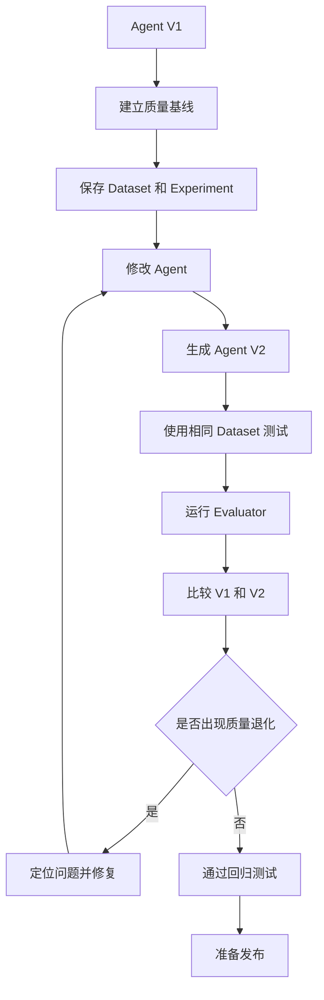

核心思路：

```
旧版本测试结果
        ↓
保存为质量基线
        ↓
修改 Agent
        ↓
使用同一批测试数据
        ↓
测试新版本
        ↓
对比两次结果
        ↓
判断是否发生 Regression
```

#### 什么是 Baseline（质量基线）？

就是一个已知版本的质量参考。

例如：

`Weather Agent V1`

| 指标                    | V1 基线 |
| ----------------------- | ------- |
| Task Success Rate       | 95%     |
| Answer Accuracy         | 94%     |
| Tool Selection Accuracy | 98%     |
| Error Rate              | 1%      |
| Average Latency         | 2 秒    |
| Average Tokens          | 1000    |

之后我们开发 V2：

| 指标                    | V1   | V2   |
| ----------------------- | ---- | ---- |
| Task Success Rate       | 95%  | 97%  |
| Answer Accuracy         | 94%  | 96%  |
| Tool Selection Accuracy | 98%  | 90%  |
| Error Rate              | 1%   | 2%   |
| Average Latency         | 2 秒 | 3 秒 |
| Average Tokens          | 1000 | 1500 |

虽然 V2 的任务成功率和回答准确率提高了，但工具选择准确率明显下降，成本和延迟也上升了。

因此不能直接认为 V2 比 V1 更好。

这也是为什么企业级 Agent 需要多指标评估。

#### Regression Testing 的核心检查项

每次修改 Agent 后，至少应该检查：

第一类：功能回归

- 原本能完成的任务是否仍然能完成？
- 是否有新的任务失败？
- 是否出现任务不完整？

第二类：工具回归

- 工具选择是否正确？
- 工具参数是否正确？
- 工具调用顺序是否发生异常？
- 工具是否能够正常执行？

第三类：回答回归

- 回答是否正确？
- 回答是否遗漏信息？
- 是否出现无依据的内容？
- 输出结构是否改变？

第四类：性能回归

- 延迟是否明显增加？
- Token 消耗是否明显增加？
- 是否出现更多重试？
- 是否出现超时？

第五类：可靠性回归

- 异常率是否增加？
- 是否出现新的错误类型？
- 是否破坏原本的异常处理逻辑？

#### 使用 LangSmith 实现 Regression Testing

我们之前创建了：

```
weather-agent-dataset
```

里面有：

```
Example 1：北京天气
Example 2：上海天气
Example 3：深圳天气
```

这批数据可以作为回归测试集。

**每次版本比较，都尽量使用相同的 Dataset 和相同的评估标准。**

```python
from langsmith import Client

from app.weather_agent import run_agent


client = Client()


def target_v1(inputs: dict) -> dict:

    result = run_agent(
        inputs["question"]
    )

    return {
        "answer": result["answer"]
    }


def target_v2(inputs: dict) -> dict:

    result = run_agent(
        inputs["question"]
    )

    return {
        "answer": result["answer"]
    }
  
  # V1 实验
results_v1 = client.evaluate(
    target_v1,
    data="weather-agent-dataset",
    evaluators=[
        answer_contains_city,
        correctness_evaluator
    ],
    experiment_prefix="weather-agent-v1",
    max_concurrency=1
)


# V2 实验
results_v2 = client.evaluate(
    target_v2,
    data="weather-agent-dataset",
    evaluators=[
        answer_contains_city,
        correctness_evaluator
    ],
    experiment_prefix="weather-agent-v2",
    max_concurrency=1
)
```

例如：

| 指标                    | V1   | V2   | 变化  |
| ----------------------- | ---- | ---- | ----- |
| Answer Accuracy         | 94%  | 96%  | +2%   |
| Tool Selection Accuracy | 98%  | 90%  | -8%   |
| Task Success Rate       | 95%  | 97%  | +2%   |
| Error Rate              | 1%   | 2%   | +1%   |
| Average Latency         | 2 秒 | 3 秒 | +50%\ |

可以得到：

- 回答质量提高。
- 工具选择能力下降。
- 整体错误率上升。
- 执行速度变慢。

所以不能只看 Answer Accuracy。

我们还需要为不同指标设定质量门槛。


回归测试并不要求所有指标都必须比旧版本更好。

因为有时我们会主动做取舍。

```
V1：

回答质量：90%
平均耗时：2 秒

V2：

回答质量：96%
平均耗时：3 秒
```

如果业务更重视回答准确性，那么 V2 可能是更好的版本。

但如果是对实时响应要求极高的场景，增加 50% 的延迟就可能不可接受。

因此，我们应该事先明确：

- 哪些指标是硬性门槛？
- 哪些指标允许一定程度下降？
- 哪些指标可以通过其他收益进行权衡？

### Quality Gate：质量门禁

就是在 Agent 发布之前，设置一组必须满足的质量条件。

```
发布条件：

Task Success Rate >= 95%

Answer Accuracy >= 90%

Tool Selection Accuracy >= 95%

Error Rate <= 2%

P95 Latency <= 5 秒
```

只要有一项关键指标不符合要求，就不能直接发布。

流程：

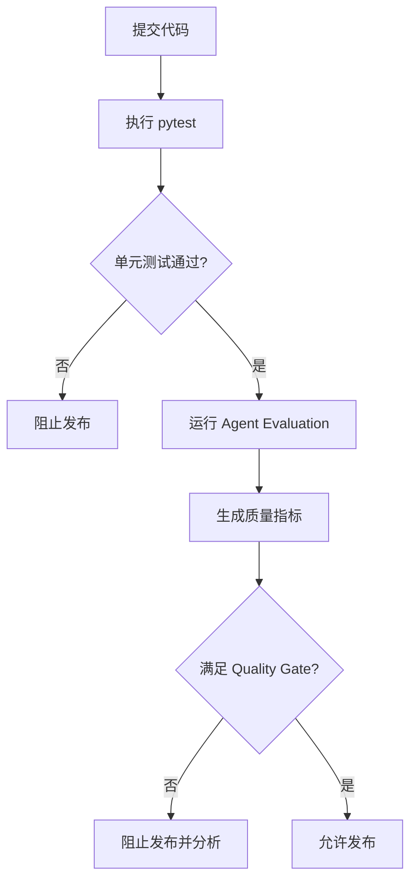

**Agent 的质量不能只依赖开发人员主观判断，而应该有明确的、可以自动执行的发布标准。**

#### 质量门禁还需要考虑统计稳定性

假设 Dataset 只有 3 个 Example：

3 个全部成功 = 100%

这并不能证明 Agent 在真实环境中的成功率就是 100%。

### 将 Regression Testing 集成到 CI/CD

```
开发人员提交代码
        ↓
GitHub 接收到代码
        ↓
自动安装依赖
        ↓
运行 pytest
        ↓
运行 Agent Evaluation
        ↓
检查 Quality Gate
        ↓
通过后允许合并或发布
```

### 企业级 Agent 质量管理体系

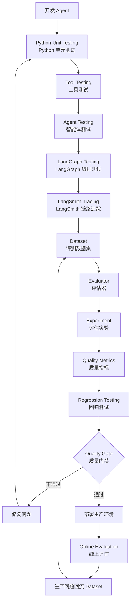

#### 每个工具负责什么？

| 工具或技术           | 主要职责             |
| -------------------- | -------------------- |
| pytest               | 执行自动化测试       |
| assert               | 验证程序行为         |
| Mock                 | 隔离外部依赖         |
| Fake Model           | 模拟 LLM 行为        |
| LangGraph Testing    | 验证图执行逻辑       |
| LangSmith Tracing    | 观察执行过程         |
| LangSmith Dataset    | 管理评估数据         |
| LangSmith Evaluator  | 判断执行质量         |
| LangSmith Experiment | 进行版本评估         |
| Regression Testing   | 检查修改是否引入问题 |
| CI/CD                | 自动执行质量检查     |
| Quality Gate         | 控制发布条件         |

#### 思路

```
开发 Agent
    ↓
编写测试
    ↓
记录 Trace
    ↓
建立 Dataset
    ↓
执行 Evaluation
    ↓
统计质量指标
    ↓
建立质量基线
    ↓
修改 Agent
    ↓
执行 Regression Testing
    ↓
通过 Quality Gate
    ↓
发布 Agent
    ↓
生产环境持续监控
```

## Production Monitoring Agent 生产环境监控与持续运营

一个 Agent 从开发完成到正式上线，需要建立怎样的生产环境监控体系？

### Development、Testing、Production 三种环境

#### Development（开发环境）

用于开发 Agent、修改 Prompt、调试 Tool、调整 LangGraph 流程。

主要工作：

- 编写和调试 Agent
- 测试工具调用
- 调整模型和 Prompt
- 开发新功能

#### Testing / Staging（测试环境）

用于验证新版本是否满足上线要求。

主要工作：

- Unit Testing
- Agent Testing
- LangGraph Testing
- Offline Evaluation
- Regression Testing
- Quality Gate

#### Production（生产环境）

用于处理真实用户请求。

主要工作：

- 处理用户请求
- 监控 Agent 运行状态
- 发现异常和质量问题
- 处理生产故障
- 收集用户反馈
- 持续优化 Agent

### Agent 生产环境的整体架构

一个企业级 Agent 上线后，通常不只是运行一个 Python 文件。

它可能包含：

- API 服务：接收用户请求。
- Agent Runtime：执行 Agent。
- LLM Provider：提供模型能力。
- Tools：调用外部 API 或内部业务系统。
- Database：保存业务数据。
- Checkpointer：保存 LangGraph 执行状态。
- Monitoring：收集运行数据并发现异常。
- Alerting：发生故障时通知开发人员。

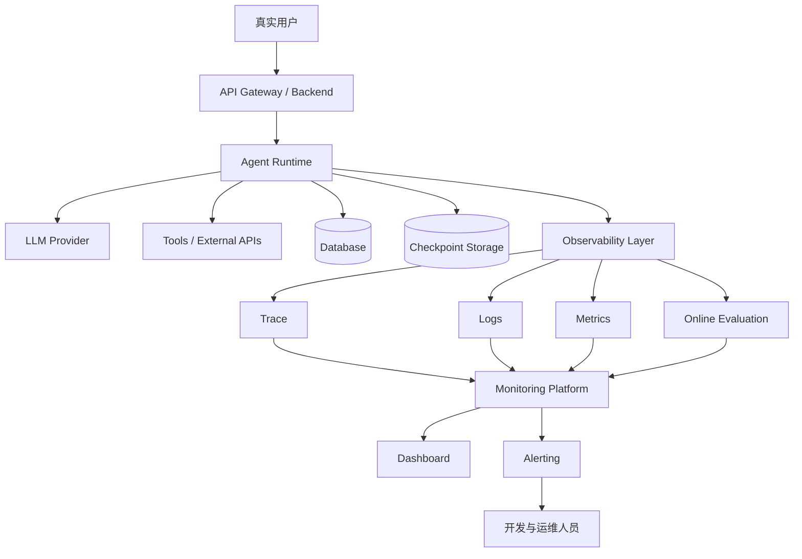

Observability Layer（可观测性层）:它的职责是收集 Agent 运行过程中产生的数据，并将这些数据交给监控平台分析。

例如：

用户向 Agent 发起请求后：

1. API 服务记录请求状态。
2. Agent 执行模型和工具调用。
3. Agent 运行过程中产生 Trace。
4. Python 应用记录业务日志。
5. 监控系统统计请求数量、延迟和错误率。
6. Online Evaluator 对部分生产请求进行质量评估。
7. 监控平台根据数据展示运行情况，并在满足告警条件时通知开发人员。

Agent 的问题不一定发生在模型内部。

```
用户请求
   |
   v
API Gateway
   |
   v
Agent
   |
   +----> LLM Provider
   |
   +----> Weather API
   |
   +----> Order Database
```

如果 Weather API 超时，Agent 最终也可能执行失败。

此时如果只监控 LLM，就无法完整定位问题。

我们需要同时观察 Agent、外部工具、API 服务和基础设施。

#### 企业项目中的常见技术组合

| 层次                | 常见技术                 | 作用               |
| ------------------- | ------------------------ | ------------------ |
| Agent Framework     | LangChain、LangGraph     | 实现 Agent         |
| Agent Observability | LangSmith                | 分析 Agent 行为    |
| Telemetry Standard  | OpenTelemetry            | 统一采集可观测数据 |
| Metrics             | Prometheus 等            | 采集和统计指标     |
| Visualization       | Grafana 等               | 展示监控数据       |
| Logging             | Python logging、日志平台 | 记录应用事件       |
| Alerting            | Webhook、告警平台        | 发送故障通知       |

OpenTelemetry 是一个厂商中立的可观测性框架，支持采集、处理和导出 Traces、Metrics、Logs 等遥测数据。它可以作为不同监控工具之间的统一数据标准。

LangSmith 主要帮助我们理解 Agent 行为，而完整的企业级监控还需要关注应用服务、基础设施和外部依赖。

#### 生产环境的监控对象

Agent 上线后，究竟需要监控什么？建议分成五个层次。

##### 第一层：基础设施监控（Infrastructure Monitoring）

监控 Agent 所运行的服务器和容器。

| 监控对象  | 需要观察的内容       |
| --------- | -------------------- |
| CPU       | CPU 使用率           |
| Memory    | 内存使用率           |
| Disk      | 磁盘空间             |
| Network   | 网络连接和流量       |
| Container | 容器运行状态         |
| Database  | 数据库连接和响应情况 |

##### 第二层：应用服务监控（Application Monitoring）

监控承载 Agent 的后端服务。

例如：

- API 是否正常响应？
- 请求是否成功进入 Agent？
- 是否发生 HTTP 500？
- 并发请求是否过多？
- 是否存在内存泄漏？
- 服务是否频繁重启？

##### 第三层：Agent 行为监控（Agent Behavior Monitoring）

需要关注：

- Agent 是否正确选择工具？
- 是否频繁重复调用工具？
- 是否出现不必要的模型调用？
- LangGraph 是否进入异常执行路径？
- 是否出现无限循环或过多迭代？
- 是否出现不符合业务要求的回答？

##### 第四层：业务质量监控（Business Quality Monitoring）

这一层关注 Agent 是否真正完成了业务任务。

例如客服 Agent：

| 监控内容       | 业务意义               |
| -------------- | ---------------------- |
| 订单查询成功率 | 是否能正确查询订单     |
| 退款处理成功率 | 是否正确完成退款流程   |
| 用户满意度     | 用户是否认可回答       |
| 人工转接率     | 有多少请求需要人工处理 |
| 错误业务操作率 | 是否执行了错误操作     |

Agent 返回 HTTP 200，不代表业务任务成功。

例如：

```
用户：帮我取消订单。

Agent：订单已经取消。

实际情况：订单并没有取消。
```

应用服务正常，Agent 也正常返回了回答，但业务任务失败了。

因此，企业级监控必须关注业务结果，而不仅仅是技术运行状态。

##### 第五层：安全与合规监控（Security & Compliance Monitoring）

生产环境还需要监控：

- 是否泄露敏感信息？
- 是否出现越权工具调用？
- 是否违反业务权限规则？
- 是否出现 Prompt Injection 攻击？
- 是否返回不符合安全策略的内容？
- 是否访问了不允许访问的数据？

##### 五层监控体系总结

| 层次                  | 主要监控对象         | 主要问题               |
| --------------------- | -------------------- | ---------------------- |
| Infrastructure        | CPU、内存、网络      | 服务器是否正常         |
| Application           | API、服务、数据库    | 应用是否正常           |
| Agent Behavior        | 模型、工具、Graph    | Agent 是否正常执行     |
| Business Quality      | 任务成功率、满意度   | Agent 是否完成业务目标 |
| Security & Compliance | 权限、隐私、安全规则 | Agent 是否安全合规     |

#### Monitoring、Observability、Evaluation 的区别

| 概念          | 中文     | 核心问题               | 主要用途         |
| ------------- | -------- | ---------------------- | ---------------- |
| Monitoring    | 监控     | 有没有出现异常？       | 发现问题、告警   |
| Observability | 可观测性 | 为什么出现这个问题？   | 分析内部运行情况 |
| Evaluation    | 评估     | Agent 的表现质量如何？ | 判断质量是否达标 |

##### Monitoring：发现异常

```
Agent Error Rate > 5%
```

监控系统发现错误率超过设定阈值，于是触发告警。

Monitoring 关注的是：**是否出现了值得关注的异常？**

##### Observability：分析原因

收到告警之后，需要找到问题根源。

```
Agent 请求失败
    |
    v
查看 Trace
    |
    v
发现 get_weather 工具失败
    |
    v
查看应用日志
    |
    v
发现第三方天气 API 返回 503
```

Observability 关注的是：**系统内部发生了什么？为什么发生？**

##### Evaluation：判断质量

即使 Agent 没有报错，也可能产生低质量回答。

```
用户：台北今天的天气怎么样？

Agent：台北今天晴天。

执行状态：成功

Evaluation：
Answer Relevance = 1
Faithfulness = 0
```

Evaluation 关注的是：**Agent 的回答、工具选择和执行行为是否符合预期？**

#### 总结

**生产环境监控不是只监控 LLM，而是监控整个 Agent 应用系统。**

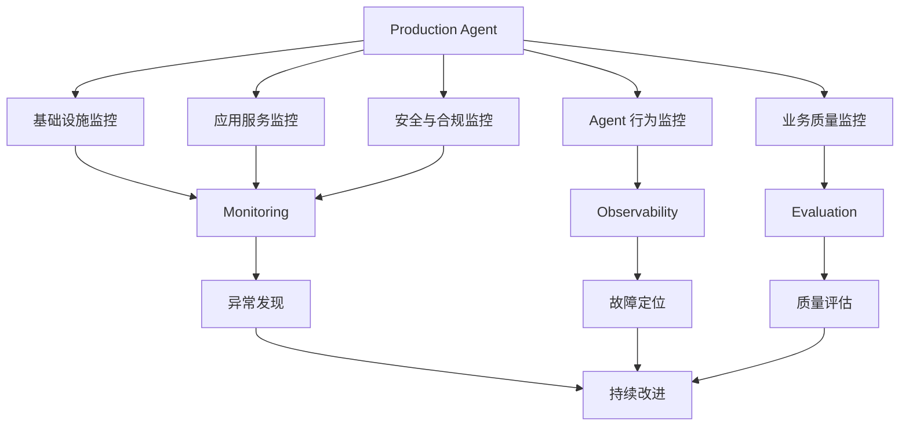

### Agent 生产环境部署与版本管理

一个在本地开发、测试通过的 Agent，应该怎样部署到生产环境？上线后又怎样管理版本、控制发布风险，并在出现问题时快速回滚？

#### Agent 服务部署架构

在前面主要通过下面的方式运行 Agent：

```python
result = agent.invoke({
    "messages": [
        {"role": "user", "content": "北京今天天气怎么样？"}
    ]
})
```

这适合本地开发和测试，但生产环境不能只依赖开发者手动运行 Python 脚本。

生产环境通常需要：

- 接收多个用户的请求。
- 通过 HTTP API 对外提供服务。
- 管理并发请求。
- 安全地管理 API Key。
- 记录请求日志和 Agent Trace。
- 管理数据库、Checkpoint 等持久化资源。
- 支持服务扩容、重启和版本更新。

所以，我们需要把 Agent 包装成一个可以长期运行的服务。

#### 典型的 Agent 生产部署架构

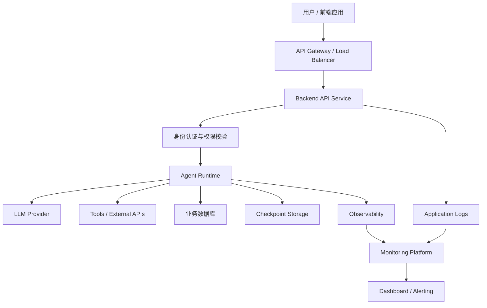

各个组件的职责：

| 组件               | 主要职责                         |
| ------------------ | -------------------------------- |
| API Gateway        | 接收请求、路由、限流             |
| Backend API        | 处理 HTTP 请求，管理用户会话     |
| 身份认证           | 验证用户身份和访问权限           |
| Agent Runtime      | 执行 LangChain / LangGraph Agent |
| LLM Provider       | 提供大语言模型能力               |
| Tools              | 调用外部 API 和业务服务          |
| Database           | 保存业务数据                     |
| Checkpoint Storage | 保存 LangGraph 执行状态          |
| Observability      | 收集 Agent 执行数据              |
| Monitoring         | 监控系统状态、发现异常           |

#### 常见的三种部署方式

##### 直接使用 FastAPI 部署 Agent

适合希望自己掌握服务架构的项目。

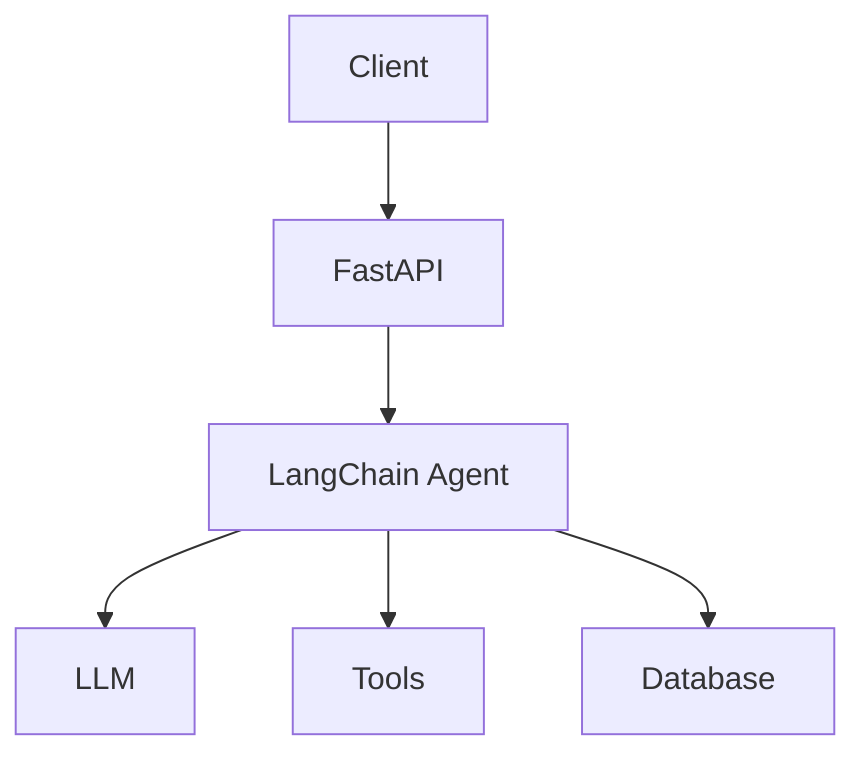

```python
from fastapi import FastAPI
from pydantic import BaseModel
from langchain.agents import create_agent
from langchain_openai import ChatOpenAI

app = FastAPI()

model = ChatOpenAI(
    model="YOUR_MODEL_NAME"
)

agent = create_agent(
    model=model,
    tools=[]
)


class AgentRequest(BaseModel):
    message: str


@app.post("/agent")
def run_agent(request: AgentRequest):
    result = agent.invoke({
        "messages": [
            {"role": "user", "content": request.message}
        ]
    })

    return {
        "answer": result["messages"][-1].text
    }
```

启动：

```bash
uvicorn main:app --host 0.0.0.0 --port 8000
```

##### 使用 LangGraph Server 部署

如果你的项目使用 LangGraph，并且需要：

- 持久化执行状态。
- Checkpoint。
- 多轮对话。
- Human-in-the-loop。
- 流式输出。
- 长时间运行的 Agent。
- 任务恢复和管理。

那么可以考虑使用 LangGraph Server 对外提供运行接口。

LangGraph 的自托管部署方式需要你负责基础设施，例如 Redis、PostgreSQL，以及构建和运行相应的 Docker 镜像。官方部署文档也明确区分了应用镜像构建与基础设施管理。

##### 使用 LangSmith Deployment

LangSmith Deployment 是用于运行生产 Agent 的部署基础设施。

它提供的能力包括：

- Agent 部署和运行。
- 持久化执行。
- 人工审批。
- 任务管理。
- Agent 版本管理。
- 版本回滚。
- 水平扩展。

它和 LangGraph 的关系是：

| 技术                 | 职责                      |
| -------------------- | ------------------------- |
| LangGraph            | 构建有状态的 Agent 工作流 |
| LangSmith            | Agent 的可观测性与评估    |
| LangSmith Deployment | 部署和运行生产 Agent      |

LangSmith Deployment 也支持非 LangGraph 框架的 Agent，不是必须使用 LangGraph 才能部署。

##### 三种部署方式如何选择？

| 方式                 | 适合场景                                   |
| -------------------- | ------------------------------------------ |
| FastAPI + Agent      | 自定义程度高，自己管理服务架构             |
| LangGraph Server     | 使用 LangGraph，需要持久化和工作流运行能力 |
| LangSmith Deployment | 希望使用托管的 Agent 部署基础设施          |

#### Development 与 Production 配置隔离

假设你的 Agent 在本地开发时使用：

```python
model = ChatOpenAI(
    model="YOUR_MODEL_NAME",
    api_key="开发环境 API Key"
)
```

部署到生产环境后，如果继续使用相同配置，就可能出现问题：

- 开发环境和生产环境使用同一个数据库。
- 测试请求污染真实业务数据。
- 开发人员误用生产 API Key。
- 调试时修改的参数影响线上服务。
- 不同环境使用不同模型，却没有明确管理。

因此，我们需要将代码与环境配置分离。

#### 三种环境的配置差异

| 配置项目          | Development     | Testing / Staging | Production       |
| ----------------- | --------------- | ----------------- | ---------------- |
| LLM API Key       | 开发 Key        | 测试 Key          | 生产 Key         |
| Model             | 开发模型        | 候选模型          | 正式模型         |
| Database          | 本地数据库      | 测试数据库        | 生产数据库       |
| LangSmith Project | agent-dev       | agent-testing     | agent-production |
| Debug             | 开启            | 按需开启          | 通常关闭         |
| 日志级别          | DEBUG           | INFO              | INFO / WARNING   |
| 外部工具          | Mock 或测试接口 | 沙箱接口          | 正式接口         |

#### 使用环境变量管理配置

用 python-dotenv依赖 和.env文件配置

```env
# Development
APP_ENV=development
OPENAI_API_KEY=dev-key
LANGSMITH_PROJECT=agent-dev
DEBUG=true
```

```env
# Production
APP_ENV=production
OPENAI_API_KEY=prod-key
LANGSMITH_PROJECT=agent-production
DEBUG=false
```

```python
from dotenv import load_dotenv
import os

load_dotenv()

APP_ENV = os.getenv(
    "APP_ENV",
    "development"
)

OPENAI_API_KEY = os.environ["OPENAI_API_KEY"]

LANGSMITH_PROJECT = os.getenv(
    "LANGSMITH_PROJECT",
    "agent-dev"
)

DEBUG = os.getenv(
    "DEBUG",
    "false"
).lower() == "true"
```

但要注意：

- `.env` 适合本地开发。
- `.env` 不应该提交到 Git。
- 生产环境应使用部署平台的环境变量或 Secret Manager。
- 不要把 API Key 写死在 Python 代码里。

#### Agent 版本管理

Agent 的行为不仅由 Python 代码决定，还受到 Prompt、Model、Tool 和配置的影响。

V1：

```
Prompt：你是一个天气助手，只回答天气问题。
Model：模型 A
Tool：get_weather
```

V2：

```
Prompt：你是一个智能旅行助手，可以查询天气和推荐景点。
Model：模型 B
Tool：get_weather、search_places
```

即使 Python 代码没有发生太大变化，Agent 的行为也可能完全不同。

所以，Agent 的版本管理不能只看 Git Commit。

##### Agent 版本应该包含什么？

```
Agent Version
    ├── Application Code Version
    ├── Prompt Version
    ├── Model Version
    ├── Tool Version
    ├── Configuration Version
    └── Dependency Version
```

```
Agent: customer-support-agent

Version: 1.2.0

Code:
    Git Commit: a83f21d

Prompt:
    support-prompt: v3

Model:
    model-x

Tools:
    search_orders: v1
    create_ticket: v2

Dependencies:
    langchain: 指定版本
    langgraph: 指定版本
```

这样，当生产环境出现问题时，就可以明确知道：

- 当时运行的是哪一版代码？
- 使用的是哪个 Prompt？
- 调用了哪个模型？
- 工具使用的是哪个版本？
- Python 依赖是什么版本？

##### 使用 Git 管理代码版本

例如：

```bash
git add .
git commit -m "feat: add order search tool"
git tag v1.0.0
```

后续发布新版本：

```bash
git add .
git commit -m "feat: improve agent reasoning"
git tag v1.1.0
```

版本号可以采用语义化版本管理：

```
MAJOR.MINOR.PATCH
```

| 版本  | 含义                 |
| ----- | -------------------- |
| MAJOR | 不兼容的重大变化     |
| MINOR | 增加向后兼容的新功能 |
| PATCH | 向后兼容的问题修复   |

例如：

- `1.0.0`：第一个正式版本。
- `1.1.0`：增加订单查询工具。
- `1.1.1`：修复订单查询参数错误。
- `2.0.0`：重新设计 Agent 工作流，产生不兼容变化。

##### 使用 Docker 镜像固定部署版本

生产环境通常不应该直接运行 Git 仓库中的最新代码。通常是打包成 docker 镜像。

```
Git Commit
    ↓
Build Docker Image
    ↓
Image Tag
    ↓
Deploy
```

打包：

```bash
docker build -t customer-agent:1.2.0 .
```

运行：

```bash
docker run \
  -p 8000:8000 \
  --env-file .env \
  customer-agent:1.2.0
```

#### Prompt、Model、Tool 版本追踪

##### Prompt 版本管理

本质是把 prompt 从代码里抽出来变成**版本化远程资产**：每次 push 生成一个不可变 commit，代码只按「名字 / commit / 标签」拉取，改 prompt 不用重新部署。

LangSmith 提供 Prompt 管理能力：

- 保存 Prompt 的不同 Commit。
- 查看历史版本。
- 比较不同版本的差异。
- 使用 Commit Hash 指定具体版本。
- 使用 Tag 标记特定版本。

创建 / 更新 push：

```python
from langsmith import Client
from langchain_core.prompts import ChatPromptTemplate

client = Client()
prompt = ChatPromptTemplate.from_messages([
    ("system", "你是客服助手，只依据已知信息回答。"),
    ("human", "{question}"),
])
url = client.push_prompt("support-answer", object=prompt)   # 返回 UI 链接

```

拉取 pull：

```python
from langsmith import Client
from langchain_openai import ChatOpenAI

client = Client()
prompt = client.pull_prompt("support-answer:prod")     # 返回 PromptTemplate
chain = prompt | ChatOpenAI(model="gpt-5.4-mini")
out = chain.invoke({"question": "..."})

```

##### Model 版本管理

模型配置单独管理：

```python
MODEL_CONFIG = {
    "model_name": "YOUR_MODEL_NAME",
    "temperature": 0,
    "max_tokens": 2000
}
```

##### Tool 版本管理

给每个 Tool 维护版本信息：

```python
TOOL_MANIFEST = {
    "search_order": {
        "version": "1.1.0",
        "description": "查询订单信息"
    },
    "create_ticket": {
        "version": "2.0.0",
        "description": "创建客服工单"
    }
}
```

真正的 Tool 版本应当与代码提交、依赖和外部 API 契约一起管理。

##### 建立 Agent 版本清单

```yaml
agent:
  name: customer-support-agent
  version: 1.2.0

application:
  git_commit: a83f21d
  docker_image: customer-agent:1.2.0

prompt:
  name: customer-support-prompt
  commit: prompt-commit-hash

model:
  provider: openai
  name: YOUR_MODEL_NAME
  temperature: 0

tools:
  - name: search_order
    version: 1.1.0

  - name: create_ticket
    version: 2.0.0

environment:
  name: production
```

这个清单的意义是：

**当一条生产 Trace 出现异常时，我们可以根据 Agent 版本清单还原当时的运行配置。**

#### 灰度发布与版本回滚

##### 什么是灰度发布？

新版本先只服务一小部分真实流量，确认运行稳定后，再逐步扩大流量。

```
Agent V1：旧版本
Agent V2：新版本

第一阶段：
V1 接收 95% 请求
V2 接收 5% 请求

第二阶段：
V1 接收 80% 请求
V2 接收 20% 请求

第三阶段：
V1 接收 50% 请求
V2 接收 50% 请求

第四阶段：
V2 接收 100% 请求
```

灰度发布时，应该重点比较：

| 指标              | 关注点               |
| ----------------- | -------------------- |
| Task Success Rate | 任务成功率是否下降   |
| Answer Accuracy   | 回答质量是否下降     |
| Tool Error Rate   | 工具错误率是否增加   |
| Error Rate        | 整体错误率是否增加   |
| P95 Latency       | 响应延迟是否增加     |
| Token Cost        | 单次请求成本是否增加 |

##### 什么是蓝绿部署？

蓝绿部署（Blue-Green Deployment）是另一种生产发布策略。

假设：

- Blue：当前生产版本 V1。
- Green：准备发布的新版本 V2。

蓝绿部署的核心是：

1. 保留当前生产环境。
2. 部署一个新版本环境。
3. 在新环境完成验证。
4. 将流量切换到新环境。
5. 出现问题时切回旧环境。

和灰度发布相比：

| 对比     | 灰度发布             | 蓝绿部署                 |
| -------- | -------------------- | ------------------------ |
| 发布方式 | 逐步增加新版本流量   | 在两个环境间切换流量     |
| 旧版本   | 通常继续承接部分流量 | 保留为备用环境           |
| 风险控制 | 通过流量比例逐步验证 | 通过环境隔离和切换控制   |
| 资源成本 | 视部署方式而定       | 通常需要同时维护两套环境 |

##### 什么是版本回滚？

新版本上线后，发现：

- Agent 任务成功率下降。
- Tool Error Rate 上升。
- P95 Latency 明显增加。

这时应该停止继续扩大流量，并恢复到旧版本。

```mermaid
flowchart TD
    A["部署 Agent V1.1.0"] --> B["生产环境监控"]
    B --> C{"是否出现严重异常？"}

    C -->|"否"| D["继续运行"]
    C -->|"是"| E["停止新版本流量"]

    E --> F["切换回 Agent V1.0.0"]
    F --> G["验证旧版本恢复"]
    G --> H["分析 V1.1.0 故障原因"]
```

```bash
# 当前版本
docker run customer-agent:1.1.0

# 回滚到旧版本
docker run customer-agent:1.0.0
```

##### 回滚不只是恢复 Python 代码

回滚时应该考虑恢复完整的运行版本：

```
Agent V1.0.0
    ├── Code A
    ├── Prompt P1
    ├── Model M1
    ├── Tool T1
    └── Compatible Configuration
```

#### 完整的 Agent 生产发布流程

```mermaid
flowchart TD
    A["Development 开发 Agent"] --> B["Git 代码管理"]
    B --> C["Unit / Integration Testing"]
    C --> D["Offline Evaluation"]
    D --> E["Regression Testing"]
    E --> F{"Quality Gate 是否通过？"}

    F -->|"否"| A
    F -->|"是"| G["Build Docker Image"]

    G --> H["记录 Agent 完整版本"]
    H --> I["部署 Staging"]
    I --> J["Staging 验证"]
    J --> K["Canary 灰度发布"]

    K --> L["Production Monitoring"]
    L --> M{"运行是否正常？"}

    M -->|"是"| N["逐步扩大流量"]
    N --> O["正式全量发布"]

    M -->|"否"| P["Rollback"]
    P --> Q["故障分析与修复"]
    Q --> A
```

### 生产环境数据监控与异常发现

现在假设天气 Agent 已经正式上线，每天处理数千个用户请求。

这时会出现一些问题：

- 某些请求的 Agent 为什么调用了错误的工具？
- 为什么最近回答质量开始下降？
- 为什么 Token 消耗突然增加？
- 某个新版本上线后，是否让任务成功率降低了？
- 如何从大量生产 Trace 中快速找到异常请求？

这些问题不能只靠开发人员手动查看日志解决。

我们需要建立一套生产数据监控与异常发现机制：从真实请求中收集数据，筛选 Trace，运行在线评估，分析质量趋势，并识别异常模式。

#### 生产 Trace 的筛选与分析

##### 生产 Trace 应该记录哪些信息？

除了前面学习过的输入、输出、执行步骤，我们还应该给生产请求添加必要的业务元数据。

```python
from langsmith import traceable

@traceable(
    name="weather_agent",
    metadata={
        "environment": "production",
        "agent_version": "1.2.0",
        "customer_tier": "standard"
    },
    tags=["weather-agent", "production"]
)
def run_weather_agent(agent, message: str):
    return agent.invoke({
        "messages": [
            {"role": "user", "content": message}
        ]
    })
```

这里的元数据用于后续筛选和分析：

| 字段          | 用途                      |
| ------------- | ------------------------- |
| environment   | 区分开发、测试和生产      |
| agent_version | 区分 Agent 版本           |
| customer_tier | 分析不同用户等级的请求    |
| tags          | 标记 Agent 类型或业务场景 |

还可以根据需要记录：

- `request_id`：请求关联 ID。
- `tenant_id`：租户标识（注意访问控制和隐私）。
- `region`：业务区域。
- `experiment_group`：灰度发布分组。
- `model_name`：模型标识。

#### 常见的生产 Trace 筛选方式

| 筛选维度   | 示例             | 想解决的问题         |
| ---------- | ---------------- | -------------------- |
| 时间       | 最近 24 小时     | 最近是否出现异常     |
| Agent 版本 | `1.2.0`          | 新版本是否有问题     |
| 环境       | `production`     | 只看线上请求         |
| Tool       | `get_weather`    | 天气工具是否异常     |
| Feedback   | 用户评价为负面   | 哪些回答让用户不满意 |
| Latency    | 执行时间超过阈值 | 哪些请求响应缓慢     |
| Error      | 存在异常         | 哪些请求执行失败     |

LangSmith 的 Trace 项目页面支持通过筛选条件查找运行记录；Online Evaluator 也可以复用 Trace 筛选条件，只让符合条件的请求触发评估。

#### 生产问题排查案例

假设天气 Agent 的 V1.2.0 上线后，用户开始反馈：

> 查询天气时，经常没有返回正确的天气信息。

可以按下面的顺序排查：

```
第一步：筛选 Production 环境
    ↓
第二步：筛选 Agent Version = 1.2.0
    ↓
第三步：筛选调用 get_weather 的请求
    ↓
第四步：查看 Tool 执行结果
    ↓
第五步：查看最终回答
    ↓
第六步：判断问题来自 Tool、Model 还是 Prompt
```


```
Trace A
    Tool: get_weather
    Tool Result: API Timeout
    Final Answer: 东京天气晴朗

Trace B
    Tool: get_weather
    Tool Result: API 返回成功
    Final Answer: 东京天气晴朗

Trace C
    Tool: get_weather
    Tool Result: API 返回成功
    Final Answer: 大阪天气晴朗
```

这就是生产 Trace 分析的价值：不只是发现请求失败，还要找到失败发生在哪个环节。

#### Online Evaluator 的采样与过滤

假设 Agent 每天处理 10,000 个请求，我们希望自动检查：

- 回答是否有帮助？
- 是否存在明显事实错误？
- 是否出现不安全内容？
- 是否在没有查询成功的情况下编造天气？
- 是否正确使用了工具？

这就是 Online Evaluation 的作用。

它会对生产 Trace 自动执行评估，持续反馈线上应用的质量。

#####  Filter：只评估符合条件的请求

例如，我们只想评估：

- Production 环境。
- Agent 版本为 1.2.0。
- 调用了 `get_weather` 工具的请求。

这样可以避免评估无关请求。

| 业务需求               | Filter 思路                        |
| ---------------------- | ---------------------------------- |
| 只检查用户不满意的回答 | 有负面用户反馈                     |
| 只检查某个工具         | 包含特定 Tool Call                 |
| 只检查企业用户         | Metadata 中的用户等级为 enterprise |
| 只检查新版本           | Agent Version 为 1.2.0             |
| 只检查某类业务         | Metadata 中的业务类型匹配          |

##### Sampling：控制评估比例

假设每天有 10,000 条符合 Filter 的 Trace。

如果全部使用 LLM-as-a-Judge 评估，可能带来较高的模型调用成本。

因此可以设置采样比例。

例如：

| Sampling Rate | 每天预计评估数量 |
| ------------- | ---------------- |
| 1.0（100%）   | 10,000           |
| 0.5（50%）    | 5,000            |
| 0.1（10%）    | 1,000            |
| 0.01（1%）    | 100              |

##### 如何选择采样比例？

建议根据评估成本和风险决定：

| 场景               | 采样建议                   |
| ------------------ | -------------------------- |
| 高风险业务操作     | 尽可能全量检查关键规则     |
| 普通问答质量评估   | 可以先抽样                 |
| 新版本灰度发布     | 提高采样比例               |
| 稳定运行的成熟版本 | 可适当降低采样比例         |
| 发生严重异常时     | 临时提高采样比例或全量监控 |

##### 一个生产环境的 Evaluator 设计

假设天气 Agent 有三个在线评估器：

| Evaluator           | 评估内容                         | 实现方式       |
| ------------------- | -------------------------------- | -------------- |
| Answer Quality      | 回答是否有帮助、是否符合用户问题 | LLM-as-a-Judge |
| Tool Usage          | 是否正确调用天气工具             | Code Evaluator |
| Hallucination Check | 是否在工具失败后编造天气         | Code + LLM     |

#### 历史 Trace 回填评估（Backfill）

今天你发现一个问题：

> 之前的 Agent 可能在天气 API 调用失败时，仍然编造天气信息。

现在你创建了一个新的 Evaluator，专门检查：

```
当天气工具调用失败时，
Agent 是否仍然生成了没有依据的天气回答？
```

但是有一个问题：

新创建的 Evaluator 默认主要用于后续符合条件的运行记录。

那么，过去 30 天的 Trace 怎么办？

难道要等新的请求发生，才能知道之前是否存在问题？

这时就需要 Backfill（历史数据回填评估）。

**Backfill 就是将新的评估规则应用到已经存在的历史 Trace 上，重新检查过去的数据。**

##### LangSmith 中如何配置 Backfill？

创建 Online Evaluator 时可以：

1. 进入对应的 Tracing Project。
2. 打开 Evaluators。
3. 创建新的 Evaluator。
4. 设置 Filter。
5. 设置 Sampling Rate。
6. 开启 `Apply to past runs`。
7. 设置 `Backfill from` 日期。
8. 创建并运行 Evaluator。

#####  Backfill 和 Backtesting 有什么区别？

这两个概念容易混淆。

它们都使用历史生产数据，但目的不同。

**Backfill：使用新的评估规则重新检查历史 Trace。**

**Backtesting：使用历史生产数据测试新的 Agent 版本。**

##### 检查过去一个月的天气 Agent

我们可以采取两种行动。

第一种：Backfill

使用新建的 `hallucination_check` Evaluator 检查过去一个月的 Trace，统计历史上是否发生过类似问题。

第二种：Backtesting

把历史上发生过工具超时的请求整理成 Dataset，让修复后的 Agent V2 重新执行。

这样可以验证：

- V2 是否能够正确识别工具失败？
- V2 是否会明确告知用户暂时无法查询？
- V2 是否还会编造天气信息？

两种方式结合，才可以既发现历史问题，又验证修复效果。

#### 生产质量趋势分析

##### 生产质量趋势应该看哪些指标？

| 指标分类 | 代表指标                                 | 关注问题           |
| -------- | ---------------------------------------- | ------------------ |
| 任务质量 | Task Success Rate                        | Agent 是否完成任务 |
| 回答质量 | Answer Accuracy、Faithfulness            | 回答是否可靠       |
| 工具质量 | Tool Error Rate、Tool Selection Accuracy | 工具是否正常工作   |
| 性能     | P50、P95、P99 Latency                    | 响应是否变慢       |
| 成本     | Token Usage、Cost Per Task               | 运行成本是否增加   |

##### 如何观察质量趋势？

趋势分析的意义在于：

不仅要发现质量下降，还要找到质量下降开始的时间，以及它与哪些变更有关。

##### 按 Agent 版本比较趋势

假设我们同时运行两个版本：

- V1.1.0：旧版本。
- V1.2.0：新版本。

我们统计它们的任务成功率：

```
V1.1.0：96%
V1.2.0：89%
```

##### LangSmith 如何帮助分析趋势？

在 LangSmith 中，生产监控可以结合以下数据：

- Tracing Project 中的运行记录。
- Online Evaluator 产生的 Feedback Scores。
- Trace Metadata 中的 Agent Version。
- Experiment 的版本对比结果。
- Dashboard 中的质量和运行指标。

```
生产 Trace
    ↓
Online Evaluator
    ↓
Feedback Scores
    ↓
按时间、版本、业务类型聚合
    ↓
发现质量趋势
    ↓
定位异常时间段
```

#### 异常请求与异常模式发现

##### 什么是异常检测？

**我们并不知道问题是什么，只知道 Agent 最近表现得不太正常。**

例如：

- 某个工具突然被调用了很多次。
- 某些请求的 Token 消耗突然增加。
- Agent 开始频繁重复调用同一个工具。
- 某个业务场景的失败率突然上升。
- Agent 的回答突然变得特别短或特别长。

这就是异常请求与异常模式发现要解决的问题。

##### 常见的 Agent 异常模式

| 异常类型            | 典型表现                | 可能原因                   |
| ------------------- | ----------------------- | -------------------------- |
| Tool 调用异常       | 同一工具重复调用        | 循环逻辑或工具结果处理异常 |
| Token 异常          | 单次请求 Token 突然增加 | Prompt 膨胀、上下文过长    |
| Latency 异常        | P95 延迟突然上升        | 模型响应慢、工具超时       |
| Answer 异常         | 回答突然变得很短        | 模型输出异常、Prompt 变化  |
| Error 异常          | 某类请求失败率增加      | 外部 API 或代码故障        |
| Tool Selection 异常 | Agent 选择了错误工具    | Prompt 或模型行为变化      |
| State 异常          | Graph 状态异常或循环    | State 更新、条件边逻辑错误 |

##### 使用规则发现异常

```python
def detect_anomaly(metrics):
    anomalies = []

    if metrics["latency"] > 10:
        anomalies.append("HIGH_LATENCY")

    if metrics["total_tokens"] > 10000:
        anomalies.append("HIGH_TOKEN_USAGE")

    if metrics["tool_call_count"] > 10:
        anomalies.append("TOO_MANY_TOOL_CALLS")

    if metrics["error_count"] > 0:
        anomalies.append("EXECUTION_ERROR")

    return anomalies

  

metrics = {
    "latency": 15,
    "total_tokens": 12000,
    "tool_call_count": 15,
    "error_count": 1
}

print(detect_anomaly(metrics))
```

##### 使用 Online Evaluator 发现质量异常

有些异常很难通过简单规则判断。

可以设计一个 LLM-as-a-Judge Evaluator：

```
你是一个 Agent 质量检查器。

请检查 Agent 是否存在以下问题：

1. 工具调用失败后仍然编造事实。
2. 回答内容与工具结果不一致。
3. 回答没有依据。
4. 回答没有解决用户问题。

如果发现问题，请返回：
- 是否异常
- 异常类型
- 异常原因
```

这样可以发现传统错误日志无法直接发现的质量问题。

##### 从异常发现到故障定位

```mermaid
flowchart TD
    A["发现 Tool Call 数量异常增加"] --> B["筛选异常时间段 Trace"]
    B --> C["按 Agent Version 分组"]
    C --> D{"是否集中在新版本？"}

    D -->|"是"| E["检查 Prompt / Model / Graph 变更"]
    D -->|"否"| F["检查外部 API 和用户请求变化"]

    E --> G["定位具体异常 Trace"]
    F --> G

    G --> H["检查 Node / Edge 执行路径"]
    H --> I["确定 Root Cause"]
    I --> J["修复 Agent"]
    J --> K["Offline Evaluation"]
    K --> L["Regression Testing"]
    L --> M["重新发布"]
```

### Agent 故障诊断与排查

发现异常之后，怎样定位问题发生在哪个组件，以及应该如何修复？

#### Model Error 排查

| 错误类型             | 典型表现           | 常见原因               |
| -------------------- | ------------------ | ---------------------- |
| Authentication Error | API Key 无效       | 密钥配置错误、过期     |
| Rate Limit Error     | 请求频率超过限制   | 并发过高、额度限制     |
| Timeout Error        | 模型响应超时       | 网络或模型服务延迟     |
| Context Length Error | 输入超过上下文限制 | Prompt 或历史消息过长  |
| Model Not Found      | 找不到指定模型     | 模型名称或权限配置错误 |
| Invalid Request      | 请求参数不合法     | 参数、消息格式不正确   |
| Provider Error       | 模型服务端异常     | 上游服务故障           |

##### 不同错误应该采用不同策略

| 错误            | 建议处理方式                         |
| --------------- | ------------------------------------ |
| API Key 错误    | 修复密钥配置，不要反复重试           |
| Rate Limit      | 控制并发、退避重试                   |
| Timeout         | 检查网络和服务延迟，必要时有限重试   |
| Context Length  | 缩短上下文、控制历史消息             |
| Model Not Found | 检查模型名称和访问权限               |
| Provider Error  | 判断是否为暂时性故障，考虑重试或降级 |

#### Tool Error 排查

| 错误类型          | 示例       | 排查方向              |
| ----------------- | ---------- | --------------------- |
| Authentication    | HTTP 401   | API Key、身份认证     |
| Permission        | HTTP 403   | 用户权限、工具权限    |
| Not Found         | HTTP 404   | 资源 ID、API 地址     |
| Rate Limit        | HTTP 429   | 调用频率、配额        |
| Server Error      | HTTP 500   | 外部服务异常          |
| Timeout           | 请求超时   | 网络、服务响应时间    |
| Invalid Arguments | 参数不合法 | Tool Schema、参数映射 |

#### LangGraph Node / Edge 故障排查

##### Node 故障

Node 是实际执行任务的节点。一个 Node 失败，可能导致整个 Graph 无法继续。

| 问题              | 可能原因                           |
| ----------------- | ---------------------------------- |
| Node 执行异常     | Python 代码或外部调用出错          |
| Node 长时间不结束 | 模型或 API 调用阻塞                |
| Node 重复执行     | 循环条件、重试策略或恢复逻辑有问题 |
| Node 输出缺失     | 返回值没有正确更新 State           |
| Node 执行顺序异常 | Graph 路由配置错误                 |

排查时先找到失败的 Node，再检查它的输入 State、执行日志、异常信息和输出。

##### Edge 与 Conditional Edge 故障

例如：用户明明要求查询订单，却进入了退款节点。

这类问题需要检查：

- Conditional Edge 的判断条件。
- 路由函数的返回值。
- State 中用于判断的字段。
- 节点名称是否与路由目标一致。
- 是否存在其他边导致意外路径。

#### Timeout 与 Retry 问题排查

Timeout 是一次操作超过允许时间仍未完成。

Retry 是失败后再次尝试执行。

##### 哪些错误适合 Retry？

| 错误         | 是否适合重试 | 原因                   |
| ------------ | ------------ | ---------------------- |
| 临时网络中断 | 是           | 网络可能恢复           |
| HTTP 429     | 通常适合     | 需要等待限流窗口       |
| HTTP 503     | 通常适合     | 服务可能暂时不可用     |
| API Key 错误 | 否           | 配置错误不会因重试消失 |
| 参数格式错误 | 否           | 应先修复参数           |
| 权限不足     | 否           | 需要修复授权问题       |

#### State、Checkpoint 与恢复问题

LangGraph 使用 State 在节点之间传递数据，并通过 Checkpointer 保存执行状态。

生产环境可能遇到：

| 问题               | 可能原因                                    |
| ------------------ | ------------------------------------------- |
| State 缺少字段     | 节点没有正确更新 State                      |
| State 内容不正确   | 字段被覆盖或更新逻辑错误                    |
| 恢复后执行结果异常 | State Schema 或业务逻辑发生变化             |
| 找不到历史执行状态 | thread_id 不一致或持久化数据不可用          |
| 任务无法恢复       | Checkpoint 不存在、存储故障或恢复输入不正确 |

#### Root Cause Analysis（根因分析）

##### 什么是 Root Cause Analysis？

它是需要找到：

- 最初发生了什么？
- 哪个组件出现问题？
- 为什么会发生？
- 哪些后续故障是由它引起的？
- 应该采取什么措施防止再次发生？

##### 实际案例

假设客服 Agent 上线后，出现以下情况：

```
用户要求：查询订单并申请退款。

生产异常：
Agent 重复创建退款申请。
```

排查结果：

```
1. Agent 正确选择 create_refund Tool。

2. Tool 参数正确。

3. 第一次退款请求实际上已经成功。

4. 外部 API 返回响应时发生网络超时。

5. Agent 将超时误认为退款失败。

6. Retry 再次执行 create_refund。

7. 最终产生重复退款申请。
```

我们可以把整个问题整理为：

| 项目     | 分析结果                     |
| -------- | ---------------------------- |
| 表面现象 | 重复创建退款申请             |
| 直接原因 | Retry 重复执行退款操作       |
| 根本原因 | 退款操作缺少幂等控制         |
| 影响范围 | 退款业务可能重复执行         |
| 修复措施 | 引入幂等键、操作状态检查     |
| 回归测试 | 模拟首次成功但响应超时的情况 |

这里真正需要修复的不是模型，也不是 Prompt，而是工具执行层的幂等机制。

#### RCA 标准流程

```mermaid
flowchart TD
    A["发现生产异常"] --> B["收集 Trace / Logs / Metrics"]
    B --> C["确定故障发生位置"]
    C --> D["分析直接原因"]
    D --> E["寻找根本原因"]
    E --> F["评估影响范围"]
    F --> G["制定修复方案"]
    G --> H["Unit / Integration Testing"]
    H --> I["Regression Testing"]
    I --> J["灰度发布"]
    J --> K["Production Monitoring"]
```

### 自动化告警与事件处理

当生产环境出现异常时，系统如何自动发现、通知负责人，并推动故障处理？

一个客服 Agent 突然出现大量工具调用失败：

- 系统自动检测到工具错误率升高。
- 触发告警规则。
- 将告警发送到 Slack、邮件或其他通知渠道。
- 值班人员收到通知后排查问题。
- 故障解决后记录事件，并将失败案例加入 Evaluation Dataset，防止问题再次发生。

#### 告警规则设计

它通常由三个部分组成：

| 组成     | 含义           | 示例            |
| -------- | -------------- | --------------- |
| 监控对象 | 监控什么       | Tool Error Rate |
| 触发条件 | 什么情况下触发 | 错误率超过 10%  |
| 持续时间 | 条件持续多久   | 连续 5 分钟     |

常见告警规则：

| 监控对象          | 告警条件示例               |
| ----------------- | -------------------------- |
| Agent 错误率      | 5 分钟内错误率超过 5%      |
| Tool Error Rate   | 5 分钟内工具失败率超过 10% |
| P95 Latency       | 连续 5 分钟超过 8 秒       |
| Token Usage       | 单次请求 Token 超过预算    |
| Task Success Rate | 15 分钟内成功率低于 90%    |

#### 告警级别与告警阈值

并不是所有异常都需要立即通知整个团队。生产环境通常将告警分级。

| 级别        | 含义               | 示例                 | 处理方式         |
| ----------- | ------------------ | -------------------- | ---------------- |
| P1 Critical | 核心业务不可用     | Agent 大面积无法响应 | 立即通知值班人员 |
| P2 High     | 重要功能严重异常   | 核心工具持续失败     | 尽快介入         |
| P3 Medium   | 局部质量下降       | 某类请求回答质量下降 | 安排排查         |
| P4 Low      | 一般异常或趋势提醒 | Token 成本缓慢上升   | 进入日常分析     |

告警级别要与业务影响挂钩，而不是只看技术指标。

#### LangSmith Automations

LangSmith 不仅能记录生产 Trace，也能基于 Trace 条件配置自动化动作。

在生产监控中，可以把它理解为：

当某些 Run 满足指定条件时，自动执行后续动作，例如触发 Webhook。

常见应用：

- 某个工具调用失败时发送通知。
- 某个 Agent 的运行结果出现特定异常时触发通知。
- Online Evaluator 发现回答质量不合格时触发后续处理。
- 特定业务类型的请求出现异常时通知对应团队。

#### Webhook 告警通知

Webhook 是一种系统间的事件通知机制。

当 LangSmith 中的自动化规则触发时，可以将事件发送到外部服务。外部服务收到请求后，再决定如何通知负责人。

例如：

```mermaid

flowchart TD
    A["LangSmith Automation"] --> B["Webhook HTTP Request"]
    B --> C["告警接收服务"]
    C --> D["校验请求与事件"]
    D --> E["生成告警事件"]
    E --> F["微信 / 钉钉 / 飞书"]
    F --> G["值班人员"]

```

#### 告警去重、抑制与升级

如果 Agent 出现故障，可能在短时间内产生几百条甚至几千条异常 Trace。

如果每条 Trace 都发送一条通知，值班人员很快就会被告警淹没。

因此，需要三个机制。

1. 告警去重: 相同原因的告警只保留一个活跃事件。

```
Tool: payment_api
Error: TimeoutError
Agent: customer_service
Environment: production
```

可以将这些字段组合成告警指纹（Fingerprint）。

相同指纹的告警归入同一个事件，而不是每次都创建新告警。

2. 告警抑制: 当某个根因已经触发高级别告警时，暂时抑制由同一故障引起的大量次级告警。

```
支付服务整体不可用
    |
    +-- 支付工具调用失败
    +-- 订单 Agent 执行失败
    +-- 客服 Agent 无法查询支付状态
```

此时应优先通知“支付服务不可用”，而不是把三个下游异常当作三个独立故障处理。

3. 告警升级: 如果告警长时间没有得到处理，就升级通知级别或通知对象。

| 时间    | 动作                             |
| ------- | -------------------------------- |
| 0 分钟  | 通知值班工程师                   |
| 10 分钟 | 尚未确认，通知团队负责人         |
| 20 分钟 | 故障仍未恢复，升级为更高级别事件 |

#### Incident Management

Incident Management（事件管理）是指：从生产故障发生，到故障恢复、影响评估和复盘改进的完整管理过程。

告警告诉我们发生了异常，Incident Management 负责推动异常得到解决。

```mermaid

flowchart TD
    A["发现异常"] --> B["触发告警"]
    B --> C["创建 Incident"]
    C --> D["分配负责人"]
    D --> E["确认影响范围"]
    E --> F["故障诊断与修复"]
    F --> G["验证服务恢复"]
    G --> H["关闭 Incident"]
    H --> I["复盘与改进"]
    I --> J["更新 Dataset / Regression Tests"]

```

一个 Incident 通常需要记录：

| 字段             | 内容                   |
| ---------------- | ---------------------- |
| Incident ID      | 事件唯一编号           |
| Severity         | P1、P2、P3、P4         |
| Start Time       | 故障开始时间           |
| Affected Service | 受影响的 Agent 或 Tool |
| Impact           | 影响用户和业务范围     |
| Root Cause       | 故障根因               |
| Resolution       | 修复措施               |
| Follow-up        | 后续改进任务           |

### 人工审核与生产反馈

#### Human Review

Human Review（人工审核）是指由人工检查 Agent 的真实执行记录，并判断它的回答、工具调用或执行过程是否符合业务要求。

常见审核对象：

| 审核对象        | 审核内容                 |
| --------------- | ------------------------ |
| Final Answer    | 回答是否正确、完整       |
| Tool Selection  | 是否选择了正确工具       |
| Tool Arguments  | 工具参数是否合理         |
| Execution Trace | 执行过程是否符合业务规则 |
| Safety          | 是否存在越权或不安全行为 |

例如，企业客服 Agent 可以设置以下审核标准：

```
审核标准：
1. 回答是否符合公司政策？
2. 是否正确理解用户需求？
3. 是否调用了正确的业务工具？
4. 是否向用户承诺了未经授权的事项？
5. 是否需要人工介入？
```

人工审核有两个重要用途：

- 质量控制：发现自动评估没有识别的问题。
- 评估校准：检查 LLM-as-a-Judge 的判断是否可靠。

#### Annotation Queues

Annotation Queue（标注队列）是 LangSmith 提供的人工审核工作流。

它可以把需要审核的生产 Run 集中起来，让审核人员按照统一标准逐条处理，而不必手动搜索大量 Trace。

```
生产环境产生 Trace
       |
       v
筛选需要人工审核的 Run
       |
       v
加入 Annotation Queue
       |
       v
审核人员领取任务
       |
       v
查看输入、输出和执行过程
       |
       v
填写评分、评论和审核结果
       |
       v
完成审核
```

#### 人工标注与质量复核

人工审核的核心产出是结构化反馈（Structured Feedback）。

不要只让审核人员填写“好”或“不好”，应该设计统一的评价字段。

| Feedback Key      | 类型 | 含义              |
| ----------------- | ---- | ----------------- |
| correctness       | 分类 | 正确 / 错误       |
| accuracy          | 数值 | 0～1 的准确度评分 |
| policy_compliance | 分类 | 符合 / 不符合政策 |
| tool_selection    | 分类 | 正确 / 错误       |
| review_notes      | 文本 | 审核意见          |

##### 为什么需要质量复核？

如果一个复杂业务案例只由一位审核人员判断，可能出现主观偏差。

可以对高风险样本要求两位或多位审核人员独立审核。

当结果不一致时：

1. 标记为需要复核。
2. 交给更有经验的审核人员。
3. 确认最终标签。
4. 必要时修订审核标准。

尤其是金融、医疗、法律、企业权限等高风险场景，不应仅凭单个审核人员的主观判断就认定系统安全。

#### 用户反馈与 Trace 关联

人工审核通常是内部人员主动检查，但生产环境还有一个非常重要的数据来源：用户反馈（User Feedback）。

例如，在 Agent 的回答下方提供：

-  👍有帮助
-  👎没有帮助

当用户点击反馈时，应用应该将反馈与对应的 LangSmith Run 关联起来。

LangSmith 可以通过 SDK 的 `create_feedback()` 为指定 Run 添加反馈。

```python
from langsmith import Client

client = Client()

# 假设 run_id 是当前请求对应的 LangSmith Run ID
client.create_feedback(
    run_id=run_id,
    key="user_satisfaction",
    score=0,
    comment="回答没有解决我的问题",
)
```

这里的 `run_id` 应当来自当前请求实际对应的 Trace，而不是随意生成。

通常可以约定：

- `score=1`：用户满意。
- `score=0`：用户不满意。

#### 失败案例回流 Dataset

人工审核和用户反馈最终应该转化为可以重复使用的评估数据。

某个用户询问特殊退款政策，Agent 给出了错误回答。

处理过程：

1. 用户提交差评。
2. 系统根据差评将对应 Run 加入 Annotation Queue。
3. 审核人员检查 Trace，确认 Agent 忽略了合同条款。
4. 审核人员补充正确答案和问题原因。
5. 将该案例加入 Evaluation Dataset。
6. 后续修改 Prompt 或 Tool 后，重新运行 Regression Testing。

需要区分两个动作：

- 添加到 Annotation Queue：把案例交给人工审核。
- 添加到 Dataset：把案例保存为可重复运行的评估样本。

审核完成后，不要直接把所有生产 Trace 都放进 Dataset。应该优先保留：

- 已确认的失败案例。
- 具有代表性的边界案例。
- 高风险业务案例。
- 自动评估与人工判断不一致的案例。

**自动化评估负责规模化发现问题，人工审核负责判断复杂问题，Dataset 负责让已经发现的问题变成长期可复用的测试样本。**

### Agent 生产环境成本与性能治理

#### Token 消耗异常分析

Token 消耗异常，通常不是简单的用户请求变长，而可能是 Agent 执行过程出现了问题。

常见原因：

| 异常情况                | 可能原因                     |
| ----------------------- | ---------------------------- |
| Input Tokens 突增       | Prompt 过长、历史消息过多    |
| Output Tokens 突增      | 回答过长、生成内容失控       |
| 单次请求调用次数增加    | Agent 重复思考、工具调用循环 |
| 多轮调用输入持续增长    | 每轮都携带大量历史上下文     |
| 相同内容反复进入 Prompt | 缺少上下文裁剪或重复检索     |

#### 示例：历史消息不断累积

假设 Agent 每次调用模型都把完整对话历史传进去：

```
第 1 次调用：1,000 Tokens
第 2 次调用：2,000 Tokens
第 3 次调用：3,000 Tokens
第 4 次调用：4,000 Tokens
```

随着对话变长，输入 Token 可能持续增长。

优化方法：

1. 对历史消息进行裁剪，只保留必要上下文。
2. 对较早的对话进行摘要。
3. 限制检索结果数量，避免塞入大量无关内容。
4. 限制 Agent 最大迭代次数。
5. 检查是否存在重复工具调用。

例如，在 LangChain Agent 中可以设置最大执行步数：

```python
agent = create_agent(
    model=model,
    tools=tools,
    system_prompt="你是一个助手。",
)

result = agent.invoke(
    {"messages": messages},
    config={
        "recursion_limit": 10,
    },
)
```

#### Agent 多轮调用优化

##### 1. 减少不必要的模型调用

如果某个步骤可以通过普通 Python 逻辑完成，就不一定需要调用 LLM。

```python
def check_order_status(order):
    if order["status"] == "completed":
        return "订单已完成"

    if order["status"] == "pending":
        return "订单处理中"

    return "订单状态未知"
```

这类确定性逻辑可以直接交给 Python 处理。

##### 2. 合并相似任务

如果两个工具可以在一次流程中并行执行，就不一定需要先调用一个工具，再调用另一个工具。

##### 3. 控制 Agent 执行路径

通过 LangGraph 的条件边明确哪些情况下需要继续调用模型，哪些情况下可以直接结束。

##### 4. 限制无意义循环

为循环设置最大次数，并检查每次循环是否产生了有效进展。

#### 工具调用性能优化

工具调用的延迟往往来自外部系统：

- 数据库查询。
- HTTP API 请求。
- 搜索服务。
- 文件读取。
- 第三方业务系统。

常见优化方式：

| 优化方式 | 说明                        |
| -------- | --------------------------- |
| 并行调用 | 多个独立工具同时执行        |
| 超时控制 | 避免工具长期占用资源        |
| 连接池   | 复用数据库或 HTTP 连接      |
| 批量请求 | 减少重复网络往返            |
| 缓存     | 避免重复查询                |
| 异步 I/O | 提高 I/O 密集型任务并发能力 |

#### 并行调用示例

假设 Agent 需要同时查询天气和空气质量，两项任务互不依赖。

可以使用 Python 的 `asyncio.gather()`：

```python
import asyncio

async def get_weather(city: str):
    ...

async def get_air_quality(city: str):
    ...

async def get_city_info(city: str):
    weather, air_quality = await asyncio.gather(
        get_weather(city),
        get_air_quality(city),
    )

    return {
        "weather": weather,
        "air_quality": air_quality,
    }
```

#### 缓存与模型路由

这是生产环境中降低成本的两个重要手段。

##### 1. Cache（缓存）

缓存的核心思想是：

**相同或可复用的请求，不必每次都重新执行昂贵的计算。**

Agent 系统常见的缓存：

| 缓存类型        | 缓存内容       | 适用场景             |
| --------------- | -------------- | -------------------- |
| LLM Cache       | 模型请求与响应 | 相同 Prompt 和参数   |
| Embedding Cache | 文本向量       | 重复文本向量化       |
| Retrieval Cache | 检索结果       | 高频重复查询         |
| Tool Cache      | 工具执行结果   | 查询天气、商品信息等 |

但缓存需要考虑数据有效期（TTL）。

##### 2. Model Routing（模型路由）

不同任务不一定需要使用同一个模型。

例如：

| 任务         | 模型选择思路             |
| ------------ | ------------------------ |
| 简单分类     | 成本较低、速度较快的模型 |
| 意图识别     | 轻量模型                 |
| 复杂推理     | 能力更强的模型           |
| 复杂代码生成 | 擅长代码的模型           |
| 最终质量审核 | 根据准确率要求选择模型   |

```python
def select_model(task_type: str):
    if task_type in ["classification", "simple_qa"]:
        return fast_model

    if task_type in ["complex_reasoning", "code_generation"]:
        return powerful_model

    return fast_model
```

#### 并发、限流与资源管理

生产环境可能同时有大量用户请求。

如果不控制并发，可能出现：

- 模型服务触发 Rate Limit。
- 外部 API 被大量请求压垮。
- 数据库连接耗尽。
- Agent Runtime 内存占用过高。
- 请求排队时间不断增长。

##### 1. Concurrency Limit（并发限制）

```python
import asyncio

semaphore = asyncio.Semaphore(20)

async def run_agent(request):
    async with semaphore:
        return await agent.ainvoke(request)
```

这里最多允许 20 个协程同时进入 Agent 执行部分。

##### 2. Rate Limiting（速率限制）

并发限制控制的是同时执行多少任务。

速率限制控制的是单位时间内允许发出多少请求。

```
并发限制：最多同时执行 20 个请求

速率限制：每分钟最多调用模型 500 次
```

两者解决的问题不同，生产环境通常需要同时使用。

##### 3. Queue（任务队列）

当请求数量超过系统处理能力时，可以通过任务队列进行缓冲：

任务队列可以帮助系统：

- 缓冲流量峰值。
- 控制 Worker 数量。
- 避免短时间内大量请求直接冲击下游服务。
- 对耗时任务进行异步处理。

但队列也会引入排队延迟，因此需要设置最大队列长度、等待时间和过载拒绝策略。


### Agent 生产环境可靠性管理

当模型、工具、数据库或其他外部服务出现故障时，Agent 能否继续提供服务，或者以可控的方式恢复？

生产环境中的故障无法完全避免。可靠性管理的目标不是保证永远不出错，而是让系统具备：

- 故障发生时能够及时发现。
- 临时故障能够自动恢复。
- 部分组件失效时能够降级运行。
- 故障影响范围能够得到控制。
- 服务恢复后能够继续处理任务。

#### 服务可用性与 SLA

SLA（服务等级协议）是服务提供方与使用方约定的服务质量目标。

对于 Agent 系统，常见的服务目标包括：

| 指标         | 含义               | 示例目标  |
| ------------ | ------------------ | --------- |
| Availability | 服务可用性         | 99.9%     |
| Success Rate | 请求成功率         | 99%       |
| P95 Latency  | 95% 请求的响应时间 | 低于 5 秒 |
| Error Rate   | 请求错误率         | 低于 1%   |

#### 超时、重试与降级策略

这三个机制经常一起使用，但它们解决的问题不同。

| 机制     | 作用                       | 解决的问题       |
| -------- | -------------------------- | ---------------- |
| Timeout  | 限制等待时间               | 请求一直没有响应 |
| Retry    | 失败后重新执行             | 临时性故障       |
| Fallback | 主方案不可用时切换备用方案 | 主服务持续不可用 |

假设 Agent 调用一个外部搜索 API，如果没有超时控制，一个外部工具可能长期占用执行资源，导致请求堆积。

Retry 适用于有可能自行恢复的临时故障，网络短暂中断，429限流，503 服务暂时不可用。

降级是指：当某个非核心能力不可用时，系统仍然保留核心服务能力。例如，客服 Agent 无法查询实时物流信息时：

- 不应该编造物流状态。
- 可以告知用户暂时无法查询。
- 可以提供订单编号和人工客服入口。
- 其他不依赖物流服务的功能继续正常运行。

#### Fallback Model（备用模型）

Fallback Model 是指主模型无法正常使用时，自动切换到备用模型。

在 LangChain 中，可以利用 Runnable 的 `with_fallbacks()` 组合备用模型：

```python
primary_model = ...
fallback_model = ...

resilient_model = primary_model.with_fallbacks(
    [fallback_model]
)

response = resilient_model.invoke(
    "请总结这段内容"
)
```

#### 外部工具故障隔离

如果某个工具发生故障，不应该让整个 Agent 系统都受到影响。

##### 按工具隔离故障

如果物流 API 不可用：

- 查询订单仍然可以工作。
- 查询商品仍然可以工作。
- 只有物流查询进入降级状态。

这要求工具具有明确的错误边界，不能因为一个工具失败，就让所有功能一起失败。

##### 使用独立的超时与重试策略

不同工具的故障特征不同，应该分别设置：

| 工具     | 超时示例 | 重试策略         |
| -------- | -------- | ---------------- |
| 商品查询 | 3 秒     | 临时故障重试     |
| 订单查询 | 5 秒     | 根据接口特性重试 |
| 支付操作 | 10 秒    | 必须考虑幂等性   |
| 文档搜索 | 5 秒     | 可以有限次数重试 |

##### 重要操作使用人工兜底

```
用户要求退款
     |
     v
调用退款工具
     |
     v
退款服务不可用
     |
     v
创建人工处理任务
     |
     v
通知客服人员
```

这里的降级不是简单地让 LLM 再试一次，而是把任务交给可靠的业务处理流程。

#### 熔断与限流

##### Circuit Breaker（熔断器）

熔断器的目标是：当某个外部服务持续故障时，暂时停止向它发送请求，避免故障不断扩大。

熔断器通常有三个状态：

- 关闭：正常向外部服务发送请求，并统计失败情况。
- 打开：失败达到阈值后，暂时不再调用外部服务，直接返回降级结果。
- 半开：等待一段时间后，允许少量请求试探服务是否恢复。

```
物流 API 连续失败 5 次
       |
       v
熔断器进入 Open
       |
       v
暂停调用物流 API 30 秒
       |
       v
进入 Half-Open
       |
       v
发送试探请求
       |
       +---- 成功 ----> Closed
       |
       +---- 失败 ----> Open
```

##### Rate Limiting（限流）

限流是控制单位时间内允许通过的请求数量。

```
物流 API：
每秒最多允许 100 次请求

支付 API：
每秒最多允许 30 次请求
```

超过限制后，可以：

- 返回 HTTP 429。
- 暂时排队。
- 拒绝低优先级请求。
- 使用降级服务。

常见算法：

| 算法           | 特点                     |
| -------------- | ------------------------ |
| Fixed Window   | 固定时间窗口计数         |
| Sliding Window | 滑动时间窗口统计         |
| Token Bucket   | 允许一定程度的突发流量   |
| Leaky Bucket   | 以相对稳定的速率处理请求 |

熔断与限流的区别：

- 限流：请求太多，主动控制流量。
- 熔断：服务持续故障，主动停止调用。

#### 故障恢复与灾难恢复

##### Fault Recovery（故障恢复）

指服务出现短暂故障后，恢复正常运行。

例如：

- Agent Worker 崩溃后重新启动。
- 模型服务恢复后重新执行请求。
- 数据库连接恢复后继续处理任务。
- LangGraph 从 Checkpoint 恢复执行。

##### Disaster Recovery（灾难恢复）

指发生更严重的基础设施故障后，恢复整个服务和数据。

例如：

- 数据库损坏。
- 运行区域不可用。
- 重要存储数据丢失。
- 整个 Agent 服务集群无法运行。

常见措施：

| 措施                      | 作用                  |
| ------------------------- | --------------------- |
| Database Backup           | 数据库备份            |
| Point-in-Time Recovery    | 恢复到指定时间点      |
| Multi-Instance Deployment | 多实例部署            |
| Health Check              | 检查服务健康状态      |
| Checkpoint Persistence    | 持久化 Graph 执行状态 |
| Disaster Recovery Plan    | 制定灾难恢复方案      |

### Production Feedback Loop 生产反馈闭环

Agent 上线之后，如何利用真实生产数据持续发现问题、改进系统，并确保每次改动不会引入新的问题？

#### 线上失败案例收集

常见来源包括：

| 数据来源          | 发现的问题                   |
| ----------------- | ---------------------------- |
| Production Trace  | Agent 执行异常、工具调用失败 |
| Online Evaluation | 自动评估发现回答质量下降     |
| User Feedback     | 用户主动提交差评             |
| Human Review      | 人工审核发现业务错误         |
| Incident Report   | 生产故障复盘发现系统缺陷     |

生产失败案例不等于程序异常。业务质量问题同样需要收集。

#### 失败案例分类

收集失败案例之后，不要马上修改 Prompt 或代码。

应该先进行分类，因为不同类型的问题，需要不同的修复方式。

| 失败类型             | 典型表现           | 改进方向                  |
| -------------------- | ------------------ | ------------------------- |
| Intent Error         | 理解错用户意图     | 优化意图识别              |
| Answer Error         | 最终回答不正确     | 优化 Prompt、上下文或模型 |
| Tool Selection Error | 选择了错误工具     | 优化工具描述和路由逻辑    |
| Tool Arguments Error | 工具参数错误       | 优化参数 Schema 和校验    |
| Retrieval Error      | 检索到无关资料     | 优化检索策略              |
| Workflow Error       | 执行路径不正确     | 修改 LangGraph 流程       |
| State Error          | 状态丢失或更新错误 | 检查 State 和 Checkpoint  |
| Safety Error         | 越权或违反业务规则 | 加强权限校验和安全控制    |

#### 生产数据转换为 Evaluation Dataset

失败案例分类完成后，就可以将有价值的生产请求转换成 Evaluation Dataset。

一个 Dataset Example 通常包含：

| 字段              | 含义                     |
| ----------------- | ------------------------ |
| inputs            | 原始用户输入             |
| outputs           | 生产环境中的实际输出     |
| reference_outputs | 人工确认的正确答案，可选 |

##### 数据转换需要注意什么？

1. 保留真实输入：尽量保留用户请求中的关键上下文。
2. 修正参考答案：不能直接把 Agent 的错误回答当作正确答案。
3. 保留必要元数据：例如业务类型、失败类别、Agent 版本。
4. 清理敏感信息：去除个人资料、密钥和不必要的隐私内容。
5. 避免重复样本：同一问题不应该无限重复加入 Dataset。

##### Dataset 应该如何管理？

建议将生产案例与原有测试案例分开管理：

```
Evaluation Datasets
│
├── basic-agent-tests
│   └── 基础功能测试
│
├── production-failures
│   └── 生产环境失败案例
│
├── edge-cases
│   └── 边界与异常案例
│
└── high-risk-cases
    └── 高风险业务案例
```

#### Backtesting（历史数据回测）

Backtesting 是使用真实生产环境中的历史请求，测试新版本 Agent 的表现。

它与普通 Regression Testing 有关联，但关注点不同：

- Regression Testing：验证修改后是否破坏了已有功能。
- Backtesting：使用真实历史请求，判断新版本在实际业务场景中是否有所改善。

#### Regression Testing（回归测试）

Backtesting 发现新版本在真实历史请求上的表现后，还需要进行回归测试，确保修改没有破坏已有能力。

#### 回归测试分层

| 测试层级           | 验证内容                       |
| ------------------ | ------------------------------ |
| Tool Testing       | 工具参数、返回值和异常         |
| Agent Testing      | 工具选择、执行轨迹和最终回答   |
| LangGraph Testing  | Node、Edge、循环和恢复         |
| Evaluation         | 回答质量、工具选择和任务成功率 |
| Regression Testing | 新版本是否引入旧问题           |

#### 持续改进闭环

```mermaid

flowchart TD
    A["Production Agent"] --> B["收集生产 Trace"]
    B --> C["Online Evaluation / User Feedback"]
    C --> D["失败案例分类与人工审核"]
    D --> E["加入 Evaluation Dataset"]
    E --> F["Backtesting / Regression Testing"]
    F --> G{"达到质量门槛？"}
    G -->|"否"| H["继续修复 Agent"]
    H --> F
    G -->|"是"| I["发布新版本"]
    I --> A

```

##### 每个阶段的职责

| 阶段         | 使用的技术                       | 主要目标         |
| ------------ | -------------------------------- | ---------------- |
| 生产数据收集 | LangSmith Tracing                | 获取真实执行记录 |
| 问题发现     | Online Evaluation、User Feedback | 发现线上问题     |
| 问题分析     | Annotation Queue、Human Review   | 确认失败原因     |
| 数据沉淀     | Evaluation Dataset               | 保存真实测试案例 |
| 版本验证     | Backtesting、Regression Testing  | 验证修复效果     |
| 持续发布     | CI/CD、Quality Gate              | 安全发布新版本   |

#### 一个完整的企业级案例

假设企业客服 Agent 在生产环境中出现退款回答错误。

第一步：发现问题

用户提交差评，Online Evaluator 也发现回答不符合退款政策。

第二步：人工分析

审核人员检查 Trace，发现 Agent 没有查询合同条款。

第三步：确定根因

问题不在模型本身，而在 Agent 的执行流程缺少合同查询步骤。

第四步：修复系统

修改 LangGraph 工作流，在退款判断之前增加合同查询节点。

第五步：回归测试

将失败请求加入 Dataset，使用新版本重新运行，并验证：

- 是否调用合同查询工具。
- 是否正确读取合同内容。
- 是否给出符合合同约定的回答。
- 是否影响其他退款场景。

第六步：发布新版本

通过 Quality Gate 后发布 V2，继续监控生产表现。

这就是一个真正可持续的 Agent 工程改进过程。

## 企业级 Agent 生产监控实战

### 构建 Production Agent

#### 项目目标

我们以一个企业客服 Agent 为例。

它需要处理三类业务：

| 用户需求 | Agent 行为         | 使用工具                         |
| -------- | ------------------ | -------------------------------- |
| 查询订单 | 查询订单状态       | `get_order`                      |
| 查询物流 | 查询物流信息       | `get_logistics`                  |
| 退款咨询 | 查询订单和退款政策 | `get_order`、`get_refund_policy` |

生产环境还需要具备：

- LangSmith Tracing：记录每次 Agent 执行。
- Online Evaluation：评估回答质量。
- Automation：发现异常后自动通知。
- Human Review：人工审核问题请求。
- Dataset：沉淀生产失败案例。
- Regression Testing：验证 Agent 新版本。

#### 整体架构

```mermaid

flowchart TD
    U["用户"] --> API["FastAPI 服务"]
    API --> AGENT["客服 Agent / LangGraph"]
    AGENT --> LLM["LLM"]
    AGENT --> TOOLS["业务工具"]
    TOOLS --> DB["订单 / 物流 / 退款系统"]

    AGENT --> TRACE["LangSmith Tracing"]
    TRACE --> EVAL["Online Evaluation"]
    EVAL --> AUTO["Automation"]
    AUTO --> WEBHOOK["Webhook 告警服务"]
    TRACE --> REVIEW["Annotation Queue"]
    REVIEW --> DATASET["Evaluation Dataset"]
    DATASET --> TEST["Regression Testing"]
    TEST --> RELEASE["新版本发布"]
    RELEASE --> AGENT

```

Agent 的业务执行与生产监控应该分离。

Agent 负责完成用户任务；LangSmith 负责追踪和评估；告警服务负责通知；Dataset 和测试体系负责持续改进。

#### 项目目录

建议建立以下项目结构：

```
production-agent/
│
├── app/
│   ├── __init__.py
│   ├── main.py
│   ├── agent.py
│   ├── state.py
│   │
│   └── tools/
│       ├── order.py
│       ├── logistics.py
│       └── refund.py
│
├── evaluation/
│   ├── dataset.py
│   ├── evaluators.py
│   └── run_experiment.py
│
├── monitoring/
│   ├── webhook.py
│   └── alerts.py
│
├── tests/
│   ├── test_tools.py
│   ├── test_agent.py
│   └── test_regression.py
│
├── .env
├── requirements.txt
└── README.md
```

#### 接入 LangSmith

##### 1. 安装依赖

```bash
uv add langgraph langchain-openai langsmith fastapi uvicorn python-dotenv
```

##### 2. 配置环境变量

在项目根目录创建 `.env`：

```env
# 访问模型的 key
OPENAI_API_KEY=your-openai-api-key
# 访问 LangSmith 的 key
LANGSMITH_API_KEY=your-langsmith-api-key
# 开启自动追踪
LANGSMITH_TRACING=true
# 指定 Trace 所属项目
LANGSMITH_PROJECT=production-customer-service
```

##### 3. 创建 Agent

先实现三个简单的业务工具。这里使用模拟数据，重点是学习生产监控接入，不连接真实订单系统。

```python
# app/tools/order.py
from langchain.tools import tool

@tool
def get_order(order_id: str) -> str:
    """根据订单编号查询订单状态。"""

    orders = {
        "1001": "订单已发货",
        "1002": "订单处理中",
    }

    return orders.get(order_id, "没有找到该订单")
```

```python
# app/tools/logistics.py
from langchain.tools import tool

@tool
def get_logistics(order_id: str) -> str:
    """根据订单编号查询物流信息。"""

    logistics = {
        "1001": "包裹正在配送中",
        "1002": "等待仓库发货",
    }

    return logistics.get(order_id, "没有找到物流信息")
```

```python
# app/tools/refund.py
from langchain.tools import tool

@tool
def get_refund_policy() -> str:
    """查询通用退款政策。"""

    return "普通商品签收后七天内可申请退款，特殊合同订单除外。"
```

接下来创建 Agent：

```python
# app/agent.py
from langchain.agents import create_agent
from langchain_openai import ChatOpenAI

from app.tools.order import get_order
from app.tools.logistics import get_logistics
from app.tools.refund import get_refund_policy

model = ChatOpenAI(
    model="替换为当前可用的模型名称",
    temperature=0,
)

agent = create_agent(
    model=model,
    tools=[
        get_order,
        get_logistics,
        get_refund_policy,
    ],
    system_prompt="""
    你是一个企业客服 Agent。

    1. 根据用户需求选择合适的工具。
    2. 订单查询必须使用订单查询工具。
    3. 物流查询必须使用物流查询工具。
    4. 退款咨询需要参考退款政策。
    5. 不允许编造工具返回的信息。
    6. 如果信息不足，应该向用户询问。
    """,
)
```

##### 5. 验证 Tracing

```python
# test_agent_local.py
from dotenv import load_dotenv

load_dotenv()

from app.agent import agent

result = agent.invoke({
    "messages": [
        {
            "role": "user",
            "content": "帮我查询一下订单 1001 的物流"
        }
    ]
})

print(result["messages"][-1].text)
```

执行：

```bash
python test_agent_local.py
```

如果配置正确，Agent 执行过程中产生的模型调用、工具调用和相关运行信息就会自动发送到 LangSmith。

##### 5. 查看生产 Trace

在 LangSmith 中进入：

```
Tracing
   |
   v
production-customer-service
   |
   v
查看 Agent 执行记录
```

重点检查：

- 用户输入是否正确记录。
- Agent 是否选择了正确的工具。
- 工具参数是否正确。
- 工具返回值是否正常。
- 最终回答是否合理。
- 整个请求的执行耗时和 Token 使用情况。

##### 6. 添加 Agent 版本和环境 Metadata

生产环境不能只记录 Trace，还应该知道每条 Trace 来自哪个版本。

可以在调用 Agent 时传入 Metadata：

```python
result = agent.invoke(
    {
        "messages": [
            {
                "role": "user",
                "content": "查询订单 1001 的物流"
            }
        ]
    },
    config={
        "tags": ["production", "customer-service"],
        "metadata": {
            "environment": "production",
            "agent_version": "1.0.0",
            "business": "logistics",
        }
    }
)
```

这样后续就可以根据：

- `environment`
- `agent_version`
- `business`

筛选和比较不同版本的生产 Trace。

这些字段也会成为后面 Online Evaluation、异常分析和版本对比的重要依据。

### 配置 Online Evaluation

#### 在 LangSmith 中创建 Online Evaluator

1. 打开 Tracing Projects。
2. 选择 `production-customer-service`。
3. 进入 online Evaluators 标签页。
4. 点击 + Evaluator。
5. 选择 LLM-as-a-Judge Evaluator

#### 配置 Evaluator

- 首先给评估器命名 answer_usefulness：这个名字表示：客服回答是否有用、是否解决了用户的问题。

- 模型选择 DeepSeek 或者其他

- Prompt Editor 选择 Mustache

提示词：

```
你是企业客服 Agent 的质量评估员。

用户问题：
{{question}}

Agent 执行结果（工具返回）：
{{tool_results}}

Agent 最终回答：
{{answer}}

评估标准：
1. 回答是否直接解决用户的问题。
2. 回答是否与工具返回的信息一致。
3. 是否编造订单状态、物流信息或退款政策。
4. 如果工具没有找到相关信息，是否如实告知用户。
5. 回答是否清晰、完整。

评分规则：
1: 回答符合要求，没有明显错误。
0: 回答存在事实错误、编造信息或未解决用户问题。
只依据实际提供的信息评分，不要假设 Agent 获得了没有提供的信息。

```

- Agent Environments & Datasets 选择 tracing 的 production-customer-service 
- Variable Mappings 的 Select path 选择
  - question - input.messages[0].content
  - tool_results - output.messages[2].content
  - answer - output.messages[3].content
- 然后点击 create 输入 LangSmith 的 apikey

#### 配置评估范围（Run Filter）

评估器创建后，还需要决定：

哪些生产请求需要触发这个评估器？

之前在 `test_agent_local.py` 中，我们已经设置了 Metadata：

因此，可以利用 Metadata 过滤生产请求。

```
environment = production
```

LangSmith 还支持根据其他条件筛选 Run，例如：

- 用户留下了负面反馈。
- Run 调用了指定工具。
- Run 包含指定 Metadata。
- 另一个 Evaluator 的评分低于指定阈值。

配置时可以通过 Filter Builder 选择条件，不需要自己编写过滤代码。

配置 Agent Environments & Datasets 下在 filter。

#### 配置 Sampling Rate

假设生产环境每天有 10,000 次请求。

如果每次请求都调用 LLM Judge，评估成本可能比较高。

因此可以设置 Sampling Rate，控制符合 Filter 的请求中有多少比例会触发评估。

Sampling Rate = 0.1 也就是 10%

假设有 10,000 次符合过滤条件的生产请求，大约会抽取 1,000 次进行评估。

配置 Agent Environments & Datasets 下的 Sampling Rate。

#### 验证评估器是否正常运行

使用之前的 `test_agent_local.py` 发送几次测试请求。

之前配置了filter 和 sampling rate 。

### 配置自动告警

#### 进入 Automations

目标是创建一条规则：

```
规则名称：customer-service-quality-alert

触发条件：
answer_usefulness 评分低于 0.5

执行动作：
Trigger Webhook
```

#### 创建自动化规则

在 Automations 页面创建一条新的 Automation。

规则名称：

```
customer-service-quality-alert
```

#### 配置 Filter

我们希望只有 `answer_usefulness` 评估不合格的请求才触发 Webhook。

因此过滤条件应该是：

`FeedBack key is answer_usefulness Score < 0.5 `

这两个条件分别表示：

| 条件                                | 含义                                       |
| ----------------------------------- | ------------------------------------------ |
| `FeedBack key is answer_usefulness` | 这条 Run 已经产生了 answer_usefulness 评分 |
| `feedback_score < 0.5`              | 评分低于 0.5                               |

#### 配置 Sampling Rate

设置成 100% 让每条不合格都触发警告。

#### 配置 Webhook Action

Webhook 的作用是：

LangSmith 在检测到符合条件的 Run 后，向我们指定的 HTTP 地址发送 POST 请求。

点击 `+Endpoints`

Url: 这里需要填写一个外部可以访问的 HTTPS 地址，例如：https://your-domain.com/webhook/langsmith?secret=YOUR_SECRET

Webhook 不等于直接发送邮件或消息，它是把事件发送到一个 HTTP 接口，由我们自己的服务决定如何通知运维人员。

#### 编写 FastAPI Webhook 服务

在 `.env` 中增加：

```
LANGSMITH_WEBHOOK_SECRET=your-long-random-secret
```


```python
# monitoring/webhook.py

import os
import logging

from fastapi import FastAPI, Request, HTTPException

app = FastAPI()

logger = logging.getLogger(__name__)


@app.post("/webhook/langsmith")
async def langsmith_webhook(
    request: Request,
):
    # 获取 URL 中的密钥
    secret = request.query_params.get("secret")

    expected_secret = os.getenv(
        "LANGSMITH_WEBHOOK_SECRET"
    )

    # 验证请求来源
    if not expected_secret or secret != expected_secret:
        raise HTTPException(
            status_code=401,
            detail="Invalid webhook secret",
        )

    # 读取 LangSmith 发送的数据
    payload = await request.json()

    runs = payload.get("runs", [])

    for run in runs:
        run_id = run.get("id")
        trace_id = run.get("trace_id")

        logger.warning(
            "Agent quality alert: run_id=%s, trace_id=%s",
            run_id,
            trace_id,
        )

    # 快速返回，避免 Webhook 超时
    return {
        "status": "received",
        "count": len(runs),
    }
```

#### Webhook 接收的数据是什么？

LangSmith 发送的是 POST 请求，Payload 中包含：

- `rule_id`：触发的自动化规则 ID。
- `start_time`、`end_time`：本次匹配的时间范围。
- `runs`：匹配到的 Run 数组。
- `feedback_stats`：反馈统计信息。

#### 验证 Webhook

完成服务部署，并在 LangSmith 中配置 Webhook URL 后，可以进行一次完整测试。

测试流程：

1. 运行 `test_agent_local.py`，产生一条生产 Trace。
2. 让 Online Evaluator 对这条 Run 评分。
3. 构造一条评分低于 0.5 的测试样本，确保它满足 Automation Filter。
4. 等待 Automation 执行 Webhook。
5. 查看 FastAPI 日志，确认收到 Run ID 和 Trace ID。
6. 回到 LangSmith 的 Automations 页面，检查对应规则的 Logs。

### 模拟生产故障

#### 模拟超时

```python
from langchain.tools import tool


@tool
def get_order(order_id: str) -> str:
    """根据订单编号查询订单状态。"""

    if order_id == "1001":
        raise TimeoutError("Order service timeout")

    orders = {
        "1002": "订单处理中",
    }

    return orders.get(order_id, "没有找到该订单")
```

运行 `test_agent_local.py`，发送请求。

```
帮我查询一下订单 1001 的状态
```

#### 模拟业务流程错误

打开 `app/agent.py`，暂时从工具列表中移除：`get_refund_policy`

然后发送请求：

```
我的订单想申请退款，请问有什么退款政策？
```

检查重点： 查看 Trace 中的 Tool Runs，确认是否调用了 `get_refund_policy`。

### 人工分析与故障修复

#### 查看异常 Trace

| 检查内容       | Tool Timeout           | 退款工具漏调用       |
| -------------- | ---------------------- | -------------------- |
| Agent 是否执行 | 是                     | 是                   |
| 工具执行情况   | 工具报错               | 缺少必要工具调用     |
| 是否有异常     | 有可能                 | 通常没有             |
| 主要问题       | 外部服务或工具执行失败 | Agent 执行流程不正确 |

#### 使用 Annotation Queue 进行人工审核

可以将异常 Run 提交到 LangSmith Annotation Queue，交由人工审核。

勾选异常的 run 然后点击 `+ Add to Annotation Queue`

人工审核时，可以使用以下反馈分类：

| Feedback Key                | 含义               |
| --------------------------- | ------------------ |
| `tool_error`                | 工具执行错误       |
| `tool_selection_error`      | 工具选择错误       |
| `business_policy_violation` | 违反业务流程或政策 |
| `answer_incorrect`          | 最终回答错误       |

#### 修复故障

根据人工审核结果，分别处理两个问题。

问题 A：Tool Timeout

- 检查订单服务是否正常。
- 检查工具的 Timeout 和 Retry 配置。
- 对无法完成的查询，返回明确的失败提示，而不是让用户误以为查询成功。

问题 B：退款工具漏调用

- 恢复 `get_refund_policy` 工具注册。
- 检查 Agent 的 System Prompt。
- 对关键业务流程，考虑通过 LangGraph 条件路由强制执行必要步骤，而不是完全依赖 LLM 自主选择工具。

#### 验证修复

重新运行两个测试：

```
查询订单 1001 的状态
我的订单想申请退款，请问有什么退款政策？
```

### 失败案例回流 Dataset

#### 整理失败案例

从 Annotation Queue 中选取已经确认的问题，例如：

| 用户输入             | 问题类型               | 期望行为                           |
| -------------------- | ---------------------- | ---------------------------------- |
| 查询订单 1001        | `tool_error`           | 超时后返回明确提示，不编造订单状态 |
| 申请退款有什么政策？ | `tool_selection_error` | 必须调用 `get_refund_policy`       |

#### 创建 Evaluation Dataset

```python
from langsmith import Client

client = Client()

dataset = client.create_dataset(
    dataset_name="production-customer-service-regression",
    description="生产环境人工审核确认的失败案例",
)

client.create_examples(
    dataset_id=dataset.id,
    inputs=[
        {"question": "查询订单 1001"},
        {"question": "申请退款有什么政策？"},
    ],
    outputs=[
        {"expected_behavior": "订单查询失败时明确提示，不编造订单状态"},
        {"expected_behavior": "调用退款政策工具，并依据工具结果回答"},
    ],
)
```

也可以在 ui 界面勾选加入到Dataset。

#### 后续如何使用？

创建 Dataset 后，就可以在新版本 Agent 发布前运行 Evaluation：

```python
results = client.evaluate(
    target,
    data="production-customer-service-regression",
    evaluators=[tool_selection_evaluator, answer_evaluator],
    experiment_prefix="customer-service-v2",
)
```

### 回归测试与版本发布

#### 运行回归测试

使用之前创建的 Dataset：

```python
from langsmith import Client

client = Client()

results = client.evaluate(
    target,
    data="production-customer-service-regression",
    evaluators=[
        tool_selection_evaluator,
        answer_evaluator,
    ],
    experiment_prefix="customer-service-v2",
)
```

重点检查：

- 退款咨询是否调用退款政策工具。
- 订单查询失败时是否正确处理。
- 最终回答是否符合预期。

#### 比较新旧版本

假设当前有两个版本：

| 版本 | 说明           |
| ---- | -------------- |
| V1   | 修复前的 Agent |
| V2   | 修复后的 Agent |

通过 LangSmith Experiment 比较两者的评估结果：

- Answer Quality
- Tool Selection Accuracy
- Task Success Rate
- Latency
- Token Cost

不能只看准确率，还要确认性能和成本没有明显恶化。

#### 设置发布条件

可以设置简单的 Quality Gate：

| 指标             | 发布要求           |
| ---------------- | ------------------ |
| Answer Quality   | 达到项目要求       |
| Tool Selection   | 关键工具调用正确   |
| Regression Tests | 全部通过           |
| Error Rate       | 没有明显异常       |
| Latency / Cost   | 没有不可接受的增长 |

#### 发布新版本

通过 Quality Gate 后：

1. 将 Agent 代码合并到发布分支。
2. 固定 Prompt、Model、Tool 和配置版本。
3. 构建并发布 V2。
4. 先进行灰度验证，再逐步扩大流量。
5. 持续观察生产 Trace、Evaluation 和告警。
6. 如果出现严重问题，回滚到稳定版本。

```mermaid
flowchart TD
    A["生产失败案例 Dataset"] --> B["运行 Regression Testing"]
    B --> C["比较 V1 / V2"]
    C --> D{"Quality Gate 通过？"}
    D -->|否| E["继续修复"]
    E --> B
    D -->|是| F["灰度发布 V2"]
    F --> G["生产监控"]
    G --> H{"运行正常？"}
    H -->|否| I["回滚"]
    H -->|是| J["正式发布"]
```

### 企业级 Agent 生产监控体系总结

#### 完整生产监控架构

```mermaid
flowchart TD
    A["Agent 开发"] --> B["Python / Tool Testing"]
    B --> C["Agent Testing"]
    C --> D["LangGraph Testing"]
    D --> E["Agent Evaluation"]
    E --> F["LangSmith Experiment"]
    F --> G{"质量检查通过？"}

    G -->|否| A
    G -->|是| H["Production Deployment"]

    H --> I["Production Agent"]
    I --> J["LangSmith Tracing"]
    J --> K["Online Evaluation"]
    K --> L["Automation / Alert"]
    J --> M["Human Review"]

    L --> N["故障诊断与修复"]
    M --> N

    N --> O["Evaluation Dataset"]
    O --> P["Regression Testing"]
    P --> Q{"质量检查通过？"}

    Q -->|否| N
    Q -->|是| R["发布新版本"]
    R --> I
```

这张图体现了两个阶段：

- 发布前质量控制：通过 Testing、Evaluation 和 Regression Testing，尽可能提前发现问题。
- 发布后持续监控：通过 Tracing、Online Evaluation、Automation 和 Human Review，持续发现生产问题。

#### 各组件的职责

| 组件               | 主要职责               |
| ------------------ | ---------------------- |
| pytest             | 自动化测试             |
| Mock               | 隔离外部依赖           |
| LangGraph Testing  | 验证图执行逻辑         |
| Evaluator          | 评估 Agent 输出和行为  |
| LangSmith Tracing  | 记录 Agent 执行过程    |
| Dataset            | 保存评估样本           |
| Experiment         | 比较不同版本           |
| Online Evaluation  | 持续评估生产请求       |
| Automation         | 根据条件触发自动化动作 |
| Annotation Queue   | 人工审核与标注         |
| Regression Testing | 防止历史问题再次出现   |

需要记住：

- Tracing 负责记录执行过程。
- Testing 负责验证程序行为。
- Evaluation 负责衡量 Agent 质量。
- Monitoring 负责持续发现生产环境问题。
- Regression Testing 负责防止已有问题复发。

#### 从开发到生产的完整质量闭环

| 阶段    | 核心任务           | 主要技术                         |
| ------- | ------------------ | -------------------------------- |
| 1. 开发 | 构建 Agent 和工具  | LangChain、LangGraph             |
| 2. 测试 | 验证功能和执行逻辑 | pytest、Mock                     |
| 3. 评估 | 衡量回答与执行质量 | Evaluator、Dataset               |
| 4. 发布 | 控制版本和发布风险 | CI/CD、Quality Gate              |
| 5. 监控 | 发现生产环境异常   | LangSmith、Automation            |
| 6. 改进 | 修复问题并持续优化 | Human Review、Regression Testing |
