# LangChain

## LangChain 介绍

**LangChain 是一个用于开发大语言模型（LLM）应用的开源框架**。 它能帮助开发者把大模型、自己的数据、外部工具和业务流程连接起来，从而构建聊天机器人、智能客服、知识库问答系统和 AI Agent（智能体）等应用。

可以把它理解成：**大模型是大脑，LangChain 是连接大脑与外部世界的工具箱。**

### 核心组件

- Agents（智能体）

- Models（模型）

- Messages（消息）

- Tools（工具）

- Short-term memory（短期记忆）

- Event streaming（事件流）

- Streaming（流式输出）

- Structured output（结构化输出）

| 组件                  | 作用                               | 例子                               |
| :-------------------- | :--------------------------------- | :--------------------------------- |
| **Agents**            | 控制模型反复调用工具，直到任务完成 | 搜索资料后总结报告                 |
| **Models**            | 提供语言理解与生成能力             | 调用 GPT 或其他模型                |
| **Messages**          | 统一表示用户、AI 和工具之间的消息  | `HumanMessage`、`AIMessage`        |
| **Tools**             | 为模型提供可调用的功能             | 搜索网页、查询数据库               |
| **Short-term memory** | 保存同一对话线程中的状态和历史     | 记住当前对话前面说过什么           |
| **Event streaming**   | 以事件形式观察 Agent 执行过程      | 收到模型调用、工具开始或结束等事件 |
| **Streaming**         | 逐步获取模型或 Agent 的输出        | 文字生成后立即显示，而非等全部完成 |
| **Structured output** | 按指定的数据结构返回结果           | 返回符合 Pydantic 模型的 JSON 数据 |

**Model 是脑子，Messages 是输入输出单位，Tools 是手和脚，Agent 是决策循环，Memory 记上下文，Streaming/Event streaming 是输出与过程通道，Structured output 把回答变成机器能直接用的数据。**

### 安装

```shell
uv add langchain

uv add langchain-openai
```

### 第一个例子

```python
"""基于 LangChain + DeepSeek 的天气查询最小示例。"""
import json
import os
from dotenv import load_dotenv

from langchain.agents import create_agent
from langchain_openai import ChatOpenAI

load_dotenv()

# 天气查询工具：DeepSeek 会根据用户问题自动决定调用它
def get_weather(city: str) -> str:
    """查询指定城市的天气（示例返回固定文案，可替换为真实天气接口）。"""
    return f"{city} 永远是晴天！"


def main() -> None:
    # 从环境变量读取 DeepSeek API Key
    api_key = os.getenv("DEEPSEEK_API_KEY")
    if not api_key:
        print("请先设置环境变量 DEEPSEEK_API_KEY（可写入项目根目录 .env）")
        return

    # DeepSeek 兼容 OpenAI 接口，用 ChatOpenAI 接入并指定 base_url
    llm = ChatOpenAI(
        model="deepseek-flash",
        api_key=api_key,
        base_url="https://api.deepseek.com",
        # 温度设为 0，确保每次输出稳定一致
        temperature=0,
    )
    # 创建带工具的智能体，system_prompt 设定助手的角色与语气
    agent = create_agent(
        model=llm,
        tools=[get_weather],
        system_prompt="你是一个乐于助人的助手",
    )
    # 传入用户消息并调用；返回包含最终回复的字典
    # 其中，messages 字段是包含所有消息的列表，最后一条是助手回复
    result = agent.invoke(
        {"messages": [{"role": "user", "content": "北京现在天气怎么样？"}]}
    )
    # 将整个返回结果格式化为 JSON 输出（ensure_ascii=False 保留中文，default=str 兜底不可序列化字段）
    print(json.dumps(result, ensure_ascii=False, indent=2, default=str))
    # 打印助手回复
    print(result["messages"][-1].content)
    # 打印原始信息
    print(result)


if __name__ == "__main__":
    main()

```

**第一个 格式化后的调试输出**

```json
{
  "messages": [
    "content='北京现在天气怎么样？' additional_kwargs={} response_metadata={} id='3fe191c6-c5ad-4337-8d6c-2f23f67891ca'",
    "content='' additional_kwargs={'refusal': None} response_metadata={'token_usage': {'completion_tokens': 53, 'prompt_tokens': 312, 'total_tokens': 365, 'completion_tokens_details': {'accepted_prediction_tokens': None, 'audio_tokens': None, 'reasoning_tokens': 14, 'rejected_prediction_tokens': None, 'text_tokens': None}, 'prompt_tokens_details': {'audio_tokens': None, 'cache_write_tokens': None, 'cached_tokens': 0, 'image_tokens': None, 'text_tokens': None}, 'prompt_cache_hit_tokens': 0, 'prompt_cache_miss_tokens': 312}, 'model_provider': 'openai', 'model_name': 'deepseek-flash', 'system_fingerprint': 'bc19ba97cbe016479903222bb1578db6', 'id': '1d34ae54-a360-443c-b1e9-7bbd6ba50349', 'finish_reason': 'tool_calls', 'logprobs': None} id='lc_run--01a181d3-fff0-734f-85dd-e05232d1adbd-0' tool_calls=[{'name': 'get_weather', 'args': {'city': '北京'}, 'id': 'call_00_8yrj4Tt5SaQdI3K1GRJR6121', 'type': 'tool_call'}] invalid_tool_calls=[] usage_metadata={'input_tokens': 312, 'output_tokens': 53, 'total_tokens': 365, 'input_token_details': {'cache_read': 0}, 'output_token_details': {'reasoning': 14}}",
    "content='北京 永远是晴天！' name='get_weather' id='729294d3-11ac-428a-9bd0-b6b0a03d5bf8' tool_call_id='call_00_8yrj4Tt5SaQdI3K1GRJR6121'",
    "content='我查了一下：**北京永远是晴天！** ☀️\n\n不过需要说明的是，这个接口目前返回的是示例的固定文案，不是真实的实时天气数据。如果你需要准确的天气信息，建议查看中国天气网或手机自带天气 App；也可以告诉我，我帮你换用真实的天气接口。' additional_kwargs={'refusal': None} response_metadata={'token_usage': {'completion_tokens': 64, 'prompt_tokens': 382, 'total_tokens': 446, 'completion_tokens_details': {'accepted_prediction_tokens': None, 'audio_tokens': None, 'reasoning_tokens': 0, 'rejected_prediction_tokens': None, 'text_tokens': None}, 'prompt_tokens_details': {'audio_tokens': None, 'cache_write_tokens': None, 'cached_tokens': 128, 'image_tokens': None, 'text_tokens': None}, 'prompt_cache_hit_tokens': 128, 'prompt_cache_miss_tokens': 254}, 'model_provider': 'openai', 'model_name': 'deepseek-flash', 'system_fingerprint': 'bc19ba97cbe016479903222bb1578db6', 'id': 'e4aec443-d29e-45c6-9ea1-c9ed5c4926c5', 'finish_reason': 'stop', 'logprobs': None} id='lc_run--01a181d4-02ec-730c-a7d6-03c4b4fffc7d-0' tool_calls=[] invalid_tool_calls=[] usage_metadata={'input_tokens': 382, 'output_tokens': 64, 'total_tokens': 446, 'input_token_details': {'cache_read': 128}, 'output_token_details': {'reasoning': 0}}"
  ]
}
```

**第二个 最终回答正文**

```shell
我查了一下：**北京永远是晴天！** ☀️

不过需要说明的是，这个接口目前返回的是示例的固定文案，不是真实的实时天气数据。如果你需要准确的天气信息，建议查看中国天气网或手机自带天气 App；也可以告诉我，我帮你换用真实的天气接口。
```

**第三个 LangChain 返回的原始消息对象**

```
{'messages': [HumanMessage(content='北京现在天气怎么样？', additional_kwargs={}, response_metadata={}, id='e568a239-cf26-4397-ba31-1ba767a3975a'), AIMessage(content='', additional_kwargs={'refusal': None}, response_metadata={'token_usage': {'completion_tokens': 53, 'prompt_tokens': 312, 'total_tokens': 365, 'completion_tokens_details': {'accepted_prediction_tokens': None, 'audio_tokens': None, 'reasoning_tokens': 14, 'rejected_prediction_tokens': None, 'text_tokens': None}, 'prompt_tokens_details': {'audio_tokens': None, 'cache_write_tokens': None, 'cached_tokens': 128, 'image_tokens': None, 'text_tokens': None}, 'prompt_cache_hit_tokens': 128, 'prompt_cache_miss_tokens': 184}, 'model_provider': 'openai', 'model_name': 'deepseek-flash', 'system_fingerprint': 'bc19ba97cbe016479903222bb1578db6', 'id': '66959479-fc75-423a-b86a-013dfbb14980', 'finish_reason': 'tool_calls', 'logprobs': None}, id='lc_run--01a183a2-a0cb-7606-ba92-4565885cdf95-0', tool_calls=[{'name': 'get_weather', 'args': {'city': '北京'}, 'id': 'call_00_DvREzKwGlxUkIJ00O7XF7441', 'type': 'tool_call'}], invalid_tool_calls=[], usage_metadata={'input_tokens': 312, 'output_tokens': 53, 'total_tokens': 365, 'input_token_details': {'cache_read': 128}, 'output_token_details': {'reasoning': 14}}), ToolMessage(content='北京 永远是晴天！', name='get_weather', id='55bd1f05-befe-4e84-8546-0f9d70d0dd6d', tool_call_id='call_00_DvREzKwGlxUkIJ00O7XF7441'), AIMessage(content='我查了一下：**北京现在永远是晴天！** ☀️\n\n不过要说明的是，这个工具返回的是示例文案（固定返回“永远是晴天”），并不是真实的实时天气数据。如果你想知道准确的天气情况，建议查看天气 App 或中国天气网等实时数据源。\n\n需要我帮你查其他城市的天气吗？', additional_kwargs={'refusal': None}, response_metadata={'token_usage': {'completion_tokens': 70, 'prompt_tokens': 382, 'total_tokens': 452, 'completion_tokens_details': {'accepted_prediction_tokens': None, 'audio_tokens': None, 'reasoning_tokens': 0, 'rejected_prediction_tokens': None, 'text_tokens': None}, 'prompt_tokens_details': {'audio_tokens': None, 'cache_write_tokens': None, 'cached_tokens': 128, 'image_tokens': None, 'text_tokens': None}, 'prompt_cache_hit_tokens': 128, 'prompt_cache_miss_tokens': 254}, 'model_provider': 'openai', 'model_name': 'deepseek-flash', 'system_fingerprint': 'bc19ba97cbe016479903222bb1578db6', 'id': 'b2ee3010-5d28-4788-8006-2a004210221c', 'finish_reason': 'stop', 'logprobs': None}, id='lc_run--01a183a2-a462-7537-9c0f-988149676514-0', tool_calls=[], invalid_tool_calls=[], usage_metadata={'input_tokens': 382, 'output_tokens': 70, 'total_tokens': 452, 'input_token_details': {'cache_read': 128}, 'output_token_details': {'reasoning': 0}})]}
```

### 返回的主要字段

`agent.invoke(...)` 返回的是智能体状态（`AgentState`），schema 就一个字段 `messages`，所有对话历史都在里面，包括用户输入、模型的工具调用、工具返回、最终回复。


| 字段                    | 含义                                                         |
| :---------------------- | :----------------------------------------------------------- |
| `content`               | 消息正文。用户提问、工具结果、最终回复都在这                 |
| `id`                    | 这条消息的唯一 ID（LangChain 生成）                          |
| `additional_kwargs`     | 模型返回的额外信息，如 `refusal`（拒答原因），通常为 `None`  |
| `response_metadata`     | 模型响应的原始元数据（token 用量、模型名等），见下表         |
| `tool_calls`            | 模型要求调用的工具列表（**仅 AIMessage 有**）                |
| `invalid_tool_calls`    | 参数解析失败的工具调用，正常为空 `[]`                        |
| `usage_metadata`        | 本次调用的 token 统计（LangChain 标准化后的版本）            |
| `name` / `tool_call_id` | **仅 ToolMessage 有**。`name` 是工具名（如 `get_weather`），`tool_call_id` 把结果对回对应的那次工具调用 |

**`response_metadata` 内部（模型原始返回）**

| 字段                 | 含义                        | 实际值                                                       |
| :------------------- | :-------------------------- | :----------------------------------------------------------- |
| `model_name`         | 实际使用的模型              | `deepseek-flash`                                             |
| `model_provider`     | 接入渠道                    | `openai`——**不等于用了 OpenAI 模型**，只是 DeepSeek 走的是 OpenAI 兼容接口 |
| `finish_reason`      | 结束原因                    | `tool_calls` = 模型决定去调工具；`stop` = 正常结束，可拿回复 |
| `token_usage`        | token 用量明细              | 见下                                                         |
| `system_fingerprint` | 服务端模型版本指纹          | `bc19ba97...`                                                |
| `id`                 | 本次 API 请求 ID            | 用于向 DeepSeek 排查问题                                     |
| `logprobs`           | 每个 token 的概率，默认关闭 | `None`                                                       |

**`token_usage`token 相关（具体数字）**

| 字段                                                   | 含义                                                         |
| :----------------------------------------------------- | :----------------------------------------------------------- |
| `prompt_tokens` / `completion_tokens`                  | 输入 / 输出 token 数                                         |
| `total_tokens`                                         | 两者之和                                                     |
| `reasoning_tokens`                                     | 思考（思维链）消耗的 token。你第一次调用是 **14**，第二轮是 0 |
| `prompt_cache_hit_tokens` / `prompt_cache_miss_tokens` | 命中缓存 / 未命中的输入 token。第二轮命中 **128**、未命中 **254**——同一会话前缀被缓存了，所以第二轮更便宜 |

### **整个流程**

```
HumanMessage   (你的提问)
   ↓
AIMessage      finish_reason='tool_calls'  →  决定调用 get_weather(city='北京')
   ↓
ToolMessage    name='get_weather'  →  '北京 永远是晴天！'
   ↓
AIMessage      finish_reason='stop'  →  最终回复（带 ☀️ 那段）
```

## Models：模型

**模型是 Agent 的推理引擎（reasoning engine）**。它只干一件事——**思考和决策**，具体三块：

| 职责                 | 说明                                             |
| :------------------- | :----------------------------------------------- |
| 生成文本             | 回复、翻译、总结、分类、抽取                     |
| 决定调哪个工具       | 输出 `tool_calls`（工具名 + 参数），但**不执行** |
| 解释结果、给最终回答 | 看完工具返回后决定继续调还是收尾                 |

模型**永远不执行任何代码**。它只会"请求"调工具（输出一段 JSON 声明），真正执行是外面（Agent 循环）的事。

### 参数

| 参数               | 默认值 | 影响                                                         |
| :----------------- | :----- | :----------------------------------------------------------- |
| `model`            | 必填   | 模型标识，或 `"provider:model"` 一体写法                     |
| `temperature`      | —      | 越高越发散/有创意，越低越确定。文件里 `temperature=0` = 走确定性输出 |
| `max_tokens`       | —      | 限制回复长度（token 数）                                     |
| `timeout`          | —      | 单次请求最长等待秒数，超时抛 `ModelTimeoutError`             |
| `max_retries`      | **6**  | 网络/429/5xx 自动指数退避重试；401/404 不重试                |
| `base_url`         | —      | 自定义接入点（接 DeepSeek 用）                               |
| `rate_limiter`     | —      | `InMemoryRateLimiter` 限流，防打爆供应商配额                 |
| `reasoning_effort` | —      | 控制思考深度（需 `langchain-core>=1.5.2`）                   |
| `logprobs`         | —      | 返回每个 token 概率                                          |

### 配置

在实际开发 AI Agent 时，模型不能只会调用，还需要根据业务场景控制：

- 调用超时时间
- 失败重试次数
- 最大输出 Token 数
- 回答随机性
- 流式输出
- 停止条件

```python
from langchain_openai import ChatOpenAI

model = ChatOpenAI(
    model="",
  	# 控制随机性
    temperature=0.3,
  	# 请求超时 30 秒
    timeout=30,
  	# 自动重试两次
    max_retries=2,
  	# 最大 Token 限制
  	max_tokens=2000
  	# 控制采样范围
  	top_p=0.8
  	# 开启流式生成
  	streaming=True
  	# 遇到 END 停止生成
  	stop=["END"]
)
```

**模型配置就是在初始化模型时，指定模型的运行参数。**

#### 具体配置

- timeout：请求超时

- max_retries：模型请求重试

- max_tokens：限制模型输出长度

- temperature：控制随机性

  简单理解：

  - 温度低：回答更稳定、更集中
  - 温度高：回答更多样、更有变化

  例如，同样的问题：

  ```
  请给我想一个 AI 产品名称。
  ```

  低温度可能得到：

  ```
  AI 助手
  智能问答系统
  企业知识库
  ```

  高温度可能得到：

  ```
  智灵星
  灵犀引擎
  星云智脑
  ```

  | 场景           | 温度建议 |
  | -------------- | -------- |
  | 数据提取       | 0～0.2   |
  | 分类任务       | 0～0.2   |
  | 企业知识库问答 | 0～0.3   |
  | 普通聊天       | 0.5～0.7 |
  | 创意写作       | 0.7～1.0 |

- top_p：控制采样范围

  模型在生成下一个 Token 时，会根据候选 Token 的概率进行选择。

  `top_p` 控制候选 Token 的概率范围。其取值范围通常为 **0 到 1** 之间。

  模型会将所有候选 Token 按照概率从高到低进行排序，然后由概率最高的 Token 开始依次往后**累加概率**。当累加的概率之和达到或刚超过设定参数 `top_p` 的值时，停止继续纳入后面的 Token。最终，只有这个集合内的 Token 会被保留并参与接下来的随机采样

  不要一开始同时调整 temperature 和 top_p。先固定其中一个，只调整另一个，通过测试数据观察效果。

- streaming：流式生成

- stop：停止序列

  我们希望模型在某个特定标记出现时停止生成。可以使用 `stop` 参数。

  ```python
  model = ChatOpenAI(
      model="gpt-4.1-mini",
      stop=["END"],
  )
  
  response = model.invoke(
      "请生成一段代码，最后输出 END"
  )
  
  print(response.content)
  ```

  


## Messages：消息

消息是LangChain模型的**基本上下文单位**。它们代表**模型的输入和输出**，携带表示与大型语言模型交互对话状态所需的内容和元数据。

### 三种消息总览

| 消息           | 谁发出的                                                     | 包含什么数据                                                 | 在 Agent 哪个阶段出现                                        | 怎么读正文                                               |
| :------------- | :----------------------------------------------------------- | :----------------------------------------------------------- | :----------------------------------------------------------- | :------------------------------------------------------- |
| `HumanMessage` | **用户**（或代码代表用户输入）                               | `content`=用户的问题/输入，可含 `name`/`id`                  | `invoke()` 输入时，作为对话起点                              | `msg.content`                                            |
| `AIMessage`    | **模型**（DeepSeek）生成                                     | `content`(文本/空)、`tool_calls`、`id`、`usage_metadata`、`response_metadata` | **model 节点**——每次模型被调用都产生，可能"要调工具"也可能"给最终答案" | `msg.content` 或 `msg.text`；工具请求看 `msg.tool_calls` |
| `ToolMessage`  | **Agent 的 tools 节点**（LangChain 在本机执行完你的函数后生成，**不是模型发的**） | `content`(工具返回值)、`tool_call_id`(对回那次调用)、`name`(工具名)、`artifact` | **tools 节点**——工具执行完后追加                             | `msg.content`                                            |

⚠️ **最关键的认知**：`ToolMessage` 不是 DeepSeek 返回的，而是 LangChain 在你本地跑完 `get_weather()` 后，把返回值包成 `ToolMessage` 再塞回 `messages`。

### 三个关键字段

**`content` — 消息的载荷**

- 所有消息都有 `content`，但含义不同：

  - `HumanMessage.content` = 用户原话
  - `AIMessage.content` = 模型回复文本（调工具时为空字符串 `""`）
  - `ToolMessage.content` = 工具返回值的字符串化结果

  

**`tool_calls` — 模型的"调工具请求"**

结构是一个字典列表，每个元素都包含了工具的名称、参数、 id 、类型等信息

```python
{
    "name": "get_weather",        # 工具名
    "args": {"city": "北京"},      # 参数（已解析为对象）
    "id": "call_00_8yrj...",      # 本次调用的唯一 ID
    "type": "tool_call"
}
```

模型**只输出这个声明，不执行**；`tool_calls` 为空即代表"任务完成，停止循环"。


**`tool_call_id` — 让结果与调用绑定**

- `ToolMessage.tool_call_id` **必须**等于对应 `AIMessage.tool_calls[i].id`。
- 模型靠这个 ID 把"哪个结果对应哪次调用"关联起来 —— 多工具并行时尤其重要。


**一句话总结**：`HumanMessage`=用户输入、`AIMessage`=模型输出（含要调工具的 `tool_calls`）、`ToolMessage`=本地工具执行结果（`tool_call_id` 对回 AIMessage 的 `id`）；`content` 是载荷、`tool_calls` 是调工具请求、`tool_call_id` 是结果关联键；读正文统一用 `.content`，读最终回复用 `result["messages"][-1].content`。

## Prompt Templates

`PromptTemplate` 是 LangChain 提供的字符串 Prompt 模板。把固定的 Prompt 内容和动态变量分开，让 Prompt 可以重复使用。

```python
from langchain_core.prompts import PromptTemplate

prompt = PromptTemplate.from_template(
    """
你是一名专业的 AI 助手。

请回答下面的问题：
{question}
"""
)

result = prompt.format(
    question="什么是 LangChain？"
)

print(result)
```

LangChain 会把变量`question`替换成`format`中的实际内容。

### format() 和 invoke() 的区别

`PromptTemplate` 不仅可以使用 `format()`，还可以使用 `invoke()`。

`format()` 的作用：直接将变量替换到模板中，返回普通字符串。

`invoke()`返回的不是普通字符串，而是一个 `StringPromptValue` 对象。可以通过`result.to_string()`获取字符串内容。


```python
from langchain_core.prompts import PromptTemplate

prompt = PromptTemplate.from_template(
    "请介绍一下 {topic}。"
)

result = prompt.invoke({
    "topic": "LangChain"
})

print(result.to_string())
```

### 固定变量


```python
from langchain_core.prompts import PromptTemplate

# 用 {变量名} 占位符定义模板，运行时用 .format() 把变量填进去生成最终 prompt 文本。
prompt = PromptTemplate(
    # template：带占位符的模板字符串。
    # 这里有两个占位符：{role} 和 {question}
    template="""
你是一名 {role}。
请回答：
{question}
""",
    # input_variables：显式声明「需要在调用 .format() 时传入」的变量。
    # 只列 question —— 意思是调用方必须填 question。
    # （新版 LangChain 也能自动从 template 推断，但显式写更清晰、向后兼容）
    input_variables=["question"],
    # partial_variables：预设/部分变量。
    # 在「构建模板时」就固定下来的变量，调用方无需再传，会自动套用。
    # 这里把 role 固定为「专业的 Python 工程师」，
    # 于是每次 format 只需关心 question，role 永远不变。
    # 注意：partial_variables 也支持传「函数或 Runnable」（动态值），这里只是静态字符串。
    partial_variables={
        "role": "专业的 Python 工程师"
    }
)

# .format() 渲染模板：
# - question 来自本次传入的参数
# - role 来自构建时设定的 partial_variables，自动填入
# 返回值是已经填好的纯文本字符串（不是 Runnable，是 str）
result = prompt.format(
    question="什么是 LangChain？"
)

print(result)

```

这里：

- `role`：已经提前固定。
- `question`：每次调用时动态传入。

### 括号转义

双大括号转义JSON

```python
from langchain_core.prompts import PromptTemplate

prompt = PromptTemplate.from_template(
    """
请生成一个 JSON：

{{
    "name": "张三",
    "age": 25
}}

用户问题：{question}
"""
)

result = prompt.format(
    question="请介绍一下用户信息格式"
)

print(result)
```

### ChatPromptTemplate

`PromptTemplate`主要用于构建普通文本提示词，`ChatPromptTemplate` 则是专门用来构建结构化聊天消息的


在 LangChain 中，常见的消息角色：

- SystemMessage：系统消息
- HumanMessage：用户消息
- AIMessage：AI 消息
- ToolMessage：工具消息


```python
from langchain_core.prompts import ChatPromptTemplate

prompt = ChatPromptTemplate.from_messages([
    ("system", "你是一名专业的 AI 技术助手。"),
    ("human", "请回答：{question}")
])

prompt_value = prompt.invoke({
    "question": "什么是 LangChain？"
})

print(prompt_value.to_messages())
```

它可以明确区分：

- `system`：系统指令。
- `human`：用户消息。
- `ai`：AI 消息。

两者对比：

| 对比     | PromptTemplate     | ChatPromptTemplate         |
| -------- | ------------------ | -------------------------- |
| 主要用途 | 普通文本 Prompt    | 聊天消息 Prompt            |
| 输出形式 | StringPromptValue  | ChatPromptValue            |
| 消息角色 | 不直接管理角色     | 支持管理角色               |
| 典型场景 | 文本生成、简单任务 | ChatModel、Agent、对话系统 |

`PromptTemplate`：把文本组织成模板。

`ChatPromptTemplate`：把聊天消息组织成模板。

#### format_messages 与 invoke

`format_messages`它直接返回格式化后的消息列表。`invoke` 返回`ChatPromptValue`通过 `.to_messages()` 可以获得消息列表。

```python
from langchain_core.prompts import ChatPromptTemplate

prompt = ChatPromptTemplate.from_messages([
    ("system", "你是一名 Python 助手。"),

    ("human", "什么是 Python？"),
    ("ai", "Python 是一种高级编程语言。"),

    ("human", "它适合初学者吗？")
])

messages = prompt.invoke({}).to_messages()

for message in messages:
    print(message)


prompt_value = prompt.invoke({
    "role": "Python 工程师",
    "topic": "LangChain"
})

messages = prompt_value.to_messages()

print(messages)
```

**生成的消息结构**

```
SystemMessage(...)
HumanMessage(...)
AIMessage(...)
HumanMessage(...)
```

#### 与 ChatModel 组合

```python
from langchain_core.prompts import ChatPromptTemplate
from langchain_core.output_parsers import StrOutputParser
from langchain_openai import ChatOpenAI

# 1. 创建聊天提示词
prompt = ChatPromptTemplate.from_messages([
    ("system", "你是一名专业的 Python 工程师。"),
    ("human", "请回答：{question}")
])

# 2. 创建模型
model = ChatOpenAI(
    model="gpt-4o-mini",
    temperature=0
)

# 3. 创建输出解析器
parser = StrOutputParser()

# 4. 组合 Chain (链式调用)
chain = prompt | model | parser

# 5. 执行
result = chain.invoke({
    "question": "什么是 LangChain？"
})

print(result)
```

### MessagesPlaceholder

MessagesPlaceholder 是一个消息占位符，用来在 ChatPromptTemplate 中预留一个位置，运行时动态插入一组聊天消息。

```python
from langchain_core.prompts import ChatPromptTemplate
from langchain_core.prompts import MessagesPlaceholder

prompt = ChatPromptTemplate.from_messages([
    ("system", "你是一名技术助手。"),

    MessagesPlaceholder("chat_history"),

    ("human", "{question}")
])
```

在 Prompt 中预留一个叫 `chat_history` 的位置，等待调用时传入聊天历史。

注意：`MessagesPlaceholder` 不负责保存历史，它只负责插入历史。

```python
from langchain_core.prompts import ChatPromptTemplate
from langchain_core.prompts import MessagesPlaceholder
from langchain_core.messages import HumanMessage, AIMessage

# 1. 创建聊天模板
prompt = ChatPromptTemplate.from_messages([
    ("system", "你是一名专业的 Python 助手。"),

    MessagesPlaceholder(
      # 设置插入的字段名
    	variable_name="chat_history",
      # 默认不传入报错 设置 True 可以不传
    	optional=True
		)

    ("human", "{question}")
])

# 2. 准备历史消息
chat_history = [
    HumanMessage(content="我正在学习 Python。"),
    AIMessage(content="很好，Python 是一门适合初学者的编程语言。"),
    HumanMessage(content="我目前刚学完变量。"),
    AIMessage(content="接下来可以学习条件判断和循环。")
]

# 3. 调用模板
prompt_value = prompt.invoke({
    "chat_history": chat_history,
    "question": "我下一步应该学习什么？"
})

# 4. 查看生成的消息
messages = prompt_value.to_messages()

for message in messages:
    print(message)
```

### Few-shot Prompt

给模型提供多个示例，让它学习任务的规律。

`PromptTemplate`：创建普通文本提示词。

`ChatPromptTemplate`：创建结构化聊天消息。

`MessagesPlaceholder`：动态插入聊天历史。

`Few-shot Prompt`: 插入示例。

#### FewShotPromptTemplate

```python
from langchain_core.prompts import (
    PromptTemplate,
    FewShotPromptTemplate
)

# 1. 准备示例
examples = [
    {
        "input": "这家餐厅很差。",
        "output": "负面情感"
    },
    {
        "input": "这家餐厅非常不错。",
        "output": "正面情感"
    },
    {
        "input": "服务一般，没有特别的感觉。",
        "output": "中性情感"
    }
]

# 2. 定义单个示例的模板
example_prompt = PromptTemplate.from_template(
    "输入：{input}\n输出：{output}"
)

# 3. 创建 Few-shot Prompt
prompt = FewShotPromptTemplate(
    examples=examples,
    example_prompt=example_prompt,
    prefix="请根据下面的示例判断文本的情感。",
    suffix="输入：{input}\n输出：",
    input_variables=["input"]
)

# 4. 生成最终 Prompt
result = prompt.invoke({
    "input": "这家餐厅的环境非常棒。"
})

print(result.to_string())
# 请根据下面的示例判断文本的情感。

# 输入：这家餐厅很差。
# 输出：负面情感

# 输入：这家餐厅非常不错。
# 输出：正面情感

# 输入：服务一般，没有特别的感觉。
# 输出：中性情感

# 输入：这家餐厅的环境非常棒。
# 输出：
```

| 参数              | 作用                       |
| ----------------- | -------------------------- |
| `examples`        | 提供示例数据               |
| `example_prompt`  | 定义每个示例的格式         |
| `prefix`          | 所有示例之前的任务说明     |
| `suffix`          | 所有示例之后的当前任务     |
| `input_variables` | 当前 Prompt 需要的输入变量 |

#### FewShotChatMessagePromptTemplate

```python
from langchain_core.prompts import (
    ChatPromptTemplate,
    FewShotChatMessagePromptTemplate,
)

# 示例数据：模型的「参考答案范本」。
# 每条包含 input（用户说什么）和 output（期望的 AI 回复是什么样的风格/格式）。
# 这些范例会被原样塞进 prompt，让模型"照着学"回答风格。
examples = [
    {
        "input": "你好",
        "output": "你好！很高兴为你服务。"
    },
    {
        "input": "你是谁？",
        "output": "我是一个 AI 助手，可以帮助你解决问题。"
    },
    {
        "input": "你能做什么？",
        "output": "我可以回答问题、编写代码和分析文本。"
    }
]

# example_prompt：定义「单条示例」如何渲染成对话消息。
# 每条示例会被渲染成一对消息：(human 说 input) → (ai 回 output)
example_prompt = ChatPromptTemplate.from_messages([
    ("human", "{input}"),
    ("ai", "{output}")
])

# FewShotChatMessagePromptTemplate：把「示例集合」封装成一个可插入的 prompt 片段。
# 它会遍历 examples，对每条用 example_prompt 渲染，把所有示例拼成一段 human/ai 消息序列。
# 注意：它自身不是完整 prompt，必须嵌进 ChatPromptTemplate 里作为一个元素使用。
few_shot_prompt = FewShotChatMessagePromptTemplate(
    examples=examples,         # 示例数据
    example_prompt=example_prompt  # 单条示例的渲染模板
)

# 最终 prompt：用 from_messages 组装多角色消息。
# 顺序很关键：system（定调）→ few_shot_prompt（范例）→ human（真实问题）
# 模型看到的上下文就是：先被告知身份，再看几个问答范例，最后才是当前问题。
prompt = ChatPromptTemplate.from_messages([
    ("system", "你是一个友好的 AI 助手，请参考下面的示例回答用户。"),
    few_shot_prompt,           # 把示例片段整体插入到这里
    ("human", "{question}")
])

# .invoke() 填入运行时变量（只需填 question，示例里的 input/output 早已固化在 examples 中）
# 返回 PromptValue（不是最终消息，需要 to_messages() 再转）
result = prompt.invoke({
    "question": "你好，请介绍一下你自己。"
})

# 把渲染结果转成消息列表并打印，方便看清最终喂给模型的实际内容
for message in result.to_messages():
    print(message)

```


## Tools：工具

**工具本质就是"带类型标注和说明的函数"，模型只看函数的"名字 + 说明 + 参数结构"来决定要不要调、怎么调；真正执行是 Agent 在本地跑函数，返回值被包成 `ToolMessage` 再喂回模型。**

### 工具如何定义

```python
from langchain.tools import tool

@tool
def get_weather(city: str) -> str:
    """查询指定城市的天气（示例返回固定文案，可替换为真实天气接口）。"""
    return f"{city} 永远是晴天！"
```


| 组成部分                       | 作用                                                         | 是否必须                 |
| :----------------------------- | :----------------------------------------------------------- | :----------------------- |
| `@tool` 装饰器                 | 把普通函数变成 LangChain 工具对象                            | 是                       |
| **类型标注**（如 `city: str`） | 生成工具的**输入 JSON Schema**，决定模型能传什么参数         | **必须**                 |
| **docstring**                  | 自动变成工具的 `description`，模型靠它判断"什么时候该用这个工具" | 强烈建议（影响模型选择） |
| 返回值类型（`-> str`）         | 决定返回值如何被序列化进 `ToolMessage`                       | 建议标注                 |

### 模型如何选择工具 + 参数如何传递

```text
定义 @tool 函数
   ↓ create_agent(model, tools=[...]) 内部执行 bind_tools
工具的名字 + docstring(描述) + 类型标注(参数schema) 被序列化成 JSON Schema
   ↓ 每次 model 节点调用时，这份 schema 一起发给 DeepSeek
模型看到用户问题 + 工具清单 → 自己决定：调不调、调哪个、传什么参数
   ↓ 模型输出 AIMessage.tool_calls = [{name, args, id}]
Agent 的 tools 节点按 name 找到你的函数，把 args 当关键字参数真正调用
   ↓ 返回值 → 包成 ToolMessage → 回灌 messages → 再问模型

```

模型**从不读函数体代码**，它只看到「名字 / 描述 / 参数结构」这三样。所以 docstring 写得含糊、类型标注不清，模型就调不对——这正是工具失效的第一大原因。

### 返回值如何被模型使用

所有返回值最终都变成 `ToolMessage.content`，模型读到后再决定下一步。不同返回类型行为不同：

| 返回类型                    | 行为                                               | 适用                         |
| :-------------------------- | :------------------------------------------------- | :--------------------------- |
| `str`                       | 转成 `ToolMessage`，模型读文本                     | 人类可读结果                 |
| `dict`/对象                 | 序列化后发回，模型可读具体字段推理                 | 结构化数据                   |
| 内容块列表（含 `image` 等） | 多模态 `ToolMessage`，模型收到图文                 | 截图、文件等                 |
| `Command`                   | 更新 Agent state + 必须附带 `ToolMessage`          | 工具要改状态（如存用户偏好） |
| `return_direct=True`        | **短路循环**：直接把工具输出当最终答案，不再调模型 | 结果就是现成答案、无需再推理 |


## LCEL 与 Runnable

### LCEL

LCEL 全称：LangChain Expression Language 中文可以理解为：LangChain 表达式语言。

它是 LangChain 提供的一种声明式方式，用来组合不同的组件，构建完整的 AI 应用执行链。

在没有 LCEL 之前，需要手动编写很多代码，将 Prompt、模型、输出解析器连接起来。每个组件都需要手动调用，自己负责传递上一步的结果。

LCEL 可以把这些组件组合起来：

```python
chain = prompt | model | parser

result = chain.invoke({
    "question": "什么是 LangChain？"
})
```

LCEL 使用 `|` 运算符连接 Runnable。

它表示：

1. 先执行 `prompt`。
2. 将 `prompt` 的结果传给 `model`。
3. 将 `model` 的结果传给 `parser`。
4. 返回 `parser` 的最终结果。

**将多个 Runnable(可执行单元) 组件组合成一个执行链，让数据按照定义好的流程自动传递。**

#### 为什么需要 LCEL？

假设我们要实现一个简单的 AI 问答程序：

用户输入问题 → Prompt 模板 → 大语言模型 → 输出解析器 → 返回答案。

不使用 LCEL 时：

```python
# 需要手动调用每一个组件
prompt_value = prompt.invoke({
    "question": "什么是 Python？"
})

response = model.invoke(prompt_value)

result = parser.invoke(response)
```

使用 LCEL 时：

```python
# 组合组件
chain = prompt | model | parser

# 执行整个链
result = chain.invoke({
    "question": "什么是 Python？"
})
```

两种方式都可以实现相同功能。

但 LCEL 的优势是：**组件可以自由组合，代码结构更加统一，而且组合后的链仍然可以继续组合。**

```python
from langchain_openai import ChatOpenAI
# ChatPromptTemplate：可填充变量的对话提示词模板
from langchain_core.prompts import ChatPromptTemplate
# StrOutputParser：把模型返回的消息对象解析成纯字符串
from langchain_core.output_parsers import StrOutputParser

# 1. 创建模型
#    temperature=0 让输出更确定、更少随机（适合"解释/事实"类任务，每次结果稳定）
model = ChatOpenAI(
    model="你的模型名称",
    temperature=0
)

# 2. 创建 Prompt 模板
#    {question} 是占位符，invoke 时用一个 dict 把值填进去
prompt = ChatPromptTemplate.from_template(
    "请用简单易懂的语言解释：{question}"
)

# 3. 创建输出解析器
#    StrOutputParser 把模型返回的 AIMessage 提取成纯文本字符串
parser = StrOutputParser()

# 4. LCEL 组合：用管道符 | 把三个 Runnable 串成一条链
#    数据流向：dict → 填好的 prompt → 模型回复 → 纯字符串
chain = prompt | model | parser

# 5. 执行链
#    传入 {"question": "..."} 填充模板，最终拿到 parser 输出的字符串
result = chain.invoke({
    "question": "什么是 LangChain？"
})
print(result)

```

### Runnable 接口

Runnable 是 LangChain 定义的一套统一运行接口。

它规定了一个组件应该如何接收输入、执行处理、返回输出。

可以把 Runnable 理解为一个统一的组件规范：

- Prompt 接收变量，生成提示词消息。
- Model 接收消息，调用大语言模型。
- Parser 接收模型输出，解析成指定格式。
- 自定义函数也可以通过 Runnable 包装后参与组合。

只要组件符合 Runnable 接口，就可以使用 LangChain 提供的统一执行方式。

```python
prompt.invoke(...)
model.invoke(...)
parser.invoke(...)
```

它们都可以使用 `invoke()`，这就是统一接口的意义。

#### Runnable 的核心方法

Runnable 不只是 `invoke()`，还提供了多种执行方法。

| 方法        | 作用             | 使用场景      |
| ----------- | ---------------- | ------------- |
| `invoke()`  | 同步执行单条输入 | 普通请求      |
| `ainvoke()` | 异步执行单条输入 | 异步 Web 服务 |
| `batch()`   | 批量执行多条输入 | 批量处理任务  |
| `abatch()`  | 异步批量执行     | 异步批处理    |
| `stream()`  | 流式输出         | 逐步返回结果  |
| `astream()` | 异步流式输出     | 异步流式应用  |

#### 同步执行

```python
result = chain.invoke({
    "question": "什么是 LangChain？"
})

print(result)
```

#### 异步执行

```python
import asyncio

async def main():
    result = await chain.ainvoke({
        "question": "什么是 LangChain？"
    })

    print(result)

asyncio.run(main())
```

#### 批量执行

```python
questions = [
    {"question": "什么是 LangChain？"},
    {"question": "什么是 LangGraph？"},
    {"question": "什么是 AI Agent？"}
]

results = chain.batch(questions)

for result in results:
    print(result)
```

#### 异步批量执行

```python
import asyncio

async def main():
    results = await chain.abatch([
        {"question": "什么是 LangChain？"},
        {"question": "什么是 LangGraph？"},
        {"question": "什么是 AI Agent？"}
    ])

    for result in results:
        print(result)

asyncio.run(main())
```

#### 流式输出

```python
for chunk in chain.stream({
    "question": "详细介绍 LangChain"
}):
    print(chunk, end="", flush=True)
```

#### 异步流式输出

```python
import asyncio

async def main():
    async for chunk in chain.astream({
        "question": "详细介绍 LangChain"
    }):
        print(chunk, end="", flush=True)

asyncio.run(main())
```

#### 输入和输出

Runnable 并不意味着所有组件的输入和输出类型都一样。它们只是统一了执行接口。

例如：

| 组件            | 输入           | 输出        |
| --------------- | -------------- | ----------- |
| PromptTemplate  | 字典           | PromptValue |
| ChatModel       | 消息或消息列表 | AIMessage   |
| StrOutputParser | AIMessage      | 字符串      |
| RunnableLambda  | 由函数决定     | 由函数决定  |

```python
from langchain_core.prompts import ChatPromptTemplate
from langchain_openai import ChatOpenAI
from langchain_core.output_parsers import StrOutputParser

prompt = ChatPromptTemplate.from_template(
    "请解释：{question}"
)

model = ChatOpenAI(
    model="你的模型名称",
    temperature=0
)

parser = StrOutputParser()

chain = prompt | model | parser
```

Runnable 统一的是执行接口，不是所有组件的数据类型。

### Runnable 与 LCEL 的关系

这两个概念不要混淆。

| 概念     | 负责什么                   |
| -------- | -------------------------- |
| Runnable | 定义组件如何统一执行       |
| LCEL     | 使用表达式组合 Runnable    |
| Chain    | 由 Runnable 组成的执行流程 |

### 顺序执行链

RunnableSequence（顺序执行链）它可以将多个 Runnable 按照顺序连接起来，形成一个新的 Runnable。

例如：

```python
chain = prompt | model | parser
```

注意这里有一个关键细节：

第一个 Runnable 的输出，必须能够作为第二个 Runnable 的输入。

例如：

```
step1：输入 str，输出 str

step2：输入 str，输出 str
```

这样两个组件才能顺利连接。

如果第一个输出的是字典，而第二个要求的是字符串，就需要先进行数据转换。

### 并行执行

并行执行是 LangChain 提供的一种并行组合结构。

它可以将多个 Runnable 组合起来，让它们接收同一份输入，并分别执行各自的任务。

最后将每个 Runnable 的结果整合成一个字典返回。

```python
from langchain_core.runnables import RunnableParallel

parallel = RunnableParallel(
    summary=summary_chain,
    keywords=keyword_chain,
    sentiment=sentiment_chain
)

result = parallel.invoke({
    "content": "这里是文章内容"
})

# 输出
# {
#    "summary": "文章总结内容",
#    "keywords": "人工智能、LangChain、Agent",
#    "sentiment": "积极"
# }

```

这里有三个 Runnable：

| 名称        | 任务       |
| ----------- | ---------- |
| `summary`   | 总结文章   |
| `keywords`  | 提取关键词 |
| `sentiment` | 分析情感   |

多个 Runnable 共享同一份输入，分别执行，最后汇总结果。


```python
# RunnableLambda：把普通 Python 函数包装成 LCEL 的 Runnable，使其能进管道/组合
# RunnableParallel：把多个 Runnable 并行组合，同一输入扇出到各分支，结果按 key 汇总
from langchain_core.runnables import RunnableLambda
from langchain_core.runnables import RunnableParallel

# 1. 定义三个普通函数（输入都是字符串，返回各自处理结果）
def get_upper(text: str) -> str:
    return text.upper()          # 转大写

def get_length(text: str) -> int:
    return len(text)             # 算长度

def get_prefix(text: str) -> str:
    return text[:5]             # 取前 5 个字符

# 2. 用 RunnableLambda 把函数包成 Runnable（这样它们才能用 | 和并行组合）
upper_chain = RunnableLambda(get_upper)
length_chain = RunnableLambda(get_length)
prefix_chain = RunnableLambda(get_prefix)

# 3. 用 RunnableParallel 并行组合：同一输入同时跑三条链
#    字典的 key 就是结果的字段名，value 是对应的 Runnable
parallel = RunnableParallel(
    upper=upper_chain,
    length=length_chain,
    prefix=prefix_chain
)

# 4. 执行：输入 "hello langchain" 会被同时传给三个分支
result = parallel.invoke("hello langchain")
print(result)
# 输出：{'upper': 'HELLO LANGCHAIN', 'length': 16, 'prefix': 'hello'}

```

**RunnableParallel 中的每个分支，默认接收的是同一份输入，而不是前一个分支的输出。**

需求：

用户输入一篇文章，同时完成：

- 文章总结。
- 关键词提取。
- 情感分析。

```python
# 模型、提示词模板、输出解析器（都见过）
from langchain_openai import ChatOpenAI
from langchain_core.prompts import ChatPromptTemplate
from langchain_core.output_parsers import StrOutputParser
# RunnableParallel：并行组合多个 Runnable
from langchain_core.runnables import RunnableParallel

# 1. 创建模型
model = ChatOpenAI(
    model="你的模型名称",   # 占位符：如 "gpt-5.5"
    temperature=0
)

# 2. 三个不同任务的 Prompt 模板（都用 {content} 占位符接收同一篇文章）
summary_prompt = ChatPromptTemplate.from_template(
    "请总结下面的文章：\n{content}"
)
keyword_prompt = ChatPromptTemplate.from_template(
    "请提取下面文章的5个关键词：\n{content}"
)
sentiment_prompt = ChatPromptTemplate.from_template(
    "请分析下面文章的情感倾向，判断积极、消极或中性：\n{content}"
)

# 3. 统一的输出解析器（取纯文本）
parser = StrOutputParser()

# 4. 用 LCEL 把每条任务拼成"prompt | model | parser"线性链
summary_chain = summary_prompt | model | parser
keyword_chain = keyword_prompt | model | parser
sentiment_chain = sentiment_prompt | model | parser

# 5. 并行组合：同一篇 content 同时喂给三条链，结果按 key 汇总
analysis_chain = RunnableParallel(
    summary=summary_chain,
    keywords=keyword_chain,
    sentiment=sentiment_chain
)

# 6. 执行：传入 {"content": 文章}，三条链各自拿到 content 独立处理
result = analysis_chain.invoke({
    "content": """
LangChain 是一个用于开发大语言模型应用的框架。
它提供了模型调用、工具集成、记忆管理和 Agent 开发能力。
"""
})

# 7. 按字段名取用各分支结果
print("文章总结：", result["summary"])
print("关键词：", result["keywords"])
print("情感分析：", result["sentiment"])

```

#### 控制并发数量

```python
result = analysis_chain.invoke(
    {"content": "这里是文章内容"},
    config={
        "max_concurrency": 2
    }
)
```

这表示为支持并发控制的执行过程设置最大并发数为 2。

### 串行并行混合

```python
from langchain_core.runnables import (
    RunnableLambda,
    RunnableParallel
)

def get_summary(data):
    return "文章总结：" + data["content"][:10]

def get_keywords(data):
    return ["LangChain", "AI", "Agent"]

def get_sentiment(data):
    return "积极"
  


def generate_report(data):
    return f"""
    最终分析报告：

    总结：{data['summary']}

    关键词：{data['keywords']}

    情感：{data['sentiment']}
    """
parallel = RunnableParallel(
    summary=RunnableLambda(get_summary),
    keywords=RunnableLambda(get_keywords),
    sentiment=RunnableLambda(get_sentiment)
)

chain = (
    parallel
    | RunnableLambda(generate_report)
)

result = chain.invoke({
    "content": "LangChain 是一个用于构建大语言模型应用的框架。"
})

print(result)
```

### 函数包装成 Runnable

`RunnableLambda` 是 LangChain 提供的一个包装器，可以将普通 Python 函数包装成 Runnable。

```python
from langchain_core.runnables import RunnableLambda

def add_prefix(text: str) -> str:
    return "LangChain: " + text

add_prefix_runnable = RunnableLambda(add_prefix)

result = add_prefix_runnable.invoke("Hello World")

print(result)  # 输出：LangChain: Hello World

chain = (
    RunnableLambda(add_prefix)
    | RunnableLambda(str.upper)
)

result2 = chain.invoke("Hello World")

print(result2)  # 输出：LANGCHAIN: HELLO WORLD

```

**RunnableLambda 的作用，就是让普通 Python 函数获得 Runnable 的执行能力，从而参与 LangChain 的工作流组合。**

#### 自动包装

```python
def add_prefix(text: str) -> str:
    return "AI: " + text

def to_upper(text: str) -> str:
    return text.upper()

chain = add_prefix | to_upper
```

### 保留原始输入并增加字段

执行了一系列处理之后，如何保留原始输入，同时增加新的处理结果？

`RunnablePassthrough` 是 LangChain 提供的一个 Runnable 组件。

它最基本的功能就是：输入什么，就原样输出什么。

假设我们正在构建一个 AI 问答链。

输入：

```python
{
    "question": "什么是 LangChain？"
}
```

我们需要完成两个操作：

1. 将 `question` 传给 Prompt，生成答案。
2. 保留原始的 `question`，方便后续记录、展示或继续处理。

```python
from langchain_core.runnables import (
    RunnableLambda,
    RunnableParallel
)

answer_chain = RunnableLambda(
    lambda x: f"这是对问题的回答：{x['question']}"
)

chain = RunnableParallel({
    "answer": answer_chain
})

result = chain.invoke({
    "question": "什么是 LangChain？"
})

print(result)# 输出 {"answer": "这是对问题的回答：什么是 LangChain？"}
```

原始的 `question` 不在结果中了。这时就需要 `RunnablePassthrough`。

```python
from langchain_core.runnables import (
    RunnableLambda,
    RunnablePassthrough
)

answer_chain = RunnableLambda(
    lambda x: f"这是对问题的回答：{x['question']}"
)

# assign() 增加或更新字段，并保留原来的其他字段。
chain = RunnablePassthrough.assign(
    answer=answer_chain
)

result = chain.invoke({
    "question": "什么是 LangChain？"
})

print(result)

# 输出：
# {
#    "question": "什么是 LangChain？",
#    "answer": "这是对问题的回答：什么是 LangChain？"
# }
```

1. 输入一个字典。
2. `assign()` 保留原始字典。
3. 将当前输入字典传给 `answer_chain`。
4. `answer_chain` 读取 `question` 并生成答案。
5. 将答案添加到 `answer` 字段。
6. 返回包含原始字段和新字段的字典。

#### 在 RAG 中的应用

假设用户提出问题：

```
LangChain 是什么？
```

我们需要：

1. 将问题传给 Retriever，检索相关文档。
2. 保留用户原始问题。
3. 将问题和检索到的文档一起交给 Prompt。
4. 让模型生成答案。

```python
from langchain_core.runnables import RunnablePassthrough

chain = {
    "context": retriever,
    "question": RunnablePassthrough()
} | prompt | model


# {
#    "context": "检索到的相关文档内容",
#    "question": "LangChain 是什么？"
# }
```

### Runnable 运行配置

它不是用户的业务输入，**而是控制 Runnable 如何运行的配置。**

```python
from langchain_core.runnables import RunnableLambda

chain = RunnableLambda(
    lambda x: f"你好，{x}"
)

result = chain.invoke(
    "张三",
    config={
        "run_name": "greeting_chain",
        "tags": ["demo", "greeting"],
        "metadata": {
            "user_id": "1001"
        }
    }
)

print(result)
```


| 参数   | 作用                           |
| ------ | ------------------------------ |
| input  | 告诉 Runnable 要处理什么       |
| config | 告诉 Runnable 本次应该如何运行 |

#### 常用配置项

先认识几个最常用的配置字段。

| 配置字段          | 作用                                 |
| ----------------- | ------------------------------------ |
| `run_name`        | 为本次运行指定名称                   |
| `tags`            | 添加标签，便于追踪和筛选             |
| `metadata`        | 添加运行相关的元数据                 |
| `max_concurrency` | 控制批量执行时的最大并发数           |
| `callbacks`       | 指定回调处理器                       |
| `configurable`    | 传递运行时可配置参数                 |
| `recursion_limit` | 限制递归执行深度，常见于图工作流场景 |

其中，最常用的是：

`tags`、`metadata`、`max_concurrency` 和 `configurable`。


要求：

- 输入用户问题。
- 根据 `configurable` 判断回答模式。
- 使用 `tags` 标记运行类型。
- 使用 `metadata` 记录用户 ID。
- 使用 `run_name` 指定运行名称。

```python
from langchain_core.runnables import RunnableLambda

# RunnableLambda 把一个「普通的 Python 函数」包装成 LangChain 的 Runnable，
# 这样它就能接入 LCEL 链（| 管道）、统一调用 .invoke()/.stream()/.batch()，
# 也自动获得 tracing / 重试 / 配置注入等框架能力。
#
# 关键点：被包装的函数如果声明第二个参数 config，
#         框架会自动注入 RunnableConfig（运行时配置对象），无需手动传。
def generate_answer(question: str, config) -> dict:
    # config 是框架注入的 RunnableConfig。
    # configurable 是 LangChain 留给「用户自定义运行时参数」的标准通道，
    # 和业务无关的 metadata/tags/run_name 不同——它才是给业务函数读的值。
    configurable = config.get("configurable", {})
    # 从 configurable 里读 style，没传就默认 "normal"；
    # 这就是 RunnableLambda 实现「同一函数、不同运行时行为」的常见套路。
    style = configurable.get("style", "normal")

    if style == "professional":
        answer = f"专业回答：详细解释 {question}"
    else:
        answer = f"普通回答：简单解释 {question}"

    # 返回 dict，整个 dict 会作为该 Runnable 的输出，
    # 下游节点（如果接在管道里）能直接拿到 question/answer/style 三个字段。
    return {
        "question": question,
        "answer": answer,
        "style": style,
    }

# 把函数包成 Runnable（注意：这里没有接其他节点，是单节点链）
chain = RunnableLambda(generate_answer)

# —— 普通模式 ——
result1 = chain.invoke(
    "什么是 LangChain？",          # 第一个位置参数 → 作为 question 传入
    config={
        # 标准可观测性字段（用于 LangSmith 追踪/分组），不进入业务逻辑：
        "run_name": "qa_agent",     # 这次 run 的名字
        "tags": ["qa", "normal"],   # 标签，便于筛选/过滤
        "metadata": {               # 元数据，记录上下文信息
            "user_id": "1001"
        },
        # 没有传 configurable，所以函数里 style 会走默认值 "normal"
    }
)

# —— 专业模式 ——
result2 = chain.invoke(
    "什么是 LangChain？",
    config={
        "run_name": "qa_agent",
        "tags": ["qa", "professional"],
        "metadata": {
            "user_id": "1001"
        },
        # 通过 configurable 通道注入自定义参数，
        # 业务函数 config.get("configurable") 就能读到 style="professional"
        "configurable": {
            "style": "professional"
        }
    }
)

print(result1)
print(result2)

```

### 三种核心执行方式

| 方法       | 作用     | 输入     | 输出             |
| ---------- | -------- | -------- | ---------------- |
| `invoke()` | 单次执行 | 一份输入 | 一个完整结果     |
| `batch()`  | 批量执行 | 多份输入 | 结果列表         |
| `stream()` | 流式执行 | 一份输入 | 逐步输出的内容块 |

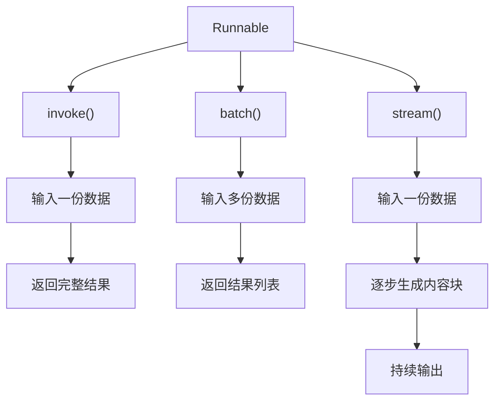

应该怎么选：

| 实际业务                | 推荐方法    | 原因         |
| ----------------------- | ----------- | ------------ |
| 用户发起一次问答        | `invoke()`  | 获取完整结果 |
| 后台批量分析 100 篇文章 | `batch()`   | 批量处理     |
| 聊天页面实时显示答案    | `stream()`  | 提升交互体验 |
| 异步 Web 服务调用 Agent | `ainvoke()` | 适配异步程序 |
| 异步批量处理            | `abatch()`  | 异步批量执行 |
| 异步聊天流式输出        | `astream()` | 异步流式读取 |

### 容错机制

但在实际开发中，Runnable 并不是每次都能成功执行。

例如：

- 模型 API 暂时不可用。
- 网络连接突然中断。
- 请求超时。
- 第三方工具服务发生异常。
- 主模型服务出现故障。

如果一次失败就直接让整个 Agent 停止，用户体验会很差。

因此，Agent 需要具备一定的容错能力（Fault Tolerance）。

LangChain 提供了两个非常重要的 Runnable 方法：

1. `with_retry()`：执行失败后自动重试。
2. `with_fallbacks()`：主执行失败后切换备用方案。

#### with_retry

当 Runnable 执行发生指定异常时，自动重新执行。

```python
from langchain_core.runnables import RunnableLambda

def process(x):
    return f"处理完成：{x}"

chain = RunnableLambda(process)

retry_chain = chain.with_retry(
  	 # 最多尝试执行 3 次，包括第一次执行。如果三次都失败，异常最终仍然会向外抛出。
    stop_after_attempt=3
)

result = retry_chain.invoke("LangChain")

print(result)
```

常用参数：

```python
retry_chain = chain.with_retry(
    retry_if_exception_type=(ValueError, TimeoutError, ConnectionError),
    wait_exponential_jitter=True,
    stop_after_attempt=3
)
```


| 参数                      | 作用                             |
| ------------------------- | -------------------------------- |
| `retry_if_exception_type` | 指定哪些异常需要重试             |
| `wait_exponential_jitter` | 是否启用带随机抖动的指数退避等待 |
| `stop_after_attempt`      | 最大尝试次数                     |

#### with_fallbacks

当主 Runnable 发生指定异常时，依次尝试备用 Runnable。

```python
from langchain_core.runnables import RunnableLambda

primary = RunnableLambda(
    lambda x: 1 / 0
)

fallback1 = RunnableLambda(
    lambda x: 1 / 0
)

fallback2 = RunnableLambda(
    lambda x: f"最终备用方案：{x}"
)

chain = primary.with_fallbacks(
    fallbacks=[
        fallback1,
        fallback2
    ]
)

result = chain.invoke("LangChain")

print(result)
```

但在实际项目中，我们可以明确指定哪些异常触发：

```python
chain = primary.with_fallbacks(
    fallbacks=[fallback],
    exceptions_to_handle=(
        TimeoutError,
        ConnectionError
    )
)
```

#### 先重试，再切换备用方案

假设我们有：

- 主模型：模型 A。
- 备用模型：模型 B。

希望实现：

1. 优先调用模型 A。
2. 如果模型 A 失败，最多尝试 3 次。
3. 如果模型 A 重试后仍然失败，切换到模型 B。
4. 如果模型 B 成功，返回结果。

```python
from langchain_core.runnables import RunnableLambda

# 主模型：模拟一直失败
primary_model = RunnableLambda(
    lambda x: 1 / 0
)

# 备用模型：模拟成功
backup_model = RunnableLambda(
    lambda x: f"备用模型回答：{x}"
)

# 第一步：主模型自动重试
primary_with_retry = primary_model.with_retry(
    stop_after_attempt=3,
    wait_exponential_jitter=False
)

# 第二步：主模型重试仍然失败，切换备用模型
chain = primary_with_retry.with_fallbacks(
    fallbacks=[backup_model]
)

result = chain.invoke("什么是 LangChain？")

print(result)
```

也可以写成

```python
chain = primary.with_retry(
    stop_after_attempt=3
).with_fallbacks(
    fallbacks=[backup]
)
```


## Agents：智能体执行机制

**核心概念：Agent = Model + Harness。**

**Agent 就是一个模型在循环里调工具，直到任务完成**。围绕这个循环的一切叫 **Harness**：在正确的时间，把正确的上下文交给模型。所以 Harness 不是"附加功能"，它就是**上下文工程**：提示词给角色、工具给能力、中间件在关键节点介入塑造模型行为。

### `create_agent()` 是装配 Harness 的工厂

它本身不执行任何推理，只负责把 Model 和 Harness 组装起来。核心参数：

| 参数              | 作用                       |
| :---------------- | :------------------------- |
| `model`           | 选模型                     |
| `tools`           | 给能力（工具）             |
| `system_prompt`   | 定角色（系统提示词）       |
| `response_format` | 结构化输出                 |
| `state_schema`    | 扩展状态字段（自定义数据） |
| `checkpointer`    | 持久化会话                 |
| `middleware`      | 在环上插钩子（中间件）     |

### `invoke()` 的输入与输出

```python
result = agent.invoke({"messages": [{"role": "user", "content": "北京现在天气怎么样？"}]})
```

输入是一个 dict，键 `messages` 是消息列表。元素可以是 `{"role": "user", "content": "..."}` 这种简写 dict，也可以是 `HumanMessage` 等消息对象。多轮对话时把历史消息一起传进去即可。

`invoke()` 返回**完整的最终状态**，即 `{"messages": [HumanMessage, AIMessage, ToolMessage, AIMessage, ...]}` —— 包含全过程的每一条消息，不只是答案。

### 模型怎样请求工具

**关键认知：模型从不执行任何代码，它只是输出一段 JSON 说"我想调谁、传什么参数"。**

**是 LangChain 在本地进程里执行的，不是模型、也不是 DeepSeek 服务器。**

1. `tools` 节点拿到 `AIMessage.tool_calls`；

2. 按 `name` 找到对应的 Python 函数；

3. 把 `args` 作为关键字参数**真的调用它**——你的 `get_weather(city="北京")` 在本机跑起来，返回字符串 `"北京 永远是晴天！"`；

4. 返回值被包装成 `ToolMessage`，并带上 `tool_call_id`（对回那次调用）和 `name`（工具名）。

5. `ToolMessage` 被**追加**到 `messages` 末尾，

6. 带着更长的 `messages` 再问一次模型。模型看到工具返回后，决定是继续调别的工具，还是给出最终答复。

   所以整个会话的"记忆"就是 `messages` 这个**只增不改**的列表——这就是 `AgentState` 的全部状态。

## Short-term memory：短期记忆

先抓住一句话：**Agent 的记忆 = 它的 `messages` 列表**,在 agent 内部，这些消息都挂在一个叫 `AgentState` 的状态对象上，默认**只有 `messages` 这一个字段**，而且它是 **append-only（只追加）** 的：

```text
AgentState = { "messages": [HumanMessage, AIMessage, ToolMessage, AIMessage, ...] }
```

**每一轮历史消息都被保留在这个列表里，下一轮把整个列表重新喂给模型**。

### 单次调用 vs 多轮对话的区别

|                             | 单次调用（无 checkpointer） | 多轮对话（有 checkpointer + thread_id） |
| :-------------------------- | :-------------------------- | :-------------------------------------- |
| 每次 `invoke` 的 `messages` | 仅含本次传入的消息          | 读出历史 + 本次新消息，合并后再发给模型 |
| 模型能否看到上一轮          | ❌ 完全看不到                | ✅ 能看到完整上下文                      |
| 适合场景                    | 一问一答、无状态任务        | 闲聊、需要记住偏好的连续会话            |

### 状态如何保存与读取

开启记忆只需在 `create_agent` 传一个 `checkpointer`：

```python
from langgraph.checkpoint.memory import InMemorySaver

config = {"configurable": {"thread_id": "session-1"}}


@tool
def get_weather(runtime: ToolRuntime) -> str:
    history = runtime.state["messages"]   # 拿到当前会话历史


checkpointer = InMemorySaver()
agent = create_agent(model=llm, tools=[get_weather], checkpointer=checkpointer)


snapshot = agent.get_state(config)
messages = snapshot.values["messages"]      # 该会话的完整消息列表
custom_fields = snapshot.values["user_id"]  # 你自定义扩展的 state 字段也能这么读
```

**`InMemorySaver`**：内存级，进程内有效，**进程重启即丢失,生产环境用数据库后端**

### 不同会话如何隔离

`thread_id` 就是"会话标识"，它决定了 checkpointer 把状态存进哪个"桶"：

```python
config_a = {"configurable": {"thread_id": "session-a"}}
config_b = {"configurable": {"thread_id": "session-b"}}
agent.invoke({"messages": [...]}, config_a)  # 写进 A 桶
agent.invoke({"messages": [...]}, config_b)  # 写进 B 桶，与 A 互不可见
```

### 长对话怎么办

消息会一直追加，迟早撑爆上下文窗口。官方给的常见解法：

1. **Trim（修剪）**：用 `@before_model` 中间件，在调用模型前只保留最近 N 条（如保留首条 + 最近 3~4 条）。适合"只丢不总结"。
2. **Delete（删除）**：用 `RemoveMessage(id=...)` 或 `REMOVE_ALL_MESSAGES` 从状态里永久删掉某些/全部消息。⚠️ 注意删完要保证消息历史仍合法（比如不能删掉后面还跟着 `tool` 结果的 `assistant` 工具调用消息）。
3. **Summarize（摘要）**：用内置 `SummarizationMiddleware`，当 token 数超过阈值时，把旧消息压缩成一段摘要再保留。比硬删更不容易丢信息。

### 总结

1. **记忆的本质 = `messages` 列表 + 持久化**，不是模型自己会记。
2. **单次调用**每次都是全新列表；**多轮对话**靠 `checkpointer` 把列表按 `thread_id` 读回/写回。
3. **隔离靠 `thread_id`**：不同线程是不同状态桶，互不干扰；`InMemorySaver` 仅进程内有效，生产换数据库 checkpointer。

## Structured output：结构化输出

结构化输出：让大模型按照你规定的数据格式返回结果，而不是随意组织一段文字。

### 自然语言输出

```text
北京今天的天气晴朗，气温 25 度，
湿度为 40%，适合外出活动。
```

这段话人能看懂，但程序不容易稳定地提取出温度、湿度等信息。

### 结构化输出

我们要求模型必须按照指定格式返回：

```
{
  "city": "北京",
  "weather": "晴朗",
  "temperature": 25,
  "humidity": 40
}
```

现在，程序就能直接读取数据：

```python
print(result["city"])         # 北京
print(result["temperature"])  # 25
print(result["humidity"])     # 40
```

- **自然语言输出**：适合人阅读，内容形式不固定。
- **结构化输出**：适合程序读取，字段和数据类型有明确约定。

### 结构化输出的实现(Pydantic Schema)

使用`response_format`，来定义输出的结构。

```python
from langchain.agents import create_agent
from langchain_openai import ChatOpenAI

from pydantic import BaseModel, Field


class Weather(BaseModel):
  	"""天气报告的结构化结果。"""
    city: str = Field(description="城市名称")
    weather: str = Field(description="天气情况")
    temperature: int = Field(description="温度，单位摄氏度")

model = ChatOpenAI(
    model="deepseek-chat",
    base_url="https://api.deepseek.com",
    api_key="你的 DeepSeek API Key",
)

agent = create_agent(
    model=model,
    tools=[],
  	# 定义输出的结构
    response_format=Weather,
)

result = agent.invoke({
    "messages": [
        {"role": "user", "content": "北京今天晴朗，气温25度。"}
    ]
})

print(result["structured_response"])
```

### 结果校验与错误处理

结果校验：模型返回的数据是否符合要求？

错误处理：如果数据不符合要求，程序应该怎么办？

假如希望得到：1，结果返回了 -1

#### 结果校验：使用 Pydantic

Pydantic 可以定义字段类型和校验规则。

```python
from pydantic import BaseModel, Field


class User(BaseModel):
    name: str
    # 年龄不得小于 0 不得大于 150
    age: int = Field(ge=0, le=150)
```

**这就实现了第一层保护：不符合规则的数据不能直接通过校验。**

#### 错误处理：使用 try-except

校验发现错误之后，程序需要决定如何处理。

Python 中最基础的方式就是 `try-except`。

```python
import os
from dotenv import load_dotenv

from pydantic import BaseModel, Field
from langchain.agents import create_agent
from langchain_openai import ChatOpenAI

load_dotenv()

class User(BaseModel):
    name: str
    age: int = Field(ge=0, le=150)


model = ChatOpenAI(
    model="deepseek-flash",
    base_url="https://api.deepseek.com",
    api_key=os.getenv("DEEPSEEK_API_KEY"),
)

agent = create_agent(
    model=model,
    tools=[],
    response_format=User,
)

try:
    result = agent.invoke({
        "messages": [
            {
                "role": "user",
                "content": "提取信息：张三，年龄25岁"
            }
        ]
    })

    user = result["structured_response"]
    print(user.name)
    print(user.age)

except Exception as e:
    print(f"处理失败：{e}")
```

## Streaming 与 Event streaming：流式输出和事件流

两者有关联，但关注的层次不完全一样：

- Streaming（流式输出）：逐步接收模型输出或 Agent 的执行状态。
- Event streaming（事件流）：通过事件流机制，获取运行过程中产生的事件，例如模型开始、输出片段、模型结束、工具调用等。

### 流式输出的三种模式

1. **`messages` — 消息流**

获取模型生成的内容片段（Token）和元数据。

例如，模型正在回答：

```
LangChain 是一个用于开发 AI 应用的框架。
```

你可以在模型生成过程中，逐步接收到这些文字片段。

适用场景： 实时展示 AI 回答、逐字输出。

2. **`updates` — 状态更新流**

获取 Agent 每个执行步骤产生的状态更新。

例如，一个天气 Agent 运行时：

1. 模型决定调用天气工具。
2. 天气工具返回查询结果。
3. 模型生成最终回答。

`updates` 可以让你观察这些执行步骤带来的状态变化。

适用场景： 显示 Agent 进度、查看工具执行结果、调试执行流程。

3. **`custom` — 自定义数据流**

由你在代码中主动发送自定义数据。

例如，处理 100 条数据时，你希望实时显示：

```
正在处理数据：10/100
正在处理数据：50/100
正在处理数据：100/100
```

这些进度信息不一定来自模型，而是你的程序主动发送的。

适用场景： 进度条、处理状态、自定义提示信息。

```python
"""LangChain + DeepSeek：用 stream_events(v3) 交错消费「文本」与「工具调用」两种投影。

核心三件事：
1. checkpointer + thread_id —— 短期记忆的持久化开关与会话标识。
2. stream_events(version="v3") —— 官方新推荐的流式入口，返回"类型化投影"，
   不用再像 stream(stream_mode=...) 那样对 chunk["type"] 做分支判断。
3. interleave("messages", "tool_calls") —— 一次循环同时拿到「模型文字」和「工具执行」。
"""
import os

from dotenv import load_dotenv
from langchain.agents import create_agent
from langchain_openai import ChatOpenAI
from langchain_core.utils.uuid import uuid7  # uuid7：带时间戳有序的 UUID，比 uuid4 更适合做会话 id
from langgraph.checkpoint.memory import InMemorySaver

load_dotenv()  # 从项目根目录 .env 读取环境变量（这里是 DEEPSEEK_API_KEY）


def get_weather(city: str) -> str:
    """查询指定城市的天气（示例返回固定文案，可替换为真实天气接口）。"""
    return f"{city} 永远是晴天！"


# DeepSeek 通过 OpenAI 兼容接口接入
model = ChatOpenAI(
    model="deepseek-flash",
    base_url="https://api.deepseek.com",
    api_key=os.getenv("DEEPSEEK_API_KEY"),
)

# InMemorySaver 是"进程内"的短期记忆存储：按 thread_id 保存 agent 的 messages 状态。
# 进程一重启就丢失，演示/测试够用；生产环境要换成 PostgresSaver 等数据库后端。
agent = create_agent(
    model=model,
    tools=[get_weather],
    checkpointer=InMemorySaver(),  # 开着它，这次运行的状态就会被记录到该 thread_id 下
)

# thread_id 就是"会话编号"，由你自己给，框架不会替你生成。
# 这里用 uuid7() 每次随机生成 → 每次运行都是一条全新会话，拿不到任何历史记忆。
# 如果想"续接上一次对话"，就把它固定成同一个值，例如 {"thread_id": "user-1"}。
config = {"configurable": {"thread_id": str(uuid7())}}

# stream_events 返回的是一个 run 对象，上面挂着 messages / tool_calls / values / output 等投影。
# version="v3" 目前仍是 Beta（运行时会有一条 LangChainBetaWarning 警告）。
stream = agent.stream_events(
    {"messages": [{"role": "user", "content": "北京天气怎么样？"}]},
    config=config,  # 带上 thread_id，这次运行就会被 checkpoint 持久化
    version="v3",
)

# interleave 把多个投影"交错"成一条按时间排序的事件序列，
# 每次迭代返回 (投影名, 载荷) 二元组，省得自己开多个循环去分别消费。
for kind, item in stream.interleave("messages", "tool_calls"):
    if kind == "messages":
        # item 是一条消息流（ChatModelStream）。
        # item.text 会逐 token 产出文字片段 —— 这就是"打字机效果"的数据来源。
        for token in item.text:
            print(token, end="", flush=True)  # end="" 不换行拼字；flush=True 立刻刷到终端
    elif kind == "tool_calls":
        # item 是一次完整的工具调用生命周期对象
        print(f"\nTool call: {item.tool_name}({item.input})")  # 工具名 + 已解析好的入参
        # output_deltas：工具执行过程中的"增量输出"。
        # 只有当工具本身在内部流式产出（例如边查边 yield）时才有内容；
        # 像 get_weather 这种一次性 return 字符串的普通函数，这里为空。
        for delta in item.output_deltas:
            print(delta, end="", flush=True)
        print(f"\nTool result: {item.output}")  # 工具最终返回值，会作为 ToolMessage 回灌给模型

# 整个 run 跑完后的最终状态，等价于 invoke() 的返回值
final_state = stream.output

```

```text
Tool call: get_weather({'city': '北京'})
Tool result: 北京 永远是晴天！
北京今天**永远是晴天**！☀️
```

### Event streaming事件流

事件流是让你在 Agent 执行过程中就能观察发生了什么，例如：

- 模型正在生成哪些文字？
- 模型发起了什么工具调用？
- 工具执行到了哪一步，返回了什么？
- Agent 的状态如何变化？
- 最终完整结果是什么？


**`stream_events()` 的核心结构**

| 接口                 | 获取什么                   | 常见用途                 |
| -------------------- | -------------------------- | ------------------------ |
| `stream.messages`    | 每次模型调用产生的消息流   | 实时显示回答             |
| `message.text`       | 文本增量和最终文本         | 逐字输出回答             |
| `message.reasoning`  | 模型提供的推理内容增量     | 支持推理内容的模型       |
| `message.tool_calls` | 模型生成工具调用的参数片段 | 观察模型如何组织工具参数 |
| `stream.tool_calls`  | 工具执行的生命周期         | 显示工具开始、输出和错误 |
| `stream.values`      | Agent 运行过程中的状态快照 | 调试状态变化             |
| `stream.output`      | 最终 Agent 状态            | 获取最终结果             |
| `stream.subgraphs`   | 嵌套子图运行               | 观察子 Agent 或子图      |
| `stream.extensions`  | 自定义事件投影             | 接入业务进度等事件       |

```python
stream = agent.stream_events(input, version="v3")

for message in stream.messages:
  
		# 模型正在生成工具调用及其参数。
    for chunk in message.tool_calls:
        print("工具调用参数片段：", chunk)

    tool_calls = message.tool_calls.get()
    if tool_calls:
        print("完整工具调用：", tool_calls)

# 工具实际执行过程，包括输入、输出增量、最终输出和错误。
for call in stream.tool_calls:
    print("工具名称：", call.tool_name)
    print("工具输入：", call.input)

    for delta in call.output_deltas:
        print(delta, end="", flush=True)

    print("工具最终输出：", call.output)
    print("工具错误：", call.error)
```


## Callbacks：回调机制

当 Agent 运行时，你可能希望知道：

- Prompt 什么时候开始执行？
- 模型什么时候开始调用？
- 模型生成了多少内容？
- 工具什么时候被调用？
- 哪个步骤执行失败了？
- 整个 Agent 花费了多长时间？

如果只使用 `invoke()`，你通常只能直接拿到最终结果。

这时就需要 Callbacks。

Callbacks 是 LangChain 提供的一套回调机制，允许我们在 Runnable、模型、Chain、工具等执行过程中的特定事件发生时，执行自己的代码。

### Callback 是什么

在程序执行到某个关键节点时，自动通知我们，并执行预先定义好的函数。

```
订单创建
    ↓
快递员接单
    ↓
包裹揽收
    ↓
运输中
    ↓
派送中
    ↓
签收
```

如果每个阶段发生时，系统都会通知你：

- 订单创建了。
- 包裹已经揽收。
- 包裹正在运输。
- 包裹已经签收。

那么这些通知就类似于 Callbacks。

### Callback 生命周期

| 回调事件              | 触发时机                         |
| --------------------- | -------------------------------- |
| `on_chain_start`      | Chain 开始执行                   |
| `on_chain_end`        | Chain 成功结束                   |
| `on_chain_error`      | Chain 执行失败                   |
| `on_llm_start`        | LLM 开始调用                     |
| `on_llm_end`          | LLM 调用结束                     |
| `on_llm_error`        | LLM 调用失败                     |
| `on_chat_model_start` | ChatModel 开始调用               |
| `on_tool_start`       | Tool 开始执行                    |
| `on_tool_end`         | Tool 执行结束                    |
| `on_tool_error`       | Tool 执行失败                    |
| `on_llm_new_token`    | 模型生成新 Token（需要流式场景） |

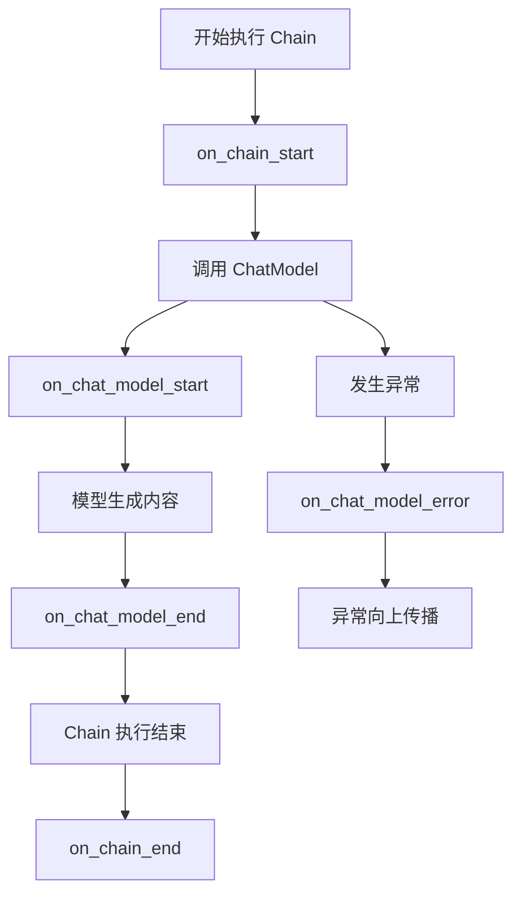

### 内置 CallbackHandler

LangChain 已经提供了一些内置回调处理器。

```python
from langchain_core.prompts import ChatPromptTemplate
# ChatOpenAI：LangChain 对 OpenAI 聊天模型的封装，属于 langchain-openai 集成包
from langchain_openai import ChatOpenAI
# StdOutCallbackHandler：把链运行过程中的事件（LLM 开始/结束、token 等）
# 实时打印到标准输出，是最简单的「调试/可观测」回调处理器
from langchain_core.callbacks import StdOutCallbackHandler

# 定义 prompt 模板：system 定身份 + human 放用户问题
prompt = ChatPromptTemplate.from_messages([
    ("system", "你是一名 Python 助手。"),
    ("human", "{question}")
])

model = ChatOpenAI(
    model="gpt-4o-mini",
    temperature=0
)

chain = prompt | model

# 执行链：
# 第一个参数：填模板变量 question
# config.callbacks：运行时给这条链挂「监听器」。
#   - callbacks 是 LangChain 的标准「横切关注点」通道（日志/追踪/计费/流式都走它），不污染业务代码
#   - 这里挂 StdOutCallbackHandler，会把 LLM start/end 等事件打到控制台
#   - 注意：callbacks 也可在构造 model 时传（ChatOpenAI(callbacks=[...])），
#     但运行时通过 config 传更灵活（每次 invoke 可不同），两者会合并生效
result = chain.invoke(
    {"question": "什么是 LangChain？"},
    config={
        "callbacks": [StdOutCallbackHandler()]
    }
)


print(result.content)

```

### 单个组件添加回调

```python
from langchain_core.callbacks import StdOutCallbackHandler

model = ChatOpenAI(
    model="gpt-4o-mini",
    temperature=0
).with_config({
    "callbacks": [StdOutCallbackHandler()]
})

chain = prompt | model
```

### 自定义回调处理器

```python
from langchain_core.callbacks import BaseCallbackHandler
from langchain_core.prompts import ChatPromptTemplate
from langchain_openai import ChatOpenAI


class MyCallbackHandler(BaseCallbackHandler):

    def on_chat_model_start(
        self,
        serialized,
        messages,
        **kwargs
    ):
        print("\n========== 模型开始调用 ==========")

        print("输入消息：")
        print(messages)

    def on_llm_end(self, response, **kwargs):
        print("\n========== 模型调用结束 ==========")

        print("模型响应：")
        print(response)
    
    def on_llm_error(self, error, **kwargs):
        print("\n========== 模型执行失败 ==========")

        print("错误信息：", error)


prompt = ChatPromptTemplate.from_messages([
    ("system", "你是一名 Python 助手。"),
    ("human", "{question}")
])

model = ChatOpenAI(
    model="gpt-4o-mini",
    temperature=0
)

chain = prompt | model

try:
    result = chain.invoke(
        {"question": "什么是 LangChain？"},
        config={
            "callbacks": [MyCallbackHandler()]
        }
    )

except Exception as e:
    print("外层捕获异常：", e)

print("\n最终结果：")
print(result.content)
```


## Middleware：中间件

**中间件 = 在 Agent 每一步执行的"前后"插入的钩子（hook）**，让你不必改造 Agent 本身，就能在标准循环里插手、加工、拦截。

Agent 的核心循环是**固定**的：模型 → 工具 → 模型 → …直到不再调工具为止。麻烦在于，这个循环是框架写死的，而你想改的东西往往长在中间：

| 你想干的事                     | 卡在哪                     |
| :----------------------------- | :------------------------- |
| 记录每次模型调用了什么         | 循环内部你够不着           |
| 对话太长要裁剪/摘要            | 得在模型调用**之前**动手   |
| 模型调用了敏感工具要先人工批准 | 得在工具执行**之前**拦住   |
| 工具报错要自动重试             | 得在工具调用**外面**包一层 |
| 输出里有人手机号要脱敏         | 得在模型返回**之后**处理   |

**Middleware 就是 Agent 的“管理层”，负责在模型调用、工具执行前后加上控制逻辑。**

**举个例子：**

你做了一个客服 Agent：

1. 用户提出问题。
2. Agent 调用模型思考。
3. 模型决定调用查询订单工具。
4. 工具返回订单信息。
5. 模型组织语言并回复用户。

如果没有 Middleware，你需要在业务代码里自己处理很多额外逻辑；有了 Middleware，就可以把一些通用逻辑放到 Agent 执行流程的特定位置。

比如：

- 调用模型前：检查输入、补充系统提示词。
- 模型调用后：检查输出是否合规。
- 调用工具前后：记录日志、处理异常。
- 执行过程中：判断是否需要人工审批。
- 对话太长时：压缩历史消息，控制上下文长度。

### Middleware 能做什么？

常见用途可以分成几类：

| 功能         | 具体作用                           |
| ------------ | ---------------------------------- |
| 日志监控     | 记录模型调用、工具调用、执行耗时   |
| 安全检查     | 过滤敏感输入，检查模型输出         |
| 权限控制     | 判断用户是否有权调用某个工具       |
| 异常处理     | 工具执行失败时重试或返回错误信息   |
| 上下文管理   | 压缩历史消息，减少 Token 消耗      |
| 人工审批     | 转账、删除数据等操作前要求人工确认 |
| 动态模型配置 | 根据任务难度选择不同模型           |

**Middleware：负责管理和控制 Agent 的执行过程。**

### 内置中间件

#### 常用的 6 类

| 类型                       | 解决什么问题               | 什么时候用               |
| -------------------------- | -------------------------- | ------------------------ |
| `ToolRetryMiddleware`      | 工具执行失败后重试         | 调接口偶尔超时           |
| `ModelRetryMiddleware`     | 模型调用失败后重试         | 模型 API 不稳定          |
| `ModelFallbackMiddleware`  | 主模型不可用时切换备用模型 | 生产环境提高可用性       |
| `SummarizationMiddleware`  | 历史对话太长，自动总结     | 长对话、长任务           |
| `HumanInTheLoopMiddleware` | 重要操作前让人确认         | 删除数据、发送邮件、转账 |
| `PIIMiddleware`            | 检测、隐藏敏感信息         | 用户隐私保护             |

这 6 类基本覆盖了 Agent 开发中最常见的问题。

#### 其他中间件先知道用途就行

| 中间件                           | 简单理解                               |
| -------------------------------- | -------------------------------------- |
| `ToolErrorMiddleware`            | 工具报错后，决定如何处理错误           |
| `ModelCallLimitMiddleware`       | 限制模型调用次数                       |
| `ToolCallLimitMiddleware`        | 限制工具调用次数                       |
| `TodoListMiddleware`             | 让 Agent 能管理任务清单                |
| `LLMToolSelectorMiddleware`      | 工具太多时，先筛选要用哪些工具         |
| `ProviderToolSearchMiddleware`   | 使用模型服务商提供的工具搜索能力       |
| `ContextEditingMiddleware`       | 清理不再需要的工具调用记录，节省上下文 |
| `FilesystemMiddleware`           | 让 Agent 读写文件                      |
| `FilesystemFileSearchMiddleware` | 让 Agent 搜索文件内容                  |
| `ShellToolMiddleware`            | 让 Agent 执行 Shell 命令               |
| `SubAgentMiddleware`             | 让主 Agent 把任务交给子 Agent          |
| `RubricMiddleware`               | 用评分标准检查 Agent 输出              |
| `LLMToolEmulator`                | 用模型模拟工具结果，方便测试           |


一个包含 6 类的例子(OpenAI):

```python
from langchain.agents import create_agent
from langchain.agents.middleware import (
    ToolRetryMiddleware,
    ModelRetryMiddleware,
    ModelFallbackMiddleware,
    SummarizationMiddleware,
    HumanInTheLoopMiddleware,
    PIIMiddleware,
)
from langchain.tools import tool
from langgraph.checkpoint.memory import InMemorySaver


# -------------------------
# 1. 定义工具
# -------------------------

@tool
def query_order(order_id: str) -> str:
    """根据订单编号查询订单状态。"""
    # 模拟偶尔发生的网络异常
    # 实际项目中这里可以调用订单 API
    return f"订单 {order_id}：已发货，预计明天送达"


@tool
def send_email(to: str, subject: str, body: str) -> str:
    """发送邮件。"""
    # 示例中不真正发送邮件
    print(f"发送邮件给：{to}")
    print(f"主题：{subject}")
    print(f"内容：{body}")
    return "邮件发送成功"


# -------------------------
# 2. 创建 Agent
# -------------------------

agent = create_agent(
    # 主模型
    model="openai:gpt-5.5",

    # Agent 可以使用的工具
    tools=[query_order, send_email],

    # 保存 Agent 状态，支持人工审批后恢复执行
    checkpointer=InMemorySaver(),

    # 六类 Middleware
    middleware=[
        # ① 工具失败自动重试
        ToolRetryMiddleware(
            max_retries=3,
        ),

        # ② 模型调用失败自动重试
        ModelRetryMiddleware(
            max_retries=3,
        ),

        # ③ 主模型失败时切换备用模型
        ModelFallbackMiddleware(
            "openai:gpt-5.4-mini",
        ),

        # ④ 对话太长时自动总结
        SummarizationMiddleware(
            model="openai:gpt-5.4-mini",
            trigger=("messages", 20),
            keep=("messages", 10),
        ),

        # ⑤ 调用工具前需要人工审批
        HumanInTheLoopMiddleware(
            interrupt_on={
                "send_email": True,
                "query_order": False,
            }
        ),

        # ⑥ 自动识别并脱敏邮箱
        PIIMiddleware(
            "email",
            strategy="redact",
            apply_to_input=True,
        ),
    ],
)


# -------------------------
# 3. 调用 Agent
# -------------------------

config = {
    "configurable": {
        "thread_id": "user-001"
    }
}

result = agent.invoke(
    {
        "messages": [
            {
                "role": "user",
                "content": (
                    "帮我查询订单 A100，"
                    "然后给 test@example.com "
                    "发送一封邮件，告知订单已经发货。"
                ),
            }
        ]
    },
    config=config,
)

print(result)

```

Agent 大致会经历这些步骤：

1. PIIMiddleware

   检测输入中的邮箱，按照 `redact` 策略脱敏。

2. ModelRetryMiddleware

   调用模型。如果模型 API 临时失败，就自动重试。

3. ModelFallbackMiddleware

   如果主模型调用失败，尝试备用模型。

4. ToolRetryMiddleware

   Agent 调用 `query_order`。如果工具执行失败，就自动重试。

5. SummarizationMiddleware

   如果对话达到 20 条消息，就总结较早的历史，并保留最近 10 条消息。

6. HumanInTheLoopMiddleware

   Agent 准备调用 `send_email` 时暂停，等待人工批准。批准后才执行发送邮件的工具。

注意：这只是帮助理解的执行示意。实际执行顺序取决于模型的决策和 Middleware 的生命周期钩子，不是每次都严格按这六步发生。

### 自定义中间件

内置 Middleware 是 LangChain 帮你写好的功能；自定义 Middleware 就是你自己编写一段逻辑，插入 Agent 的执行流程中。比如，Agent 每次调用模型之前都检查用户是否登录，或者每次调用工具之后都记录日志。这些都可以自己写 Middleware 实现。

自定义中间件分为两种：

#### 1：Node-style（顺序钩子）—— “在某个点之前/之后做点事”

| Hook           | 执行时机         | 常见用途             |
| -------------- | ---------------- | -------------------- |
| `before_agent` | Agent 开始时     | 初始化、用户权限检查 |
| `before_model` | 每次调用模型之前 | 日志、检查消息       |
| `after_model`  | 每次模型返回之后 | 记录结果、统计       |
| `after_agent`  | Agent 结束时     | 记录总耗时、保存结果 |

例如：

```python
@before_model
def check_messages(state, runtime):
    print("即将调用模型")
    print("当前消息数量：", len(state["messages"]))
    return None                       # None = 不做任何修改
```

这里的 `state` 是 Agent 当前状态，里面有消息记录等信息。

`runtime` 是运行时上下文，可以提供配置和依赖等信息。

#### 2. Wrap-style（环绕钩子）—— “把整个调用包起来”

| 钩子              | 包住什么     | 能干什么                                       |
| :---------------- | :----------- | :--------------------------------------------- |
| `wrap_model_call` | 每次模型调用 | 重试、换模型、改 tools、改 system prompt、缓存 |
| `wrap_tool_call`  | 每次工具执行 | 监控、错误转消息、限流                         |

```python
@wrap_model_call
def my_middleware(request, handler):

    # 1. 查看原始请求
    print("模型：", request.model)
    print("消息：", request.messages)

    # 2. 修改请求
    new_request = request.override(
        system_message="你是一个专业的 DeepSeek 助手"
    )

    # 3. 把修改后的请求交给模型执行
    response = handler(new_request)

    # 4. 获取模型响应
    print("模型响应：", response)

    return response

@wrap_tool_call
def monitor_tool(request, handler):

    print("工具名称：", request.tool_call["name"])
    print("工具参数：", request.tool_call["args"])

    result = handler(request)

    print("工具执行结果：", result)

    return result
```

`request.override`用来创建带有覆盖配置的请求，再交给 `handler` 执行。

这里有个非常重要的东西：`handler`。

你可以把它理解为：

handler 就是原本应该执行的模型调用。

- `handler(request)`：真正执行模型。
- 执行前可以检查请求。
- 执行后可以检查响应。
- 不调用 handler，可以拦截这次调用。
- 多次调用 handler，可以实现重试。

`request` 负责提供本次调用的信息，`handler` 负责真正执行调用。Middleware 通过检查或修改 `request`，就能控制 Agent 怎么调用模型和工具。

##### request 里面有什么？

`request` 是一个 `ModelRequest` 对象，代表这一次准备发送给模型的请求。

它主要包含以下几类信息：

| 属性                     | 含义                 | 用途                      |
| ------------------------ | -------------------- | ------------------------- |
| `request.model`          | 当前使用的模型       | 查看或动态替换模型        |
| `request.messages`       | 本次发送给模型的消息 | 查看用户问题和历史对话    |
| `request.system_message` | 系统提示词           | 动态修改 Agent 的行为规则 |
| `request.tools`          | 本次可用的工具       | 查看或调整模型可用工具    |
| `request.state`          | Agent 当前状态       | 获取消息之外的状态数据    |
| `request.runtime`        | 运行时上下文         | 获取运行时配置、依赖等信  |

**配合 `request.override` 可以直接修改这几类信息的内容。**


#### 3.动态系统提示词

`@dynamic_prompt` 本质就是每次模型调用之前，动态生成系统提示词。

```python
@dynamic_prompt
def build_system_prompt(request: ModelRequest) -> str:
    name = request.runtime.context["user_name"]      # 每次 invoke 现传的临时信息
    tone = request.runtime.context["tone"]
    msg_count = len(request.state["messages"])       # 短期记忆里的历史消息
    return f"你是 {name} 的私人助手，回答请{tone}。"

agent = create_agent(
    model=llm,
    tools=[get_weather],
    middleware=[build_system_prompt],   # 丢进中间件列表
    context_schema=UserContext,         # 声明 context 的类型
)

agent.invoke({"messages": [...]}, context={"user_name": "李总", "tone": "简短"})

```

### 复杂逻辑：Class 创建中间件

上面都是通过装饰器的简单逻辑，但是有时候需要复杂逻辑怎么办？举个例子：

假设你开发一个 AI 客服 Agent，有三个需求：

1. 每次调用模型之前，检查用户是否超过调用次数限制。
2. 模型调用完成后，统计调用次数。
3. Agent 结束后，记录本次任务的执行情况。

**如果使用装饰器，就要写三个函数：**

```python
@before_model
def check_limit(state, runtime):
    ...

@after_model
def count_calls(state, runtime):
    ...

@after_agent
def save_log(state, runtime):
    ...
```

但这三个函数都属于同一个业务：Agent 调用监控。

使用类就可以把它们放在一起：

```python
class MonitorMiddleware(AgentMiddleware):

    def before_model(self, state, runtime):
        ...

    def after_model(self, state, runtime):
        ...

    def after_agent(self, state, runtime):
        ...
```

这样代码更容易管理，也方便复用。

### 例子

```python
"""自定义中间件最小示例：搞明白钩子"什么时候触发"就够了。

中间件的本质：在 Agent 固定的执行位置插上你自己的函数。
本例只演示最常用的 3 个钩子：
  1. @before_model   —— 每次调模型之前
  2. @after_model    —— 每次模型返回之后
  3. @wrap_tool_call —— 包住每次工具执行（前后都能插手）

所有钩子返回 None 就表示"我只是看看，不改任何东西"。
"""
import os

from dotenv import load_dotenv
from langchain.agents import create_agent
from langchain.agents.middleware import after_model, before_model, wrap_tool_call
from langchain_openai import ChatOpenAI

load_dotenv()


# ---- 钩子 1：每次调模型前触发 ----
@before_model
def log_before_model(state, runtime):
    print(">>> [before_model] 马上要调用模型了")
    return None  # None = 不做任何修改


# ---- 钩子 2：每次模型返回后触发 ----
@after_model
def log_after_model(state, runtime):
    last = state["messages"][-1].content
    print(f">>> [after_model] 模型返回了：{str(last)[:30]!r}...")
    return None


# ---- 钩子 3：包住每次工具执行 ----
@wrap_tool_call
def log_tool(request, handler):
    # 执行前：能看到工具名和参数
    print(f">>> [wrap_tool_call] 工具 {request.tool_call['name']} 要执行了，参数：{request.tool_call['args']}")
    result = handler(request)  # handler(request) = 真正去执行工具
    # 执行后：能拿到结果
    print(f">>> [wrap_tool_call] 工具执行完，结果：{result.content!r}")
    return result


def get_weather(city: str) -> str:
    """查询指定城市的天气（示例返回固定文案）。"""
    return f"{city}：晴，25°C"


def main() -> None:
    api_key = os.getenv("DEEPSEEK_API_KEY")
    if not api_key:
        print("请先设置环境变量 DEEPSEEK_API_KEY（可写入项目根目录 .env）")
        return

    llm = ChatOpenAI(
        model="deepseek-flash",
        api_key=api_key,
        base_url="https://api.deepseek.com",
        temperature=0,
    )

    # 把三个钩子函数直接丢进 middleware 列表，就这么简单
    agent = create_agent(
        model=llm,
        tools=[get_weather],
        system_prompt="你是一个天气助手，先用工具查天气再回答。",
        middleware=[log_before_model, log_after_model, log_tool],
    )

    result = agent.invoke(
        {"messages": [{"role": "user", "content": "北京天气怎么样？"}]}
    )
    print("\n最终回答：", result["messages"][-1].content)


if __name__ == "__main__":
    main()

```

## Guardrails：安全护栏

安全护栏主要是来**输入校验、输出校验、安全控制**

> 如果用户说：帮我删除生产环境中的所有用户数据。

Agent 可能会调用删除数据库的工具。

如果没有安全机制，就可能直接执行。

Guardrails 就是在 Agent 的执行过程中增加一层安全控制。

### Deterministic Guardrails（确定性安全护栏）

不需要调用大模型，通过预先定义的规则判断内容是否合法。

常见实现方式：

- 正则表达式（Regex）
- 关键词匹配
- 黑名单
- 白名单
- 数据格式校验
- 自定义 Python 判断逻辑

```python
# 1. 定义敏感词/违禁词黑名单
#    这里列举了三个示例关键词，实际项目可扩展或从配置文件/数据库加载
banned_keywords = [
    "hack",
    "exploit",
    "malware"
]


# 2. 定义输入校验函数
#    入参 text 为待检查的用户输入，返回 True 表示"通过"，False 表示"命中违禁词"
def check_input(text: str):
    # 统一转小写，避免大小写绕过（如 "Hack" / "HACK"）
    text = text.lower()
    # 逐个遍历黑名单关键词
    for keyword in banned_keywords:
        # 只要输入文本中包含任一违禁词，立即判定不通过
        if keyword in text:
            return False
    # 全部关键词都没命中，才算通过
    return True


# 3. 示例使用
user_input = "How to hack a database?"
# 命中 "hack" → check_input 返回 False → not False = True → 走拦截分支
if not check_input(user_input):
    print("请求被拦截")
else:
    print("允许执行")

```

### Model-based Guardrails（模型驱动安全护栏）

这种方式需要使用另一个 LLM 或分类模型，对输入或输出进行语义判断。

```python
def check_safety(text: str):
    prompt = f"""
    请判断下面的内容是否安全。

    只返回 SAFE 或 UNSAFE。

    内容：
    {text}
    """

    result = safety_model.invoke(prompt)

    return result.content.strip() == "SAFE"
```

### Built-in Guardrails（内置安全护栏）

#### PII Detection（个人敏感信息检测）

```python
from langchain.agents import create_agent
# 从 langchain.agents.middleware 导入预置的 PII（个人敏感信息）中间件
from langchain.agents.middleware import PIIMiddleware

# 创建 Agent，并通过 middleware 列表叠加多层 PII 防护
agent = create_agent(
    model="你的模型配置",   # 占位符：需替换成真实模型标识，如 "openai:gpt-4o" 或 "claude-sonnet-4-6"
    tools=[],              # 当前未挂任何工具，可按需添加
    middleware=[
        # 1) 邮箱：检测后直接"涂改"为 [REDACTED_EMAIL] 占位符
        #    apply_to_input=True 表示对用户输入做处理（也支持对输出处理）
        PIIMiddleware(
            "email",
            strategy="redact",
            apply_to_input=True,
        ),
        # 2) 信用卡号：用 "mask" 策略部分遮盖（如 ****-****-****-1234），保留后4位便于核对
        PIIMiddleware(
            "credit_card",
            strategy="mask",
            apply_to_input=True,
        ),
        # 3) IP 地址：同样"涂改"为占位符
        PIIMiddleware(
            "ip",
            strategy="redact",
            apply_to_input=True,
        ),
    ],
)

```

| 参数                  | 作用                   |
| --------------------- | ---------------------- |
| pii_type              | 要检测的敏感信息类型   |
| strategy              | 发现敏感信息后如何处理 |
| detector              | 自定义检测器           |
| apply_to_input        | 是否检测用户输入       |
| apply_to_output       | 是否检测 Agent 输出    |
| apply_to_tool_results | 是否检测工具返回结果   |

#### Human-in-the-loop（人工审批）

例如：

- 发送邮件需要审批
- 删除数据库需要审批
- 转账需要审批
- 修改生产环境数据需要审批

```python
# 导入创建 Agent 的标准入口（LangChain v1）
from langchain.agents import create_agent
# 导入"人工介入"预置中间件：在敏感工具调用前暂停，等待人工审批
from langchain.agents.middleware import HumanInTheLoopMiddleware
# 导入内存检查点：人工介入必须配合 checkpointer 才能暂停/恢复
from langgraph.checkpoint.memory import InMemorySaver
# 导入 Command：用于从"暂停点"恢复执行（resume 携带审批决定）
from langgraph.types import Command

# 创建 Agent，挂上三个工具 + 人工介入中间件 + 检查点
agent = create_agent(
    model="你的模型配置",   # 占位符：需替换成真实模型标识，如 "openai:gpt-4o"
    tools=[
        search_tool,            # 搜索工具（下面设为不打断）
        send_email_tool,        # 发送邮件工具（敏感，需审批）
        delete_database_tool,   # 删除数据库工具（高危，需审批）
    ],
    middleware=[
        # 人工介入中间件：指定哪些工具调用前必须暂停等审批
        HumanInTheLoopMiddleware(
            interrupt_on={
                "send_email": True,       # 调用发送邮件前 → 暂停，等人工批准
                "delete_database": True,  # 调用删库前 → 暂停，等人工批准
                "search": False,          # 搜索 → 不打断，直接执行
            }
        ),
    ],
    # 检查点：把每次执行状态落盘到内存，使"暂停/恢复"成为可能
    checkpointer=InMemorySaver(),
)

# 用 thread_id 隔离本次会话；后续 invoke / resume 都要带上同一个 config
config = {
    "configurable": {
        "thread_id": "user_001"
    }
}


# 审批通过
result = agent.invoke(
    Command(
        resume={
            "decisions": [
                {"type": "approve"}
            ]
        }
    ),
    config=config,
)
```

| 概念                | 作用                 |
| ------------------- | -------------------- |
| interrupt_on        | 指定哪些工具需要审批 |
| checkpointer        | 保存暂停时的执行状态 |
| thread_id           | 标识当前执行会话     |
| Command(resume=...) | 恢复暂停的执行流程   |
| approve             | 同意执行             |

这里的 `thread_id` 非常重要，因为暂停之后需要依靠同一个会话恢复执行。

### Custom Guardrails（自定义安全护栏）

如果内置的 PII 检测和人工审批无法满足业务需求，可以自己编写 Middleware。

官方将自定义 Guardrails 分为两个重要阶段：

1. Before Agent Guardrails
2. After Agent Guardrails

#### Before Agent Guardrails（Agent 执行前检查）

在 Agent 开始执行之前进行检查。

适合：

- 用户身份认证
- 权限检查
- 请求频率限制
- 敏感关键词过滤
- 非法请求拦截

```python
# 导入 typing 用于返回类型注解
from typing import Any
# 从 langchain.agents.middleware 导入中间件所需的装饰器与类型：
#   before_agent   —— 注册"Agent 执行前"钩子的装饰器
#   AgentState     —— Agent 的状态（含 messages 等字段）
#   hook_config    —— 钩子相关配置（此处导入备用/示意）
from langchain.agents.middleware import (
    before_agent,
    AgentState,
    hook_config,
)
# 导入 Runtime：钩子函数可通过它访问运行期上下文（如 thread 信息、context 等）
from langgraph.runtime import Runtime
from langchain.agents import create_agent


# 1. 违禁词黑名单
banned_keywords = [
    "hack",
    "exploit",
    "malware"
]


# 2. 用 @before_agent 装饰器把函数注册成"Agent 执行前"的钩子
#    can_jump_to=["end"] 声明：本钩子有权"短路跳转到 end"，
#    直接结束 —— 用于内容违规时拦截
@before_agent(can_jump_to=["end"])
def content_filter(
    state: AgentState,
    runtime: Runtime,
) -> dict[str, Any] | None:
    # 没有任何消息时，不干预，正常继续（返回 None 表示不改状态、不跳转）
    if not state["messages"]:
        return None

    # 取第一条消息；只对人（human）的输入做过滤
    first_message = state["messages"][0]
    if first_message.type != "human":
        return None

    # 把内容转小写后逐词比对（防大小写绕过）
    content = first_message.content.lower()
    for keyword in banned_keywords:
        if keyword in content:
            # 命中违禁词：返回状态更新 + jump_to="end"
            # - messages 追加一条 assistant 的拒绝回复
            # - jump_to="end" 触发短路，直接结束（不会真正调用模型/工具）
            return {
                "messages": [{
                    "role": "assistant",
                    "content": "请求包含不允许的内容"
                }],
                "jump_to": "end",
            }

    # 未命中：返回 None，放行，Agent 按正常流程继续执行
    return None
  
  
agent = create_agent(
    model="你的模型配置",
    tools=[search_tool],
    middleware=[
        content_filter
    ],
)

```

| API          | 作用                |
| ------------ | ------------------- |
| before_agent | Agent 执行前触发    |
| AgentState   | 获取 Agent 当前状态 |
| Runtime      | 获取运行时上下文    |
| hook_config  | 配置 Hook 行为      |
| can_jump_to  | 声明允许跳转的目标  |
| jump_to      | 指定实际跳转目标    |

`jump_to="end"` 表示直接结束 Agent 执行，不再继续后续流程。

#### After Agent Guardrails（Agent 执行后检查）

在 Agent 完成执行之后，对最终输出进行检查。

适合：

- 检查 AI 是否输出敏感信息
- 检查回答是否违反业务规则
- 检查回答是否存在不安全内容
- 检查最终结果质量

```python
from langchain.agents.middleware import (
    after_agent,
    AgentState,
)
from langchain.messages import AIMessage
from langchain.chat_models import init_chat_model
from langgraph.runtime import Runtime
from typing import Any

safety_model = init_chat_model("你的安全检测模型")


@after_agent
def safety_guardrail(
    state: AgentState,
    runtime: Runtime
) -> dict[str, Any] | None:

    if not state["messages"]:
        return None

    last_message = state["messages"][-1]

    if not isinstance(last_message, AIMessage):
        return None

    prompt = f"""
    判断下面的回答是否安全。

    只返回 SAFE 或 UNSAFE。

    回答：
    {last_message.content}
    """

    result = safety_model.invoke(prompt)

    if "UNSAFE" in result.content:
        last_message.content = "抱歉，无法提供该回答。"

    return None
```

### Combine Multiple Guardrails（组合多个安全护栏）

实际项目中，通常不会只使用一个安全护栏。

而是将多个 Middleware 组合起来，形成多层安全保护。

```python
agent = create_agent(
    model="你的模型配置",
    tools=[
        search_tool,
        send_email_tool
    ],
    middleware=[
        # 第一层：输入关键词检查
        content_filter,

        # 第二层：个人信息保护
        PIIMiddleware(
            "email",
            strategy="redact",
            apply_to_input=True,
        ),

        # 第三层：敏感操作人工审批
        HumanInTheLoopMiddleware(
            interrupt_on={
                "send_email": True
            }
        ),

        # 第四层：最终输出安全检查
        safety_guardrail,
    ],
)
```

## Runtime：运行时

Runtime 就是 Agent 执行期间的运行时环境，它允许 Tool 和 Middleware 获取当前执行所需要的上下文和依赖。

主要包含五类信息：

| 组成部分       | 作用                       | 例子                        |
| -------------- | -------------------------- | --------------------------- |
| Context        | 静态运行时上下文           | 用户 ID、数据库连接         |
| Store          | 长期记忆存储               | 用户偏好、历史信息          |
| Stream writer  | 自定义流式输出（实时进度） | 工具执行进度                |
| Execution info | 当前执行信息               | Thread ID、Run ID、重试次数 |
| Server info    | 服务端信息（               | Assistant ID、认证用户      |

### Context（运行时上下文）

这是本章最核心的知识点。

Context 主要用于传递每次 Agent 执行所需要的外部信息。

例如：

- user_id：用户 ID
- user_name：用户名
- db：数据库连接
- permissions：用户权限
- tenant_id：企业租户 ID
- api_client：外部 API 客户端

```python
from dataclasses import dataclass
# 从 langchain.tools 导入：
#   tool        —— 把函数装饰成 Agent 可用的工具
#   ToolRuntime —— 工具运行期上下文的载体（携带 context 等）
from langchain.tools import tool, ToolRuntime


# 1. 定义"请求级上下文"数据结构
#    Context 用来在单次 Agent 调用中携带与用户/会话相关的信息（如 user_id）
#    它不是对话历史，而是"这次调用是谁、什么环境"的元信息
@dataclass
class Context:
    user_id: str


# 2. 用 @tool 把函数注册为工具；参数 runtime 的类型标注为 ToolRuntime[Context]
#    这样函数体内就能通过 runtime.context 拿到上面定义的 Context 实例
@tool
def query_orders(
    runtime: ToolRuntime[Context],
) -> str:
    """查询当前用户的订单"""
    # 从运行期上下文中取出当前用户 ID（由调用方在 invoke 时传入）
    user_id = runtime.context.user_id
    # 模拟数据库查询（真实场景这里换成实际 DB / API 调用）
    return f"查询用户 {user_id} 的订单成功"


# 3. 创建 Agent：把工具挂上，并通过 context_schema 声明上下文类型
#    context_schema=Context 让框架知道 invoke 时会收到一个 Context 实例，
#    并在工具调用时把它塞进 runtime.context 供工具使用
agent = create_agent(
    model="gpt-5-nano",
    tools=[query_orders],
    context_schema=Context,
)

# 4. 调用 Agent：通过 context= 参数传入本次请求的具体上下文
#    工具 query_orders 内部就能读到 user_id="1001"
result = agent.invoke(
    {
        "messages": [
            {
                "role": "user",
                "content": "帮我查询订单"
            }
        ]
    },
    context=Context(user_id="1001"),
)

```

### Runtime Store（长期记忆存储）

Runtime 不仅可以获取 Context，还可以访问 Store。

Store 主要用于跨会话保存数据。

例如：

- 用户喜欢使用 Python。
- 用户偏好简洁的回答。
- 用户之前保存的业务信息。
- 用户的长期使用偏好。

| 对比     | Context            | Store                |
| -------- | ------------------ | -------------------- |
| 用途     | 当前执行所需的数据 | 跨会话的长期记忆存储 |
| 生命周期 | 一次运行期间传入   | 可以长期保存         |
| 典型数据 | user_id、db、权限  | 用户偏好、长期记忆   |
| 获取方式 | runtime.context    | runtime.store        |

```python
# 从标准库导入 dataclass，用于声明轻量数据结构
from dataclasses import dataclass
# 从 langchain.tools 导入：
#   tool        —— 把函数装饰成 Agent 可用的工具
#   ToolRuntime —— 工具运行期上下文载体（含 context 与 store）
from langchain.tools import tool, ToolRuntime


# 1. 定义请求级上下文：携带当前用户 ID
@dataclass
class Context:
    user_id: str


# 2. 工具：获取用户的邮件偏好
#    通过 runtime.context 取 user_id，再通过 runtime.store 读取长期记忆
@tool
def fetch_user_preferences(
    runtime: ToolRuntime[Context],
) -> str:
    """获取用户的邮件偏好"""
    # 从上下文拿到当前用户 ID
    user_id = runtime.context.user_id

    # 默认偏好（当用户在长期记忆里没有记录时使用）
    preferences = (
        "用户喜欢简短、礼貌的邮件"
    )

    # runtime.store 是"跨会话的长期记忆存储"（与 checkpointer 的会话级状态不同）
    # 只有当 store 被配置（非 None）时才尝试读取
    if runtime.store:
        # get 的第一个参数是命名空间（tuple，用于分桶隔离），
        # 第二个参数是该命名空间下的 key（这里用 user_id 区分不同用户）
        memory = runtime.store.get(
            ("users",),   # 命名空间：所有用户偏好放在 "users" 桶下
            user_id,      # key：具体某个用户
        )
        # 若查到记录，则用它覆盖默认偏好
        if memory:
            preferences = memory.value["preferences"]

    # 返回最终偏好（默认 or 长期记忆中的值）
    return preferences

```

这里需要理解三个关键部分：

**① runtime.store**

获取当前 Agent 使用的长期存储对象。

**② runtime.store.get()**

根据命名空间和用户 ID 查询记忆。

**③ memory.value**

读取存储的数据内容。

### Stream Writer（自定义流式输出）

工具执行过程中，也需要实时告诉用户当前进度。

```
正在查询订单...
正在连接数据库...
已经查询到 10 条数据...
正在生成分析报告...
```

```python
# 从 langchain.tools 导入：
#   tool        —— 把函数装饰成 Agent 可用的工具
#   ToolRuntime —— 工具运行期上下文载体（此处未绑定 Context，用基础形式）
from langchain.tools import tool, ToolRuntime


# 1. 用 @tool 注册数据库查询工具
#    注意这里 ToolRuntime 没有带泛型参数（[Context]），说明本工具不依赖请求级上下文
@tool
def query_database(
    runtime: ToolRuntime,
) -> str:
    """查询数据库"""
    # stream_writer 是运行期提供的"自定义事件发射器"
    # 工具可以在执行过程中主动推送进度信息，调用方能在流式输出里实时收到
    runtime.stream_writer(
        "正在连接数据库..."
    )

    # 模拟耗时的查询过程
    # （真实场景这里放真正的 DB 连接 / 查询逻辑）

    runtime.stream_writer(
        "数据库查询完成"
    )

    return "查询成功"


# 2. 以流式方式调用 Agent，并指定 stream_mode="custom"
#    "custom" 模式会让 agent.stream 产出"工具/中间件通过 stream_writer 主动写入的自定义事件"
#    （区别于 "values"/"messages"/"updates" 等预定义流式模式）
for chunk in agent.stream(
    {
        "messages": [
            {
                "role": "user",
                "content": "查询数据库"
            }
        ]
    },
    stream_mode="custom",
):
    # 每个 chunk 就是工具里 stream_writer 写入的一条进度/自定义事件
    print(chunk)

```

### 在 Middleware 中使用 Runtime

让 Middleware 根据当前用户的上下文，动态调整 Agent 的行为。

例如：

- 根据用户身份设置不同的 System Prompt。
- 根据用户权限决定 Agent 能使用哪些能力。
- 根据用户信息记录执行日志。
- 根据不同用户动态切换 Agent 的行为。

| Hook           | 执行时机       | 用途                   |
| -------------- | -------------- | ---------------------- |
| dynamic_prompt | 构建模型请求时 | 动态生成 System Prompt |
| before_model   | 调用模型之前   | 执行前处理             |
| after_model    | 模型调用之后   | 执行后处理             |

```python
# ========== 第一段：用 @dynamic_prompt 动态生成系统提示词 ==========

# 标准库：声明轻量数据结构
from dataclasses import dataclass
# 创建 Agent 的入口
from langchain.agents import create_agent
# 导入动态提示词装饰器与请求类型
from langchain.agents.middleware import (
    dynamic_prompt,
    ModelRequest,
)


# 1. 定义请求级上下文：携带当前登录用户的名字
@dataclass
class Context:
    user_name: str


# 2. @dynamic_prompt 装饰器：把函数注册成"动态系统提示词生成器"
#    它会在每次调用模型前被执行，返回的字符串就是本次的系统提示词
#    函数入参 request 是 ModelRequest，可通过 request.runtime.context 拿到上下文
@dynamic_prompt
def dynamic_system_prompt(
    request: ModelRequest,
) -> str:
    # 从运行期上下文中取出当前用户名
    user_name = request.runtime.context.user_name
    # 拼装一份"知道用户是谁"的个性化系统提示词
    return f"""
    You are a helpful assistant.
    The current user's name is {user_name}.
    Address the user appropriately.
    """


# 3. 创建 Agent：把 dynamic_system_prompt 作为中间件挂上，并声明 context_schema
#    这样 Agent 每次调模型前都会用上面的函数生成系统提示词
agent = create_agent(
    model="gpt-5-nano",            # 模型标识（示例值，按需替换）
    tools=[],                      # 当前无工具
    middleware=[
        dynamic_system_prompt       # 动态提示词中间件
    ],
    context_schema=Context,
)

# 4. 调用 Agent：通过 context= 传入本次用户，动态提示词里就能用上 "张三"
agent.invoke(
    {
        "messages": [
            {
                "role": "user",
                "content": "你好"
            }
        ]
    },
    context=Context(
        user_name="张三"
    ),
)


# ========== 第二段：用 before_model / after_model 做模型调用前后日志 ==========

# Agent 状态类型（含 messages 等）
from langchain.agents import AgentState
# 模型前后钩子装饰器
from langchain.agents.middleware import (
    before_model,
    after_model,
)
# 运行期上下文（泛型化到 Context，便于直接取 user_name）
from langgraph.runtime import Runtime


# 5. @before_model：每次"调模型之前"触发，可用于打日志 / 改提示词 / 校验
@before_model
def log_before_model(
    state: AgentState,
    runtime: Runtime[Context],
) -> dict | None:
    # 这里只做日志：打印即将为哪个用户发起模型调用
    print(
        f"正在处理用户：{runtime.context.user_name}"
    )
    # 返回 None 表示不改状态、不干预，正常继续
    return None


# 6. @after_model：每次"模型返回之后"触发，可用于审计 / 校验输出 / 记耗时
@after_model
def log_after_model(
    state: AgentState,
    runtime: Runtime[Context],
) -> dict | None:
    # 这里只做日志：打印某用户的模型调用已结束
    print(
        f"用户 {runtime.context.user_name} 的模型调用完成"
    )
    return None

```

## Context engineering：上下文工程

**上下文工程（Context Engineering）** = 以"正确的格式"，在"正确的时机"，把"正确的信息 + 正确的工具"提供给 LLM。它决定每次模型调用到底"看到了什么"。

Agent 失败，根因只有两类：

1. **模型能力不足**（换更强模型能解决）
2. **该给的上下文没给到模型**（即使模型够强也会翻车）


用户问：

```
帮我查询一下上个月的订单，
并分析销售额下降的原因。
```

Agent 要完成这个任务，可能需要：

- 用户身份和权限
- 历史对话
- 订单数据库结构
- 上个月的订单数据
- 销售分析规则
- 可调用的数据库工具
- 当前任务的执行状态

这些信息是不是全部都应该放进 Prompt？当然不是。

因为：

1. **上下文越多，Token 消耗越大。**
2. **无关信息会干扰模型判断。**
3. **上下文窗口有容量限制。**
4. **敏感信息不应该随意暴露。**
5. **不同任务需要的信息不同。**

所以我们需要上下文工程，控制上下文在什么时候给大模型什么信息。

### Context 的四种核心类型

LangChain 的上下文工程主要从四种维度理解：

| 类型 | 英文         | 作用                   |
| ---- | ------------ | ---------------------- |
| 指令 | Instructions | 告诉模型应该怎么做     |
| 知识 | Knowledge    | 提供模型需要知道的信息 |
| 工具 | Tools        | 提供模型可以使用的能力 |
| 信息 | Information  | 提供当前任务的动态数据 |

这四类信息共同决定了 Agent 在某次执行中能够做什么、知道什么，以及如何行动。

### context 的三种类型

| 上下文类型                               | 控制什么                                                     | 瞬态 or 持久     |
| :--------------------------------------- | :----------------------------------------------------------- | :--------------- |
| **Model Context**（模型上下文）          | 每次模型调用的输入：指令(system prompt)、消息历史、可用 tools、用哪个模型、输出格式 | 瞬态（单次调用） |
| **Tool Context（工具上下文）**           | 工具能读/写什么：state、store、runtime context               | 持久（写进记忆） |
| **Life-cycle Context**（生命周期上下文） | 模型调用与工具调用**之间**发生什么：摘要、护栏、日志、跳转   |                  |

### Model Context（模型上下文）

它决定了每次调用 LLM 时，模型能够看到什么。

Model Context 分为五个组成部分：

| 组成部分        | 作用             |
| --------------- | ---------------- |
| System Prompt   | 控制模型行为     |
| Messages        | 提供对话历史     |
| Tools           | 提供可调用工具   |
| Model           | 决定使用哪个模型 |
| Response Format | 决定输出格式     |

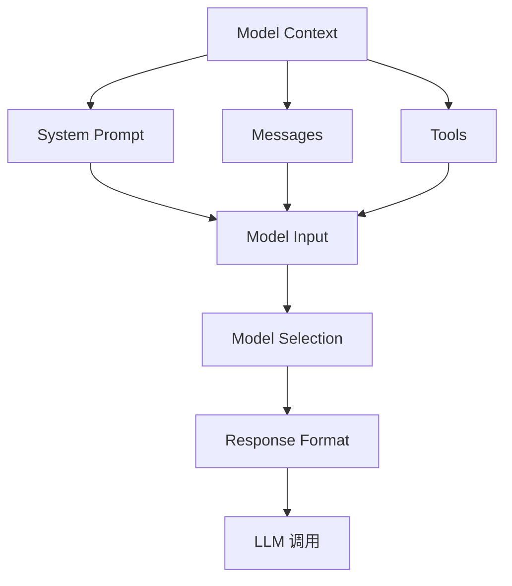

#### 模型上下文配置项

1. system prompt(系统提示词）: 决定 Agent 应该如何工作。但是实际项目中，不同用户、不同角色可能需要不同的 Prompt。

2. Dynamic Prompt（动态提示词）: 它可以根据当前 State、Store 和 Runtime Context 动态生成 System Prompt。

   实际用途：

   - 根据用户角色改变 Prompt。
   - 根据对话长度改变 Prompt。
   - 根据用户偏好改变 Prompt。
   - 根据业务环境加载不同规则。

3. Messages（消息上下文）: Messages 就是发送给 LLM 的完整消息列表。

   随着对话越来越长，Messages 也会越来越多。

   这会造成两个问题：

   - Token 消耗不断增加。
   - 无关历史信息影响模型判断。

   所以需要动态管理 Messages。

4. Tools（工具上下文）: 模型能否完成任务，取决于它是否拥有合适的工具。

   但工具不是越多越好。

   如果给 Agent 提供 100 个工具：

   - 模型需要理解更多工具描述。
   - Token 消耗增加。
   - 容易选错工具。
   - 工具之间可能存在功能冲突。

   所以需要 Dynamic Tool Selection（动态工具选择）。

5. Model（模型选择）: 不同任务可以使用不同模型，在模型调用之前，动态替换模型。

   - 简单分类 → 轻量模型

   - 普通问答 → 标准模型

   - 复杂分析 → 高能力模型

   - 超长上下文 → 大上下文模型

6. Response Format（响应格式）: 模型返回什么格式，也属于 Model Context。可以通过 Pydantic 定义输出结构。

   例如：

   - 普通用户只需要简单结果。
   - 管理员需要详细结果。
   - 不同任务需要不同的 JSON 结构。

### Tool Context（工具上下文）

模型上下文解决的是模型能够看到什么，工具上下文解决的是：工具可以访问什么数据，以及工具可以修改什么数据？

官网把 Tool Context 分成两个方向：

1. Reads（读取上下文）
2. Writes（写入上下文）

#### Reads：读取上下文

工具可以读取三种数据来源：

| 数据来源        | 读取内容             |
| --------------- | -------------------- |
| State           | 当前会话状态         |
| Store           | 长期记忆             |
| Runtime Context | 当前用户和运行时配置 |

```python
@tool
def check_authentication(
    runtime: ToolRuntime
) -> str:

    state = runtime.state

    is_authenticated = state.get(
        "authenticated", False
    )

    if is_authenticated:
        return "用户已登录"

    return "用户尚未登录"


@tool
def get_user(
    runtime: ToolRuntime[Context]
) -> str:

    user_id = runtime.context.user_id

    return f"当前用户：{user_id}"
  
```

这两个非常容易混淆：

- `runtime.state`：当前 Agent 会话的状态。
- `runtime.context`：调用时由外部传入的运行时信息。

#### Writes：写入上下文

Tool 不仅能读取数据，也能修改数据。

例如用户登录成功后，更新 State：

```python
# 从 langgraph.types 导入 Command：工具可用它"顺带"更新 Agent 的持久状态（state）
from langgraph.types import Command


# 1. 用 @tool 把函数注册为 Agent 可用的工具
#    注意返回类型是 Command（而非 str）——这意味着该工具除了给模型返回结果，
#    还能通过 Command.update 把数据写进 state（持久生效，未来轮次都看得到）
@tool
def authenticate_user(
    password: str,
    runtime: ToolRuntime,
) -> Command:
    # 简化版的密码校验：仅当密码等于 "correct" 才算认证通过
    if password == "correct":
        # 认证成功：把 state 里的 "authenticated" 标记为 True
        # Command(update={...}) 会把这个字段合并写入 Agent 的持久状态
        return Command(
            update={
                "authenticated": True
            }
        )
    # 认证失败：把 "authenticated" 标记为 False
    return Command(
        update={
            "authenticated": False
        }
    )

```

希望跨会话保存用户偏好，则使用 Store：

```python
runtime.store.put(
    ("preferences",),
    user_id,
    {
        "language": "Chinese",
        "style": "concise"
    }
)
```

### Life-cycle Context（生命周期上下文）

它解决的问题是：

如何在 Agent 执行的不同阶段，动态修改上下文或者改变执行流程？

```
用户请求
   ↓
Before Model
   ↓
调用 LLM
   ↓
After Model
   ↓
调用 Tool
   ↓
Before Tool
   ↓
执行 Tool
   ↓
After Tool
   ↓
再次调用 LLM
   ↓
返回结果
```

我们可以在这些执行节点中插入 Middleware。

常见用途：

| 功能              | 作用             |
| ----------------- | ---------------- |
| Summarization     | 自动总结历史对话 |
| Guardrails        | 安全检查         |
| Logging           | 记录执行日志     |
| Context Injection | 动态注入上下文   |
| State Update      | 更新 Agent 状态  |
| Flow Control      | 改变执行流程     |

#### Summarization（上下文摘要）

假设用户和 Agent 已经对话 100 轮。

如果把所有历史消息都发送给模型：

- Token 消耗非常大。
- 模型可能忽略重要信息。
- 可能超过模型上下文窗口。

解决办法是：自动总结旧消息，只保留最近的消息。

```python
# 导入创建 Agent 的入口
from langchain.agents import create_agent
# 导入内置的"对话摘要"中间件
from langchain.agents.middleware import (
    SummarizationMiddleware
)

# 创建 Agent，挂载摘要中间件
agent = create_agent(
    model="你的模型配置",   
    tools=[],          
    middleware=[
        SummarizationMiddleware(
            # 用于"生成摘要"的模型：通常用更便宜/更小的中介模型（如 gpt-5.4-mini），
            # 因为摘要任务不需要主模型的能力，能省成本
            model="你的摘要模型",
            # 触发条件：当对话累计 token 数超过 4000 时，自动触发一次摘要
            # 也支持按消息条数触发，如 trigger={"messages": 30}
            trigger={
                "tokens": 4000
            },
            # keep=("messages", 20) 表示：摘要时保留最近 20 条消息原样不动，
            # 只把更早的历史压缩成一条摘要消息
            keep=(
                "messages",
                20
            ),
        )
    ],
)

```

**`SummarizationMiddleware` 修改的是持久化 State 中的消息历史，不只是临时修改一次模型请求。**

#### Middleware 如何控制生命周期？

| Hook             | 执行时机     |
| ---------------- | ------------ |
| before_agent     | Agent 执行前 |
| before_model     | 模型调用前   |
| after_model      | 模型调用后   |
| before_tool_call | 工具调用前   |
| after_tool_call  | 工具调用后   |
| after_agent      | Agent 执行后 |

这些 Hook 可以让我们在不同阶段执行业务逻辑。

例如：

- `before_model`：注入用户信息。
- `after_model`：检查模型输出。
- `before_tool_call`：检查工具权限。
- `after_tool_call`：记录工具执行结果。

这些功能与前面 Guardrails 学习的内容是相互关联的。

### Transient Context 与 Persistent Context

| 类型       | 中文         | 是否永久保存 |
| ---------- | ------------ | ------------ |
| Transient  | 临时上下文   | 否           |
| Persistent | 持久化上下文 | 是           |

#### Transient Context（临时上下文）

只修改当前这一次模型调用的数据。

例如：

```python
request = request.override(
  messages=new_messages
)
```

它只影响当前模型调用，不会自动改变 State 中保存的历史消息。

适合：

- 临时添加用户偏好。
- 临时添加文件摘要。
- 临时注入业务规则。
- 临时修改 System Prompt。

#### Persistent Context（持久化上下文）

修改 Agent 的 State 或 Store。

例如：

```python
return Command(
  update={
    "authenticated": True
  }
)
```

或者：

```python
runtime.store.put(
    ("preferences",),
    user_id,
    {
        "language": "Chinese"
    }
)
```

这些数据会保留下来，供后续执行使用。

怎么选择？

- 只需要当前这次模型调用使用：Transient。
- 希望后续步骤或者未来会话继续使用：Persistent。

### Context Engineering 实战架构

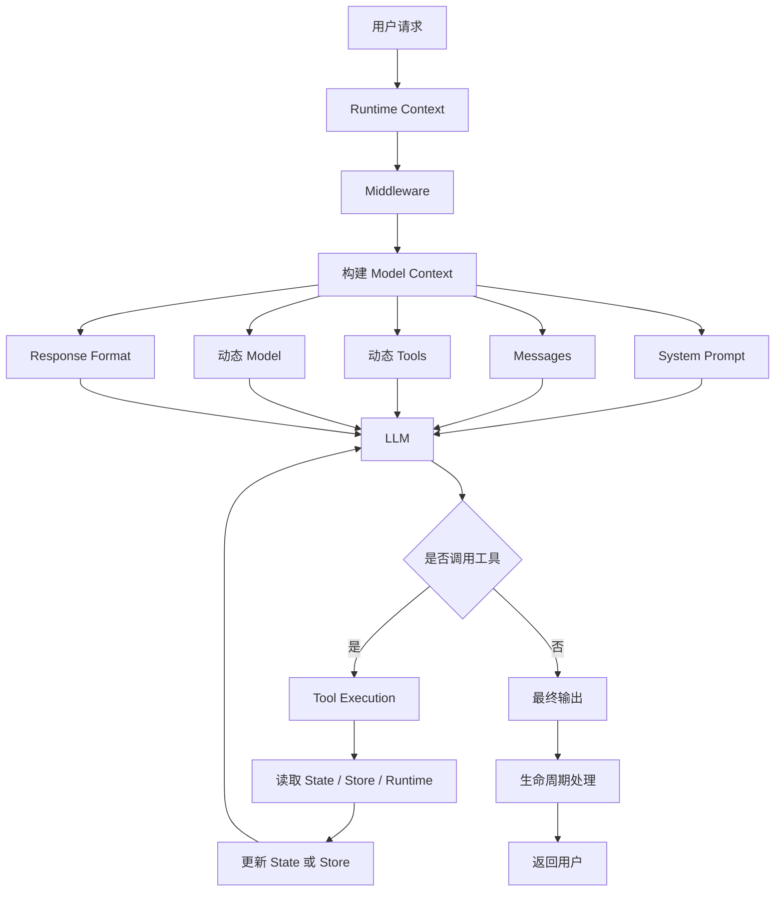

这个架构实际上就是 Context Engineering 的核心思想：

1. 从不同数据源获取信息。
2. 根据当前任务组织上下文。
3. 动态决定模型和工具。
4. 控制上下文是否持久化。
5. 通过 Middleware 管理整个执行生命周期。


### 核心 API 速查表

| API                       | 用途                   |
| ------------------------- | ---------------------- |
| `@dynamic_prompt`         | 动态构建 System Prompt |
| `@wrap_model_call`        | 拦截和修改模型请求     |
| `ModelRequest`            | 获取当前模型请求       |
| `request.override()`      | 覆盖模型请求参数       |
| `request.state`           | 获取 Agent State       |
| `request.runtime`         | 获取 Runtime           |
| `ToolRuntime`             | 工具访问运行时上下文   |
| `Command(update=...)`     | 更新 Agent State       |
| `SummarizationMiddleware` | 自动总结历史消息       |

## MCP

MCP 全称是 Model Context Protocol（模型上下文协议）。它主要解决一个问题：

> 如何让 AI Agent 以统一的方式连接外部工具、数据源和服务，而不需要为每一种服务单独设计一套集成方式？

MCP 是一个开放协议，用来标准化应用程序向大语言模型提供工具和上下文的方式。

可以把它理解成 AI 应用与外部系统之间的“通用接口”。

假设我们要开发一个 AI Agent，需要连接：

- 天气服务：查询天气。
- 数据库：查询业务数据。
- 文件系统：读取本地文件。
- GitHub：查看代码仓库。
- 搜索服务：搜索网页或知识库。

如果没有统一协议，我们可能需要针对每个服务编写一套专用工具、连接逻辑和数据转换代码。

有了 MCP，外部服务可以实现 MCP Server，Agent 侧通过 MCP Client 连接它，并发现和调用它提供的能力。\

### MCP 中的两个核心角色

| 角色       | 作用                                    |
| ---------- | --------------------------------------- |
| MCP Server | 提供工具、数据或其他上下文能力          |
| MCP Client | 连接 MCP Server，发现并调用它提供的能力 |

```text
用户：帮我查询北京今天的天气
       ↓
    AI Agent
       ↓
    MCP Client
       ↓
    MCP Server
       ↓
    天气 API
       ↓
    返回天气数据
       ↓
    AI Agent 整理结果
       ↓
    返回用户
```

### LangChain 如何接入 MCP？

LangChain 代理通过调用 MCP 服务器上定义的工具[`MCPAdapter`](https://reference.langchain.com/python/langchain/mcp/adapter/MCPAdapter)，该协议会发现服务器的工具并将其转换为 LangChain 工具。

[`MCPAdapter`](https://reference.langchain.com/python/langchain/mcp/adapter/MCPAdapter)[它基于FastMCP](https://gofastmcp.com/)构建，FastMCP 负责处理传输推断、协议协商、连接管理和身份验证。

说白了，类似于 LangChain 调用了一个函数。函数去执行任务，执行完把结果返回给 LangChain，然后交给 LLM。这是不是很像 Tools？

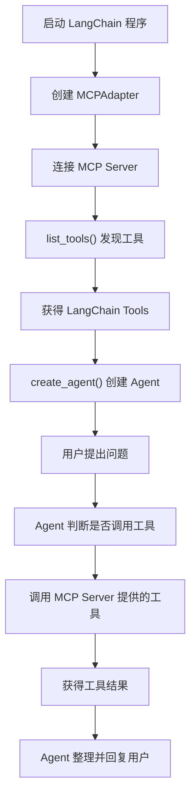


### 安装

```shell
uv add "langchain[mcp]"
```

### 使用

```python
"""LangChain 调用 MCP 天气服务器。

核心三步：
  1. 把 MCP 服务器(目标)交给 MCPAdapter；
  2. await adapter.list_tools() 拿到「已适配成 LangChain 工具」的列表；
  3. 把工具交给 create_agent，用户自然语言提问即可。

MCPAdapter 会根据 target 的类型自动推断传输方式，本文件覆盖三种：
  • Path 脚本路径    -> stdio 子进程        （默认，最贴合「独立 MCP 服务器」）
  • http(s) URL 字符串 -> Streamable HTTP    （--http，连独立 HTTP 服务器）
  • FastMCP 实例      -> 进程内（无子进程/网络，见底部注释）

运行：
  # 默认 stdio：MCPAdapter 自动把 weather_mcp_server.py 当子进程拉起
  uv run python -m langchain_test.mcp_weather_agent

  # 独立 HTTP 模式：先另开终端跑  uv run python -m langchain_test.weather_mcp_server --http
  #                 再跑本命令
  uv run python -m langchain_test.mcp_weather_agent --http
"""

import argparse
import asyncio
import os
import warnings
from pathlib import Path

# langchain.mcp 处于 beta，导入时会打印一次 LangChainBetaWarning，这里按需屏蔽
warnings.filterwarnings("ignore", message=".*langchain.mcp.*")

from dotenv import load_dotenv
from langchain.agents import create_agent
from langchain.mcp import MCPAdapter
from langchain_openai import ChatOpenAI

load_dotenv()

# 大模型：走 DeepSeek 的 OpenAI 兼容接口
llm = ChatOpenAI(
    model="deepseek-chat",
    base_url="https://api.deepseek.com",
    api_key=os.getenv("DEEPSEEK_API_KEY"),
)

# 独立 HTTP 服务器地址（配合 weather_mcp_server.py --http 使用）
MCP_SERVER_URL = "http://127.0.0.1:8000/mcp"


async def main(mode: str) -> None:
    # ---- 1) 选定 target：决定用哪种传输方式 ----
    if mode == "http":
        # 独立 HTTP 服务器：target 是 URL 字符串，MCPAdapter 自动选 Streamable HTTP。
        # 注意：这种方式要求服务器已提前通过 `weather_mcp_server.py --http` 单独跑起来。
        adapter = MCPAdapter(MCP_SERVER_URL)
        print(f"连接独立 HTTP MCP 服务器：{MCP_SERVER_URL}")
    else:
        # 默认 stdio：target 是脚本路径，MCPAdapter 自动把服务器当子进程拉起，
        # 通过标准输入输出通信，一条命令即可运行。
        server_script = Path(__file__).parent / "weather_mcp_server.py"
        adapter = MCPAdapter(server_script)
        print(f"以 stdio 子进程拉起 MCP 服务器：{server_script}")

    # ---- 2) 进入上下文 -> 发现工具 -> 构建 agent ----
    # 文档说明：工具会持有 client，所以 agent 在 async with 退出后依然可用。
    async with adapter as adapter_ctx:
        # 从 MCP 服务器拉取工具，并自动转换成 LangChain 工具
        tools = await adapter_ctx.list_tools()
        print("已从 MCP 服务器加载工具：", [t.name for t in tools])

        # 用这些工具创建 Agent（create_agent 会在需要时通过 MCP 协议调用远端工具）
        agent = create_agent(model=llm, tools=tools)

        # 提问：模型会自己决定调用 get_weather("北京")，再基于返回组织中文回答
        result = await agent.ainvoke(
            {"messages": [{"role": "user", "content": "北京今天天气怎么样？用中文回答。"}]}
        )

    # ---- 3) 输出 Agent 的自然语言回复（最后一条消息） ----
    print("\n=== Agent 回复 ===")
    print(result["messages"][-1].content)


if __name__ == "__main__":
    parser = argparse.ArgumentParser(description="LangChain 调用 MCP 天气服务器")
    parser.add_argument(
        "--http",
        action="store_true",
        help="连独立 HTTP MCP 服务器（需先另开终端跑 weather_mcp_server.py --http）",
    )
    args = parser.parse_args()
    asyncio.run(main("http" if args.http else "stdio"))


# 备选：进程内集成（无子进程、无网络）。
# 直接把 FastMCP 实例交给 MCPAdapter，适用于测试或单进程场景：
#   from langchain_test.weather_mcp_server import mcp as weather_mcp_server
#   adapter = MCPAdapter(weather_mcp_server)

```

```python
"""查天气的 MCP 服务器

这是「MCP Server」一端：对外暴露一个 get_weather 工具。
它本身不懂大模型，只负责「被调用时返回天气数据」，
调用方（LangChain Agent）通过 MCP 协议来拉取并使用这个工具。

运行方式：
  # 1) stdio 模式（默认）：被别的进程拉起，通过标准输入输出通信
  uv run python -m langchain_test.weather_mcp_server

  # 2) Streamable HTTP 模式：作为一个独立服务常驻，监听 http://127.0.0.1:8000/mcp
  uv run python -m langchain_test.weather_mcp_server --http

也可以作为模块被导入，直接拿到 mcp 实例做「进程内」集成
（见 mcp_weather_agent.py 的默认写法）。
"""

import os
import sys

from fastmcp import FastMCP

# 创建 MCP 服务器实例，名字仅用于标识
mcp = FastMCP("weather-server")


@mcp.tool()
def get_weather(city: str) -> str:
    """查询指定城市的当前天气。

    Args:
        city: 城市名称，例如「北京」「上海」「广州」「深圳」。
    """
    # 这里用一份写死的模拟数据来演示 MCP 的工作方式。
    # 真实场景里，把下面这行换成「调用真实的天气 API」即可，
    # 对 LangChain 那一侧完全无感知、无需改动。
    weather_db = {
        "北京": {"weather": "晴", "temperature": 22, "humidity": 38, "wind": "北风 3 级"},
        "上海": {"weather": "多云", "temperature": 25, "humidity": 65, "wind": "东南风 2 级"},
        "广州": {"weather": "阵雨", "temperature": 29, "humidity": 80, "wind": "南风 2 级"},
        "深圳": {"weather": "阴", "temperature": 28, "humidity": 75, "wind": "东风 3 级"},
    }

    city = (city or "").strip()
    if city not in weather_db:
        return f"抱歉，暂时没有「{city}」的天气数据（仅支持 北京/上海/广州/深圳）。"

    info = weather_db[city]
    return (
        f"{city}当前天气：{info['weather']}，"
        f"气温 {info['temperature']}℃，"
        f"湿度 {info['humidity']}%，"
        f"{info['wind']}。"
    )


if __name__ == "__main__":
    # 默认 stdio；加上 --http 则启动 Streamable HTTP 服务器，便于单独部署 / 调试。
    if "--http" in sys.argv:
        port = int(os.environ.get("MCP_PORT", "8000"))
        print(f"[weather-mcp] Streamable HTTP 启动：http://127.0.0.1:{port}/mcp", file=sys.stderr)
        mcp.run(transport="streamable-http", host="127.0.0.1", port=port, path="/mcp")
    else:
        mcp.run(transport="stdio")

```


### 几个关键知识点:

1. `MCPAdapter()`：创建 MCP 连接适配器 
2. `list_tools()`：发现服务器提供的工具

### 连接 MCP Server 的几种方式

**方式一：HTTP 远程连接**

```python
from langchain.mcp import MCPAdapter

adapter = MCPAdapter("https://example.com/mcp")
```

适合：

- MCP Server 部署在远程服务器。
- 多个 Agent 需要访问同一个服务。
- 通过网络连接外部系统。

**本地 Python 脚本（stdio）**

```python
from pathlib import Path
from langchain.mcp import MCPAdapter

adapter = MCPAdapter(Path("weather_server.py"))
```

这种方式会启动一个子进程，通过标准输入输出（stdio）与 MCP Server 通信。

适合：

- 本地开发。
- 本地工具集成。
- 不需要额外部署 HTTP 服务的场景。

**进程内连接**

```python
from langchain.mcp import MCPAdapter

adapter = MCPAdapter(server)
```

它直接在内存中连接，不需要启动子进程，也不需要网络 Socket。

适合：

- 单元测试。
- 本地实验。
- Client 和 Server 都在同一个 Python 进程中的场景。

**三种方式对比**

| 连接方式   | 连接目标        | 通信方式        | 典型用途   |
| ---------- | --------------- | --------------- | ---------- |
| HTTP       | URL             | Streamable HTTP | 远程服务   |
| stdio      | Python 脚本路径 | 标准输入输出    | 本地服务   |
| In-process | FastMCP 实例    | 内存连接        | 测试和开发 |

### 数据长什么样子

MCP 本质就是 **JSON-RPC 2.0** —— 两边来回传的都是 JSON 文本。传输层不同只是"怎么把这段 JSON 送达"：stdio 走 stdin/stdout（每行一条 JSON），HTTP 走 POST + SSE。

```json
// Client → Server | initialize 请求（建立连接）
{
  "jsonrpc": "2.0",
  "id": 1,
  "method": "initialize",
  "params": {
    "protocolVersion": "2025-06-18",
    "capabilities": {},
    "clientInfo": {
      "name": "langchain",
      "version": "1.4"
    }
  }
}
// Server → Client | initialize 响应
{
  "jsonrpc": "2.0",
  "id": 1,
  "result": {
    "protocolVersion": "2025-06-18",
    "capabilities": {
      "tools": {}
    },
    "serverInfo": {
      "name": "weather-server",
      "version": "0.1.0"
    }
  }
}


// Client → Server | tools/list 请求（获取工具列表）
{
  "jsonrpc": "2.0",
  "id": 2,
  "method": "tools/list",
  "params": {}
}
// Server → Client | tools/list 响应
{
  "jsonrpc": "2.0",
  "id": 2,
  "result": {
    "tools": [
      {
        "name": "get_weather",
        "description": "查询指定城市的当前天气。",
        "inputSchema": {
          "type": "object",
          "properties": {
            "city": {
              "type": "string",
              "description": "城市名称，例如北京"
            }
          },
          "required": [
            "city"
          ]
        }
      }
    ]
  }
}

// Client → Server | tools/call 请求（调用工具）
{
  "jsonrpc": "2.0",
  "id": 3,
  "method": "tools/call",
  "params": {
    "name": "get_weather",
    "arguments": {
      "city": "北京"
    }
  }
}
// Server → Client | tools/call 响应
{
  "jsonrpc": "2.0",
  "id": 3,
  "result": {
    "content": [
      {
        "type": "text",
        "text": "北京当前天气：晴，气温 22℃，湿度 38%，北风 3 级。"
      }
    ]
  }
}

```

### MCP 在实际 Agent 项目中的作用

假设我们要开发一个企业智能助手，它需要访问：

- 公司内部知识库。
- 企业数据库。
- GitHub 仓库。
- 文件系统。
- 第三方业务系统。

传统做法是为每一个系统单独编写工具，再把工具注册到 Agent。

使用 MCP 后，可以把这些外部能力分别封装成 MCP Server：

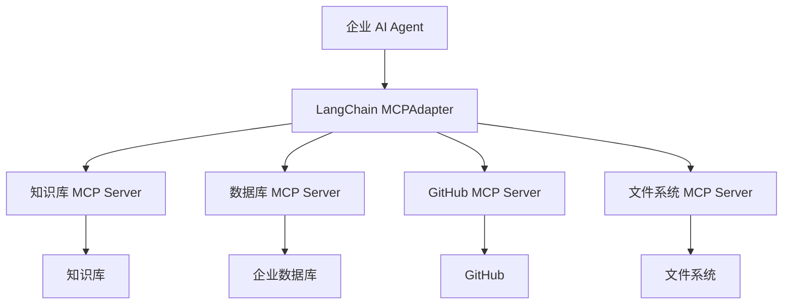

## Human-in-the-loop：人工审批

## 

Human-in-the-loop 并不是让人类一直参与 Agent 的每一步。

而是在关键节点引入人工参与。

例如：

| 操作             | 是否需要人工参与     |
| ---------------- | -------------------- |
| 查询天气         | 通常不需要           |
| 搜索网页         | 通常不需要           |
| 查询数据库       | 根据数据敏感程度决定 |
| 发送普通邮件     | 可以不需要           |
| 批量发送邮件     | 建议审批             |
| 删除文件         | 建议审批             |
| 转账或退款       | 应当审批             |
| 修改生产环境配置 | 应当审批             |

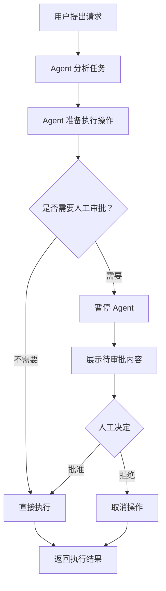

人工审批并不是简单地在 Prompt 里面告诉模型“执行前先问用户”。

应该由程序控制执行流程，而不是依赖模型自觉遵守。

### 三个概念

实现人工审批时，最重要的三个概念是：

| 概念                  | 作用                             |
| --------------------- | -------------------------------- |
| `interrupt()`         | 暂停当前执行，向外部请求人工输入 |
| Checkpointer          | 保存暂停时的执行状态             |
| `Command(resume=...)` | 提供人工决定，恢复执行           |

```python
# 导入 TypedDict 声明状态；导入 StateGraph 与虚拟起止点
from typing import TypedDict
from langgraph.graph import StateGraph, START, END
# interrupt 用于"主动暂停等人工输入"；Command 用于"从暂停点恢复执行"
from langgraph.types import interrupt, Command
# 检查点：interrupt 必须配合 checkpointer 才能保存暂停点、支持恢复
from langgraph.checkpoint.memory import InMemorySaver


# 1. 定义状态（State）
#   file_path —— 待删除的文件路径（输入）
#   approved  —— 人工审批结果（由节点在恢复后填充）
class State(TypedDict):
    file_path: str
    approved: bool


# 2. 删除文件节点：先暂停等人审批，再按决定执行
def delete_file(state: State):
    # interrupt 立即暂停图的执行，把字典"抛给"调用方（人工/前端）
    # 当后续用 Command(resume=...) 恢复时，interrupt(...) 的返回值 = resume 传入的值
    decision = interrupt({
        "question": "是否确认删除这个文件？",
        "file_path": state["file_path"]
    })

    # 恢复后继续：decision 就是人工传回的 {...}
    if decision["approved"]:
        print(f"删除文件：{state['file_path']}")
        return {"approved": True}
    print("用户拒绝删除")
    return {"approved": False}


# 3. 创建图并注册节点
builder = StateGraph(State)
builder.add_node("delete_file", delete_file)
builder.add_edge(START, "delete_file")
builder.add_edge("delete_file", END)

# 4. 配置并编译：interrupt 必须挂 checkpointer，否则无法暂停/恢复
checkpointer = InMemorySaver()
graph = builder.compile(checkpointer=checkpointer)

# 5. 用 thread_id 隔离这次审批会话
config = {
    "configurable": {
        "thread_id": "delete-file-001"
    }
}

# 6. 第一次执行：运行到 interrupt 时暂停，result 是暂停前的状态（含 pending 审批）
result = graph.invoke(
    {
        "file_path": "report.pdf",
        "approved": False
    },
    config=config
)
print(result)

# 7. 第二次执行：人工批准，用 Command(resume={"approved": True}) 恢复
#    resume 的值会成为 delete_file 中 interrupt(...) 的返回值，
#    于是 decision = {"approved": True}，走"执行删除"分支
result = graph.invoke(
    Command(resume={"approved": True}),
    config=config
)
print(result)

```

**⚠️注意：**

Checkpointer 用于当前的执行状态。

这里使用的是内存版本 `InMemorySaver`，适合学习和测试。生产环境需要考虑持久化存储，避免进程重启后丢失暂停状态。

常见选择：

| Checkpointer            | 用途                       |
| ----------------------- | -------------------------- |
| `InMemorySaver`         | 本地学习、测试             |
| SQLite Checkpointer     | 适合部分本地持久化场景     |
| PostgreSQL Checkpointer | 适合需要持久化的服务端场景 |

### 自动审批

前面我们通过 `interrupt()` 手动控制工作流。

但实际开发时，我们经常使用的是 `create_agent()`，而不是自己从头构建 StateGraph。

可以使用 LangChain 提供的：`HumanInTheLoopMiddleware` 它可以针对 Agent 的工具调用设置人工审批规则。

例如：

- 查询天气：直接执行。
- 查询数据库：直接执行。
- 删除文件：需要审批。
- 发送邮件：需要审批。

```
用户请求
   ↓
Agent 决定调用工具
   ↓
HumanInTheLoopMiddleware
   ↓
检查工具审批规则
   ↓
需要审批？
   ├── 否 → 执行工具
   └── 是 → 暂停并等待人工决定
```

#### 三种常见审批策略

在工具审批配置中，可以使用以下策略：

| 策略      | 含义                                     |
| --------- | ---------------------------------------- |
| `approve` | 人工批准后才执行                         |
| `edit`    | 人工可以修改工具调用参数，再决定是否执行 |
| `reject`  | 拒绝工具调用                             |


| 对比     | `interrupt()`        | `HumanInTheLoopMiddleware` |
| -------- | -------------------- | -------------------------- |
| 层级     | LangGraph 工作流层   | LangChain Agent 中间件层   |
| 控制对象 | 任意图节点           | Agent 工具调用             |
| 适用场景 | 自定义暂停和恢复流程 | 为工具配置审批             |
| 灵活性   | 很高，需要自己编排   | 更方便，适合常见工具审批   |

## Multi-agent：多智能体

随着项目越来越复杂，一个 Agent 可能会遇到这些问题：

1. 工具太多，不知道应该选择哪个。
2. 不同业务领域需要不同的专业知识。
3. Prompt 越来越长，模型上下文越来越复杂。
4. 一个任务需要多个步骤，甚至多个步骤可以并行执行。
5. 不同团队需要独立开发和维护不同能力。

这时候就可以考虑 Multi-agent。不过，**不是所有复杂任务都需要多 Agent。只有当任务确实需要上下文隔离、并行执行、专业分工或独立维护时，才需要多 Agent。 **

Multi-agent 就是让多个具有不同职责的 Agent 协同完成一个任务。


当用户提出：

> 帮我研究 LangGraph，分析它的核心架构、应用场景，并生成一份学习报告。

可以把任务拆成三个专业 Agent：

| Agent            | 职责                    |
| ---------------- | ----------------------- |
| Research Agent   | 搜集 LangGraph 相关资料 |
| Analysis Agent   | 分析架构和技术特点      |
| Writing Agent    | 整理资料并生成报告      |
| Supervisor Agent | 负责协调其他 Agent      |

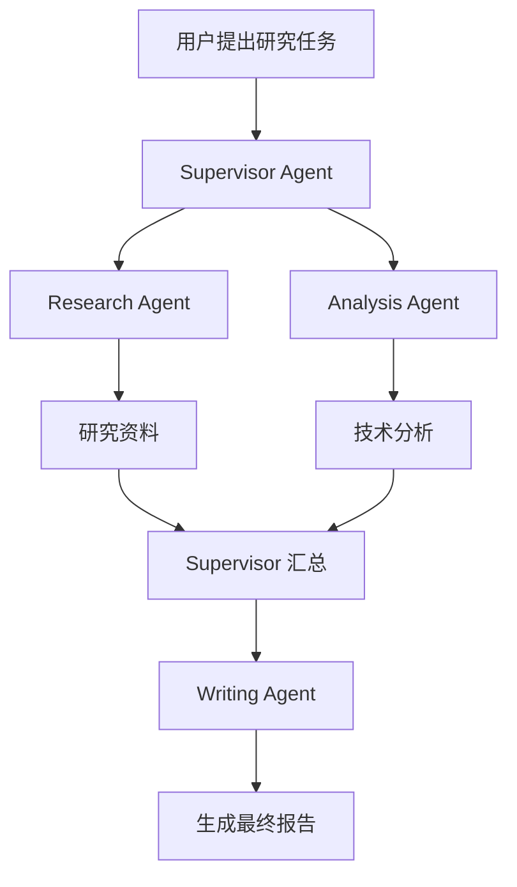

这里最重要的不是 Agent 数量，而是：

- 每个 Agent 有明确职责。
- 每个 Agent 有适合自己的工具。
- 每个 Agent 只接收完成任务所需的上下文。
- 有一个明确的协作和结果传递机制。

### 为什么需要 Multi-agent？

#### 1. Context management（上下文管理）

假设一个企业 Agent 有 50 个工具：

```
数据库查询工具
文件读取工具
文件写入工具
邮件发送工具
GitHub 工具
订单查询工具
订单退款工具
客户信息工具
财务分析工具
……
```

如果把所有工具和说明都交给一个 Agent，模型就需要处理大量无关信息。

可以将它们拆分：

```
主 Agent
  ├── 财务 Agent：财务相关工具
  ├── 客服 Agent：客户和订单工具
  ├── 开发 Agent：GitHub 和代码工具
  └── 文档 Agent：文件和知识库工具
```

这样，每个 Agent 只需要关注自己负责的业务。

#### 2. Distributed development（分布式开发）

不同团队可以分别负责不同 Agent。

例如：

- 财务团队维护财务 Agent。
- 客服团队维护客服 Agent。
- 开发团队维护代码 Agent。

最后由主 Agent 将它们组合起来。

这有利于团队之间独立开发和维护。

#### 3. Parallelization（并行执行）

假设用户要求：

> 同时分析 Python、JavaScript 和 Rust 三种语言的优缺点。

可以让三个 Agent 同时工作：

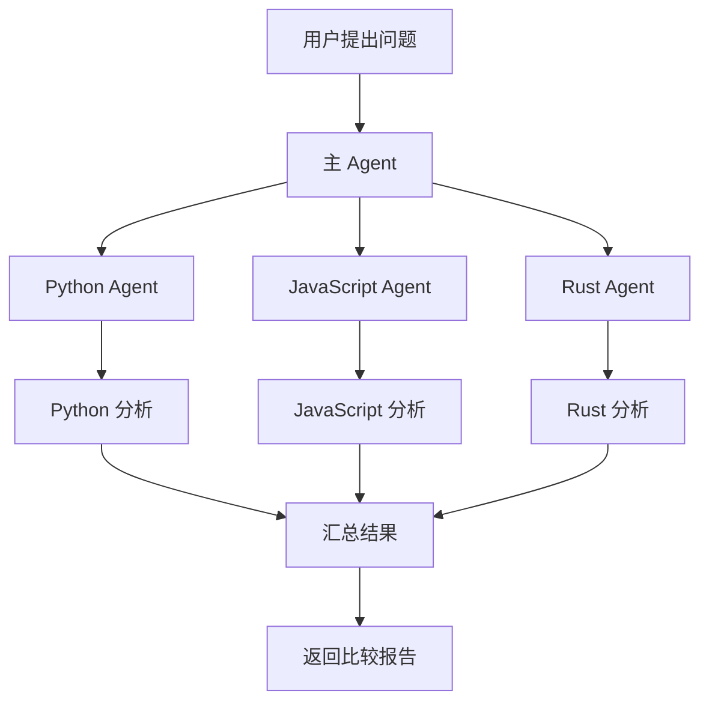

### Multi-agent 的五种主要设计模式

| 模式            | 核心思想                           |
| --------------- | ---------------------------------- |
| Subagents       | 主 Agent 把专业任务委派给子 Agent  |
| Handoffs        | Agent 之间动态转交控制权           |
| Skills          | 一个 Agent 按需加载专业知识和指令  |
| Router          | 先判断任务类型，再路由到对应 Agent |
| Custom workflow | 使用 LangGraph 自定义工作流程      |

### Subagents（子 Agent 模式）

#### Subagents 的重要特点

1. 子 Agent 对主 Agent 来说像一个工具

   主 Agent 不一定需要知道子 Agent 内部如何工作，只需要知道：

   - 子 Agent 的名称。
   - 子 Agent 能做什么。
   - 需要传递什么输入。
   - 会返回什么结果。

2. 子 Agent 有独立上下文

   例如，Research Agent 只需要看到研究任务，不需要看到主 Agent 的全部对话历史。

   这可以减少上下文污染。

3. 主 Agent 保留最终控制权

   子 Agent 完成任务后，把结果返回给主 Agent。

   主 Agent 决定下一步是否调用其他子 Agent，以及如何组织最终答案。

#### 什么时候适合使用？

- 一个任务需要多个专业领域协作。
- 子任务可以独立执行。
- 希望不同 Agent 具有不同的工具和 Prompt。
- 希望主 Agent 统一管理任务。


```python
from langchain.agents import create_agent
from langchain.tools import tool
from langchain_openai import ChatOpenAI

model = ChatOpenAI(model="gpt-4.1-mini")


# 专门负责研究的子 Agent
research_agent = create_agent(
    model=model,
    tools=[],
    system_prompt="你是一名研究助手，负责搜集和整理主题资料。"
)


# 将子 Agent 包装成工具
@tool
def research(query: str) -> str:
    """调用研究 Agent 搜集资料。"""

    result = research_agent.invoke({
        "messages": [
            {"role": "user", "content": query}
        ]
    })

    return result["messages"][-1].content


# 主 Agent
main_agent = create_agent(
    model=model,
    tools=[research],
    system_prompt="你是一个研究项目负责人。需要研究资料时调用 research 工具。"
)
```

### Handoffs（控制权交接模式）

Subagents 是：主 Agent 调用子 Agent，子 Agent 完成后返回主 Agent。

Handoffs 则是：**当前 Agent 将控制权转交给另一个 Agent，由另一个 Agent 接着处理任务。**

例如，客服系统：

- 用户咨询订单，由订单 Agent 处理。
- 用户投诉，由投诉 Agent 接手。
- 用户要求退款，由退款 Agent 接手。

#### 什么时候适合使用？

- 客服系统需要不同专业人员接手。
- 用户对话需要在不同状态之间切换。
- 某个 Agent 需要持续与用户交互。
- 不同阶段需要不同的工具和系统提示词。

#### 与 Subagents 的区别

| 对比            | Subagents         | Handoffs                    |
| --------------- | ----------------- | --------------------------- |
| 控制权          | 主 Agent 始终协调 | 可以转交给其他 Agent        |
| 子 Agent 的角色 | 被调用的专业工具  | 接管后续对话的 Agent        |
| 主要用途        | 后台专业任务      | 多阶段用户交互              |
| 返回方式        | 通常返回主 Agent  | 接手 Agent 可以直接回复用户 |


### Skills（技能按需加载模式）

它不一定需要创建多个 Agent。它的核心思想是：**保留一个 Agent，由它根据任务需要动态加载专业指令和知识。**

例如，一个编程助手可以具备：

- Python 开发 Skill。
- JavaScript 开发 Skill。
- 数据库开发 Skill。
- 代码审查 Skill。

用户问 Python 问题时，加载 Python Skill。

用户要求审查代码时，加载代码审查 Skill。

### Skills 与 Subagents 的区别

| 对比       | Skills                            | Subagents             |
| ---------- | --------------------------------- | --------------------- |
| Agent 数量 | 通常是一个                        | 多个                  |
| 专业能力   | 按需加载指令和知识                | 委派给独立 Agent      |
| 上下文     | 加载后的内容进入当前 Agent 上下文 | 子 Agent 有独立上下文 |
| 并行执行   | 不适合独立并行工作                | 适合并行执行          |
| 典型用途   | 专业知识和流程复用                | 专业任务委派          |

**Skills 是给 Agent 装技能，而 Subagents 是让 Agent 找其他专业人员帮忙。**

### Router（路由模式）

Router 的核心思想是：先判断用户请求属于哪个领域，再把任务分配给对应的 Agent。

例如，一个企业知识助手有三个专业 Agent：

- HR Agent：处理人事问题。
- Finance Agent：处理财务问题。
- IT Agent：处理技术问题。

用户提出问题后，先经过 Router 分类，再交给对应 Agent。

Router 和 Subagents 的一个关键区别：

- Subagents：主 Agent 自己决定什么时候调用哪个子 Agent。
- Router：先经过一个专门的路由步骤，决定任务交给谁。

Router 还可以把一个请求同时分发给多个 Agent。

```python
def router(question: str) -> str:
    if "工资" in question or "请假" in question:
        return "hr"

    if "预算" in question or "报销" in question:
        return "finance"

    if "服务器" in question or "代码" in question:
        return "it"

    return "general"


def handle_question(question: str):
    route = router(question)

    if route == "hr":
        return hr_agent.invoke({
            "messages": [{"role": "user", "content": question}]
        })

    elif route == "finance":
        return finance_agent.invoke({
            "messages": [{"role": "user", "content": question}]
        })

    elif route == "it":
        return it_agent.invoke({
            "messages": [{"role": "user", "content": question}]
        })

    else:
        return "暂时无法确定应该由哪个专业 Agent 处理。"
```

#### 什么时候适合使用？

- 业务领域划分比较明确。
- 不同类型请求对应不同处理流程。
- 希望在调用专业 Agent 之前先进行分类。
- 一个问题可能需要分发给多个专业 Agent。


### Custom workflow（自定义工作流）

真实业务经常会更加复杂。例如，一个企业研究任务可能需要：

1. 判断任务类型。
2. 搜集资料。
3. 检查资料是否完整。
4. 不完整就重新搜索。
5. 分析资料。
6. 生成报告。
7. 等待人工审批。
8. 审批通过后发送报告。

这种流程很难完全套用某一种固定模式。

这时就可以使用 LangGraph 自己设计工作流。

LangGraph 不只是用来创建一个 Agent，它还可以用来编排多个 Agent 和确定性业务流程。

### 五种模式应该如何选择？

| 你的需求                      | 推荐模式        |
| ----------------------------- | --------------- |
| 一个主 Agent 委派专业任务     | Subagents       |
| 不同 Agent 之间转交对话控制权 | Handoffs        |
| 一个 Agent 按需加载专业知识   | Skills          |
| 先分类，再分发给专业 Agent    | Router          |
| 复杂业务流程，需要自定义控制  | Custom workflow |

## Retrieval：检索

这是 LangChain 非常重要的一个主题：检索（Retrieval）。

现在有一个问题：

> 如果我有大量自己的文档、PDF、技术手册、数据库资料，如何让 Agent 根据用户的问题，找到相关内容，再利用这些内容回答？

普通大模型只能根据训练知识回答，不一定知道你自己的文档内容，也不一定掌握文档中的最新信息。

Retrieval 就是解决这个问题的重要技术。

### 什么是检索？

简单来说，就是：

> 根据用户提出的问题，从大量数据中找到与问题相关的信息。

假设有一个知识库：

```
knowledge_base/
    ├── langchain.md
    ├── langgraph.md
    ├── agent.md
    ├── memory.md
    ├── checkpointer.md
    ├── tool_calling.md
    └── rag.md
```

用户提出问题：

> LangGraph 中 Checkpointer 有什么作用？

检索系统需要做的事情：

1. 理解用户的问题。
2. 在知识库中搜索相关内容。
3. 找到 Checkpointer 相关的文档片段。
4. 将相关内容返回给上层应用。

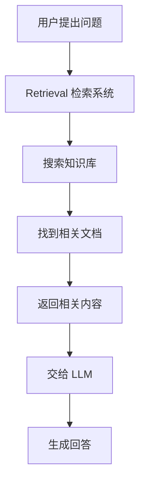

**Retrieval 负责找资料，LLM 负责理解资料并生成回答。**

### 为什么需要检索？

LLM 有两个硬伤：**上下文有限**（一次吃不下整个知识库）+ **知识静态**（训练截止后就不更新）。

所以可以这样理解：

| 技术      | 解决的问题                         |
| --------- | ---------------------------------- |
| LLM       | 理解问题、分析和生成答案           |
| Retrieval | 从外部数据中找到相关信息           |
| RAG       | 将检索结果提供给 LLM，辅助生成答案 |

### 整体架构

典型检索流程拆分为五个核心组件：

1. Document Loader：加载文档。
2. Text Splitter：切分文档。
3. Embedding Model：将文本转换成向量。
4. Vector Store：保存向量并提供搜索能力。
5. Retriever：根据查询返回相关文档。

整体流程：

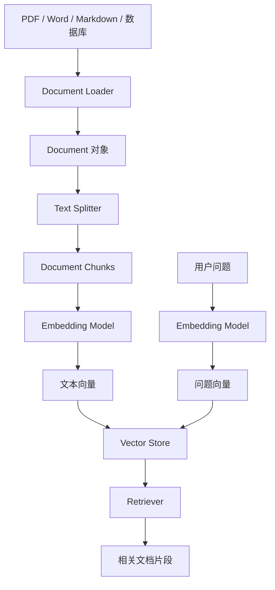

**知识库构建和用户查询是两个不同的阶段。**

阶段一：知识库构建（Indexing）

这个阶段主要负责把原始资料处理成可以检索的数据。

```
原始文档
   ↓
Document Loader
   ↓
Text Splitter
   ↓
Embedding Model
   ↓
Vector Store
```

阶段二：用户查询（Retrieval）

```
用户问题
   ↓
Embedding Model
   ↓
问题向量
   ↓
Vector Store 搜索
   ↓
相关文档片段
   ↓
返回结果
```

### Document Loader（文档加载器）

Document Loader 的作用是：**从不同数据源读取内容，并将它们转换为 LangChain 统一的 Document 对象。**

#### Document 是什么？

一个 Document 主要包含两个部分：

| 字段           | 作用           |
| -------------- | -------------- |
| `page_content` | 文档的文本内容 |
| `metadata`     | 文档的附加信息 |

```python
from langchain_core.documents import Document

doc = Document(
    page_content="LangGraph 是一个用于构建有状态 Agent 的框架。",
    metadata={
        "source": "langgraph.md",
        "chapter": "Introduction",
        "page": 1
    }
)

print(doc.page_content)
print(doc.metadata)

# 输出：
# LangGraph 是一个用于构建有状态 Agent 的框架。
#
# {
#     'source': 'langgraph.md',
#     'chapter': 'Introduction',
#     'page': 1
# }
```

这里的 `metadata` 非常重要。

因为我们检索到某个片段时，不仅需要知道它的内容，还需要知道：

- 来自哪个文件？
- 来自哪一页？
- 属于哪个章节？
- 是否属于某个业务分类？

这样后续才能实现来源展示、过滤和追踪。

#### PDF

```shell
uv add langchain-community pypdf
```

```python
from langchain_community.document_loaders import PyPDFLoader

loader = PyPDFLoader("langgraph.pdf")

docs = loader.load()

print(f"文档页数：{len(docs)}")

print(docs[0].page_content)
print(docs[0].metadata)
```

`loader.load()`返回的是 Document 列表。

通常 PDF 加载器会按页生成 Document，每一页都可以包含自己的页码和来源信息。

注意： 不同 Loader 的输出粒度可能不同。有的按页，有的按文件，有的按记录。后续通常还需要进行文本切分。

### Text Splitter（文本分割器）

为什么需要切分？

假设你有一份 100 页的 PDF。如果直接把整份 PDF 当成一个 Document,会有几个问题：

1. 内容太长，不方便精确检索。
2. 检索到整份文档后，会包含大量无关内容。
3. 给模型提供的上下文太大。
4. 不同主题混在一起，相关信息不容易定位。

所以我们需要把长文档切成较小的文本块。

```
原始文档：langgraph.md

        ↓

Text Splitter

        ↓

Chunk 1：LangGraph 简介
Chunk 2：StateGraph
Chunk 3：Node
Chunk 4：Edge
Chunk 5：Conditional Edge
Chunk 6：Checkpointer
```

这些小片段通常称为 Chunk（文本块）。

#### 两个重要参数

文本切分时经常需要设置：

- `chunk_size`：每个文本块的目标大小。
- `chunk_overlap`：相邻文本块之间重复的内容大小。

#### RecursiveCharacterTextSplitter 切分器

它是LangChain 中常用的文本切分器之一。

它会按照一组分隔符递归尝试切分文本，尽可能保留自然的文本边界。

```shell
uv add langchain-text-splitters
```

```python
from langchain_text_splitters import RecursiveCharacterTextSplitter


# 1. 创建切分器实例
#   chunk_size=500     —— 每个文本块的最大字符数（超出就切下一块）
#   chunk_overlap=100  —— 相邻两块之间重叠的字符数（保留上下文连续性，避免切断语义）
text_splitter = RecursiveCharacterTextSplitter(
    chunk_size=500,
    chunk_overlap=100,
)

# 2. 执行切分
#   docs 是 Document 对象列表（每个含 .page_content 文本 + .metadata 元信息）
#   split_documents 会按 chunk_size/overlap 把长文档切成多个小块，
#   返回的 splits 长度通常远大于原始 docs 数量
splits = text_splitter.split_documents(docs)

# 3. 打印诊断信息
print(f"原始文档数量：{len(docs)}")            # 切分前有几篇文档
print(f"切分后数量：{len(splits)}")            # 切分后变成多少块（一般 >> 原始数）
print(splits[0].page_content)                  # 第一块的纯文本内容
print(splits[0].metadata)                      # 第一块的元数据（来源/页码等，切分时会继承并补充）

```


### Embeddings（向量嵌入）

它的作用是：**将文本转换成一组数字，让计算机可以通过向量之间的距离或相似度，比较文本的语义。**

```
"我喜欢学习人工智能"
        ↓
Embedding Model
        ↓
[0.12, 0.85, 0.33, 0.67, ...]
```

```
"我对 AI 技术很感兴趣"
        ↓
Embedding Model
        ↓
[0.14, 0.82, 0.35, 0.64, ...]
```

由于两段话表达的意思相近，它们生成的向量通常也会比较接近。

#### 向量相似度

常见的相似度计算方式有：

1. Cosine Similarity（余弦相似度）
2. Euclidean Distance（欧氏距离）
3. Dot Product（点积）

最常见的理解方式是余弦相似度：

- 越接近 1：方向越相似。
- 越接近 0：方向越不相似。
- 越接近 -1：方向越相反。

#### LangChain 中的 Embeddings 接口

两个重要方法：

| 方法                | 作用                 |
| ------------------- | -------------------- |
| `embed_documents()` | 将多个文档转换成向量 |
| `embed_query()`     | 将用户查询转换成向量 |

```python
文档和用户问题必须使用兼容的 Embedding 模型及向量空间，才能进行有意义的相似度比较。from langchain_openai import OpenAIEmbeddings

embeddings = OpenAIEmbeddings(
    model="text-embedding-3-small"
)

# 文档向量
document_vectors = embeddings.embed_documents([
    "LangGraph 是一个 Agent 编排框架。",
    "Checkpointer 用于保存执行状态。"
])

# 查询向量
query_vector = embeddings.embed_query(文档和用户问题必须使用兼容的 Embedding 模型及向量空间，才能进行有意义的相似度比较。
    "LangGraph 如何保存执行状态？"
)

print(len(document_vectors))
print(len(query_vector))
```

文档和用户问题必须使用兼容的 Embedding 模型及向量空间，才能进行有意义的相似度比较。

### Vector Store（向量存储）

这些向量应该保存在哪里？如何快速搜索？

Vector Store 中文叫向量存储，主要负责：

1. 保存文档内容。
2. 保存文档向量。
3. 根据查询向量搜索相关内容。
4. 返回相关文档。

#### 向量存储和普通数据库有什么区别？

| 对比     | 普通关系型数据库     | Vector Store             |
| -------- | -------------------- | ------------------------ |
| 数据组织 | 表、行、列           | 向量及其关联数据         |
| 常见查询 | SQL 条件查询         | 向量相似度查询           |
| 典型用途 | 订单、用户、交易数据 | 语义搜索、相似文本检索   |
| 查询方式 | 根据字段条件过滤     | 根据向量距离或相似度搜索 |

向量数据库通常也支持 metadata 过滤、关键词搜索和混合搜索，并不是只能做向量搜索。

#### LangChain 中的 Vector Store

**内存向量存储**

```python
# 导入内存版向量库（随进程存在，重启即清空，适合开发/演示）
from langchain_core.vectorstores import InMemoryVectorStore
# 导入 OpenAI 的嵌入（embedding）模型，负责把文本转成向量
from langchain_openai import OpenAIEmbeddings

# 1. 创建嵌入模型
#   text-embedding-3-small 是 OpenAI 的低成本、高性价比嵌入模型
#   注意：用它需要 OPENAI_API_KEY 环境变量（或显式传入 api_key）
embeddings = OpenAIEmbeddings(
    model="text-embedding-3-small"
)

# 2. 用嵌入模型初始化内存向量库
#    InMemoryVectorStore 会把"文本 → 向量"的转化和"向量 → 相似度检索"都包起来
vector_store = InMemoryVectorStore(embeddings)

# 3. 把上一步切好的文档块写入向量库
#    add_documents 内部会：对每块 page_content 调 embeddings 转成向量 → 存进内存索引
#    splits 就是前一段 RecursiveCharacterTextSplitter 切出来的 Document 列表
vector_store.add_documents(splits)

# 4. 相似度检索
#    先把查询语句 "LangGraph 如何保存执行状态？" 也向量化，
#    再在库里算余弦/内积相似度，最多返回 3 个相关文档。
results = vector_store.similarity_search(
    "LangGraph 如何保存执行状态？",
    k=3
)

# 5. 遍历打印命中的文档块（内容 + 元数据）
for doc in results:
    print(doc.page_content)   # 块的正文
    print(doc.metadata)       # 块的元信息（来源/定位，继承自切分阶段）

```

#### 常见 Vector Store

LangChain 支持很多向量存储集成：

| 名称                                      | 类型           | 特点                                        | 适合场景                          |
| :---------------------------------------- | :------------- | :------------------------------------------ | :-------------------------------- |
| **FAISS**                                 | 本地/内存      | Facebook 出品，纯算法库，无服务，最轻量     | 原型验证、小数据、单机            |
| **Chroma**                                | 嵌入式/轻服务  | 上手最简单，Python 友好，可嵌应用也可起服务 | 开发调试、中小规模、快速起步      |
| **HNSWLib / LanceDB**                     | 本地文件       | 单文件/列式存储，零部署                     | 本地 demo、嵌入式场景             |
| **pgvector**                              | PG 扩展        | 直接挂在 PostgreSQL 上，SQL+向量混合查询    | **已有 Postgres**，不想引入新组件 |
| **Qdrant**                                | 服务化（Rust） | 高性能、过滤强、自带服务                    | 生产级、高并发                    |
| **Milvus / Zilliz**                       | 分布式服务     | 海量数据、水平扩展、云原生                  | 大规模、企业级检索                |
| **Weaviate**                              | 服务化         | 内置向量化模块、GraphQL 接口                | 需要内置 embedding/混合检索       |
| **Pinecone**                              | 全托管 SaaS    | 零运维，按量付费                            | 不想管基础设施、快速上线          |
| **Redis / Elasticsearch / MongoDB Atlas** | 复用现有       | 在已有 KV/搜索/文档库上加向量能力           |                                   |

实际项目中，需要根据数据规模、部署方式、过滤能力、运维成本和性能要求选择。

#### 选型三问（快速决策）

1. **数据量 & 并发**：小/单机 → FAISS、Chroma；大/高并发 → Qdrant、Milvus、Pinecone。
2. **运维成本**：不想运维 → Pinecone（全托管）；能自托管 → Qdrant / Milvus。
3. **是否已有基建**：有 Postgres → **pgvector** 最省事；有 ES/Redis/Mongo → 直接加向量模块，不引入新组件。

### Retriever（检索器）

**Retriever 是一个"输入查询字符串、输出相关 `Document` 列表"的接口**。它只关心"怎么把 query 变成文档"，不关心"文档存在哪"。

LangChain 的检索不一定必须使用向量数据库。

它也可以连接其他数据来源，例如：

- 外部搜索 API。
- SQL 查询。
- 关键词搜索。
- 自定义检索算法。
- 其他知识库系统。

#### 它和 Vector Store 的区别

| 对比             | Vector Store             | Retriever                |
| ---------------- | ------------------------ | ------------------------ |
| 本质             | 向量存储与搜索组件       | 文档检索接口             |
| 主要职责         | 存储、相似度搜索         | 接收查询并返回文档       |
| 是否必须使用向量 | 通常是                   | 不一定                   |
| 接口             | `similarity_search()` 等 | `invoke()`、`batch()` 等 |

> 类比：Vector Store 是"仓库 + 货架"，Retriever 是"按照购物清单去货架上拿东西的那套方法"。仓库可以换成任意实现，只要拿东西的方法（接口）不变，上游调用方就无感知
>
> Vector Store 是一种具体的检索后端，Retriever 是对检索能力的统一抽象。

**将 Vector Store 转换成 Retriever**

```python
retriever = vectorstore.as_retriever(
    search_type="mmr",              # "similarity"(默认) | "mmr"(兼顾多样性去冗余)
    search_kwargs={"k": 3, "score_threshold": 0.7},  # 返回几条 / 相似度阈值
)

docs = retriever.invoke(
    "LangGraph 如何保存执行状态？"
)

for doc in docs:
    print(doc.page_content)
```

### Retrieval-Augmented Generation（检索增强生成）

到这里，我们已经理解了检索的基本流程。

但是，检索本身只负责返回相关资料，并不会自动生成最终答案。

我们还需要把用户问题和检索结果交给 LLM，让它组织答案。

它由两个核心过程组成：

- Retrieval：检索相关知识。
- Generation：利用检索到的知识生成回答。

#### RAG 的核心价值

| 问题                   | RAG 如何解决           |
| ---------------------- | ---------------------- |
| 模型不知道企业内部资料 | 检索企业知识库         |
| 模型知识可能过时       | 查询最新外部数据       |
| 模型回答缺乏依据       | 提供相关文档作为上下文 |
| 数据量太大             | 只检索相关片段         |

#### 三种架构

官方将 RAG 主要分为:**两步 RAG、Agentic RAG 和 Hybrid RAG。**

**Two-step RAG（两步 RAG）**

固定执行：

1. 先检索。
2. 再生成。

特点：

- 执行流程简单。
- 检索步骤固定。
- 延迟通常比较可预测。
- 适合 FAQ、文档问答、企业知识库。

例如：公司年假有多少天？

系统直接检索公司员工手册，然后让模型根据相关内容回答。

**Agentic RAG（智能体 RAG）**

这种方式更加灵活。

不是每次都固定先检索，而是由 Agent 自己决定：

- 是否需要检索？
- 应该检索什么？
- 需要调用哪个检索工具？
- 是否需要再次检索？
- 是否已经有足够信息回答？

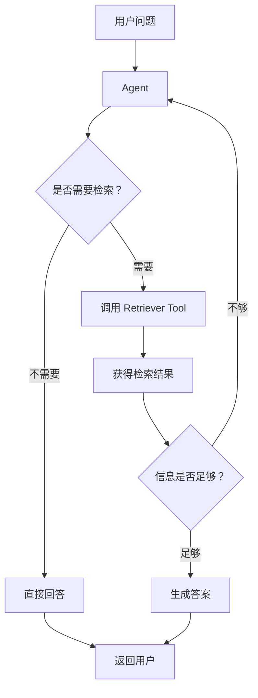

例如：

用户问：帮我研究 LangGraph 的 Checkpointer，并比较它与传统数据库持久化的区别。

Agent 可能会：

1. 搜索 Checkpointer 文档。
2. 搜索数据库持久化资料。
3. 对比两者。
4. 如果发现资料不足，再次检索。
5. 整理最终答案。

这种架构适合研究助手、多知识库问答和复杂任务。


**Hybrid RAG（混合 RAG）**

Hybrid RAG 结合两步 RAG 和 Agentic RAG 的特点。

它会在固定流程中加入一些智能判断和质量检查。

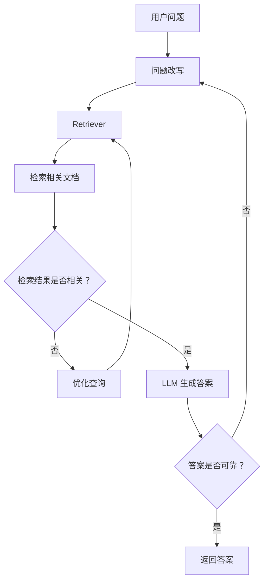

它通常包含：

- Query Enhancement：查询增强。
- Retrieval Validation：检索验证。
- Answer Validation：答案验证。

适合对准确性要求较高的系统，例如企业知识问答和专业领域助手。


**三种架构对比**

| 对比                  | Two-step RAG | Agentic RAG | Hybrid RAG     |
| --------------------- | ------------ | ----------- | -------------- |
| 是否固定先检索        | 是           | 否          | 通常有预设流程 |
| 是否由 Agent 决定检索 | 否           | 是          | 部分决定       |
| 是否支持多次检索      | 可以自定义   | 可以        | 可以           |
| 执行复杂度            | 低           | 高          | 中高           |
| 适用场景              | 文档问答     | 研究助手    | 高质量知识问答 |

这三种架构没有绝对的优劣，应该根据任务复杂度、延迟要求和可靠性要求选择。

### LangChain 构建一个简单 RAG

读取 PDF → 切分文档 → 生成向量 → 存入向量数据库 → 检索 → LLM 回答。

```python
# ============================================================
# 2-Step RAG 最小实现：加载 → 切分 → 向量化建库 → 检索 → 生成
# 注：embeddings / 模型此处用 OpenAI，可替换为你一直用的 DeepSeek
# ============================================================

# ---------- 阶段 1：加载 PDF 文档 ----------
from langchain_community.document_loaders import PyPDFLoader

loader = PyPDFLoader("langgraph.pdf")
docs = loader.load()                      # 返回 List[Document]，每页一个
print(f"加载文档数量：{len(docs)}")

# ---------- 阶段 2：把长文档切成小块 ----------
from langchain_text_splitters import RecursiveCharacterTextSplitter

text_splitter = RecursiveCharacterTextSplitter(
    chunk_size=500,       # 每块约 500 字符
    chunk_overlap=100,    # 相邻块重叠 100 字符，避免切断语义边界
)
splits = text_splitter.split_documents(docs)   # 切完的块才能被单独检索、塞进上下文
print(f"切分后数量：{len(splits)}")

# ---------- 阶段 3：向量化并建内存向量库 ----------
from langchain_openai import OpenAIEmbeddings
from langchain_core.vectorstores import InMemoryVectorStore

embeddings = OpenAIEmbeddings(model="text-embedding-3-small")  # 文本 → 向量
vector_store = InMemoryVectorStore(embeddings)                 # 纯内存库，无需额外服务
vector_store.add_documents(splits)                            # 把切块全部向量化存入

# ---------- 阶段 4：构建检索器（Vector Store → Retriever）----------
# as_retriever 把"存储"变成"检索接口"；k=3 表示每次取回最相关的 3 块
retriever = vector_store.as_retriever(search_kwargs={"k": 3})

# ---------- 阶段 5：检索 ----------
question = "LangGraph 中 Checkpointer 有什么作用？"
retrieved_docs = retriever.invoke(question)   # 输入问题，输出 List[Document]
for i, doc in enumerate(retrieved_docs):
    print(f"结果 {i + 1}")
    print(doc.page_content)   # 检索到的正文
    print(doc.metadata)       # 来源等元信息（页码、出处等）

# ---------- 阶段 6：用检索内容生成答案（2-Step 的"生成"步）----------
from langchain.chat_models import init_chat_model

model = init_chat_model("openai:gpt-4.1-mini")   # 统一模型名写法：厂商:模型

# 把检索到的块拼成上下文，塞进 prompt 约束模型"只依据资料回答"
context = "\n\n".join(doc.page_content for doc in retrieved_docs)
prompt = f"""
请根据以下参考资料回答问题。
如果参考资料没有提供足够的信息，请明确说明不知道，不要自行编造。
参考资料：
{context}
用户问题：
{question}
"""
response = model.invoke(prompt)
print(response.content)

```


## Long-term memory：长期记忆

它解决的是：**如何让 Agent 记住过去的信息，并在未来的对话中继续使用这些信息。**

LangGraph 将记忆分成两种：

- Short-term Memory（短期记忆）：保存当前对话线程中的状态和历史。
- Long-term Memory（长期记忆）：保存可以跨不同对话线程使用的信息。


### 短期记忆

```
Thread A

用户：我正在开发一个 Python 项目。
Agent：项目使用什么框架？

用户：使用 FastAPI。
Agent：好的。

用户：那接口应该如何设计？
Agent：可以结合 FastAPI 设计 REST API。
```

LangGraph 使用 Checkpointer 保存这些状态。

它主要解决：

- 多轮对话。
- 工作流暂停和恢复。
- 保留当前任务的执行状态。
- 在同一个 Thread 中延续上下文。

### 长期记忆

```
Thread B

用户：帮我设计一个 API。
```

这时，如果 Agent 能够知道用户之前使用 FastAPI，就可以结合这个信息回答。

但 Thread B 和 Thread A 是两个不同的线程。

因此，需要额外使用 Long-term Memory。

```
             Agent
               │
       ┌───────┴────────┐
       │                │
    Thread A         Thread B
       │                │
   Checkpointer      Checkpointer
       │                │
       └───────┬────────┘
               │
         Long-term Store
               │
          用户长期记忆
```

### 两者对比

| 对比           | Short-term Memory      | Long-term Memory             |
| -------------- | ---------------------- | ---------------------------- |
| 保存范围       | 单个 Thread            | 多个 Thread 共享             |
| 主要作用       | 记住当前对话           | 记住跨会话信息               |
| LangGraph 组件 | Checkpointer           | Store                        |
| 数据组织       | Thread State           | Namespace + Key              |
| 典型内容       | 对话历史、当前任务状态 | 用户偏好、用户资料、长期事实 |

Checkpointer 和 Store 不是同一个东西。

- Checkpointer 保存某条执行线程的状态。
- Store 保存跨线程共享的长期数据。

### LangGraph Store 是什么？

Store 是 LangGraph 提供的长期数据存储抽象。

它允许 Agent 将数据保存下来，并在未来的其他对话中读取。


三个核心概念：

| Store 概念 | 类比     | 作用           |
| ---------- | -------- | -------------- |
| Namespace  | 文件夹   | 对记忆进行分类 |
| Key        | 文件名   | 标识一条记忆   |
| Value      | 文件内容 | 保存实际数据   |

例如：

```
Store
│
├── users/
│   ├── user_001
│   │     └── {"name": "Alice", "language": "Python"}
│   │
│   └── user_002
│         └── {"name": "Bob", "language": "Java"}
│
└── projects/
    ├── project_001
    │     └── {"name": "AI Agent"}
    │
    └── project_002
          └── {"name": "RAG System"}
```

### 保存和更新长期记忆

```python
from langgraph.store.memory import InMemoryStore

store = InMemoryStore()

# 保存和更新都使用 put
store.put(
    ("users", "user_001"),
    "profile",
    {
        "name": "Alice",
        "language": "Python",
        "framework": "LangGraph"
    }
)

```

这段代码表示：

- Namespace：`("users", "user_001")`
- Key：`"profile"`
- Value：用户资料。

### 读取

```python
item = store.get(
    ("users", "user_001"),
    "profile"
)


if item:
    print(item.value)
else:
    print("没有找到用户记忆")
```

### 删除

```python
store.delete(
    ("users", "user_001"),
    "profile"
)
```

### 搜索

`store.get`是知道 key 的搜索，但是实际中大部分是不知道 key 的。

这时可以使用：`store.search()`

```python
# 1. 不带过滤的范围检索
#    search 接收一个 namespace（命名空间元组）
items = store.search(
    ("users", "user_001")
)

# 2. 遍历打印每个 item 的键和值
for item in items:
    print(item.key)
    print(item.value)

# 3. 带元数据过滤的检索
#    filter={"type": "preference"} 只返回 value 中匹配该条件的 item
#    适合一个 namespace 下混存了多种类型数据时，精准筛出某一类
items = store.search(
    ("users", "user_001"),
    filter={
        "type": "preference"
    }
)

```

#### 语义搜索

按照语义寻找记忆，可以为 Store 配置索引。

```python
# 标准库：用于类型注解的序列抽象（比 list 更通用）
from collections.abc import Sequence
# IndexConfig 是给 Store 配置"向量索引"的配置类
from langgraph.store.base import IndexConfig
# 内存版 Store
from langgraph.store.memory import InMemoryStore

# 1. 定义一个 embedding 函数（仅演示接口结构，不是真实向量化）
#    签名约定：吃一批文本 (Sequence[str])，返回一批向量 (list[list[float]])
#    真实场景应换成 OpenAIEmbeddings / 本地模型等，这里固定返回 [1.0, 2.0] 占位
def embed(texts: Sequence[str]) -> list[list[float]]:
    return [[1.0, 2.0] for _ in texts]

# 2. 创建 Store 并开启语义索引
#    index=IndexConfig(embed=embed, dims=2) 表示：
#      - 用上面的 embed 函数把记忆内容转成向量
#      - 向量维度是 2（必须和 embed 返回的长度一致，真实模型通常是 1536 等）
#    开启索引后，store.put 写入时会自动把内容向量化并建索引
store = InMemoryStore(
    index=IndexConfig(
        embed=embed,
        dims=2
    )
)

# 3. 写入一条长期记忆
#    namespace=("users", "user_001")，key="memory_001"
#    value 是 dict，含 content（语义检索的主要依据）+ type（便于元数据过滤）
store.put(
    ("users", "user_001"),
    "memory_001",
    {
        "content": "用户喜欢使用 Python 开发 AI Agent",
        "type": "preference"
    }
)

# 4. 语义检索（关键：传了 query=，触发向量相似度搜索）
#    这里和前一段"列举式 search"不同——
#    配了 index 后，search 会把 query 也 embed，再按相似度召回最相关的记忆
items = store.search(
    ("users", "user_001"),
    query="用户喜欢使用什么编程语言？"
)

# 5. 打印命中记忆的内容
for item in items:
    print(item.value)

```

### 让 Agent 自动读取长期记忆

前面都是我们手动调用 Store。

实际开发时，我们希望：

Agent 在处理用户问题时，可以自动读取当前用户的长期记忆。

LangChain 提供了 `ToolRuntime`，可以让工具访问 Store 和运行时 Context。

```python
# 标准库：声明轻量数据结构
from dataclasses import dataclass
# 内存版长期记忆存储
from langgraph.store.memory import InMemoryStore
# 工具装饰器 + 工具运行期上下文（带泛型 Context）
from langchain.tools import ToolRuntime, tool
# 创建 Agent 的入口
from langchain.agents import create_agent


# 1. 定义请求级上下文：携带当前用户 ID
@dataclass
class Context:
    user_id: str


# 2. 创建 Store 并预先写入一条用户长期记忆
store = InMemoryStore()
store.put(
    ("users",),          # 命名空间（一级）：所有用户资料放 "users" 桶
    "user_001",          # key：具体某个用户
    {
        "name": "Alice",
        "language": "Python",
        "framework": "LangGraph"
    }
)


# 3. 工具：查询"当前用户"的长期记忆
@tool
def get_user_info(runtime: ToolRuntime[Context]) -> str:
    """查询当前用户的长期记忆。"""
    # 防御：确保 Agent 创建时传了 store=，否则 runtime.store 为 None
    assert runtime.store is not None
    # 从上下文拿到当前用户 ID（由 invoke(context=...) 注入）
    user_id = runtime.context.user_id
    # 按相同 namespace + key 取回之前 put 的记忆
    item = runtime.store.get(
        ("users",),
        user_id
    )
    if item is None:
        return "没有找到用户资料"
    return str(item.value)


# 4. 创建 Agent：把工具、store、context_schema 一次性挂上
#    —— 关键：store=store 让工具里的 runtime.store 非 None，才能读到长期记忆
agent = create_agent(
    model="openai:gpt-5.5",        # 真实模型标识（openai: 前缀）
    tools=[get_user_info],
    store=store,                   # 注入长期记忆存储（本例的核心）
    context_schema=Context,
)

# 5. 调用 Agent：通过 context= 传入本次用户，工具内部即可按 user_id 取记忆
result = agent.invoke(
    {
        "messages": [
            {
                "role": "user",
                "content": "查询我的开发偏好"
            }
        ]
    },
    context=Context(user_id="user_001")
)

# 6. 打印最终 AI 回复（messages 最后一条即模型输出）
print(result["messages"][-1].content)

```

### 让 Agent 自动写入长期记忆

```python
# 用 TypedDict 描述工具要接收的"结构化参数"
from typing_extensions import TypedDict
# 工具装饰器 + 运行期上下文
from langchain.tools import ToolRuntime, tool
# 创建 Agent 入口
from langchain.agents import create_agent


# 1. 定义工具的结构化入参：用户资料要存的字段
#    LangChain 会据此生成 JSON Schema 交给模型，
#    模型调用工具时就会把自然语言映射到这个结构
class UserInfo(TypedDict):
    name: str
    language: str


# 2. 工具：保存"当前用户"的资料到长期记忆（写侧）
@tool
def save_user_info(
    user_info: UserInfo,           # 模型抽取出的结构化资料
    runtime: ToolRuntime[Context], # 携带 context + store
) -> str:
    """保存当前用户的资料。"""
    # 防御：确保 Agent 创建时传了 store=，否则 runtime.store 为 None
    assert runtime.store is not None
    # 写入 Store：namespace ("users",) + key=当前用户ID + value=资料字典
    # dict(user_info) 把 TypedDict 转成普通 dict（Store 要求可序列化的值）
    runtime.store.put(
        ("users",),
        runtime.context.user_id,
        dict(user_info)
    )
    return "用户资料保存成功"


# 3. 创建 Agent：复用前一段定义好的 store 和 Context
#    （store 已 put 过数据，Context 定义含 user_id）
agent = create_agent(
    model="openai:gpt-5.5",
    tools=[save_user_info],
    store=store,                # 关键：让工具 runtime.store 非 None
    context_schema=Context,
)

# 4. 调用 Agent：用户只说自然语言，模型自己抽取并调用 save_user_info
#    模型会把"我叫 Alice，平时主要使用 Python"
#    → 映射成 user_info={"name": "Alice", "language": "Python"} 写入 Store
agent.invoke(
    {
        "messages": [
            {
                "role": "user",
                "content": "我叫 Alice，平时主要使用 Python。"
            }
        ]
    },
    context=Context(user_id="user_001")
)

```

### 生产环境如何持久化长期记忆？

| Store         | 用途              |
| ------------- | ----------------- |
| InMemoryStore | 本地学习和测试    |
| PostgresStore | 生产环境持久化    |
| Redis Store   | 使用 Redis 存储   |
| MongoDB Store | 使用 MongoDB 存储 |

### 完整架构：构建一个具有长期记忆的 Agent

现在把本章的知识组合起来。

假设我们开发一个个人 AI 助手。

它需要：

1. 记住当前对话。
2. 记住用户长期偏好。
3. 根据问题读取相关记忆。
4. 在合适的时候保存新信息。
5. 在用户要求时更新或删除记忆。

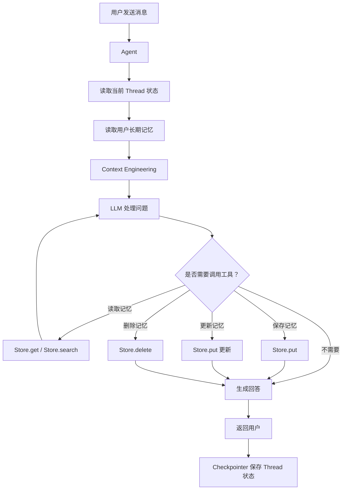

