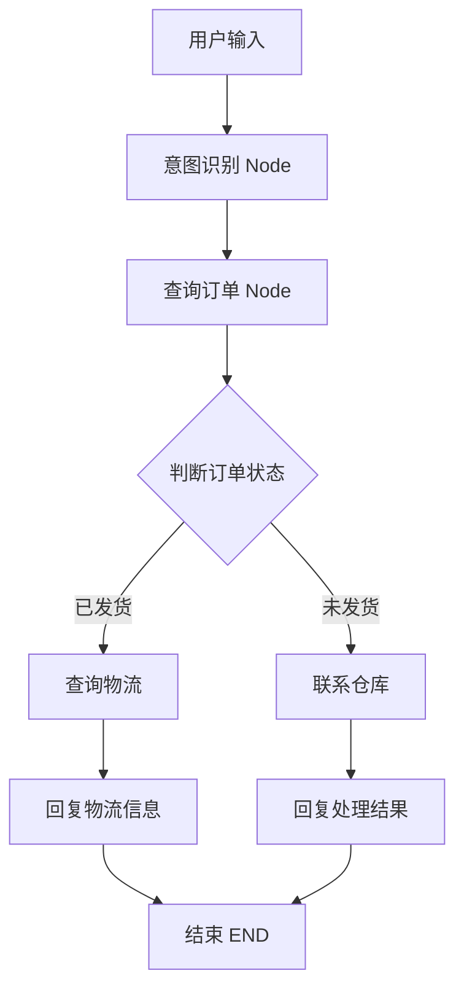
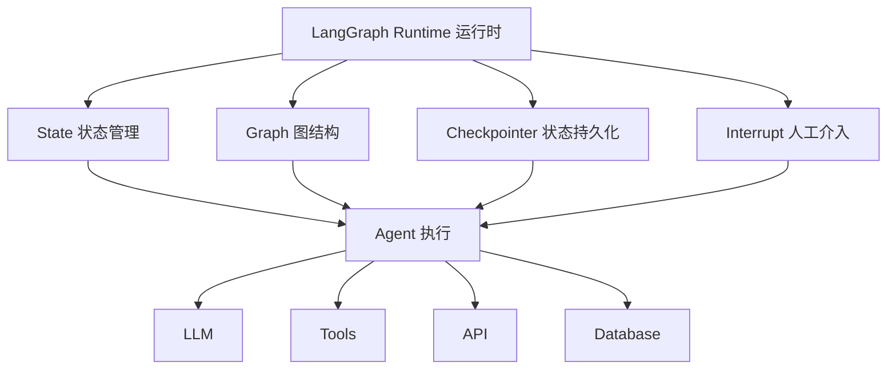
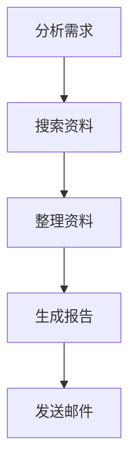
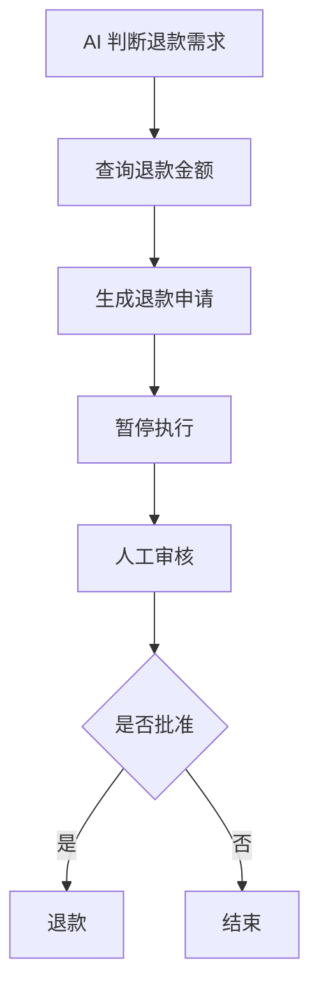
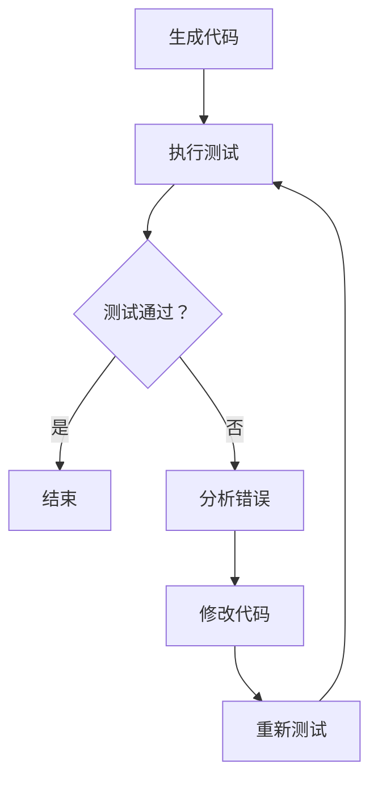
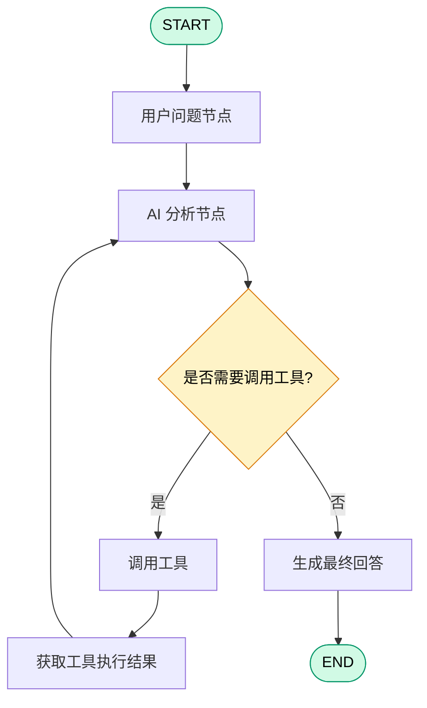

# LangGraph

## 什么是 LangGraph？

LangGraph 是 LangChain 团队推出的一个用于构建有状态（Stateful）、可循环（Cyclic）、可控制的 AI Agent 工作流的框架。

简单来说：

如果说 LangChain 帮助你快速调用大模型、连接工具、构建 AI 应用，那么 LangGraph 更关注的是：

如何让一个 AI Agent 像一个真正的程序一样，有状态、有流程、有记忆、能循环执行任务，并且在关键节点接受人工干预。

使用图（Graph）的方式，把 AI Agent 的执行过程组织起来。


假设你想开发一个 AI 客服 Agent，用户问：

> 帮我查询订单，如果订单已经发货，就告诉我物流信息；如果还没发货，就联系仓库处理。

一个简单的 AI 程序可能是：

```
用户提问
   ↓
调用 LLM
   ↓
返回答案
```

但实际业务远远没有这么简单。

它需要：

1. 判断用户到底想查询什么。
2. 调用订单查询接口。
3. 判断订单是否发货。
4. 如果已发货，调用物流接口。
5. 如果未发货，调用仓库系统。
6. 如果接口调用失败，尝试重试。
7. 如果需要人工审批，暂停并等待人工确认。
8. 最后整合结果回复用户。

这实际上是一个有分支、有循环、有状态的复杂流程。

传统的线性 Chain 很难优雅地管理这些逻辑。

LangGraph 就是为了解决这类问题而设计的。

## LangGraph 的核心思想：把 Agent 变成一张图

LangGraph 最重要的设计理念是 Graph（图）。

它不是简单地把任务从上到下执行，而是把整个 AI 工作流程拆成节点（Node），再通过边（Edge）连接起来。




### 核心架构图



## 三个核心概念

### 1. State（状态）

State 就是整个 Agent 执行过程中共享的数据。

```python
state = {
    "user_query": "我的订单发货了吗？",
    "order_id": "10001",
    "order_status": "shipped",
    "tracking_number": "SF123456",
    "answer": ""
}
```

每个节点都可以读取 State，也可以更新 State。

### 2. Node（节点）

Node 是一个执行单元，通常是一个 Python 函数。

```python
def query_order(state):
  	# 获取订单状态
    order = order_api(state["order_id"])
		
    # 返回订单状态
    return {
        "order_status": order["status"]
    }
```

一个 Node 可以执行：

- 调用大模型。
- 调用外部 API。
- 执行业务代码。
- 查询数据库。
- 处理数据。

### Edge（边）

Edge 决定节点之间如何流转。

主要有两种：

- 普通 Edge：A 执行完后，进入 B。
- Conditional Edge：根据当前 State 决定下一步进入哪个节点。

```python
def route_order(state):
    if state["order_status"] == "shipped":
        return "logistics"

    return "warehouse"
```

**这就实现了动态流程控制。**

## LangGraph 主要解决了哪几个问题？

| 传统 Agent 的问题          | LangGraph 的解决方案      |
| -------------------------- | ------------------------- |
| 流程只能简单串行执行       | 支持分支、循环、跳转      |
| 多步骤之间数据容易丢失     | State 统一管理状态        |
| Agent 执行中断后难以恢复   | Checkpoint 持久化状态     |
| 模型容易自主发挥，难以控制 | 可以混合确定性代码与 LLM  |
| 重要操作缺少人工审核       | Human-in-the-loop         |
| 长时间运行的任务难以管理   | 支持持久化和恢复执行      |
| 执行过程不透明             | 可配合 LangSmith 追踪调试 |

### 持久化与断点恢复（Persistence）

假设你开发一个 AI 自动化系统，需要执行：




如果执行到生成报告时服务器突然崩溃，怎么办？

普通程序可能需要重新执行整个任务。

LangGraph 可以**通过 Checkpointer 保存执行状态，在满足恢复条件时从之前保存的状态继续执行。**

### 人工介入（Human-in-the-loop）

假设 Agent 要给客户退款。

你肯定不希望 AI 自己决定金额，然后直接执行退款。

可以设计成：



人工可以检查甚至修改 Agent 的 State，然后继续执行。

### 循环执行（Cycles）

这是 LangGraph 很重要的特点。

例如 AI 生成代码：



它可以反复执行，直到满足条件，或者达到最大迭代次数。

## LangChain 和 LangGraph 有什么区别？

这是初学者最容易混淆的地方。

| 对比     | LangChain                    | LangGraph              |
| -------- | ---------------------------- | ---------------------- |
| 定位     | LLM 应用开发框架             | Agent 编排框架与运行时 |
| 核心关注 | 模型、工具、检索、Agent 抽象 | 流程、状态、执行控制   |
| 流程     | 适合常见 Chain 和 Agent 模式 | 支持复杂图结构         |
| 状态管理 | 提供相关抽象                 | 核心设计能力           |
| 循环控制 | 可以实现                     | 原生图结构支持         |
| 断点恢复 | 不是核心定位                 | 核心能力               |
| 人工审批 | 需要组合实现                 | 提供专门机制           |

两者不是竞争关系，而是可以配合使用。

## 什么时候应该使用 LangGraph？

举几个常见的例子：

- 场景 1：智能客服

  需要识别问题、查询订单、调用工具、判断业务规则，必要时转人工。

- 场景 2：AI 深度研究 Agent

  搜索资料、分析资料、发现信息不足、继续搜索、整合报告。

- 场景 3：AI 编程 Agent

  编写代码、执行测试、分析错误、自动修复、重新测试。

## 安装

```shell
uv add langgraph

# 大部分时候还需要 langchain
uv add langchain
```

## StateGraph：创建图

通过使用 StateGraph 开始创建图。它的作用是：创建一个状态图，用来组织节点和节点之间的执行关系。它是一张流程图的容器。

```python
# 从标准库 typing 导入 TypedDict，用于声明图的强类型状态结构
from typing import TypedDict
# 从 langgraph.graph 导入构建状态图所需的类与虚拟起止点
from langgraph.graph import StateGraph, START, END


# 1. 定义状态（State）
# 使用 TypedDict 描述图在运行过程中维护的数据结构
# 这里只有一个字段 message，表示在节点之间传递的一条文本消息
class MyState(TypedDict):
    message: str


# 2. 创建状态图（Builder）
# StateGraph 接收状态类型 MyState，负责登记节点与边，编译前只是"草稿"
builder = StateGraph(MyState)


# 3. 定义节点（Node）
# 节点是一个函数，接收当前 state，返回需要更新的字段
# 返回 {"message": ...} 会覆盖（替换）state 中的 message
def hello_node(state: MyState):
    # 忽略输入，直接返回一条固定的问候消息
    return {
        "message": "Hello LangGraph!"
    }


# 4. 添加执行节点
# 第一个参数是节点名（"hello"），第二个参数是对应的处理函数
builder.add_node("hello", hello_node)


# 5. 添加边（Edge），定义节点的执行顺序
# 从虚拟起点 START 流向 hello 节点（图的入口）
builder.add_edge(START, "hello")
# 从 hello 节点流向虚拟终点 END（图的出口）
builder.add_edge("hello", END)


# 6. 编译图
# 把草稿（节点+边）固化成可执行的 Runnable 对象，之后才能 invoke
graph = builder.compile()


# 7. 执行图
# 传入初始 state（message="你好"），沿 START → hello → END 运行
result = graph.invoke({
    "message": "你好"
})
# 打印最终 state：{"message": "Hello LangGraph!"}
print(result)

```


注意一个容易混淆的地方：

- `builder`：负责构建图。
- `graph`：编译后得到的可执行图。

## State：状态

它负责保存整个 Graph 执行过程中需要共享的数据。

例如，一个 AI Agent 需要保存：

- 用户的问题
- AI 的回答
- 工具调用结果
- 当前执行次数
- 是否需要调用工具

这些数据都可以放在 State 中。

### 定义 state

```python
from typing import TypedDict


class AgentState(TypedDict):
  	#	用户的问题
    question: str
		# AI 的回答
    answer: str
		# 执行次数
    count: int
```

### state 如何传递

```python
# 从标准库导入 TypedDict，用于声明图的强类型状态结构
from typing import TypedDict
# 导入构建状态图所需的类与虚拟起止点
from langgraph.graph import StateGraph, START, END


# 1. 定义状态（State）
# AgentState 描述图运行期间维护的数据：
#   question —— 用户提出的问题（输入）
#   answer   —— 生成的回答（由节点填充）
class AgentState(TypedDict):
    question: str
    answer: str


# 2. 定义节点 A：处理问题并生成回答
def node_a(state: AgentState):
    # 读取输入中的问题并打印
    print("问题：", state["question"])
    # 返回要更新的字段：写入 answer（这里用固定文本模拟"AI 生成"）
    return {
        "answer": "这是 AI 生成的回答"
    }


# 3. 定义节点 B：消费/展示上一节点产生的回答
def node_b(state: AgentState):
    # 读取已被 node_a 更新过的 answer 并打印
    print("回答：", state["answer"])
    # 返回空字典表示本节点不修改任何状态字段
    return {}


# 4. 创建状态图（Builder），状态类型使用 AgentState
builder = StateGraph(AgentState)

# 5. 注册两个节点（指定节点名与对应函数）
builder.add_node("node_a", node_a)
builder.add_node("node_b", node_b)

# 6. 添加边，定义执行顺序：START → node_a → node_b → END
builder.add_edge(START, "node_a")
builder.add_edge("node_a", "node_b")
builder.add_edge("node_b", END)

# 7. 编译图，固化成可执行的 Runnable 对象
graph = builder.compile()

# 8. 执行图：传入初始 state（question 有值，answer 先留空）
result = graph.invoke({
    "question": "什么是 LangGraph？",
    "answer": ""
})

# 打印最终返回的状态
print(result)
# 问题： 什么是 LangGraph？
# 回答： 这是 AI 生成的回答
# {'question': '什么是 LangGraph？', 'answer': '这是 AI 生成的回答'}
```

### 如何"追加"数据

上面的例子只能获取到每次更新之后的数据，但是想要之前的数据就只能用累加了

```python
# Annotated 用于在类型注解上附加"元数据"，LangGraph 借此识别 reducer
from typing import Annotated
# operator.add 是一个二元操作函数：operator.add(a, b) == a + b
# LangGraph 把它用作"归约函数（reducer）"，决定状态字段如何合并
import operator
# TypedDict 用于声明图的强类型状态结构
# （从 typing_extensions 导入，兼容低版本 Python；3.10+ 也可直接 from typing import TypedDict）
from typing_extensions import TypedDict


# 定义状态：只有一个字段 messages
class AgentState(TypedDict):
    # Annotated[list, operator.add] 的含义：
    #   - 类型仍是 list
    #   - 附加的 reducer = operator.add（即列表拼接）
    # 效果：当某个节点返回 {"messages": [新消息]} 时，
    #       LangGraph 不会"覆盖"原 messages，而是把新列表内容"追加"到原有列表末尾
    # 这正是实现多轮对话历史累积的标准写法
    messages: Annotated[list, operator.add]

```

## Node: 执行节点

它是 Graph 中真正执行任务的地方。**一个 Node 就是一个执行函数。**

例如：

- 接收用户问题
- 调用大模型
- 查询数据库
- 调用搜索工具
- 执行 Python 代码
- 分析工具返回结果

```python
def llm_node(state):
  	print("开始调用LLM")
    response = llm.invoke(state["question"])
    print("调用结束")

    return {
        "answer": response.content
    }
```

**Node 通常接收 State，并返回一个字典，表示对 State 的更新。如果返回空的字典，表示不更新**

### 多节点组合

```python
# 导入 TypedDict 用于声明强类型状态；导入 StateGraph 与虚拟起止点
from typing import TypedDict
from langgraph.graph import StateGraph, START, END


# 1. 定义状态（State）
# 三个字段分别表示流程中的三件事：
#   question —— 用户原始问题（输入）
#   analysis —— 分析过程/结论（中间产物，会被多个节点读写）
#   answer   —— 最终回答（输出）
class AgentState(TypedDict):
    question: str
    analysis: str
    answer: str


# 2. 节点一：接收问题，写入初步分析
def question_node(state):
    # 读取输入问题，生成"分析开始"文本，写入 analysis 字段
    return {
        "analysis": f"正在分析：{state['question']}"
    }


# 3. 节点二：在已有分析基础上追加结论
def analysis_node(state):
    # 读取上一节点写好的 analysis，拼接"分析完成"后回写
    # （注意：analysis 是普通 str，这里靠"先读后写"完成累积）
    return {
        "analysis": state["analysis"] + "，分析完成"
    }


# 4. 节点三：生成最终回答
def answer_node(state):
    # 本节点只写 answer，不关心 analysis 的具体内容
    return {
        "answer": "这是最终回答"
    }


# 5. 创建状态图（Builder）
builder = StateGraph(AgentState)

# 6. 注册三个节点（节点名与函数一一对应）
builder.add_node("question", question_node)
builder.add_node("analysis", analysis_node)
builder.add_node("answer", answer_node)

# 7. 添加边，定义线性执行顺序：
# START → question → analysis → answer → END
builder.add_edge(START, "question")
builder.add_edge("question", "analysis")
builder.add_edge("analysis", "answer")
builder.add_edge("answer", END)

# 8. 编译图，固化成可执行的 Runnable 对象
graph = builder.compile()


result = graph.invoke({
    "question": "什么是 LangGraph？",
    "analysis": "",
    "answer": ""
})
print(result)
# 输出：
# {'question': '什么是 LangGraph？',
#  'analysis': '正在分析：什么是 LangGraph？，分析完成',
#  'answer': '这是最终回答'}
```

## Edge：执行流程

它的作用是连接不同的 Node，决定执行完当前节点后，接下来执行哪个节点。

```python
builder.add_edge(START, "node_a")
builder.add_edge("node_a", "node_b")
builder.add_edge("node_b", "node_c")
builder.add_edge("node_c", END)
```

## Conditional Edge：条件分支

Conditional Edge 就是条件边。**根据当前 State 或其他判断结果，动态决定下一个执行节点。**

假设 Agent 判断用户的问题：

- 如果需要搜索，就调用搜索节点。
- 如果不需要搜索，就直接回答。

```python
# 导入 TypedDict 声明状态；导入 StateGraph 与虚拟起止点
from typing import TypedDict
from langgraph.graph import StateGraph, START, END


# 1. 定义状态（State）
#   question  —— 用户问题（输入）
#   need_tool —— 是否需要调用工具的标记（由 agent 节点判断）
#   answer    —— 最终回答（输出）
class AgentState(TypedDict):
    question: str
    need_tool: bool
    answer: str


# 2. 节点：agent，模拟"AI 决策"
# 这里写死返回 need_tool=True，真实场景会由 LLM 判断是否需要检索/工具
def agent_node(state):
    # 模拟 AI 判断是否需要借助外部工具
    return {
        "need_tool": True
    }


# 3. 路由函数（router）：根据状态决定下一步走哪条分支
# 注意：它不属于"节点"，不会出现在 add_node 里，
#       只作为 add_conditional_edges 的"路由依据"被调用
def route_node(state):
    # 返回值是字符串，必须出现在下面 path_map 的 key 中
    if state["need_tool"]:
        return "search"   # 需要工具 → 走搜索分支
    return "answer"       # 不需要 → 直接生成回答


# 4. 分支节点一：search，模拟调用搜索工具得到答案
def search_node(state):
    return {
        "answer": "这是搜索得到的结果"
    }


# 5. 分支节点二：answer，模拟直接生成回答
def answer_node(state):
    return {
        "answer": "这是直接生成的回答"
    }


# 6. 创建状态图（Builder）
builder = StateGraph(AgentState)

# 7. 注册节点（router 不需要注册为节点）
builder.add_node("agent", agent_node)
builder.add_node("search", search_node)
builder.add_node("answer", answer_node)

# 8. 画主流程的入边：START → agent
builder.add_edge(START, "agent")

# 9. 添加"条件边"：从 agent 节点出发，按 route_node 的返回值分流
builder.add_conditional_edges(
    "agent",          # 源节点
    route_node,       # 路由函数：返回 "search" 或 "answer"
    {                 # 路径映射：返回值 → 目标节点名
        "search": "search",
        "answer": "answer"
    }
)

# 10. 两个分支都汇向 END（终点）
builder.add_edge("search", END)
builder.add_edge("answer", END)

# 11. 编译图，固化成可执行的 Runnable 对象
graph = builder.compile()


result = graph.invoke({
    "question": "今天天气怎么样？",
    "need_tool": False,
    "answer": ""
})
print(result)
# 输出：
# 因 agent_node 固定返回 need_tool=True，会走 search 分支：
# {'question': '今天天气怎么样？', 'need_tool': True, 'answer': '这是搜索得到的结果'}
```


## Cycles：循环/重试

LangGraph 与普通线性工作流最大的区别之一，就是它支持循环执行。

在 AI Agent 中，很多任务不能一次完成。

例如：

- AI 生成的代码运行失败，需要重新修改。
- 搜索结果不准确，需要重新搜索。
- AI 回答不符合要求，需要重新生成。
- 工具调用失败，需要再次尝试。

这些场景都需要循环。

```python
# 导入 TypedDict 声明状态；导入 StateGraph 与虚拟起止点
from typing import TypedDict
from langgraph.graph import StateGraph, START, END


# 1. 定义状态（State）
#   count  —— 已生成次数（计数器）
#   result —— 最近一次生成的结果（中间产物）
#   passed —— 是否通过校验（门控标记）
class AgentState(TypedDict):
    count: int
    result: str
    passed: bool


# 2. 节点：generate，每次把计数 +1 并生成一条结果
def generate_node(state):
    count = state["count"] + 1        # 自增计数
    return {
        "count": count,
        "result": f"第 {count} 次生成结果"
    }


# 3. 节点：check，根据当前 count 判断是否满足通过条件
def check_node(state):
    # 模拟业务规则：累计生成达到 3 次才算"通过"
    passed = state["count"] >= 3
    return {
        "passed": passed
    }


# 4. 路由函数（router）：决定"继续重试"还是"结束"
def route_node(state):
    if state["passed"]:           # 已通过 → 结束
        return "end"
    if state["count"] >= 3:       # 兜底：计数也到 3 → 结束
        return "end"
    return "retry"                # 否则 → 回到生成节点重试


# 5. 创建状态图（Builder）
builder = StateGraph(AgentState)

# 6. 注册两个业务节点（router 不是节点，无需注册）
builder.add_node("generate", generate_node)
builder.add_node("check", check_node)

# 7. 主流程：START → generate → check
builder.add_edge(START, "generate")
builder.add_edge("generate", "check")

# 8. 条件边：从 check 出发，按 route_node 返回值分流
builder.add_conditional_edges(
    "check",                      # 源节点
    route_node,                   # 路由函数：返回 "retry" 或 "end"
    {                             # 路径映射
        "retry": "generate",      # 返回 retry → 跳回 generate（形成循环）
        "end": END                # 返回 end   → 直接结束
    }
)

# 9. 编译图，固化成可执行的 Runnable 对象
graph = builder.compile()

# 10. 执行：初始计数 0，循环直到 count 达到 3
result = graph.invoke({
    "count": 0,
    "result": "",
    "passed": False
})

print(result)
# 输出：
# {'count': 3, 'result': '第 3 次生成结果', 'passed': True}
```

**Cycles = Node + Edge + 返回之前节点的流程连接。**

**循环通常需要配合条件判断和最大重试次数，避免无限循环。**

## Checkpointer：持久化

Checkpointer 是 LangGraph 的状态保存机制。

它可以在 Graph 执行过程中保存状态快照。

**就像游戏存档一样，可以保存 Agent 当前的执行进度，之后再恢复。**


假设用户正在使用一个 AI Agent：

1. 用户提出一个复杂问题。
2. Agent 已经执行了几个步骤。
3. Agent 需要等待人工审批。
4. 用户关闭页面。
5. 第二天重新打开。
6. 希望继续之前的任务。

如果没有状态保存机制，就可能需要从头执行。


```python
# Checkpointer 负责在图执行过程中"持久化状态"，让图具备记忆 / 可恢复能力
from langgraph.checkpoint.memory import InMemorySaver

# 1. 创建一个内存检查点对象（数据存在进程内存里，重启即丢失）
#    生产环境可换成 SqliteSaver / PostgresSaver 等做持久化存储
checkpointer = InMemorySaver()

# 2. 编译图时把 checkpointer 挂上去
#    挂上之后，图就变成"有状态（stateful）"的：每次执行的中间状态会被记录下来
graph = builder.compile(
    checkpointer=checkpointer
)

# 3. 配置对象：用 thread_id 标识"哪一次会话 / 哪一条对话线程"
#    不同的 thread_id 拥有相互独立的持久化状态，互不干扰
config = {
    "configurable": {
        "thread_id": "user_001"
    }
}

# 4. 调用图时传入 config
#    - 同一 thread_id 的多次 invoke 会"接着上次的状态继续"（对话记忆）
#    - 也支持中途崩溃后从检查点恢复、以及 human-in-the-loop 中断/续跑
#    这里只传了 question，answer 等字段依赖检查点维护（首次调用需状态定义兼容）
result = graph.invoke(
    {
        "question": "什么是 LangGraph？"
    },
    config=config
)

```

需要注意：

- `InMemorySaver` 只适合开发和测试。
- 程序重启后，内存中的数据不会保留。
- 生产环境应该使用持久化存储，例如 SQLite 或 PostgreSQL 对应的 Checkpointer。

## Interrupt：人工审批

Interrupt 就是中断。它可以让 Agent 在执行到某个位置时暂停，等待外部输入或人工审批。

AI Agent 不应该在所有情况下都自动执行。

尤其是涉及以下操作：

- 转账
- 删除数据
- 发送重要邮件
- 修改数据库
- 发布内容
- 执行高风险操作

应该先提出操作计划，再由人决定是否允许执行。


```python
# 导入 TypedDict 声明状态；导入 StateGraph 与虚拟起止点
from typing import TypedDict
from langgraph.graph import StateGraph, START, END
# interrupt 用于在节点中"主动暂停并等待外部输入"（人工介入 / 审批）
# Command 用于"从暂停点恢复执行"，resume 的值会回传给 interrupt
from langgraph.types import interrupt, Command
# 检查点：interrupt 必须配合 checkpointer 才能恢复（暂停点要先落盘）
from langgraph.checkpoint.memory import InMemorySaver


# 1. 定义状态（State）
#   action   —— 待执行的操作（输入）
#   approved —— 人工审批结果（由 approval 节点在恢复后填充）
#   result   —— 最终执行结果（输出）
class AgentState(TypedDict):
    action: str
    approved: bool
    result: str


# 2. 节点：approval，发起人工审批并暂停
def approval_node(state):
    # interrupt 会立刻暂停图的执行，并把传入的字典"抛给"调用方
    # 当后续用 Command(resume=...) 恢复时，interrupt(...) 的返回值 = resume 的值
    approved = interrupt({
        "message": "是否允许执行该操作？",
        "action": state["action"]
    })
    # 恢复后才继续往下走：把人工给的 approved 写回状态
    return {
        "approved": approved
    }


# 3. 节点：execute，根据审批结果决定执行还是拒绝
def execute_node(state):
    if state["approved"]:
        return {
            "result": "操作执行成功"
        }
    return {
        "result": "操作已被拒绝"
    }


# 4. 创建状态图（Builder）并注册节点
builder = StateGraph(AgentState)
builder.add_node("approval", approval_node)
builder.add_node("execute", execute_node)

# 5. 主流程：START → approval → execute → END（线性，但 approval 内部会暂停）
builder.add_edge(START, "approval")
builder.add_edge("approval", "execute")
builder.add_edge("execute", END)

# 6. 编译图：interrupt 必须挂 checkpointer，否则暂停点无法保存、无法恢复
checkpointer = InMemorySaver()
graph = builder.compile(
    checkpointer=checkpointer
)

# 7. 用 thread_id 隔离这次审批会话
config = {
    "configurable": {
        "thread_id": "approval_001"
    }
}

# 8. 第一次执行：运行到 approval_node 里的 interrupt 时暂停
#    此时返回的 result 是暂停前的状态（含 pending 的 interrupt 信息）
result = graph.invoke(
    {
        "action": "删除数据库记录",
        "approved": False,
        "result": ""
    },
    config=config
)

print(result)
# 输出：
# {'action': '删除数据库记录', 'approved': False, 'result': ''}   # 第一次：停在审批前

# 9. 第二次执行：人工审批通过，用 Command(resume=True) 恢复
#    resume=True 会成为 approval_node 中 interrupt(...) 的返回值，
#    于是 approved 被赋值为 True，图从暂停处继续往下走到 execute_node
result = graph.invoke(
    Command(resume=True),
    config=config
)

print(result)
# 输出：
# {'action': '删除数据库记录', 'approved': True,  'result': '操作执行成功'}  # 第二次：恢复后执行

```

- **`interrupt` 是暂停器**：节点调用它时，图立刻停下并把 payload 交回调用方；节点"后面的代码"要等恢复才执行。
- **`Command(resume=X)` 是续命键**：`X` 会成为 `interrupt(...)` 的返回值。本例 `resume=True` → `approved = True`。要拒绝就传 `Command(resume=False)`。

## Subgraphs：多 Agent/模块化

Subgraphs 就是子图。

当一个 Agent 项目变得复杂时，我们不应该把所有 Node 都放在一个 Graph 中。

可以把不同功能拆分成独立的 Graph，再组合起来。

1. 搜索 Agent
2. 分析 Agent
3. mcp Agent

每个子图都可以独立管理自己的节点和执行流程。

假设我们需要构建一个多 Agent 系统：

| Agent          | 负责的任务 |
| -------------- | ---------- |
| Research Agent | 搜集资料   |
| Coding Agent   | 编写代码   |
| Review Agent   | 检查代码   |
| Report Agent   | 生成报告   |

如果全部写在一个 Graph 中，会变得非常复杂。

使用 Subgraphs 就可以把每个 Agent 独立封装起来。

### 创建子 agent

```python
# 导入 TypedDict 声明状态；导入 StateGraph 与虚拟起止点
from typing import TypedDict
from langgraph.graph import StateGraph, START, END


# 1. 定义"子图"自己的状态（SubState）
#    子图拥有独立的状态结构，和父图的状态可以不同
class SubState(TypedDict):
    message: str


# 2. 子图内的节点：在传入的消息后追加一句完成标记
def sub_node(state):
    return {
        "message": state["message"] + "，子图执行完成"
    }


# 3. 用 StateGraph 搭建子图（builder）
sub_builder = StateGraph(SubState)

# 4. 在子图里注册节点并连边：START → sub_node → END
sub_builder.add_node("sub_node", sub_node)
sub_builder.add_edge(START, "sub_node")
sub_builder.add_edge("sub_node", END)

# 5. 编译子图
#    ——关键：编译后的 graph 本身可以被当作"一个节点"挂到别的图里
sub_graph = sub_builder.compile()

```


### 子 agent 加入主 agent

```python
# 1. 定义"主图"的状态（MainState）
#    注意：它和上一段的 SubState 都有同名字段 message —— 这是父子状态能自动映射的关键
class MainState(TypedDict):
    message: str


# 2. 主图节点：写入一条初始消息
def main_node(state):
    return {
        "message": "主图开始执行"
    }


# 3. 创建主图的 builder
main_builder = StateGraph(MainState)

# 4. 注册主图自己的节点
main_builder.add_node("main", main_node)

# 5. 关键：把"已经编译好的子图 sub_graph"直接当作一个节点挂进主图
#    LangGraph 会把主图状态按字段名映射进子图的 SubState，
#    子图执行完再把结果按字段名映射回主图状态
main_builder.add_node("sub", sub_graph)

# 6. 主流程：START → main → sub → END（sub 在这里就是一个"黑盒节点"）
main_builder.add_edge(START, "main")
main_builder.add_edge("main", "sub")
main_builder.add_edge("sub", END)

# 7. 编译主图，得到可执行的完整图
main_graph = main_builder.compile()

result = main_graph.invoke({"message": ""})
print(result)
# 输出：
# {'message': '主图开始执行，子图执行完成'}

```

### 如果主图和子图的 State 不一样呢？

```python
# 主图
class MainState(TypedDict):
    question: str
    answer: str
      
# 子图
class SubState(TypedDict):
    search_query: str
    search_result: str
```

此时就需要进行状态转换。可以使用一个普通 Node 作为适配层：

```python
def call_subgraph(state):
    result = sub_graph.invoke({
        "search_query": state["question"]
    })

    return {
        "answer": result["search_result"]
    }
```

```python
main_builder.add_node(
    "search_subgraph",
    call_subgraph
)
```

让主图与子图中间加一层转换层。这样主图就可以调用拥有不同 State Schema 的子图。

**Subgraphs = 把一个复杂 Graph 拆分成多个独立的小 Graph，再组合起来。**

主要价值：

1. **模块化开发。**
2. **复用工作流。**
3. **降低代码复杂度。**
4. **构建多 Agent 系统。**
5. **方便独立测试和维护。**


## 整体流程



