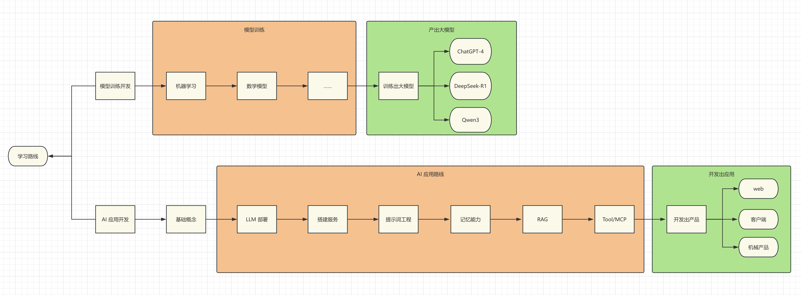

# AI

AI 是让机器模仿人类智能行为（学习、推理、感知、决策）的科学与工程。它不是通过硬编码的规则，而是通过从数据中学习模式来完成任务。AI 的目标是让机器在给定目标下自主地执行任务，并尽量降低对人类干预的依赖（通常仍需人类触发或监督）。

## 核心名词

### 机器学习 (Machine Learning) ML

机器学习（ML）是一种人工智能技术，它通过算法让计算机从数据中学习规律，并利用学习到的规律完成预测、分类、聚类和决策等任务，而不需要针对每种情况都编写明确的规则。

### 深度学习 (Deep Learning) DL

深度学习，受生物神经元结构的启发，使用包含多个层次的神经网络来处理数据。能够从原始数据（图像像素、音频波形）中提取非常复杂的特征，无需过多人工干预。比如：图像识别、语音识别、自然语言处理等。

### 神经网络 (Neural Network) NN

神经网络是深度学习的基础架构。由像神经单元一样的节点层层连接而成。数据从输入层流入，经过多个隐藏层的处理，最后由输出层得到结果。

### 生成式 AI (Generative AI)

生成式 AI（Generative AI）是一类能够根据学习到的数据分布和模式生成新内容的人工智能技术，包括文本、图像、音频、视频和代码等。

### 计算机视觉 (Computer Vision) CV

让计算机能看和理解图像和视频，比如：人脸识别、图像分类、自动驾驶中的物体检测等。

### 自然语言处理 (Natural Language Processing) NLP

让计算机能够理解、分析和生成人类语言，比如机器翻译、文本分类、情感分析、文本问答等。语音识别和语音合成则属于相关的语音技术领域。

### API 接口

API（Application Programming Interface，应用程序编程接口）是不同软件系统之间进行交互的接口。在 AI 应用开发中，可以通过 API 调用云端或本地部署的 AI 模型，将输入数据发送给模型，并获取处理结果。比如：调用 OpenAI 的 API，发送一段文字，就能得到 AI 生成的文字。

### 大语言模型 (Large Language Model) LLM

大语言模型是一种基于深度学习的自然语言处理模型，它能够理解和生成人类语言。比如 GPT 系列、Qwen 系列、DeepSeek 系列、Llama 系列等。

#### 模型参数
模型参数就是模型内部可学习的**权重（weights）与偏置（biases）**，类似神经元之间的连接强度。参数数量是衡量模型规模的重要指标。通常情况下，在训练数据、模型架构和训练方法等条件相近时，增加参数规模能够提高模型的表达能力。但模型的实际效果还取决于训练数据质量、模型架构、训练方法和推理策略等因素。

#### 参数文件
模型参数文件，就是将模型参数保存下来，方便下次使用。比如：GPT-3 约有 1750 亿（175B）个参数，其权重文件按 FP16 精度保存约需 350GB（FP32 约 700GB）存储空间。以上仅为模型权重的理论存储空间，不包含运行时激活值、KV Cache、框架开销等额外内存占用。
它包含了模型的所有可学习参数，如权重、偏置、嵌入表、归一化参数等。

### 提示词工程 (Prompt Engineering)

设计和优化输入给 AI 模型（尤其是 LLM）的提示词，以获得更好的输出结果。比如给 LLM 的提示加上"用一句话、面向小学生解释"的约束，输出会比不加约束更贴合需求；又如提供少量示例（few-shot）能显著提升特定任务的准确率。

### Token

在 NLP（自然语言处理）中，Token 是大语言模型处理文本时使用的基本单位。它可以是一个完整单词、词的一部分、一个汉字，也可能包含标点或其他字符。具体如何切分取决于模型使用的 Tokenizer。

### LangChain

LangChain 是一个用于开发基于大语言模型应用的开发框架，提供模型调用、提示词管理、结构化输出、工具调用、检索以及 Agent 等能力，帮助开发者将 LLM 与外部数据源和工具整合起来。比如：将 LLM 与数据库连接起来，实现一个智能客服系统。又或者将 LLM 与搜索引擎连接起来，实现一个智能问答系统。

### RAG （Retrieval-Augmented Generation）检索增强生成

RAG（Retrieval-Augmented Generation，检索增强生成）是一种将外部知识检索与大语言模型生成能力结合起来的技术。它在生成回答之前，先从外部知识库中检索相关信息，再将检索结果作为上下文提供给 LLM，使模型能够基于外部资料生成回答。

RAG 可以减少模型因知识缺失或知识过时而产生的错误，但不能完全消除幻觉。

### Agent 智能体

Agent（智能体）是一种能够根据目标感知环境、进行推理、规划任务，并调用工具执行操作的 AI 系统。它通常由 LLM、工具、状态管理和执行逻辑等部分组成，可以根据任务执行结果动态调整后续行动。

### MCP（Model Context Protocol）模型上下文协议

MCP（Model Context Protocol，模型上下文协议）是一种开放协议，用于标准化 AI 应用与外部数据源、工具及服务之间的连接方式。通过 MCP，支持该协议的客户端可以发现并使用 MCP Server 提供的资源、工具和提示模板等能力。

## 与前端结合

对于前端开发来说，并不需要成为训练神经网络的专家，但是要成为 **AI 与用户界面之间的桥梁**。
任务是理解 AI 能做什么，如何使用 AI，如何将 AI 与用户界面结合。

### 两条线路

AI 与前端结合有两条线路，一条是 **AI 应用开发**，另一条是 **模型训练开发**。

- AI 应用开发：学习关键概念、实现应用的技术方案。目的就是开发不同的 AI 应用，比如：Dify、豆包、Chatbox、Cursor 等（注：这些是 AI 应用产品或平台，而非"开发"本身）。
- 模型训练开发：学习数学模型、机器学习等等。目的就是训练不同能力的模型，比如：GPT-4、Qwen3、DeepSeek-R1 等。

