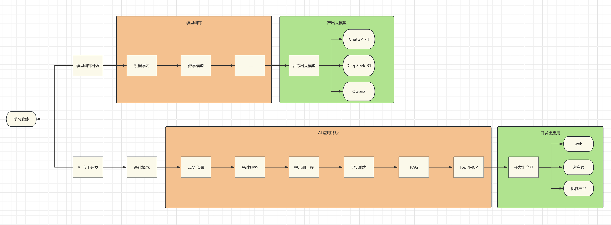

# AI

AI 是让机器模仿人类智能行为（学习、推理、感知、决策）的科学与工程。它不是通过硬编码的规则，而是通过从数据中学习模式来完成任务。AI 的目标是让机器在给定目标下自主地执行任务，并尽量降低对人类干预的依赖（通常仍需人类触发或监督）。

## 核心名词

### 机器学习 (Machine Learning) ML

机器学习是一种让计算机通过模型分析大量数据来学习，并且给予学习的结果做出预测或者决策。

### 深度学习 (Deep Learning) DL

深度学习，受生物神经元结构的启发，使用包含多个层次的神经网络来处理数据。能够从原始数据（图像像素、音频波形）中提取非常复杂的特征，无需过多人工干预。比如：图像识别、语音识别、自然语言处理等。

### 神经网络 (Neural Network) NN

神经网络是深度学习的基础架构。由像神经单元一样的节点层层连接而成。数据从输入层流入，经过多个隐藏层的处理，最后由输出层得到结果。

### 生成式 AI (Generative AI)

生成式 AI 是一种 AI 技术，它能够生成新的、与训练数据相似的数据。比如：生成新的图像、生成新的文本等。

### 计算机视觉 (Computer Vision) CV

让计算机能看和理解图像和视频，比如：人脸识别、图像分类、自动驾驶中的物体检测等。

### 自然语言处理 (Natural Language Processing) NLP

让计算机能理解和解释、生成人类语言，比如：机器翻译、语音识别、情感分析、智能客服、语音助手。

### API 接口

在 AI 环境下，通常是指云服务商提供的 AI 能力接口，自己不需要训练模型，只需要调用 API，发送数据就能得到 AI 处理后的结果。比如：调用 OpenAI 的 API，发送一段文字，就能得到 AI 生成的文字。

### 大语言模型 (Large Language Model) LLM

大语言模型是一种基于深度学习的自然语言处理模型，它能够理解和生成人类语言。比如：GPT-3、BERT、T5 等。

#### 模型参数
模型参数就是模型内部可学习的**权重（weights）与偏置（biases）**，类似神经元之间的连接强度。参数越多，模型容量通常越大、潜在能力越强，但实际效果还取决于数据质量、架构与训练方法；同时参数越多，训练与推理也越复杂、耗时越长。

#### 参数文件
模型参数文件，就是将模型参数保存下来，方便下次使用。比如：GPT-3 约有 1750 亿（175B）个参数，其权重文件按 FP16 精度保存约需 350GB（FP32 约 700GB）存储空间。
它包含了模型的所有可学习参数，如权重、偏置、嵌入表、归一化参数等。

### 提示词工程 (Prompt Engineering)

设计和优化输入给 AI 模型（尤其是 LLM）的提示词，以获得更好的输出结果。比如给 LLM 的提示加上"用一句话、面向小学生解释"的约束，输出会比不加约束更贴合需求；又如提供少量示例（few-shot）能显著提升特定任务的准确率。

### Token

在 NLP（自然语言处理）中，Token 是指模型处理文本时的基本单元（注意：字符才是最小单位），比如将一句话分割成单词或者子词。英文可能是一个单词或者词根，中文通常是一个字或者一个词。

### LangChain

一个用于开发由 LLM 驱动的应用程序的框架。它能轻松的将 LLM 与外部数据源、API、数据库、工具等连接起来，构建复杂的 AI 应用。比如：将 LLM 与数据库连接起来，实现一个智能客服系统。又或者将 LLM 与搜索引擎连接起来，实现一个智能问答系统。

### RAG （Retrieval-Augmented Generation）检索增强生成

一种结合了外部知识库（比如数据库、文档）与 LLM 的生成能力结合的技术。通过检索知识库中的相关内容，再结合 LLM 的生成能力，实现更准确和丰富的输出结果。
它的出现是为了解决 LLM 的胡编乱造和知识过时或者不全面的问题。

### Agent 智能体

智能体是 AI 系统中的一个组件，它能在给定目标下自主地执行任务（通常仍需人类触发或监督）。比如：自动驾驶汽车中的智能体，能够自主地驾驶汽车。

### MCP（Model Context Protocol）模型上下文协议

它是一种开源的开放协议，可以把它理解为 AI 模型与外部世界数据和工具之间的万能插头。
它的目的是让大语言模型能够安全、标准地使用外部数据、工具和各种服务，从而实现更强大的功能。

## 与前端结合

对于前端开发来说，并不需要成为训练神经网络的专家，但是要成为 **AI 与用户界面之间的桥梁**。
任务是理解 AI 能做什么，如何使用 AI，如何将 AI 与用户界面结合。

### 两条线路

AI 与前端结合有两条线路，一条是 **AI 应用开发**，另一条是 **模型训练开发**。

- AI 应用开发：学习关键概念、实现应用的技术方案。目的就是开发不同的 AI 应用，比如：Dify、豆包、Chatbox、Cursor 等（注：这些是 AI 应用产品或平台，而非"开发"本身）。
- 模型训练开发：学习数学模型、机器学习等等。目的就是训练不同能力的模型，比如：GPT-4、Qwen3、DeepSeek-R1 等。

