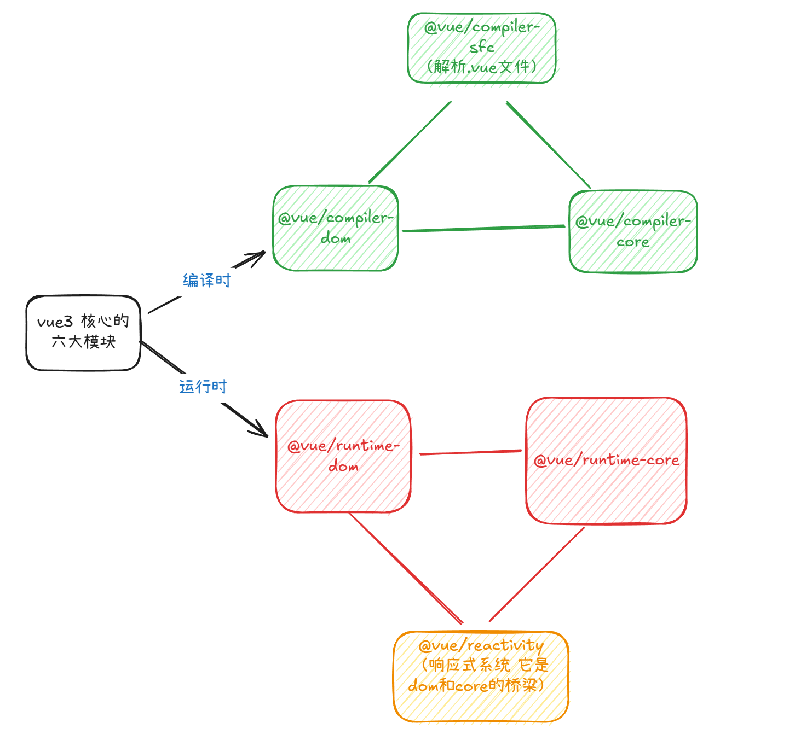

# Vue 源码解析

## 六大核心模块



## 挂载流程

```js
import { createApp } from "vue";
import App from "./app.vue";

const root = document.querySelector("#root");

createApp(App).mount(root);
```

从代码上来看 createApp 应该就是用来生成 html 而 mount 就是用来插值到 `#root`里面。
实际上并不全是，继续看。

### createApp

```js
const createApp = (...args) => {
  return ensureRenderer().createApp(...args);
};
// ensureRenderer().createApp
const createApp = (rootComponent) => {
  const app = {
    _component: rootComponent,
    mount(rootContainer) {
      // 基于根组件去创建 vnode
      const vnode = createVNode(rootComponent);
      // 调用 render 基于 vnode 去开箱
      render(vnode, rootContainer);
    },
  };

  return app;
};
```

rootComponent： 就是传进来的 App 组件。
mount：就是渲染方法。

所以说 createApp 的核心就是生成一个对象，包含 \_component 和 mount。

### createVNode

实际上就是给标签变成对象。

```ts
const createVNode = (type: any, props?: any, children: string | Array<any>) => {
  const vnode = {
    el: null,
    components: null,
    key: props?.key,
    type,
    props: props || {},
    children,
    shapeFlag: getShapeFlag(type),
  };

  if (Array.isArray(children)) {
    vnode.shapeFlag |= ShapeFlag.ARRAY_CHILDREN;
  } else if (typeof children === "string") {
    vnode.shapeFlag |= ShapeFlag.TEXT_CHILDREN;
  }

  nomolizeChildren(vnode, children);

  return vnode;
};
```

### ShapFlag

```ts
const enum ShapFlag {
    // 最后要渲染的 element 类型
    ELEMENT:1,
    // 组件类型
    STATEFUL_COMPONENT: 1 << 2, // 4
    // vnode 的 children 为 string 类型
    TEXT_CHILDREN: 1 << 3, // 8
    // vnode 的 children 为 Array 类型
    ARRAY_CHILDREN: 1 << 4, // 16
    // vnode 的 children 为 slots 类型
    SLOTS_CHILDREN: 1 << 5, // 32
}
```

vnode 的 type 实际上就是组件的描述。
ShapeFlag 就是描述组件类型的。

### nomolizeChildren

就是给 vnode 添加上组件类型

```js
const nomolizeChildren = (vnode, children) => {
  if (typeof children === "object") {
    if (vnode.shapeFlag & ShapeFlag.ELEMENT) {
    } else {
      vnode.shapeFlag |= ShapeFlag.SLOTS_CHILDREN;
    }
  }
};
```

### render

```js
const render = (vnode, container) => {
  patch(null, vnode, container);
};
```

### patch

```js
const patch = (
  n1,
  n2,
  container = null,
  anchor = null,
  parentComponent = null,
) => {
  const { type, shapeFlag } = n2;
  // type 就是app组件的描述对象
  switch (type) {
    case Text:
      // 处理文本
      processText(n1, n2, container);
      break;
    case Fragment:
      // 处理 fragment
      processFragment(n1, n2, container);
      break;
    default:
      if (shapeFlag & ShapeFlag.ELEMENT) {
        // 处理 element（浏览器原生标签）
        processElement(n1, n2, container, anchor, parentComponent);
      } else if (shapeFlag & ShapeFlag.STATEFUL_COMPONENT) {
        // 处理 component（组件）
        processComponent(n1, n2, container, parentComponent);
      }
  }
};
```

### processComponent

```js
const processComponent = (n1, n2, container, parentComponent) => {
  // 判断 n1 是否存在 存在则更新 不存在则挂载
  if (!n1) {
    mountComponent(n2, container, parentComponent);
  } else {
    updateComponent(n1, n2);
  }
};
```

### mountComponent

```js
const mountComponent = (initialVNode, container, parentComponent) => {
  // 创建组件实例
  const instance = (initialVNode.component = createComponentInstance(
    initialVNode,
    parentComponent,
  ));

  // 创建组件实例的属性和方法
  setupComponent(instance);
  // 创建 effect
  setupRenderEffect(instance, initialVNode, container);
};
```

### createComponentInstance

创建组件实例，也就是 vnode 添加一些属性

```js
const createComponentInstance = (vnode, parent) => {
  const instance = {
    type: vnode.type,
    vnode,
    next: null, // 需要更新的 vnode，用于更新
    parent,
    provides: parent ? parent.provides : {},
    proxy: null,
    isMounted: false,
    attrs: {}, // 存放 attr 的数据
    slots: {}, // 存放插槽数据
    ctx: {}, // context 对象
    setupState: {}, // 存放 setup 的返回值
    emit: () => {},
  };
  instance.ctx = { _: instance }; // 将 instance 添加到 proxy 中

  instance.emit = emit.bind(null, instance);
  return instance;
};
```

### setupComponent

```js
// 创建 props
const initProps = (instance， rawProps) => {
    instance.props = rawProps;
};
// 处理插槽
const initSlots = (instance, children) => {
    const { vnode } = instance;
    if(vnode.shapeFlag & ShapeFlag.SLOTS_CHILDREN) {
        normalizeObjectSlots(children, (instance.slots = {}));
    }
}

const setupComponent = (instance) => {
    const { props, children } = instance.vnode;
    // 处理 props
    initProps(instance, props);
    // 处理插槽
    initSlots(instance, children);
    // 处理setup 创建 setup 上下文
    setupStatefulComponent(instance);
}
```

### setupStatefulComponent

处理setup

```js
let currentInstance = null;
const setCurrentInstance = (instance) => (currentInstance = instance);

const setupStatefulComponent = (instance) => {
  // 对 vue 做属性代理对象
  instance.proxy = new Proxy(instance.ctx, publicInstanceProxyHandlers);

  const Component = instance.type;
  const { setup } = Component;
  if (setup) {
    // 改写 instance
    setCurrentInstance(instance);
    // 创建 setup上下文
    const setupContext = createSetupContext(instance);

    // 执行 setup
    //让 props 变成只读的，注入上下文
    const setupResult =
      setup && setup(shallowReadOnly(instance.props), setupContext);
    // 执行 setup 之后，清除 instance
    setCurrentInstance(null);
    // 处理 setup 的返回值 修正 render 函数
    handleSetupResult(instance, setupResult);
  } else {
    finishComponentSetup(instance);
  }
};
```

### publicInstanceProxyHandlers

组件实例的公共属性代理处理器,拦截组件实例（this）的属性访问 / 赋值操作，让你能在组件中通过 this.xxx 便捷访问到想要的属性（比如 props、data、methods、computed 等），同时屏蔽框架内部的私有属性。
简单来说，在组件里写 this.message、this.$emit、this.count 时，背后都是这个 Proxy 处理器在 “帮你找值”。

```js
const publicInstanceProxyHandlers = {
    get({ _:instance }, key) {
        const { setupState, props } = instance;

        // 非$开头的key优先从setupState中获取
        if(key[0] !== '$') {
            return setupState[key]
        } else if(hasOwn(props, key)) {
            // 非$开头的key优先从setupState中获取
            return props[key];
        }

        const publicGetter = publicPropertiesMap[key];

        if(publicGetter) {
            return publicGetter(instance);
        }
    }
    set({ _:instance }, key, value) {
        const { setupState } = instance;

        if(hasOwn(setupState, key)) {
            setupState[key] = value;
        }

        return true;
    }
};
```

### createSetupContext

给 setup 函数提供上下文

```js
const createSetupContext = (instance) => {
  return {
    attrs: instance.attrs,
    slots: instance.slots,
    emit: instance.emit,
    expose: () => {},
  };
};
```

### handleSetupResult

setup 函数返回值处理

```js
const handleSetupResult = (instance, setupResult) => {
  // 如果是一个函数，则作为 render 函数
  if (typeof setupResult === "function") {
    instance.render = setupResult;
  } else if (typeof setupResult === "object") {
    // 如果是一个对象，则挂载到 setupState
    instance.setupState = proxyRefs(setupResult);
  }
  // 修正 render 保证组件正常渲染
  finishComponentSetup(instance);
};
```

### finishComponentSetup

修正 render 方法。若未定义 render 函数，检查是否有编译后的模板（template），通过 compile 编译模板自动生成 render 函数；

```js
const finishComponentSetup = (instance) => {
  const Component = instance.type;
  if (!instance.render) {
    // 检查是否存在编译器且组件没有render函数时，尝试编译模板
    if (compile && !Component.render) {
      // 如果组件定义了template模板，则使用编译器将模板编译为render函数
      if (Component.template) {
        Component.render = compile(Component.template);
      }
    }
    // 将render函数挂载到实例上
    instance.render = Component.render;
  }
};
```

### setupRenderEffect

创建 effect
用于处理组件的首次挂载和后续更新
1. 首次挂载：执行渲染函数生成虚拟节点树，通过patch渲染到容器并标记已挂载
2. 更新时：处理新旧节点替换，执行预渲染更新，重新生成虚拟节点树
3. 响应式更新：使用effect包装组件更新函数，通过调度器将更新任务加入队列执行
```js
const setupRenderEffect = (instance, initialVNode, container) => {
  /**、
   * 实际就是执行 instance 的 render 函数，生成子组件的 vnode，并调用 patch 函数将虚拟节点树渲染到容器中
   * 首次挂载时：执行渲染函数生成虚拟节点树，通过patch渲染到容器，并标记组件已挂载
   * 更新时：处理新旧节点替换，执行预渲染更新，重新执行渲染函数生成新的虚拟节点树并保存
   */
  function componentUpdateFn() {
    if (!instance.isMounted) {
      const proxyToUse = instance.proxy;
      // 就是子节点的 vnode
      const subTree = (instance.subTree = nomalizeVNode(
        instance.render.call(proxyToUse, proxyToUse),
      ));

      patch(null, subTree, container, null, instance);

      initialVNode.el = subTree.el;

      instance.isMounted = true;
    } else {
      const { next, vnode } = instance;

      if (next) {
        next.el = vnode.el;
        updateComponentPreRender(instance, next);
      }

      const proxyToUse = instance.proxy;

      const nextTree = nomalizeVNode(
        instance.render.call(proxyToUse, proxyToUse),
      );

      const prevTree = instance.subTree;
      instance.subTree = nextTree;
    }
  }

  //
  instance.update = effect(componentUpdateFn, {
    scheduler: () => {
      queueJobs(instance.update);
    },
  });
};
```

### effect
```js
const effect = (fn, options = {}) => {
  const _effect = new ReactiveEffect(fn);
  // 合并对象
  extend(_effect, options); // Objct.assign(effect, options)

  _effect.run();

  const runner = _effect.run.bind(_effect);
  runner.effect = _effect;
  return runner;
}
```

### reactiveEffect
```js
// 依赖收集的标志
let shouldTrack = null;
let activeEffect = null;

// 用于收集依赖
class ReactiveEffect { 
  active = true;
  deps = [];
  public onStop?: () => void;
  constructor(public fn, public scheduler?) {
    
  }
  run() { 
    if (!this.active) { 
      return this.fn();
    }
    shouldTrack = true;
    activeEffect = this;

    const result = this.fn();
    shouldTrack = false;
    activeEffect = undefined;
    return result;
  }
  stop() { 
    if (this.active) { 
      cleanupEffect(this);
      if (this.onStop) { 
        this.onStop();
      }
      this.active = false;
    }
  }
}